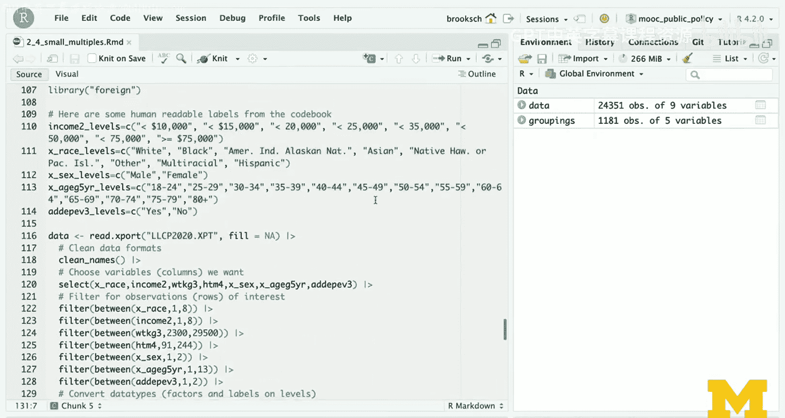
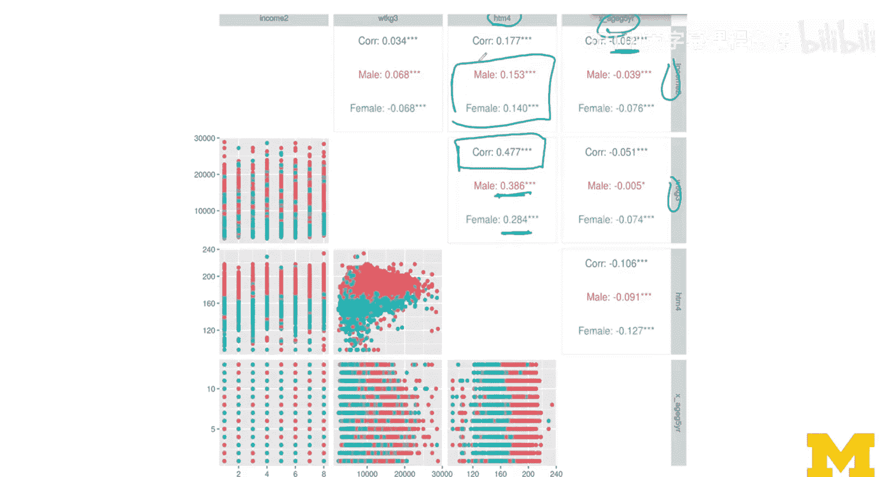

# 密歇根大学《公共部门的R数据分析（基础、数据探索、决策支持、）｜Data Analytics in the Public Sector with R》中英字幕 p76 32_散点图矩阵应用.zh_en -BV1YZ421J7Fx_p76-

There's a special kind of small multiples that's often used in analysis of large data sets called splom or the scatter plot matrix。

 It's another great example of small multiples as it visualizes the pairwise comparison of all variables that exist in a data set so that an analyst can quickly see if correlations or trends exist。

😊，Now this is not a facet grid faceting takes the values in your variables and unpacks them into either rows or columns and just creates more charts。

 however， each one of these charts is arbitrarily complex and can contain numerous different variables。

A sploom， on the other hand， just creates scatter plots of two variables at a time。

 but it does so for all variables in your dataset set。

 So facets and splos are both examples of small multiples。

 but they aren't the same thing conceptually。 Our phishing data sadly。

 does not have many continuous variables or even ordinal values and for scatter plots to be meaningful。

 you really want this kind of data。 However， our population data from the B RFSS does。

 So I'm going to bring in that data set that we used for the population pyramid for one more quick demonstration。

So this is a copy and paste from the population pyramid lecture with a few updates I'm going to only get a look at data which is either ordinal or continuous。

So here I bring in all sorts of different variables， the income levels， race levels， sex levels。

 the age， and then the answer to our question here， and that question was on mental health。

And then I do this filtering， but you can see here the big thing that I've taken out of this is I actually only really want sex to be kept as the factor。

 I'm not going to use the other ones as factor， so let's just run this for our quick data cleaning。

To create a spum， we can use the Ggaley package， which brings in various new plotting methods。

 including the Gi pairs method。

So one frustration I have with our is that there's no shared naming conventions。

 So unlike all of the other libraries， this one actually starts with two capitalized Gs。

 so just be aware of that。Now， we don't need to use a G G plot base layer for this。

 We can call G G pairs directly。 We've got a supplier data， but supplying aesthetics is optional。

 The X and the Y aesthetics are actually going to be chosen by other parameters。

 We do not have a columns parameter。We do have a columns parameter， but importantly。

 this does not refer to the columns of the plot， but instead the columns or variables in our data table。

 so I'm going to provide a list here， so I'm going to say I want these G G pairs pass in my data。

 my aesthetics。 I just want to color it by sex， and then I want my columns to be the income。

 the weight， the height and the year banding that they are。And then I've added this here as well。

 the D to put it blank just for demonstration， you can uncomment that and see what it does。

 it's useful as well， and then I'm going to actually save this to a file so we can bring it up and talk about okay so what can we see patternwise from this splolum Now the only one that jumps out to me from the splolum is the relationship between height and weight so we can see our height over here variable and our weight variable here and so the interaction of them is right here。

So we can see that there's sort of a diagonal barrier across here Now our two genders are colored or sexist。

 so this is male and this is female。And we could see that the relationship between height。

 it's very hard to be really tall and really light。

 so that would be like this person down here and that that just doesn't really exist much Now the opposite isn't necessarily true。

 you can be tall and heavy or you can be tall and light right。

 so that can be that's all in this category here。The other thing we can tell from this with this coloration。

 and it's not really a feature of the spum per se， but it's our aesthetic。

 is that men tend to be taller than women。 So that's this kind of peach here indicates taller。

 whereas women have a deeper。Amount here， they can go down， so a different height。

Now we can actually see this in numerous plots， anything that really interacts with height。

 So if we take height and this one here， which is our income。

 we actually see that there's a nice distinction there too right so men in general are taller and women in general are shorter。

 but it doesn't really tell us much about income because that's this axis across here where the income I believe increases。

 remember these are factors and we haven't labeled them。

 so they're just the numeric values but here we have you know kind of the same spread it appears between the two genders as we have here roughly we can't really tell we would need to run a better statistics there。

 we also see a difference between height in this case here and the age So if we follow these down here in this splo we see that there's again。

 a nice strong distinction line here and we've got the men on the one side tend tends towards taller。

And the women on the other side tends towards shorter。

 but it's not actually telling us that much that's informative of age。

So I'm going to clear this and talk about some of the other different characteristics here。

 So one of the nice thing about Gigi pairs is it actually brings in some correlations as well and runs those statistical tests for us now we haven't talked much about those but they're actually brought into this chart automatically。

 So for instance， we can see with our height and our weight it runs a correlation and finds that they're positively correlated。

 So as people get taller， they tend to get heavier and vice versa and we see that that's actually a stronger correlation for men than it is for women。

 We also see that if we look at， for instance， the age somebody's at and their income that this is a slight negative correlation and that's again true for both men and women。

 So as age increases income in this case will decrease。The last correlation that I'll pull out here。

 and again， it exists for both men and women here is a positive correlation between height and income。

 So as height increases， income increases。 Now， again， this isn't causal。

 We don't know that height causes somebody to make more money。

In fact， the other causal explanation， if we wanted to link these two variables causally。

 and it's quite possible that they're not linked in any way causally。

 they're linked to something else。 but the other opportunity would be that as people get taller or sorry。

 as people make more money， they get taller。 I don't know， maybe they think they're taller。 remember。

 this is all self report data。

