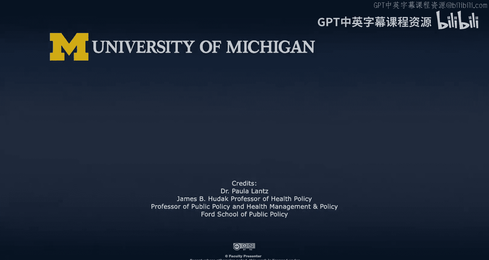

# 密歇根大学《公共部门的R数据分析（基础、数据探索、决策支持、）｜Data Analytics in the Public Sector with R》中英字幕 p77 33_本周补充：2019世界数据可视化大奖解析.zh_en -BV1YZ421J7Fx_p77-

Hello， it's the end of course， too， and I have one more quick thing to share with you。

Professor Brooks and I wanted to call your attention to a data visualization that won first prize in the static image category for the 2019 World Data Viualization contest。

The winning designer was Dimeterter Toshkov， who's a professor of public administration in the Netherlands。

His winning visualization is about the relationship between the level of human development or personal thriving in a country and the freedoms in that state or country related to its level of government effectiveness and whether or not this relationship varies by the size of the country。

 trying to convey a lot of information in the state of visualization， but he accomplished the task。

Professor Tashovov's visualization has three components， as you can see when you look at it。

 a scatter plot。A small map in the upper right hand corner。

And a series of density are ridge plots that show that small countries tend to be more politically stable。

 less corrupt， and more free than middle size and big sized countries。 However。

 the visualization also shows us that more recently。

 smaller states or countries have made fewer improvements or accomplishments in all of these important areas。

All the charts for the state of visualization were done in R using the G Grs and World map libraries。

Professor Tashkov has kindly shared his art code publicly and we've provided you with the link。

 so take a look。Now two things we want you to think about and consider。First。

 take a moment and study the visualization itself and take in all that it's attempting to communicate。

 As you look at this， Think about why this effort won a World prize。

 What makes this so successful in its communication objectives。😊，Second。

 take a look at the R code for this visualization and also be sure to keep in mind that more and more people are sharing their code publicly for others。

 including you to use and build upon there is really a great world of shared code out there。

 and this will be a great resource for you at any stage of your career in data analytics。

