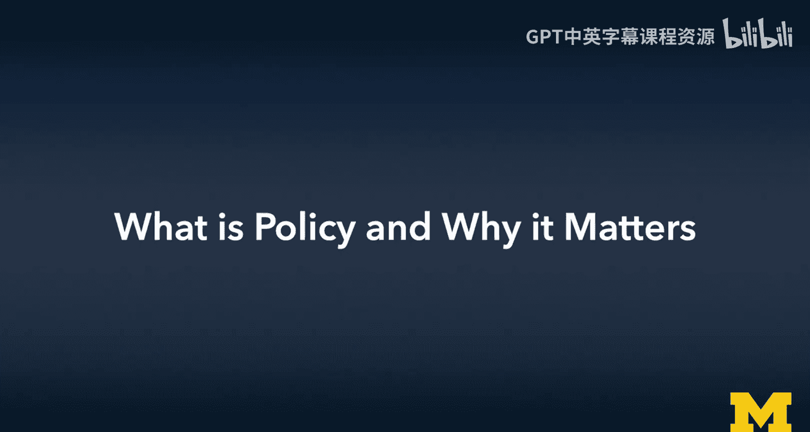
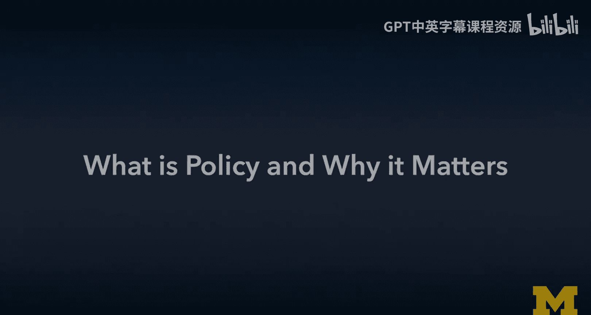
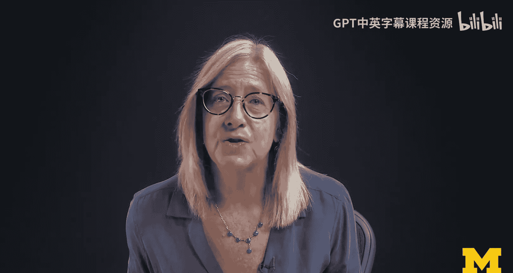
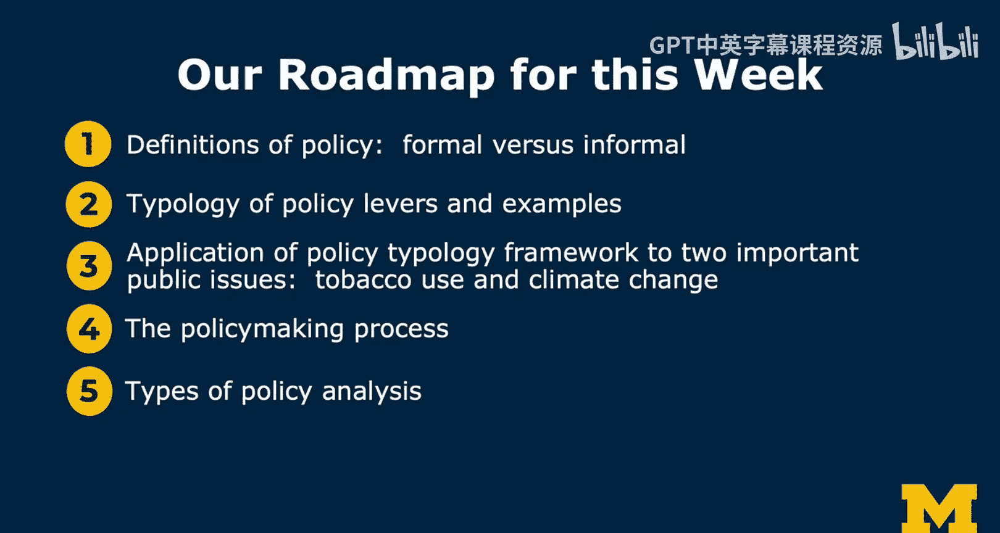
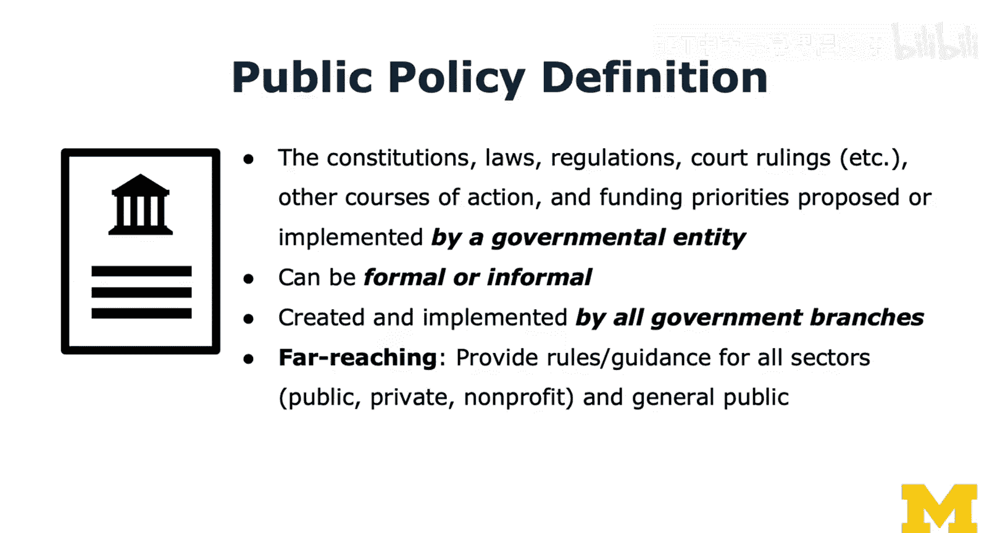
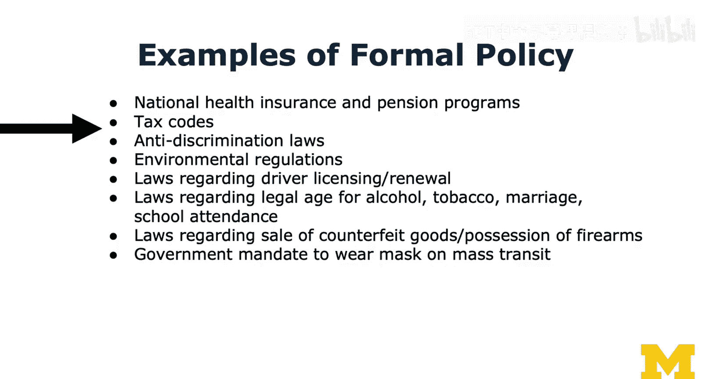
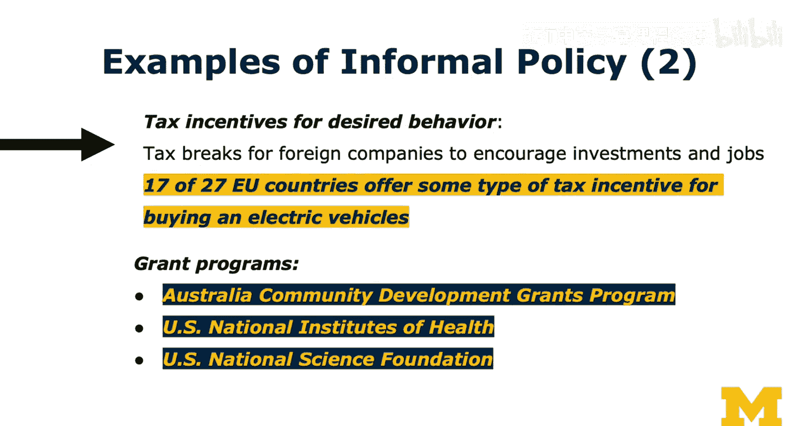
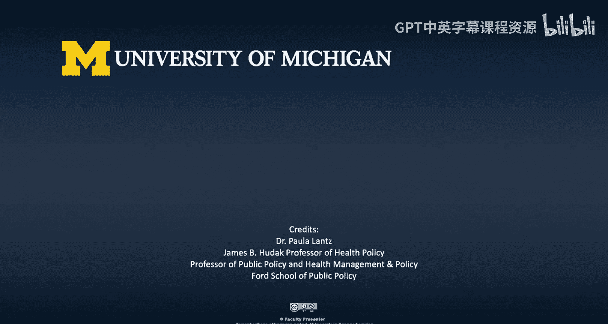

# 密歇根大学《公共部门的R数据分析（基础、数据探索、决策支持、）｜Data Analytics in the Public Sector with R》中英字幕 p80 1_政策定义及其重要性.zh_en -BV1YZ421J7Fx_p80-

Hi， I'm Professor Paula Lance and welcome to Cose3 in our series on data analytics for the public sector This course is focused on a main activity that involves data analysis。

 which is different types of policy analysis so in the weeks for this course we're going to be talking about several different ways in which policy analysis is done in the public sector and the fundamental role of data。

To get us started， however we need to talk about policy what exactly is policy and why does it matter so much in the work of the public sector a roadmap for this week is to first of all define policy in different types of policy we will then apply a useful policy typology to two important public issues tobacco use and climate change we'll also talk very generally about the policymaking process and the role of different types of data and analysis in that process and finally for this first week we'll have an introduction to different types of policy analysis which willll then dive into in much more detail in the following weeks I'm really excited to be with you as you learn more about public policy and policy analysis as I've been engaged in policy analysis and teaching about it for my entire career I hope you enjoy it as much as I do。

Okay， so what is policy at its most general level， a policy is a course of action or a principle of action adopted or proposed by a government。

 political party， business organization or even an individual us as individuals because can have our own personal policies for our purposes we're focusing on public policy which includes constitutions of governments and their subdivisions。

 laws， regulations， administrative rules， court decisions and other courses of action undertaken by governmental entities and this includes funding priorities as well now public policy can be both formal。

Or informal and we'll talk more about that in a moment public policy is created by all branches of government。

Legislative but also the administrative and judicial branches of government and public policy is far reaching。

 it has a lot of influence not only on the public sector itself， but also on the private sector。

 the nonprofit sector and the general public public policy shapes in both good and problematic ways。

 all of our systems， institutions， organizations and communities in society the most simplistic policy typology that's used in the world of public policy is one that distinguishes between formal policy。

Our policy with a big P or a capital P an informal policy or policy with a small P I assure you that policy experts talk about policy with a big P or a small P formal or big P policy includes things like laws。

 regulations， executive orders， court rulings， administrative rules， budgetary rules。

 entitlement programs so on and so forth the most important characteristic about formal policy is that there are consequences for not following the policy consequences like having a fine losing a license or some other privilege or even criminal consequences formal policy does tend to have an impact on a large number of people but again its most important characteristic is that there are consequences for not following or obeying the policy examples and there are many there's just a few listed on a slide and it includes things like national health insurance and pension programs。

 tax codes， anti。

crimination laws， environmental regulations， all of the laws related to driving laws related to the legal age for many activities like using alcohol。

 tobacco， getting married， buying a firearm， school attendance and so forth laws regarding the sale of counterfeit or knockoff goods and government mandates to wear a mask on mass transit during a pandemic。

Now on the other hand， we have informal policy or policy with a small or little P informal policy is things like guidelines issued by a professional association or the government。

 the recommendations of expert panels。

Rules within institutions， different types of local programs for youth。

 government grants for capacity building I hope you're getting the picture here informal policy is well less formal or rigid than formal policy with a big P it tends to be smaller in scope and often smaller in the use of resources but again the most important part of informal policy is that there are really no consequences for not following the policy some examples of informal policy include public information or education campaigns for example。

 Portugal has an antihate campaign aimed at children that's called the no hate ninjas campaign Brazil has a public information campaign on how to protect your own personal data some other examples are all the guidelines and recommendations that are out there by governments and expert organizations regarding wearing a mask now a mask mandate by a government is a formal。

big policy if there are consequences for not following it like not being allowed entry into some place if you're not wearing a mask。

 sometimes even getting a fine if you're not wearing a mask。

 but guidelines and recommendations regarding wearing masks to protect against covid-19 spread are an example of informal policy In addition。

 there's lots of international agencies that issue all kinds of recommendations， best practices。

 reports guidelines this includes reports and guidelines that come out from the United nationations intergovernmental panel on climate change this group has issued a number of recommendations for both formal and informal policy changes let's do a couple more quick examples while we are all required to pay our taxes and this is a very formal type of public policy。

 there are also some tax incentives that are informal policies that are trying to nudge rather than require or force certain times types of behavior。

For example， 17 of the countries in the European Union offer tax breaks to consumers who purchase electric vehicles you're not required to do this there's no consequences if you don't do it。

 but if you do you get a break on your taxes， also government grant programs for community development for health and other types of scientific research for the arts。

 etc， can also be considered informal policy。

