# 密歇根大学《公共部门的R数据分析（基础、数据探索、决策支持、）｜Data Analytics in the Public Sector with R》中英字幕 p81 2_政策类型学.zh_en -BV1YZ421J7Fx_p81-

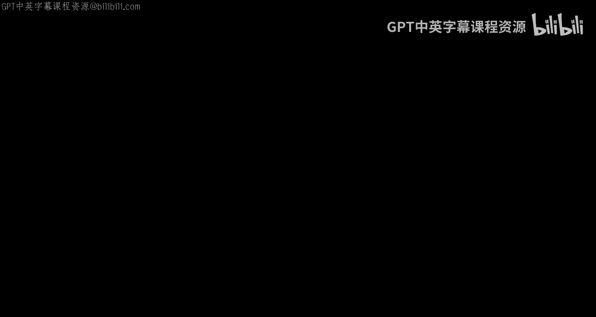

Welcome back。

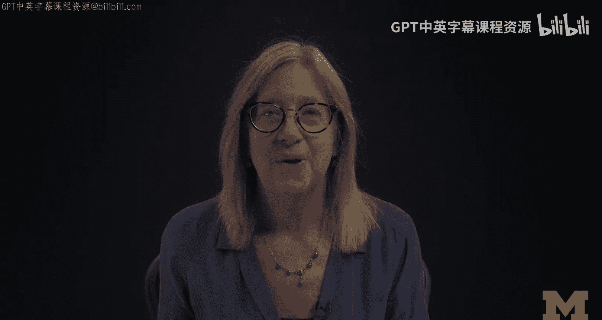

We just talked about two general types of public policy， formal versus informal policy。

Now we're going to talk about types of policy in a bit more detail。

I'm going to present to you a policy typology framework that suggests that governments generally have eight different types of policy or policy levers that they can pull or implement at their disposal now we do have to remember too that there is a ninth policy option for governments and that is to keep status quo keep things the same or do nothing so when we talk about policy options in different types of policy。

 we always have to remember that keeping the policy landscape the same。

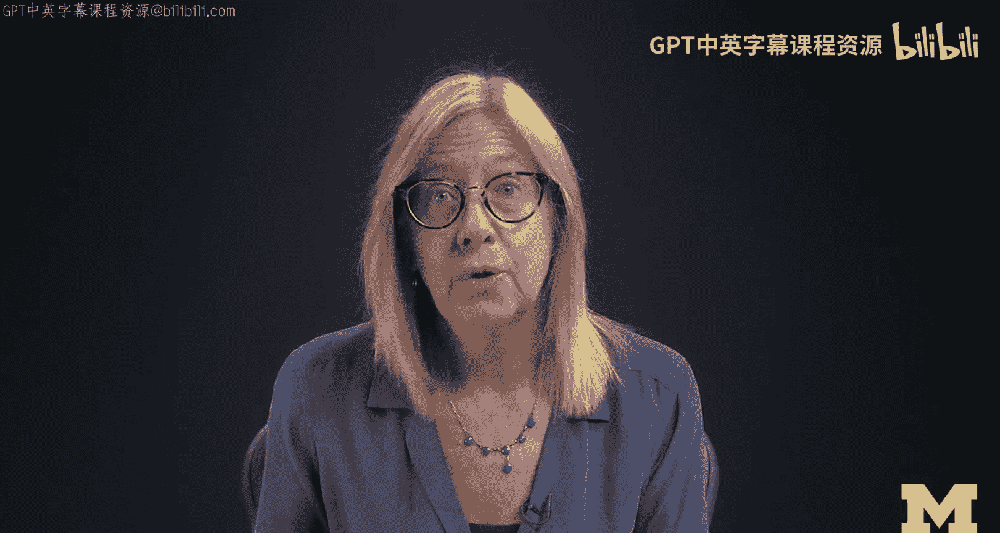

I a policy option and a policy choice， but let's get into the typology All right now one type of policy option that governments have。

 and this is an example of informal policy is doing things that attempt to persuade people or organizations to do things or not do things and this includes what is referred to as moral suuasion or trying to persuade certain behaviors or actions often by appealing to values now the two main policy lovers here are first of all。

 inform。

This simply means that the government is providing information to people。And governments do this。

 they provide a lot of information data and then also recommendations with the hopes of influencing behavior or action。

 but without requiring or mandating it now when information is accompanied by appeals to values or even sometimes scare tactics we call this exhortation and then we call this policy lever implore the difference between inform and implore not a big distinction and doesn't usually require a lot of time debating it but here here's an example of the difference perhaps a government can say well we have a problem with drunk driving。

 drunk drivers killed 75 people in our area last year the penalty for drunk driving or driving under the influence of alcohol is。

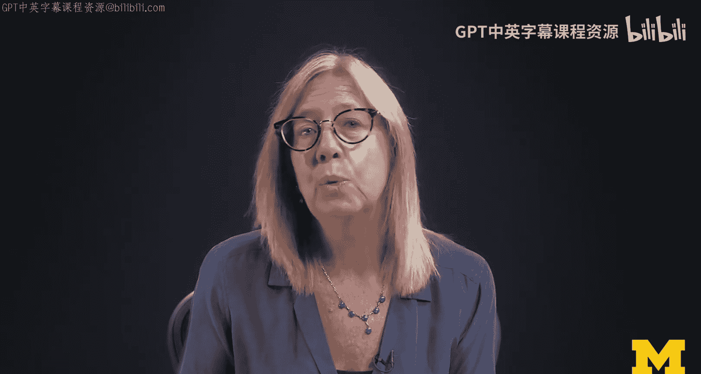

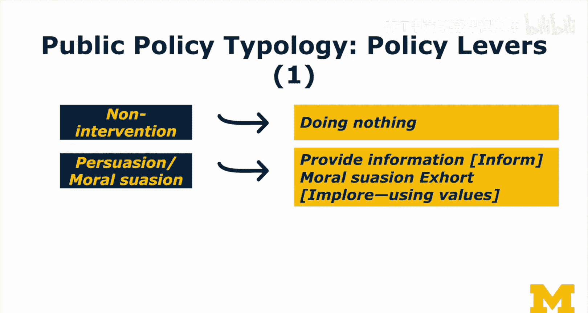

And then state the penalty in their area that's an example of inform versus an information campaign that states drunk drivers took the lives of 75 innocent people last year。

 including 30 children and destroyed lives。Of the drivers but also their innocent victims give up your keys have a designated driver so again imploring is different than inform inform is providing facts imploring again appeals to values and also includes actions that people should take now a third type of policy action is in a bucket of what we call economic incentives in here we have two main types subsidies and taxes now subsidies are a type of policy that make things cheaper for people and organizations and taxes I think we all know what taxes are taxes increase the price of things goods and services and we know from basic economics that for most products and services in the economy。

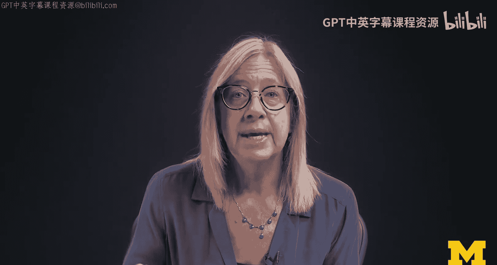

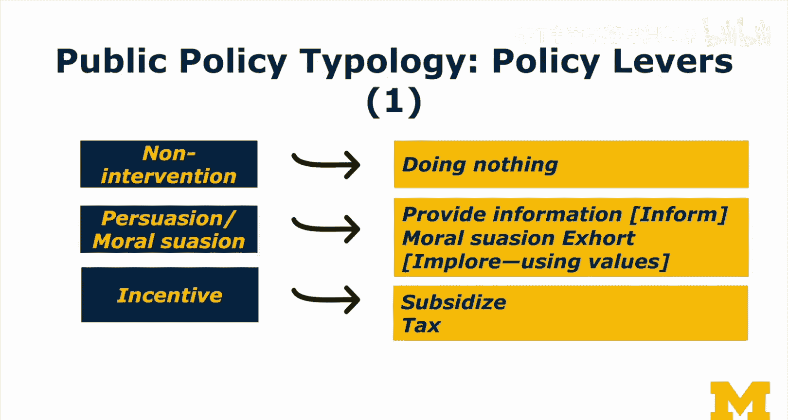

Price matters。Making something less expensive through a tax break or a subsidy should increase demand。

And making something cost more through attacks like attacks on alcohol， tobacco， gasoline。

Et cetera will decrease demand。Okay moving on， the fourth bucket of policy action is called procure and I know this is not the most exciting stuff in the world。

 but procurement is a very big activity of government and it's when governments attempt to provide goods and services in the public sector economy now governments provide all kinds of things we've talked about public goods before and some examples are garbage collection。

 recycling programs， healthcare， housing， scientific research。

 parks and recreation facilities on and on。

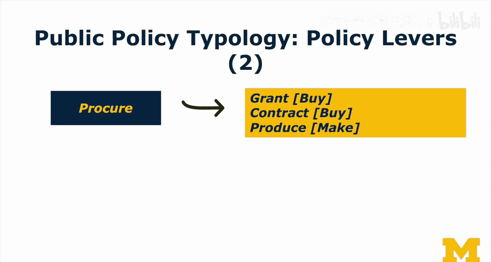

Now in doing providing these goods or services to people， governments always have to make a choice。

 should we make it ourselves？Or buy it。You hear this phrase in public administration a lot。

 make or buy， make or buy。This means that the government is either going to try to make a product or service itself with government employees in some division of the government or a government is going to buy products or services that it provides to people but from outside vendors outside private businesses when the government buys goods and services from outside vendors it does so through grants and contracts so this is a very big part of government。

 the grants and contracts then the bidding and application process for all these grants and contracts again I know this isn't all that exciting but there are actually many。

 many data analytics involved with this procurement part of government now when a government makes something itself it is producing that let's go back to the garbage collection example。

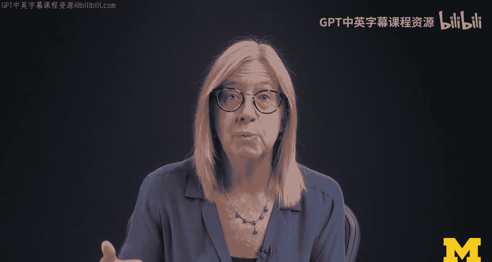

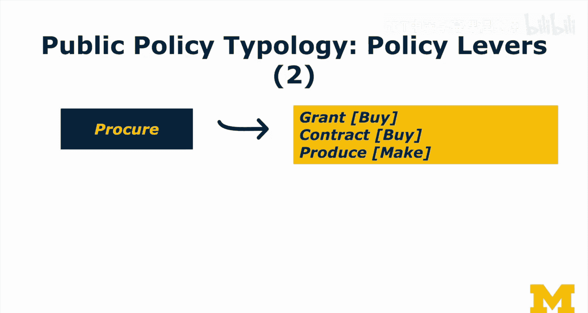

In some places， the people who pick up our trash are employed by the city and garbage collection is a part of city government。

In other places， however， the city buys。Garbage collection from an outside vendor through a contract。

 So， again， we have to think about making or buying and then how the government。

 if it's going to buy it， how it does it through a grant or a contract。

Finally， a very big type of policy action for governments is the big P。

 formal policy action of law and regulation， and laws and regulations either require that a person。

 organization， business or the government itself do something or not do something or behave in a certain way or face consequences and these requirements either prohibit some kind of action or they also can oblige some sort of action。

 making people you can't do something or you must do something and if you don't again。

 you face some kind of consequences。

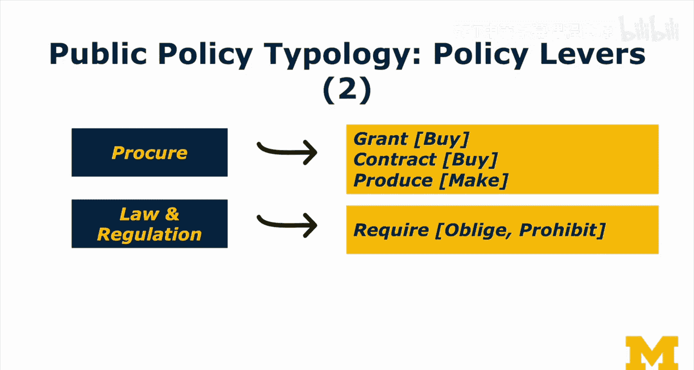

All right， let's go through some examples of these eight types of policy levers to make them perhaps a bit more clear and understandable so under persuasion or moral susuasion examples of inform are things like fact sheets or infographics with information covid-19 dashboards that just present data in statistics but an example of exhort or implore is a mass media campaign raising awareness of the incidents and also the terrible impact in toll of human trafficking in regard to incentives or nudges examples of subsidies are public child savings accounts。

 there are some places where the government actually is putting money away for children in a savings account that becomes available to them when they're 18 to invest in their education or other worthy endeavors public housing subsidized housing is another example Also an example of a subsidy is。

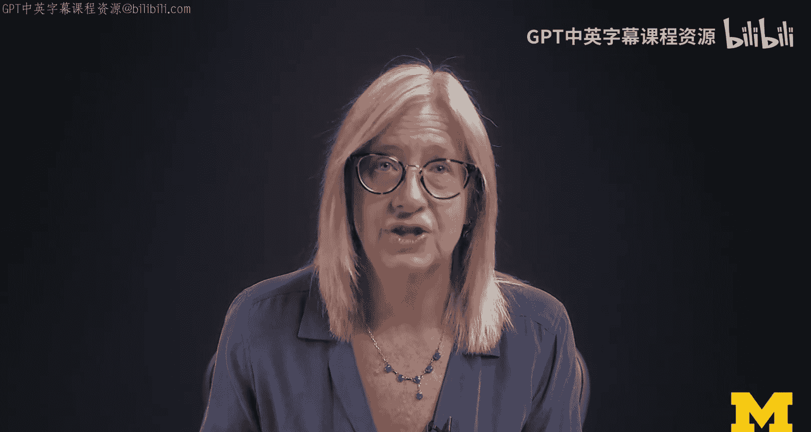

When insurance companies have lower rates for nonsmos examplesles of taxes i'm sure pretty obvious to all of you。

 but it does include things like what we call sin taxes or things taxes on things like cigarettes。

 alcohol gambling winnings， higher taxes on luxury items like boats， fur coats， etc。

 but taxes don't literally have to be taxes， anything that makes something cost more like a fee or a fine we also put in the tax policy lover category for example。

 higher car registration fees in urban areas。

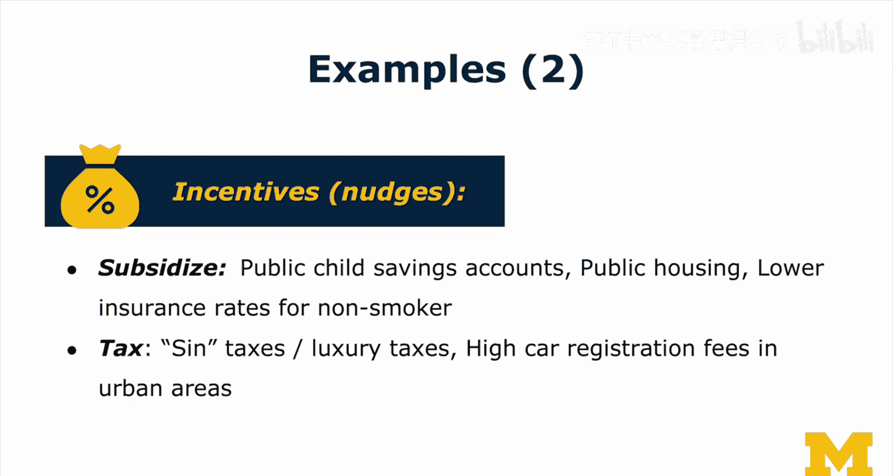

Can be used to discourage the number of cars in an area for example I lived in washing DC for four years actually didn't own a car for the four years i lived there it was too expensive the fees for getting a driver's license register in your car in parking on public streets are ridiculously high and it's all designed as a policy lever to disincentivize people from having cars in a very crowded dense area urban area with a lot of traffic examples of the procure bucket of public policy activity include a government contract to hire or buy the services of a private media company to design a mass media education campaign on an issue another example is the government paying a private company to further develop and produce vaccines an example of produce is that a public education producing here in this case is making too where the government makes education。

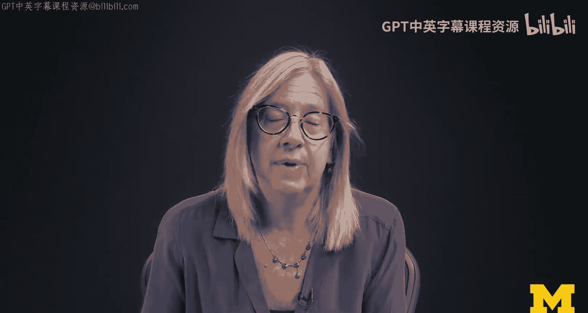

Governments run public school systems and also in that process they create or make standard curricula for different grades in the school system other quick examples of make for the government are making goods such as a postal or mail service system governments make and maintain roads and of course governments make all the things that go along with national security。

 like the military and cyber securitycur and intelligence okay finally under law and regulation。

 there are so many examples of governments prohibiting certain actions or behaviors or obliging or requiring other actions and behaviors and I think you all can think of your own examples。

 but again things like speed limits and other traffic laws。

 as we already mentioned age restrictions on all kinds of things like voting。

 getting a tattoo etc banning advertisements for tobacco products on television。

That's a formal policy decision in this category， regulations for toxic waste disposal and on and on。

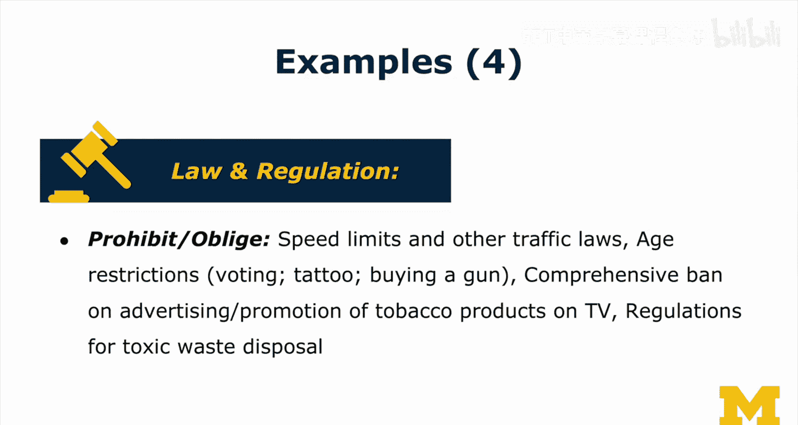

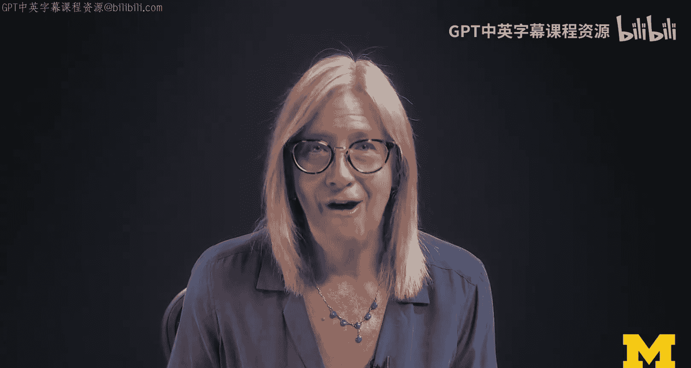

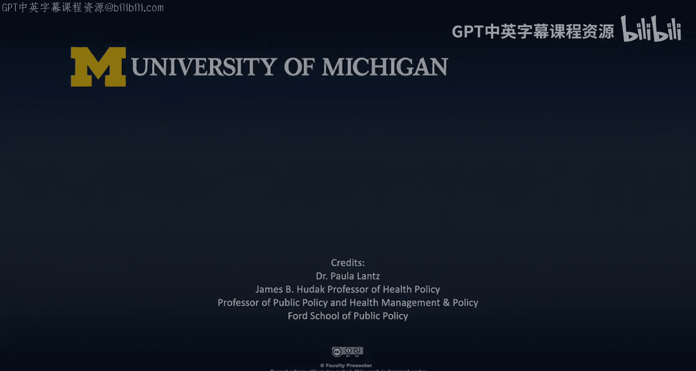