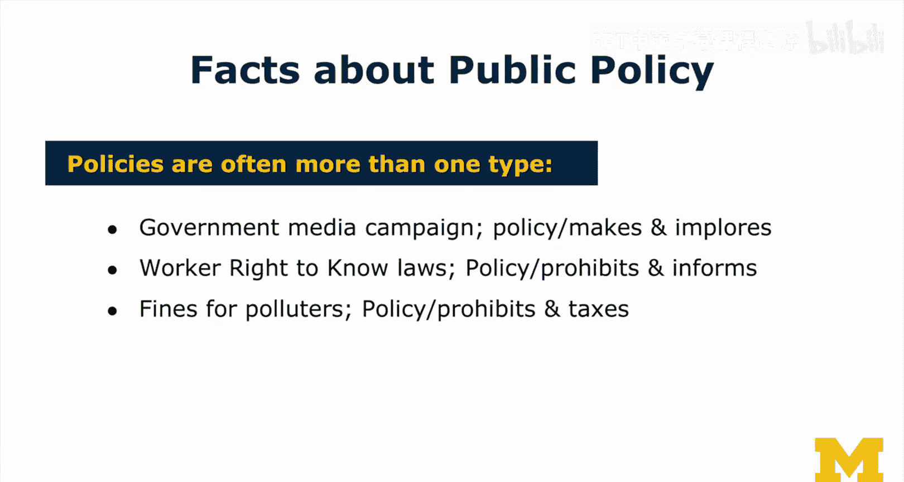
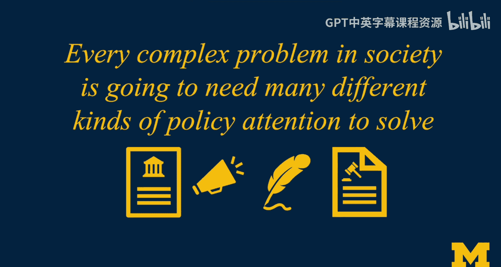

# 密歇根大学《公共部门的R数据分析（基础、数据探索、决策支持、）｜Data Analytics in the Public Sector with R》中英字幕 p82 3_公共政策基本事实.zh_en -BV1YZ421J7Fx_p82-

Public policy is actually quite complex within countries and it certainly differs and is quite complex across countries public policy is quite different in regard to how it's made。

And the actual policies themselves。But here are a few more basic facts about different types of public policies that really cut across different countries and different kinds of government even first of all。

 many policies are more than one type or used more than one policy lover at the same time for example。

 if a government designs its own educational media campaign。

 this is an informal policy that both makes and imps another example， worker right to know laws。

 which are laws that require businesses to inform their workers about risks dangers and potential exposures to harm they might face in the course of their work in writing is an example of formal policy that prohibits businesses from not providing this information or face a fine and it also informs workers let's do one more example。

 when governments find businesses for polluting this is a formal policy that does two things。

It prohibits businesses from polluting usually very clearly defined and excruciating detail and that also taxes them if they break that policy with a fine all right again。

 thinking about ways in which public policy is the same across countries。

 every complex problem in society is going to need many different kinds of policy attention from many different policy levers to address the problem。

 mitigate it and try to solve it so if you are working in the government on a specific type of issue。

 for example， education， transportation， environmental protection， housing， public health， whatever。

You need to understand all of the different types of policy activity that are happening in relation to your issue。

