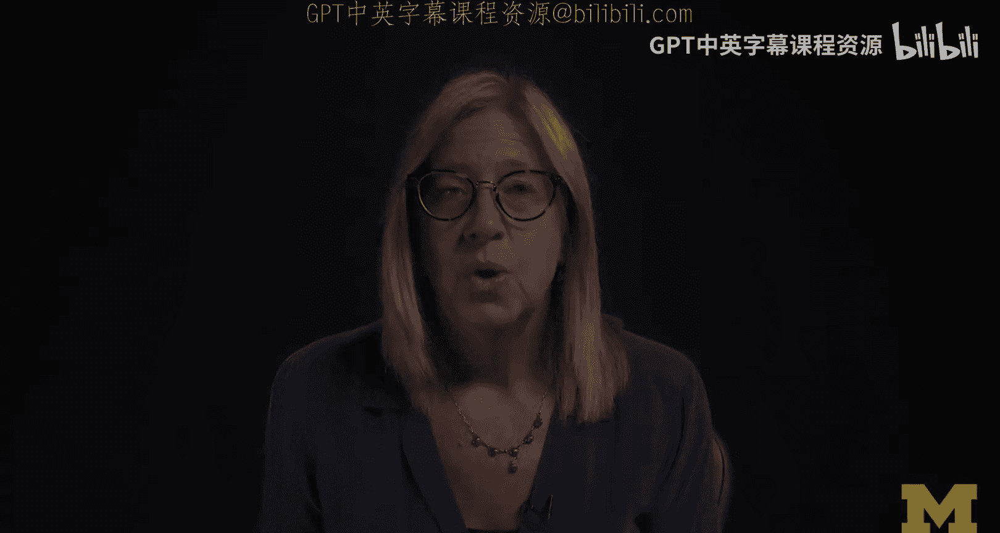
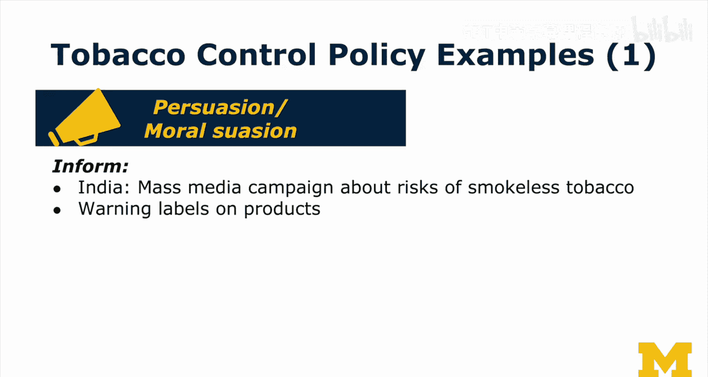
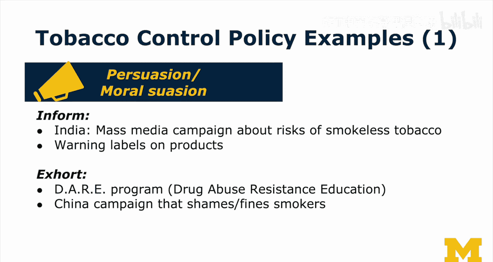
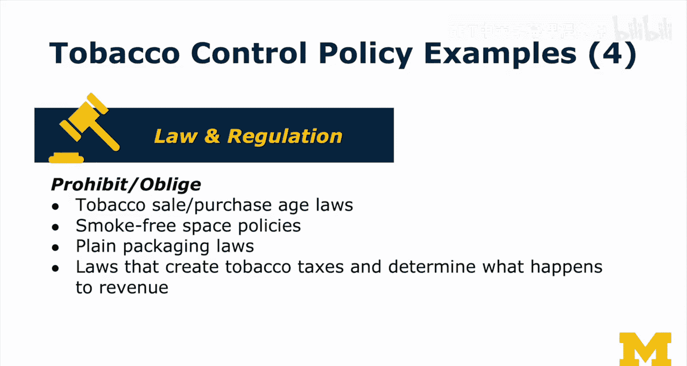
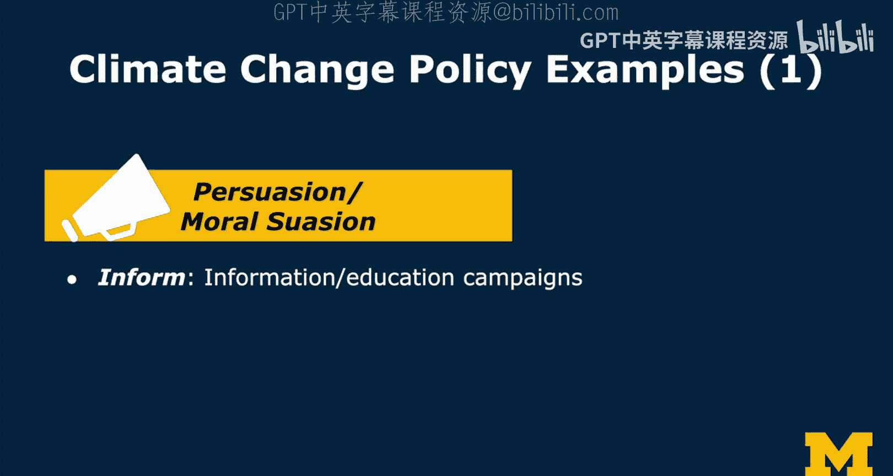
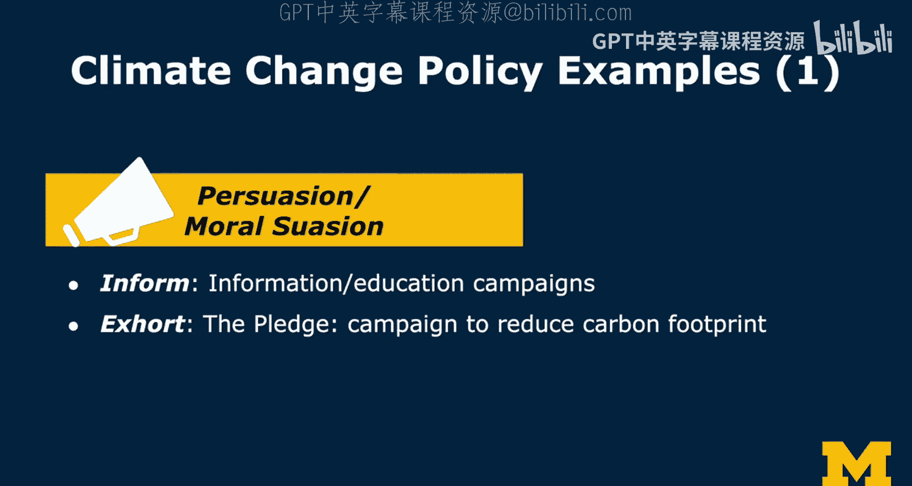
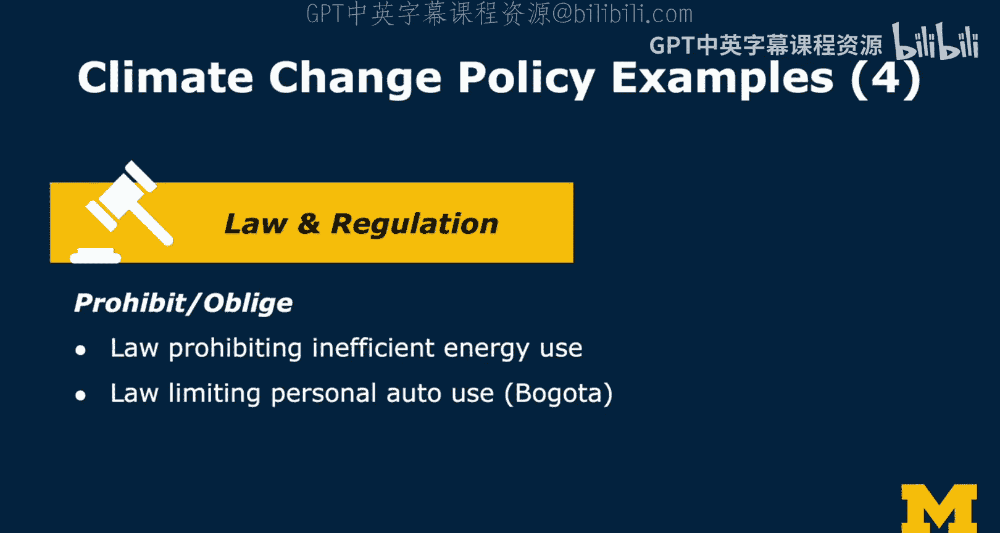

# 密歇根大学《公共部门的R数据分析（基础、数据探索、决策支持、）｜Data Analytics in the Public Sector with R》中英字幕 p83 4_政策类型学实例解析.zh_en -BV1YZ421J7Fx_p83-

When we're thinking about problems in society and public policy responses。

We know that these problems are always shaped in some way by existing public policies and also that they need to be addressed and attempted to be remediated or even solved with additional policies。

And we also know that addressing complex social problems involves using multiple different policy lovers。

We've already talked about a typology framework for public policy。

This framework can be used to help think about and understand social problems or issues of concern to a government from a policy perspective。

We're asking you to do this in an upcoming assignment。

 we want you to pick a social problem or public issue of interest to you。

What's an issue that you care about and are perhaps already working on or would like to work on in your job or in your volunteer work？

To understand this issue from a policy perspective。

 this exercise is a designed to see if you can come up with examples of public policies using all the different policy levers that have been implemented or being debated to address some aspect of the problem I'm going to go through a couple of examples to show you how to do this The examples I'm going to use are public policy aimed at decreasing tobacco use and public policy related to mitigating the effects of climate change so let's jump into our first policy issue which is tobacco use control policy Some examples of the policy lever of inform for this social issue include in India there's a mass media campaign about the risks of smokeless or chewing tobacco that's been implemented another example of inform is text warning labels about the risk of use on tobacco product packages like the little tiny type that's on the site of a cigarette package that says smoking increases。

Risk of heart disease now moving from inform to implore or exhort。

One example is the very graphic warning photos and messages that are being used in a number of countries around the world。

This moves from just providing factual information to issuing dramatic value laden and actually。

You know。Graphic warnings about the important and deep health effects from smoking。

 another example of moving beyond informing is the dareA program that was used quite extensively in the United States。

 dareA stands for drug abuse resistance education and this was an intervention that 75% of elementary schools in the USS had implemented that involved uniformed police officers coming into elementary schools in an 18 week program to provide information about the risks of drug tobacco and alcohol use but also to scare kids。

 one more example in China there was a mass media campaign designed to shame people who were smoking in public and also to find them。

All right， let's move on and think about policy examples in the bucket of incentives we have a number of examples of subsidies related to tobacco use policy this includes reduced insurance rates for non-smokers the public funding for community interventions that attempt to that are aimed at youth and attempt to prevent the uptake of smoking and another example is public health insurance programs that have benefits that cover the costs of smoking cessation drugs and other kinds of interventions for the tax policy lover we obviously have actual taxes。

 tobacco product taxes which make the price higher are one of the most effective tobacco control policies another example however of a is making rents higher for smokers who are renting departments in public housing in regard to procurement making and buying most governments buy research and。

monnstruation projects through grants and contracts that help develop and evaluate interventions to prevent smoking or to help people quick lots and lots of examples of this in regard to law and regulation there are also many examples of policies that prohibit including age limits for tobacco sale and purchase laws regarding smokefree zones in spaces another example is plain packaging laws these are strict rules and regulations about what can be on cigarette packages and in many countries the answer is not much plain packaging laws prohibit companies from actually branding their products on the package very strict rules about what portion of the real estate on a tobacco cigarette package has to be a graphic image also what part of it has to be warnings etc Also another example。

Here is laws that not only create the level of a tobacco tax。

 but also what's done with the revenue that's generated from that tobacco tax okay。

 let's move on to another example and this one is the big social world problem。

Of climate change。How do we think about climate change from a policy perspective again we can take our typology of eight different policy lovers and think about examples related to climate change for each of them。

 for the policy lever of inform an example is public education campaigns that are providing information people with information about the size of the holes in the ozone level。

 rising temperatures， rising ocean levels， the melting rates of polar caps。

 increases in the rate of fires etc， really providing information and scientific information that is correlating changes on the planet with climate change。

 but moving beyond information， most climate change campaigns are more in the camp of implore or exhort as they not only provide information but also do so in a way that raises alarm and calls for very。

strtrong changes to action one example is the pledge campaign which ask people to estimate their own carbon footprint and then attempt to reduce it in regard to incentives or nudges。

 there are many， many examples of subsidies globally this includes tax subsidies to offset the cost of green energy investments by businesses or individuals in regard to taxes there are also many examples this includes taxing carbon emissions。

And then also related to that what is referred to carbon cap and trade policy for the government。

 policy lever of buying things through grants and contracts。

 many cities are purchasing more fuel efficient buses for their own public transportation systems and governments are taking policy action by making or investing in their own renewable energy research。

 this is conducted by government agencies and their employees。

 but also with outside university and think tank and other researchers and other places outside of government。

 but when the government does it itself that's an example of making the government is also making more services and routes available to more people in their mass transit systems in order to incentivize people to put their cars away and take mass transit for law and regulation again many。

 many examples just a couple。Regulations and laws prohibiting inefficient energy use and laws that restrict personal auto use for example。

 in Bogota， Columbia in 2014 a policy was put in place that restricts cars with a license plate ending in an even number like 02。

4，6 or eight from driving during rush hours on even number days of the month。

 and then vehicles with odd number license plate numbers ending with odd numbers are restricted from driving during rush hours on odd number days of the month。

 there are of course many， many other examples for each of the policy levers for both of the issues we talked about tobacco control policy and climate change policy。

And also。Some examples are more than one type of policy the point here is just to get you to start thinking about the issues that you care about from a policy perspective。

I hope you have some fun in selecting an issue that you care about and then thinking about different types of public policies that are in use or are being debated。

