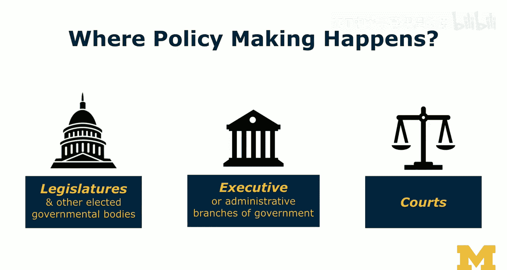
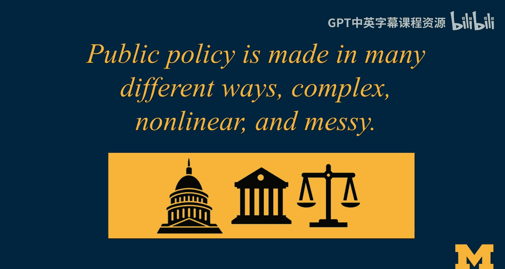
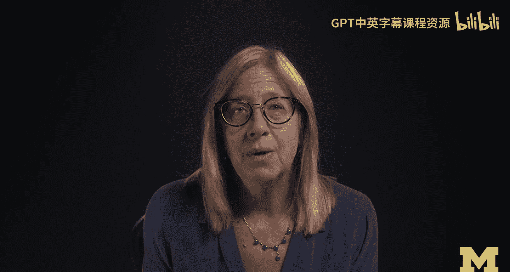
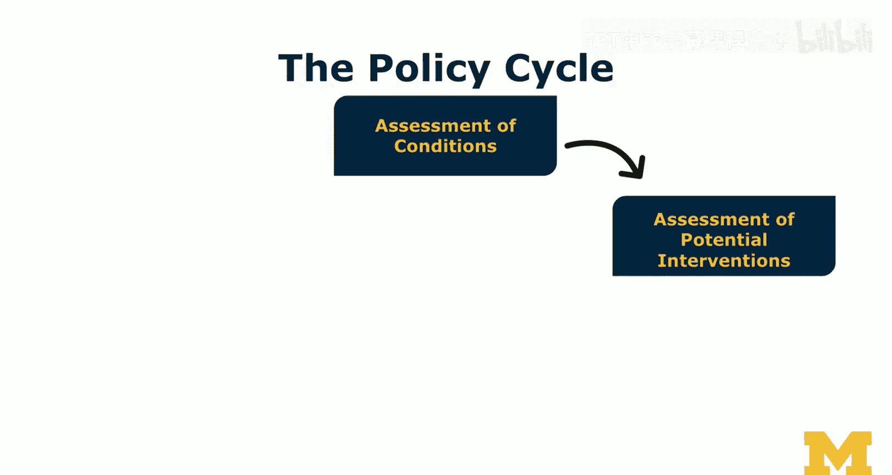
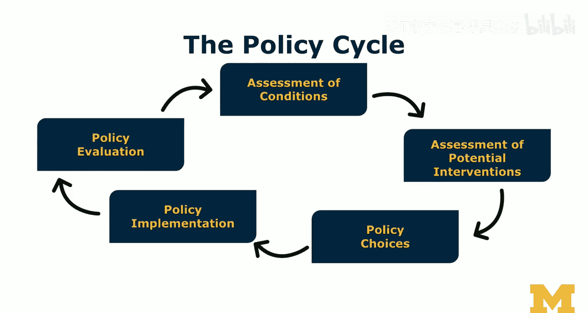
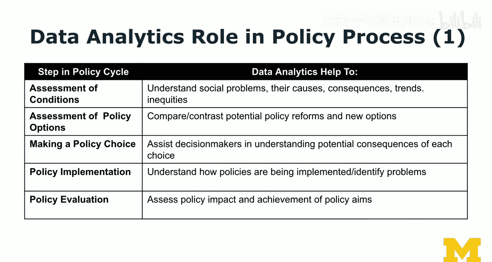
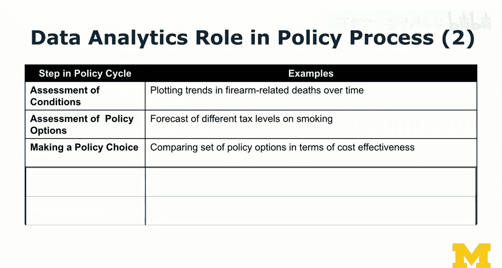
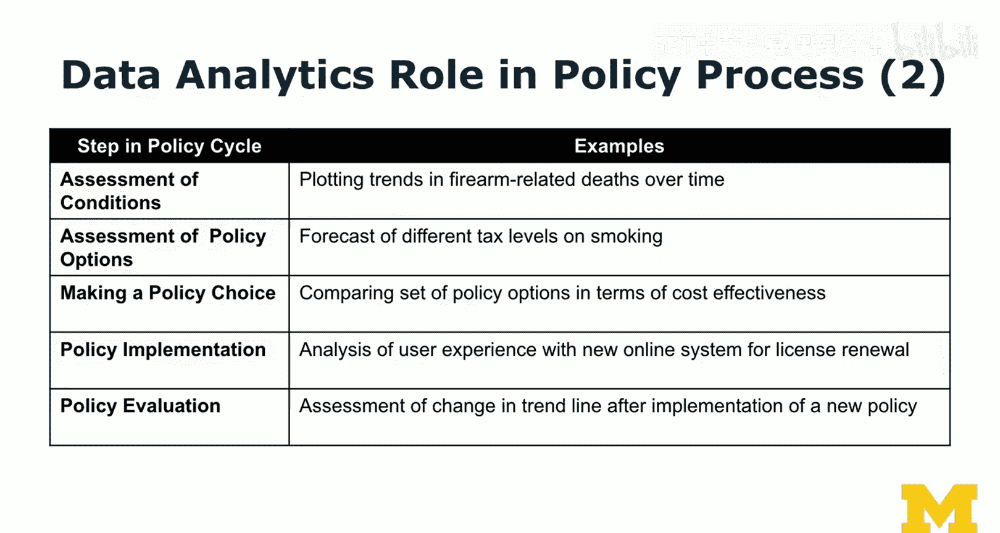
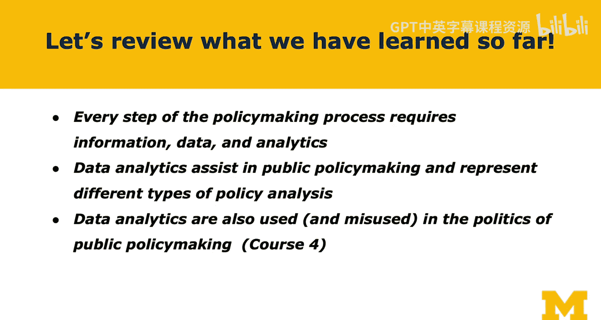

# 密歇根大学《公共部门的R数据分析（基础、数据探索、决策支持、）｜Data Analytics in the Public Sector with R》中英字幕 p84 5_政策制定流程解析.zh_en -BV1YZ421J7Fx_p84-

Welcome back。In this session， we're going to talk about the policy making process。

 So where is policy made， As we already talked about， it's made in many parts of government。

 Of course， it's made in legislatures。 That's their main job。

 but it's also made in the executive or administrative branch of government。

And it's also made in the courts now the way public policy is made happens in many different ways。

 it's quite complex， it is certainly nonlinear and it's very messy and it happens in very different ways all across the world。

But there are some general ways we can think about policy and how it's made by thinking about what's referred to as the policy cycle again。

 this is pretty general， but these are the main steps that we think about in the making a public policy that generally holds true so first of all in the policy cycle there has to be an assessment of conditions how are things going is there a problem that needs to be addressed。

 is there a growing problem that more people are worried about and here we can also think about what issues get on the agenda。

Of policymakers so again first step assessment of conditions next step there is an assessment of potential interventions。

 so we have a problem， we have a set of conditions defined as a problem now what is the range of interventions？

What might we do in response after assessing the potential policy options？

Choices are made。And again， a choice could be to do nothing to keep the status quo。

 but sometimes policy reforms are made， new policies are decided upon。

 and then those need to be implemented， so another phase in the policy cycle is policy implementation。

Once policies are implemented then we hope there's an evaluation did the policy choice that was made and implemented have an impact on that set of conditions that were labeled as problematic or needing some policy attention and some resources and then obviously the cycle starts all over again now again complex very messy sort of process but the next thing I want to talk about is how important data analytics are to every step in the policy cycle so first of all step one and the assessment of conditions data analytics are extremely important in understanding and visualizing what's going on what is the issue that people are worried about what's the cause。

 what are some of the consequences what are the trends and also what are perhaps some inequities that we see in this issue step two the assessment of policy options here's where data are really important we need to。

Use data to compare and contrast different potential policy reforms and new options Step3。

 making a policy choice again， we hope that data and information are useful and assist decision makers in understanding not only the potential impact of positive consequences of their decisions but also maybe what some of the negative consequences might be so helping decision makers make policy choices with data and data analytics policy implementation very important we need to understand how policies are being implemented are they being implemented as the designers intended are there problems with the implementation is it reaching the right people what is the user experience for some policies so policy implementation requires a lot of data analytics and then also of course policy evaluation assessing the policy impact in achievement of the policy aim is all about data collecting it。

then communicating it to the policymakers and also to the general public so we can again assess conditions and see if we need to go through the cycle again let's do some examples assessing conditions so plotting trends in firearmrelated deaths over time is an example of a lot of this going on in the United States right now a great example of using data to understand what's happening with a social issue in a social problem assessment of policy options here we can think about a policy simulation model that forecasts different tax levels on smoking behavior an example of making a policy choice is comparing a set of policy options in terms of their cost effectiveness and the making a decision we're going to be talking about all these things in much more detail going forward policy implementation using data to analyze user experience with a new online system。

For driver license renewal that's an example of how data analytics could be helpful and finally policy evaluation。

 assessing the change in a trend line after the implementation of a new policy data analytics is extremely important in this kind of evaluation All right。

 let's review what we've learned so far every step of the policy making process requires information data and then good analytics of that information and data data analytics assist in public policymaking and represent different types of policy analysis and data analytics can be used but also misused in the policy of public policymaking will get into more detail in that in the fourth course in this series。

