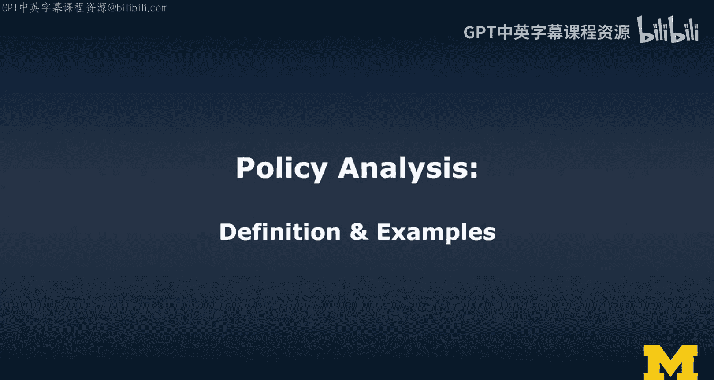
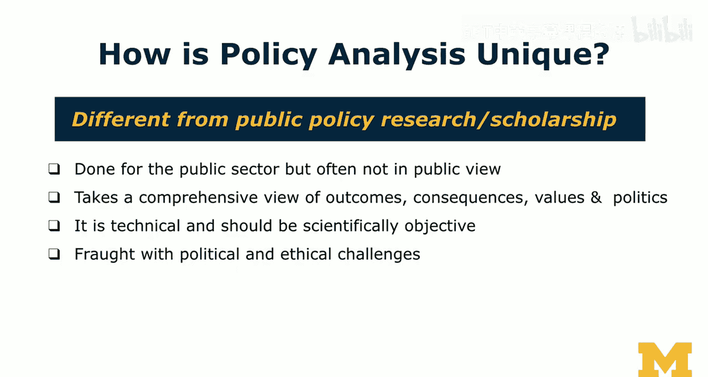
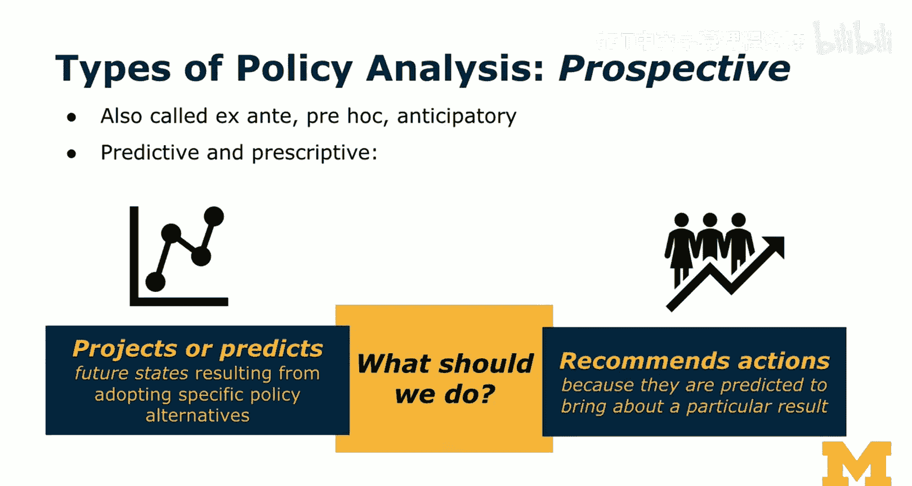
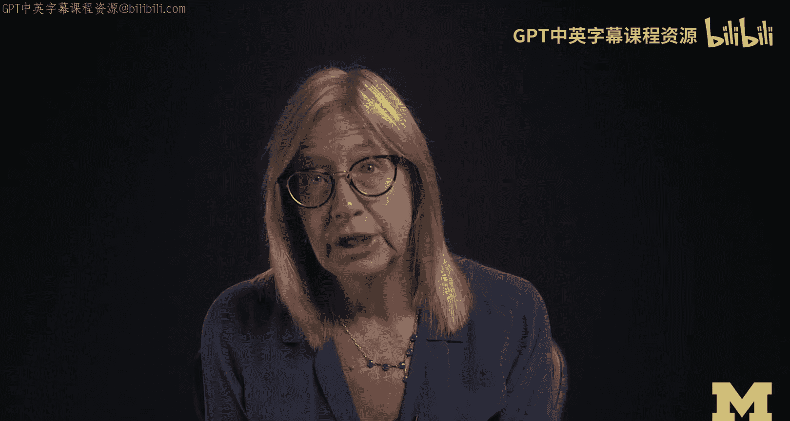
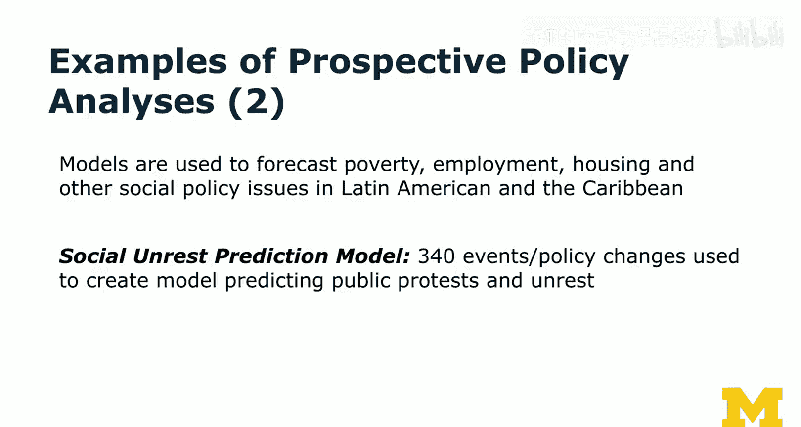
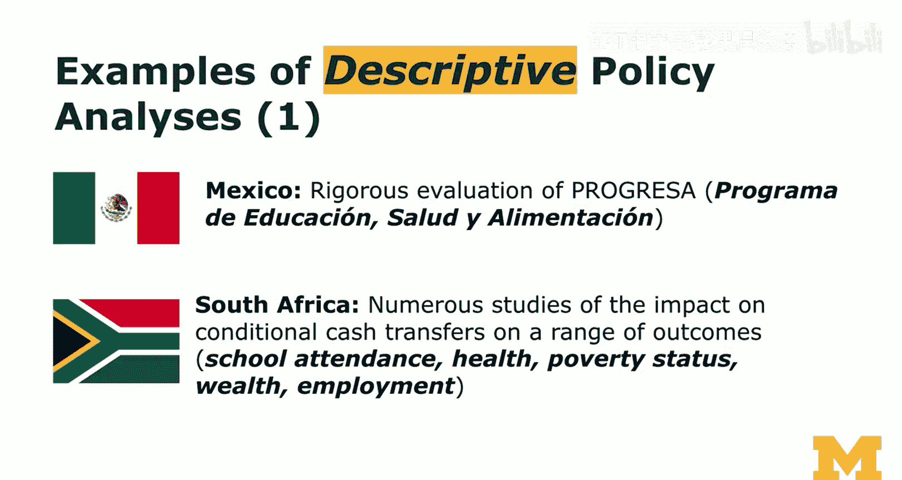
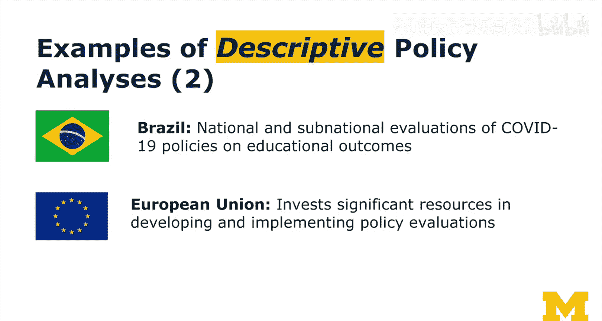

# 密歇根大学《公共部门的R数据分析（基础、数据探索、决策支持、）｜Data Analytics in the Public Sector with R》中英字幕 p85 6_政策分析：定义与典型案例.zh_en -BV1YZ421J7Fx_p85-

Continuing our discussion of the policy making process。

Let's now talk about policy analysis Policy analysis is advice for stakeholders or clients relevant to public decisions and informed by social values so how is policy analysis unique and how is it different from public policy research or scholarship first of all when we talk about policy analysis it's really something that's done for the public sector but not often in public view it's different from researchers and universities or think tanks who do research but then try to publish it in reports and in peer revieweded journals policy analysis tries to take a comprehensive view of outcomes。

 consequences， values and also politics it is technical and it should be scientifically objective but it also is fraught with political and ethical challenges as we will be discussed。

In great detail as we move forward right so there are two main types of policy analysis。

Propective。And retrospective so let's talk about prospective first prospective policy analysis is also called exant prehawkc or anticipatory policy analysis it's predictive。

And prescriptive and really what we're trying to do in prospective policy analysis is predict。

Future states that would happen resulting from adopting different kinds of policy alternatives it really prospective policy analysis tries to answer the question what should we do and after doing the analysis the goal is to recommend actions because they're predicted to bring about a particular result let's go through some examples so most countries but also international organizations like the United Nations or OECD have macroeconomic models that are used for monetary and fiscal policy forecasting so these models attempt to forecast what would the future look like if different types of monetary and fiscal policies are implemented what would be the impact not only on a specific country but also on the global economy so for example what would be the impact of an interest rate change on inflation or on the performance of private。

marketkes or what might be the impact of different tax changes on consumer behavior So another example is the numerous models that are used to forecast poverty employment housing and other social policy issues in all country but we'll go through some examples in Latin America and the Caribbean one model that that is used as something called the social unrest prediction model and this model uses different kinds of events that happen in societies and also policy changes and these are used to create models that try to predict how much public protest and unrest might result in events you know very negative things like you know assassination assassination attempts riots。

 etc cea， things like that our second type of policy analysis。

I descriptive or retrospective policy analysis sometimes also called X post or post this is not analysis like prospective policy analysis is trying to predict what the future would look like under different policy scenarios Re analysis is really trying to answer the question。

Did a policy that was implemented work what was the impact of what was done so it is an evaluation of past policies it's a description in very technical sorts of ways but focusing on what was implemented in evaluating what was the impact of that policy did it achieve its goals let's do some examples in Mexico there is a a large program it's actually a set of social welfare programs called Prorea or the Proma a duca Aementon so education health and nutrition and there's been very rigorous evaluations of Progressa to see what its impact has been on the different areas of social welfare that it targeted and we are going to be talking more about Proa later in this course another example is in South Africa and also many other countries there have been numerous studies of the impact of an intervention called conditional cash transfers。

On a range of outcomes in families and households including outcomes like children's school attendance。

 health usage， poverty status， wealth gains and also employment so these are program and policy evaluations that try to。

Tell us what happened when these policies and programs were implemented more examples in Brazil there's been a number of national but also subnational evaluations of different kinds of coVd 19 policies on children's school attendance and their educational outcomes also another example the European Union invests a lot of money and resources and developing and implementing evaluations of many different EU policies。

