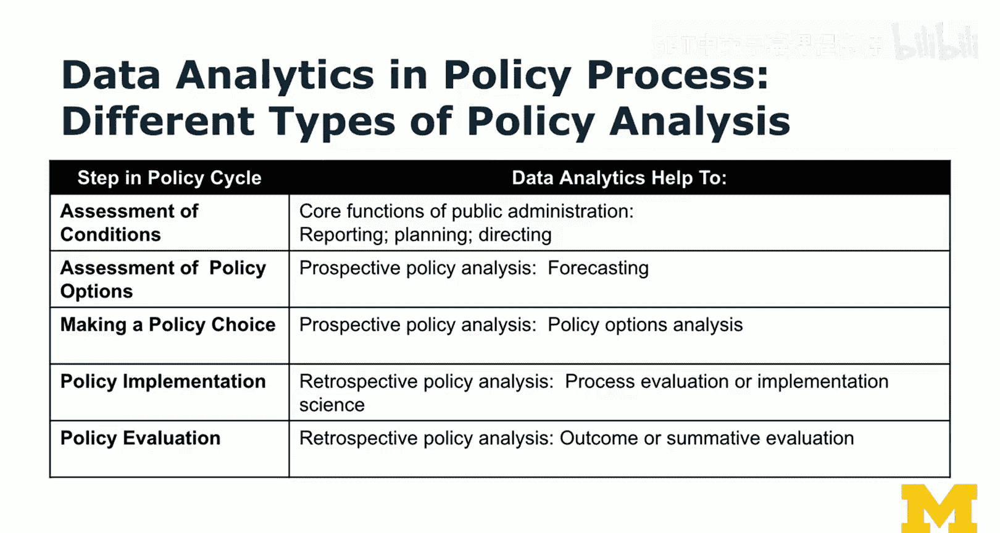
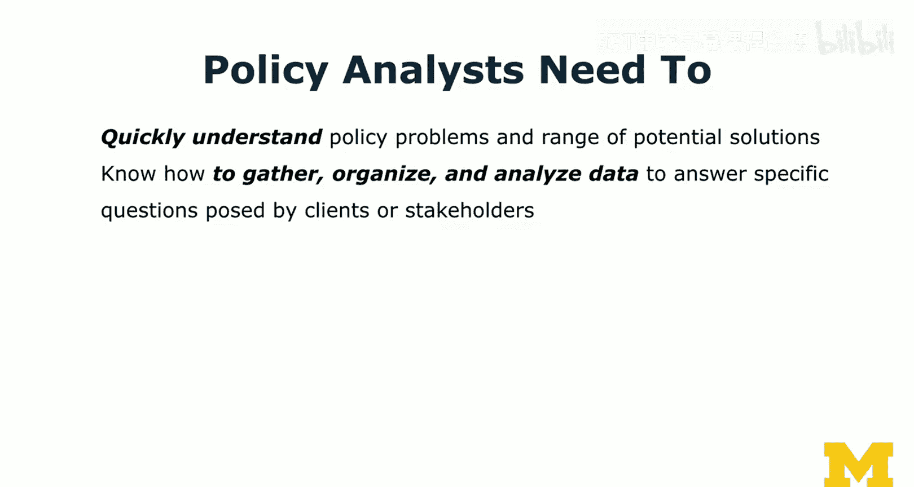
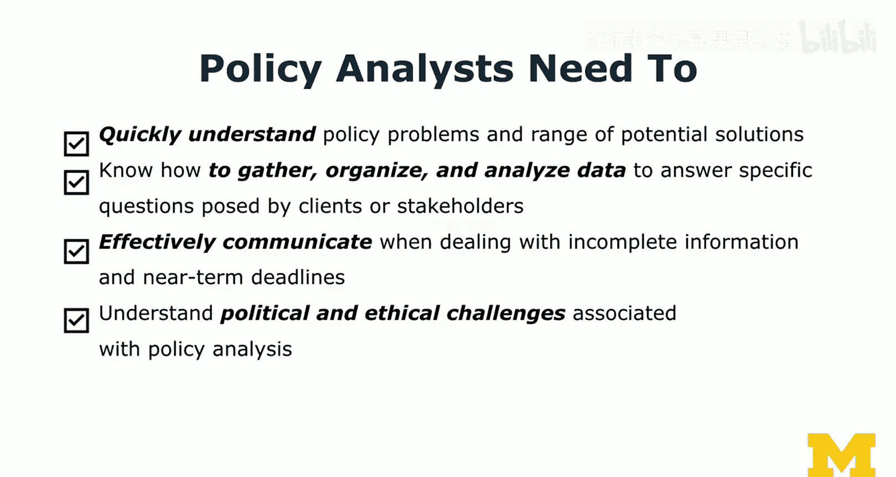
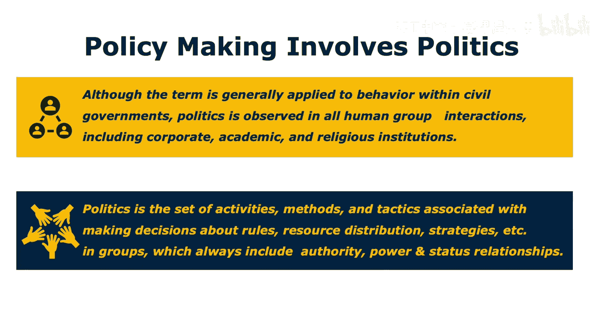
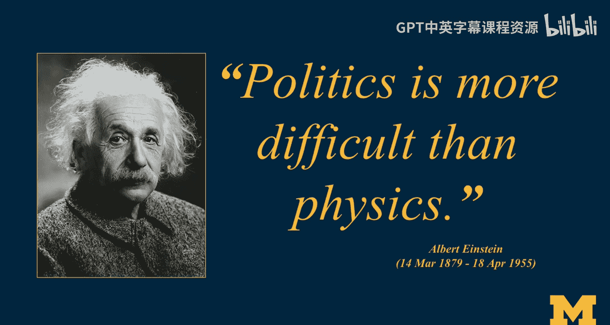
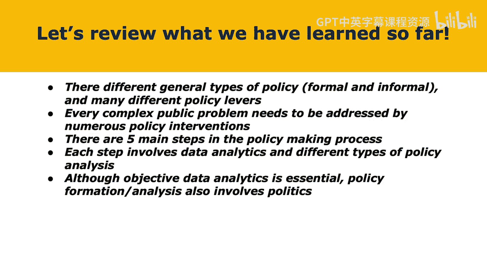

# 密歇根大学《公共部门的R数据分析（基础、数据探索、决策支持、）｜Data Analytics in the Public Sector with R》中英字幕 p86 7_政策分析中数据分析的核心作用.zh_en -BV1YZ421J7Fx_p86-

All right， let's also now focus on how data analytics are so important to these different kinds of policy analysis and also how these types of policy analysis map to the steps in the policy cycle so again。

 assessment of conditions， data analytics helpful with the core functions of public administration here reporting planning directing and using data to understand what is the current state of a set of conditions as a problem。

 what's causing it does it need more attention， who's worried about it， etc ce。

 now step two in the policy cycle， assessment of policy options。

This is prospective policy analysis， this is using data。

 data analytics to think about what are our policy options and what might the future look like。

If they were implemented， so it's forecasting it's prospective policy analysis and also then assessing policy options and making a choice again it's this prospective policy analysis where here we use a different kind of prospective policy analysis called policy options analysis we're going to be talking about policy options analysis and policy forecasting models coming up very soon and then we're also going to be talking about after policies are implemented how are they evaluated retrospective policy analysis this includes both what is referred to as process evaluation or implementation science so once a policy implemented we want to evaluate how that implementation went and then also for the fifth step in the policy cycle evaluating the impact of the policies this is also retrospective policy analysis and here we can talk about outcome or summative evaluation again。

We're going to have lots， lots of time together talking about both prospective policy analysis and retrospective policy analysis in much more detail。

 but the point here is that data analytics are core to the steps and the policy cycle because data analytics are core to these different kinds of policy。

Alysis now if you're gonna to be a policy analyst and not just a data analyst but a policy analyst。

 well what do you need in addition to your savvy and sharp data analytics skills well one it's good to be able to quickly understand policy problems and the range of potential solutions Also you do need to know how to gather organize and analyze data but in a way that is answering specific questions posed by clients stakeholders or policymakers in here。

 you'll really be working on a team it's not going to be your job to decide what data do people need and want but to work with them and then help gather。

 organize and analyze that data Also in addition to be able being able to analyze data。

 you need to be able to communicate about that data and especially when dealing with incomplete information。

In near term deadlines， sometimes policy analysts are asked to pull together data and analyze it and communicate about it in a matter of。

Hours or a few days this kind of work can happen very very fast and in doing this work you also need to understand that there are political and ethical challenges associated with policy analysis stakeholders often have an idea of what they want the data to say and if the data aren't matching what their perceptions are that leads to some political challenges also I hate to say it but it happens a lot policy analysts are actually asked to go find the data that matches with certain people's definitions of problems or the policies that they want to put forward and they don't want to see data that goes against what their perspective is again we will be talking about a lot of this along the way but the point here is that policy analysts need to have a bigger picture and this is why we're spending all。

Time on it you need to have a bigger picture of the context of the data analytics it's not just about the skills。

 it's about why they're being used and what role you as a analyst are going to play in the process so policymaking again involves politics what do we mean by that and it's not necessarily a negative thing this term politics it's generally applied to behavior within civil governments and with power dynamics but it's also observed in all human group interactions including in corporate businesses and academic environments in religious institutions but there's even some politics involved in your family and what we mean by this it's really its sets of activities。

 methods and tactics associated with making decisions about rules about resource distribution about strategies。

About behaviors basically we think about politics is what happens when groups of humans get together and try to make decisions and the politics become especially challenging when there are you know different levels of authority and power and status relationships you know。

 Albert Einstein's one of my favorite quotes actually said that politics is more difficult than physics and I tend to agree with that It doesn't mean that you know we really have to be afraid of them but we just have to be aware that when you're in the world a public policy even as an analyst that is ostensibly dealing with data and as objective。

A neutral way as possible there are going be politics involved what we have covered so far in this first module in this course first there are different general types of policy。

 both formal and informal and every complex， public problem needs to be addressed by numerous different kinds of policy interventions。

 we also talked about the five main steps and the policymaking process and that each of these steps involves data analytics in different types of policy analysis and although objective data analytics is essential。

 policy formation and analysis also involves politics。

