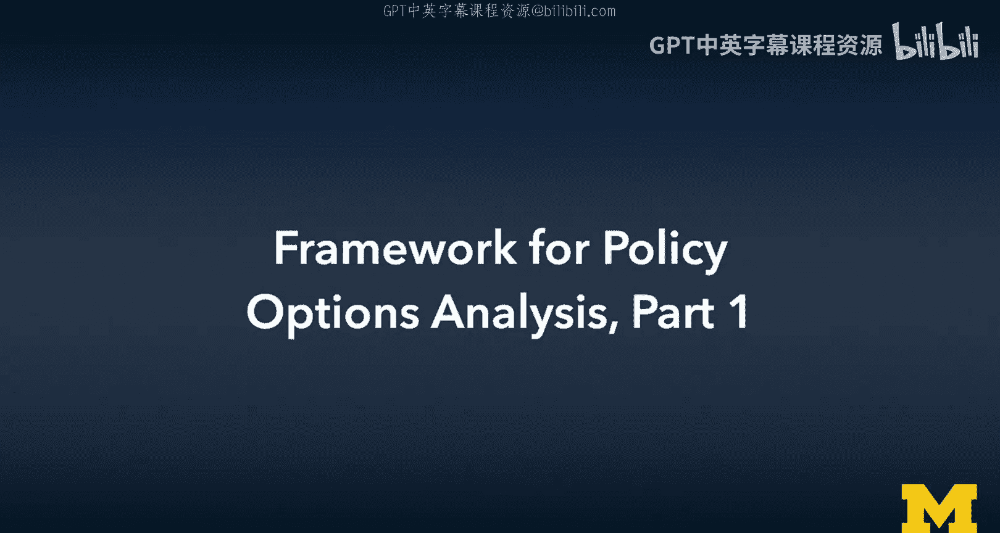
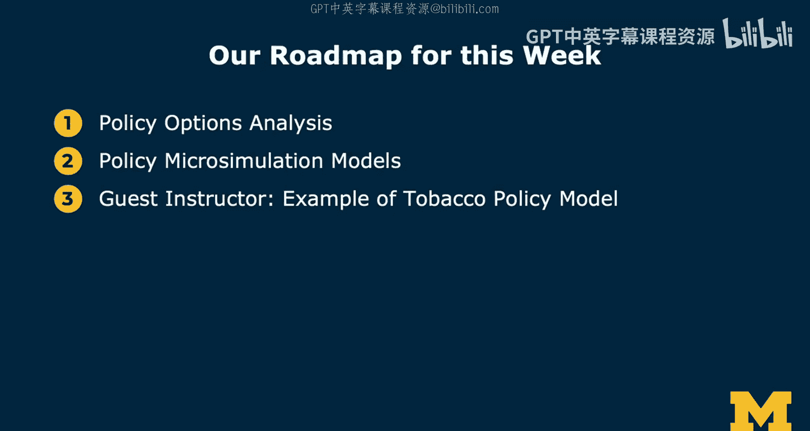
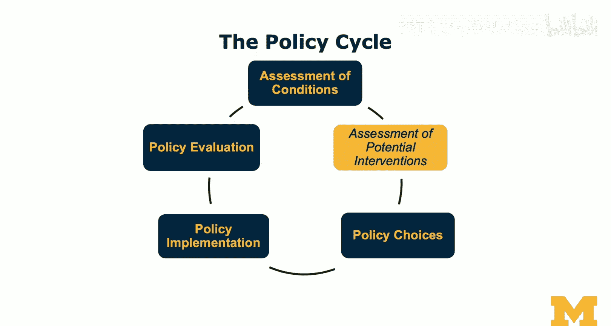
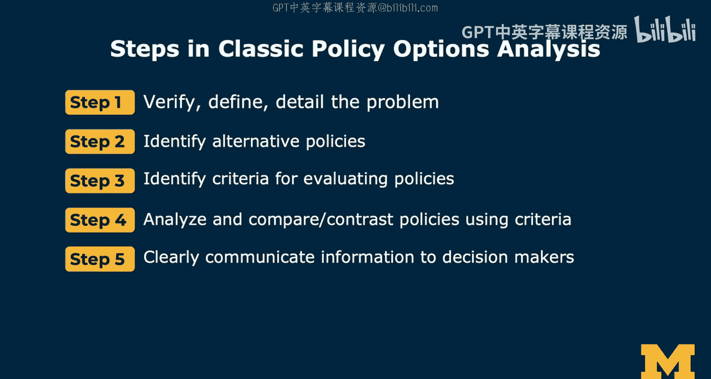
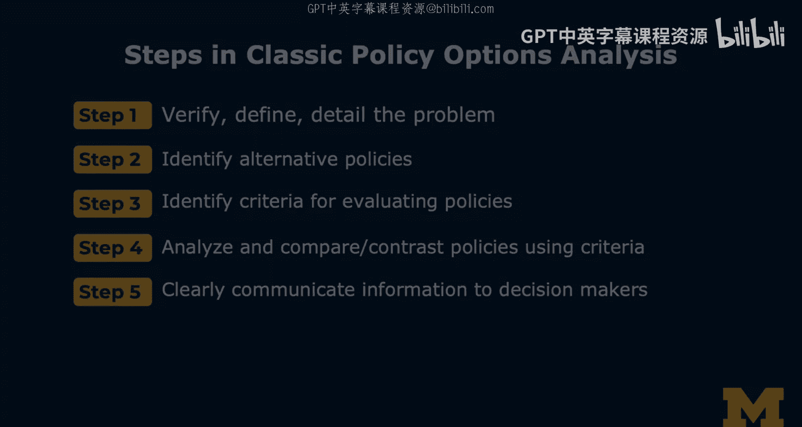
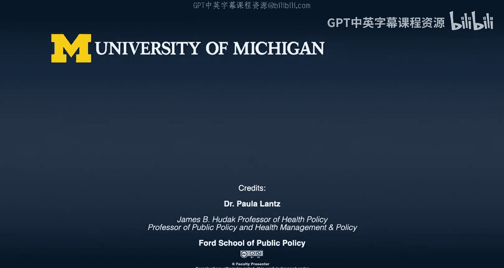

# 密歇根大学《公共部门的R数据分析（基础、数据探索、决策支持、）｜Data Analytics in the Public Sector with R》中英字幕 p87 8_政策选项分析框架（第一部分）.zh_en -BV1YZ421J7Fx_p87-

Welcome back。Continuing our discussion of different kinds of policy analysis。

 We're going to be focusing on prospective policy analysis， or。

Analysis that helps decision makers decide， what should we do。Quickly。

 what's our upcoming roadmap for covering this material？

Well， first I'm going to explain what a policy options analysis is。

And then we're going to talk about another kind of policy analysis that is prospective policy analysis。

 and that is something called policy micros simulationimulation models。

 And then you'll have a guest instructor come in。 colleague and friend of mine。

 Professor David Mendez， who will talk about a tobacco policy model that he designed and has been used quite extensively to help decision makers。

All right， policy options analysis。 What is this， Again， it's a type of prospective policy analysis。

 We also call this。Xant prehc or anticipatory。And it is。

 as the name implies predictive or prescriptive， we're to actually trying to predict the future。

 we're trying to project or predict future states that might result from adopting different kinds of policy alternatives。

And then based on those prescriptions， or again， are trying to predict in a crystal ball of the future。

 then make recommendations of actions to policy makers。

All this is trying to give decision makers some answers to the questions。

What should we do about a particular social problem or policy issue that we need to address？

Now we've talked about the policy cycle before， there's an assessment of conditions。

 then an assessment of potential interventions， then policy choices are made。

 then one or more policies is implemented and then we need to evaluate it and the cycle starts again。

😊，We are in the second step here today， the assessment of potential interventions。

 this is prospective， prescriptive policy analysis。

So here are the steps in a classic policy options analysis。

First of all， we've got to verify， define， detail the problem。

 what is the specific problem that decision makers feel that they need to address。

 what is the problem and data are very important to defining problems as we've already talked about。

Step 2， we need to identify what are some alternative policies。 And again。

 what's one policy that's always included。Status quo。

 it could be that we just leave things the way they are， but in addition to status quo。

 what are some policy changes that could be considered and implemented。Then step 3。

 we need to evaluate。The different policy alternatives that we identified in step two with criteria。

 measurable criteria。And then we analyze and compare and contrast our set of policy alternatives using the criteria。

And five， then we need to clearly communicate this information to decision makers。

 so again we're going to identify a small set of alternative policies。

 identify some criteria for comparing and contrasting them， and then we need to do that analysis。

 and then communicate the results to decision makers。

