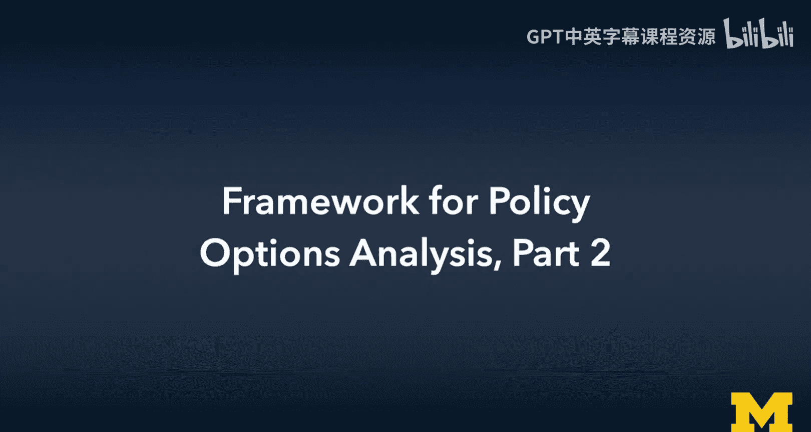
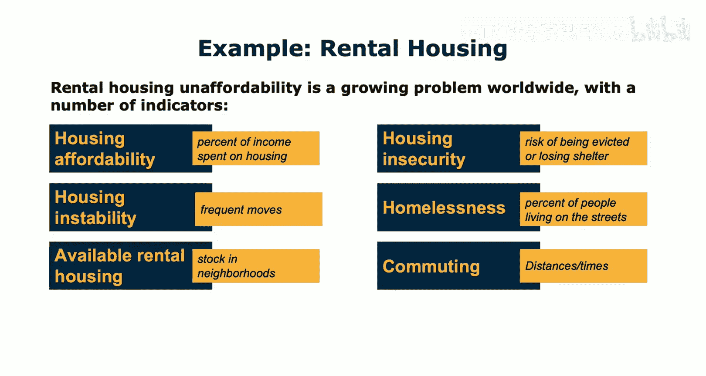
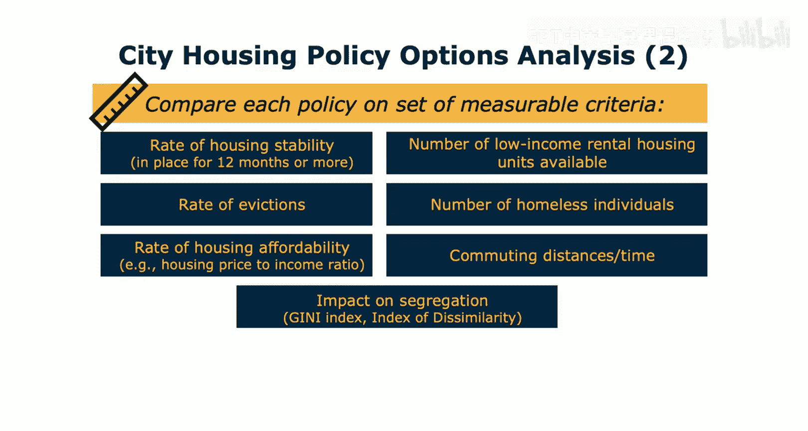
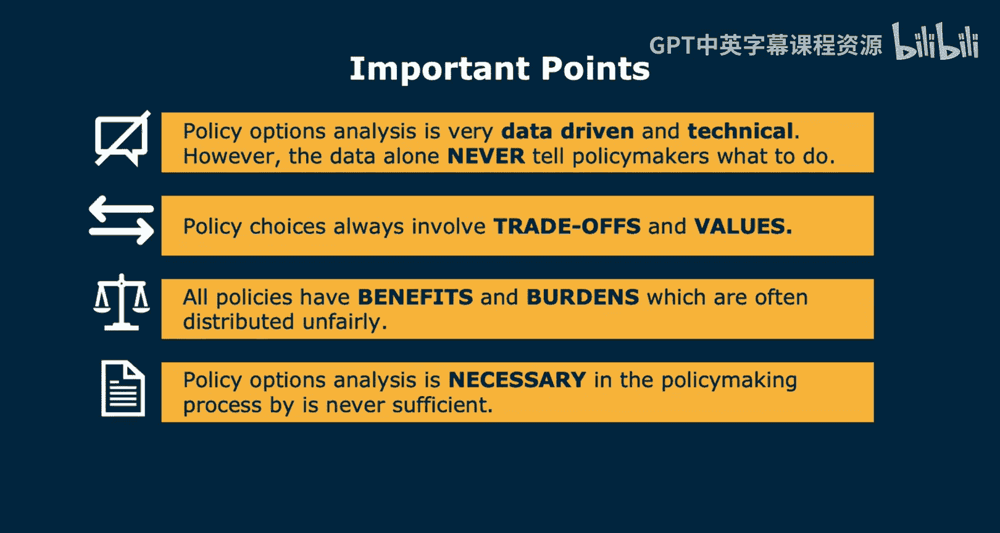
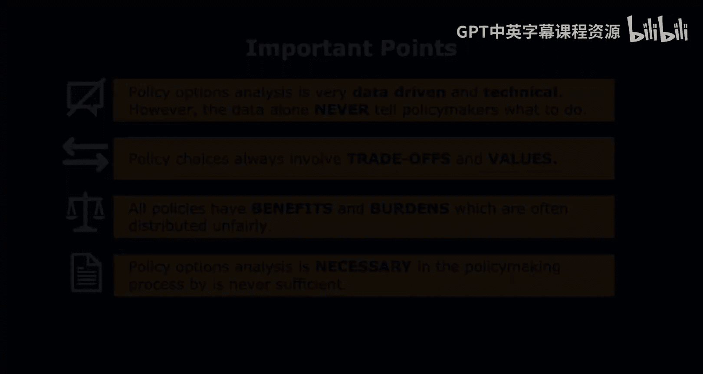

# 密歇根大学《公共部门的R数据分析（基础、数据探索、决策支持、）｜Data Analytics in the Public Sector with R》中英字幕 p88 9_政策选项分析框架（第二部分）.zh_en -BV1YZ421J7Fx_p88-

Continuing our discussion of policy options analysis， let's do an example。

And let's think about the problem of rental housing。Rental housing。

 unaffordability is a growing problem worldwide， and we know this from a number of data indicators。

 including housing affordability， which is often defined as the percent of income that a household spends on housing。

Housing insecurity， the risk of being evicted or losing shelter。

Housing instability often measured as the number of moves that a person or a household has to endure in a certain amount of time。

Homelessness， and there are a number of very specific definitions of homelessness。

But it generally is defined as a rate or percent of people who do not have any place to sleep。

 including a shelter。Another indicator of things going on in the rental housing market are its availability。

 So what's the rental housing stock in specific neighborhoods。

And then also thinking about rental housing， how far are people having to live from where they work to find affordable。

 secure housing， what's the commuting time because that's another dimension of the problem。

 and that's often measured and not only the distance people live from their work。

 but also the time it takes them to get there。

So what are some potential policy options for dealing with rental housing problem in a city， again。

 a lot of cities have determined that they have a problem with housing affordability。

 housing insecurity， its framed many different ways。

 but there is a serious problem with the rental housing market in their city。

So what are some policy options that a government could put into place Well one policy option is rent control putting limits on landlords on the number of rent increases they can have in a certain amount of time the percent of rent increase so rent control is one another potential public policy option is government subsidies for rent paid to landlords so you can help people。

For their rents more， if the government subsidizes part of their rent and pays it directly to landlords。

 these programs are called different things under different governments in the United States there's a large program called Section 8 housingous。

 and again it's where the government provides a subsidy for rent and it's paid directly to the landlords。

There are also a number of policy options related to zoning laws for apartment buildings。

 so laws that say， for example， X percent of a large apartment building must be available for government subsidized rental programs。

 and there are other ways in which governments can use zoning laws to help with housing issues。Also。

 there can be subsidies and other kinds of incentives to the private sector to build more affordable housing。

 sorry for the public sector to build more affordable housing number four， but also number five。

 incentivize private builders to create more lowine housing and that one way to do that is provide them with low interest loans。

And also， another potential policy option is to prevent displacement of people as rents increase in their areas as areas get more gentrified or rents keep going up and up in some places。

 prevent displacement。By assisting landlords with code enforcement costs。 So actually。

 if landlords get help from the government for keeping their properties up to code in certain ways。

 that might prevent them from passing on those costs to their tenants and keep people from having to move out。

 So again， there are many， many policy options and many more than the ones I've just mentioned to you in an up cityity housing policy options analysis。

 the first thing we have to do is consider what is a set of policy options that are really on the table and that the decision makers。

Want to actually consider。And you don't want a large set of it。

 We have to have a small and narrow and reasonable set of options when we do this kind of analysis。

One option that almost always is on the table is status quo， keeping things the way they are。

And then we compare other policy options， policy A and B， which we can say in this case。

 usually then are compared to status quo， so again， the first step。

 pick a small set of policy options to consider in the analysis。

 don't pick them yourself as a data analyst， the stakeholders and the decision makers pick them。

 but we need to narrow it down。Then。We compare and contrast each of the policies and our options set。

On a set of measurable criteria。 And again， in housing。

 there are a number of things we could look at， listed several of them here。 so we could look。

 compare and contrast our policy options on the rate of housing stability， the rate of evictions。

 the rate of housing affordability， the number of lowine rental units available。

 the number of homeless individuals in commuting distance in times。

 So we're going to compare our three options on all of these criteria。 and then also。

 we could compare them on the impact on segregation to these policy options increase or decrease racial residential segregation。

 which is also a growing problem in a lot of cities。

 and we can do that using things called the Ginny index or the index of dissimilarity。

All right， so we're not going to actually do a housing policy options analysis。

 but let me just sum up with some important points。

First of all， policy options analysis is very data driven and technical。

 and there's an important role for data analysts。However。

 the data alone never tell policymakers what to do。

And this is because policy choices always involve trade offs。

And value judgments about those trade offs。All policies have both benefits and burdens。

 and they're often distributed unfairly。And so while policy options analysis is necessary in the policy making process because it does provide some really important information and data to decision makers。

By itself， it's never sufficient。 And we will be talking about all this more。

In the future， thank you。

