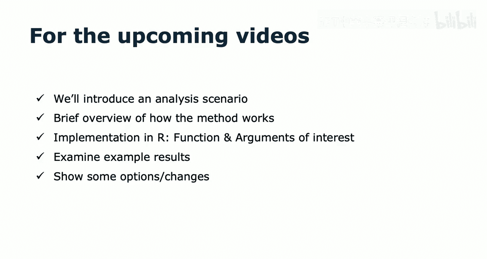

# 密歇根大学《公共部门的R数据分析（基础、数据探索、决策支持、）｜Data Analytics in the Public Sector with R》中英字幕 p89 10_R语言推断性统计分析导论.zh_en -BV1YZ421J7Fx_p89-

Hello everybody， I'm Alton Worthington， I'm a political scientist and a lecturer in public policy at the Ford School of Public Policy。

 I have experience in data analysis in the public sector， the private sector and academia。

 and I like teaching people about new methods to help them learn more about the world。

I'm here today to teach you more about how to do statistical analysis using methods in R。

Today we're going to look at just a small slice of what R can do。

 but it's a gateway to your further learning in the R environment。

We're going to work in a little bit differently than you've seen so far， you've worked in notebooks。

Today we're going to work in code more directly， we're going to look at how to engage with code in the console and in our scripts。

 we'll edit our scripts， we'll pass code to the console。

 we'll look at our results some parts of this will look familiar and some parts will look a little bit different。

 but in both cases we're working in the same environment you've seen already。

We're going to practice writing functions and comments。

 giving ourselves little notes so we know what's in our code。

 we'll examine results in the console and take a look at some of the objects we've created。

 and we'll edit our script to add in some additional analysis where appropriate for exploring some of the functions we're going to see in these sessions。

This is a quick screenshot of what our environments going to look like。

 so we'll have our familiar code script in the upper right hand side。

 It won't look as much like a notebook。 It will look instead like a script of analysis in the upper right hand side。

 we'll have our data environment where the object we've created will appear as things we can see in the lower right hand side。

 we'll have our console。 that's where our results and the code we've run will be presented and on the lower left hand side in this screenshot。

 there are files。 But when we create plots those will pop up there。

We're going to try this out using our projects， it's a slightly different way of organizing our data and code。

All of the analysis for these videos will be shared as our projects。

 so you will see a dorporoG file and you will see other files in a folder。

Everything in our analysis is going to be in one folder， our data files。

 the scripts that we've written to do our analysis and any output we've created。

 if we create graphs or other images， they'll be saved in this folder all associated with a single project。

You don't need to use projects though， as long as you have the script and the files all in the same working directory。

 you should be fine。 All of the action to do the things we're going to do in these videos is in the scripts。

For these upcoming videos， we're going to introduce analysis scenarios。

 give you a brief overview of how the methods we're going to use work。

 We'll talk about implementation in R， specifically introducing the function of interest and the arguments of interest。

 And then we'll examine some results and play around with some options if necessary。

 to see how things change。 I look forward to us learning together， and I'll see you soon。😊。

