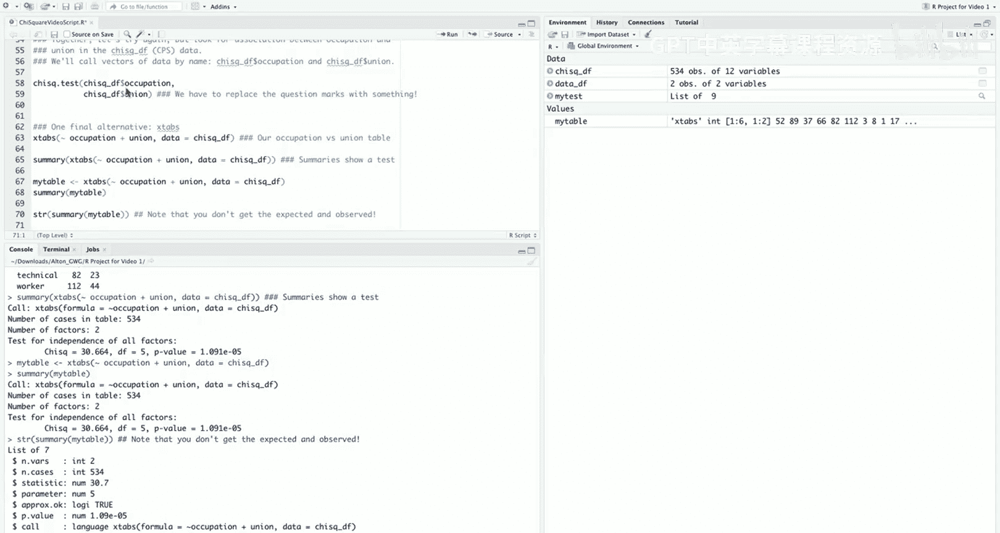

# 密歇根大学《公共部门的R数据分析（基础、数据探索、决策支持、）｜Data Analytics in the Public Sector with R》中英字幕 p90 11_卡方关联性检验.zh_en -BV1YZ421J7Fx_p90-

Hi， everybody。

Let's talk about an analysis task you might encounter Maybe you're working with categorical data。

 you have a categorical outcome of interest， somebody's choice of job what kind of school they send their children to or their use of a public service and you have some information about them that's categorical in nature。

 whether they received a policy intervention or not their identity group or what neighborhood they live in In this case you might want to examine whether there's a relationship between the two did students who had a job training program go into the trades more often did issuing vouchers to residents increase the number of parents sending their children to charter schools when we have these kinds of categorical associations。

 we want to perform analysis that matches these kinds of categorical data。

A gateway to doing this is creating tables。We can examine frequencies of occurrences in our data by creating a contingency table。

 This is sometimes also known as a cross tab。 Cross tabs have a feature where rows contain the levels of one variable。

 and columns contain the levels of another。The cells within this table contain counts。

 how many observations within our data exist for each combination of the two variables。

To do this in R， we can create basic tables and then pass these to another function to create proportional tables so we can see what proportions of each row or each column are according to each category。

 We'll look at this in a moment。 Let's take a look at how to do this in R。

We'll switch over to the our session now。Here's a script for this session。

 we're going to start by importing some data。 The data in this session come from the current population survey in of May of 1985。

This basic data set has some information on employment characteristics of a group of individuals。

 so we see things like wage， education， experience and age。 Those are continuous variables。

 We'll set those aside for now， but we also see categorical variables like ethnicity。

 the region where someone lived， their gender， their occupation， the sector of employment。

 whether they're in a union or not， and whether they're married or not。

Those categorical variables we can use to create these contingency tables。

The way we create contingency tables in R is with the table command。When we give our a table command。

 we need to provide it with one or more than one variables across which the table is created。

In this case， in our first table， we're going to create it using the occupation variable and the sector variable。

So I'll identify the data frame from which the variable comes， and I'll call the variable by name。

 In this case， chi squared Df occupation， Chi squared Df sector。

 When we execute this code in our console， we now see。Our contingency table with here。

 we see the results of our table command。Our contingency table here shows us in the cells the number of occurrences in our data for each combination of the two factors。

 for instance， there are two individuals who work office jobs who are in the construction industry。

There are 68 workers in the manufacturing industry。

 there are 81 people who work in services in all other industries。

We can do this for any pair of variables， so if we did occupation in Union。

 where union is a binary variable， we would see。The proportion of people or the occurrence of people in each of these categories for each of our industries。

There is in fact a simpler way to do this if you don't want to write the data frame name each time。

 and that's to use the width command， with is a helper which evaluates a function inside a specific data environment so you could write with chiis Square table and then just the variable names these results will look exactly the same as the ones you just saw。

If you want to try out proportion table， you can check the help file for Pro table I've left that code for you on line 28。

 if you read the help file for Pro table you'll see that Pro table takes a table as input。

 so an object that we've created that is a table as input to the later calculation。With Pro table。

 we pass R， a table object。 In this case， we'll reuse the code we wrote with with。

Where we specify occupation and sector， and we specify which margin we're going to take proportions across in this case。

 these are row proportions。When we use Pro table。Prop table calculates row totals and row proportions for each of the levels of our row variable。

 so occupation was in the rows， sector was in the columns。If you look。

10% or about 11% of our respondents in the management occupation were in manufacturing。

 About 89% were in other occupations， other sectors rather。

We can do the same thing across columns by switching to the second margin of our table。In this case。

 the proportions are calculated over columns。Let's switch back over to the slides and we'll talk a little bit about chiqua tests。

The KisSqua test of Association is a test where we examine whether proportions of a categorical outcome are associated with a particular categorical factor。

We compute a test statistic， this is where the test gets its name， this is the chi squared。

 it compares our observed frequencies， the frequencies we've seen in our data from the tables we just created with expected frequencies。

 as if the rows and columns were truly unassociated。

Our baseline expectation is that our outcome is totally unassociated with our factor of interest。

 this is our null hypothesis。If the difference between observed frequencies and expected frequencies is big enough。

 we might reject this null hypothesis in favor of an alternative that there is some association between the columns and the rows。

Let's look at these two example tables on the left we have data that we observed in our data set。

Let's assume we have a situation where there were some families that received no voucher within those families。

 155 of them sent their children to public schools and 30 sent their children to charter schools。

 but among the recipients of some sort of voucher， 45 sent their students to public schools and 19 sent their students to charter schools。

If we calculated an expected probability or an expected frequency。

 when those two factors were totally independent， we might see a table like the one on the right。

 where about 148。6 families sent their children to public schools when they received no voucher and 36。

4 sent their children to charter schools， mean， within voucher families， 51。

4 sent their children to public schools and 12。6。To charter schools。

If you want to visualize the difference， imagine on the left， we have the data that we've observed。

 Not how the regions within the no voucher and voucher groups are different heights。

 But in the expected data， the proportions are identical。 This is our assumption of independence。

Kiqua dot test is the function we use in R for performing chi square tests。

It's a function within the stats package， and a lot of the things we're going to look at in these videos come from the stats package。

 The function name is Chi Chi SQ dot test。It performs a variety of different tests。

 we specifically want the types of tests that are contingency table tests， tests of independence。

To do this， we can either give the function two different vectors of the same length。

 These may be variables from our data set。 So from a single data set， we specify two vectors。

 or we can give a prepared contingency table， a matrix of values of observed frequencies。

 We're going to try both in the code。 So let's switch over to the our session and take a look。

So here in our code we'll look at the example from the slides。

 I'm going to show you how to set up that data frame directly。

 so here we have our public school observations and our charter of school observations and we'll specify the row names so it's easy to see our table。

I'm going to make sure I rename my column name so that they look like public school and charter school。

 and let's take a quick look at our data frame。So I'll add in a line to observe the data frame。

 and there's the observed data from before。When we perform the chi square test。

 all we have to do is wrap chiqua dot test around the name of our observed frequencies matrix。

 our table。In this case， the results that we get break down a couple of pieces of information about the test we just performed。

When we look at the results from our function， we see a variety of different pieces of information。

 R tells us what the data source was， the information that went into the function。

 it tells us x squared， which is our test statistic。 It tells us the degrees of freedom called Df。

 and it tells us the probability value， P value。This P value is generally what you're looking at when you perform one of these tests in general。

 if the P value is less than 0。05。We would reject the null hypothesis and remember that our null hypothesis is that there's no association between the row factor and the column factor we'll discuss P values in a future video。

Let's switch back over to the R console and we'll take a look at what we can do next。

We can also pass our chi square test to an object name。 In this case， let's call it my test。Now。

 when you do this， you can also look at a summary of your test object。

 and it tells you all of the different elements within your chi square test。

When you look at the structure of your test， you'll notice that it has a number of elements to it。

 these are elements that you can use in other analysis or in a markdown document。

Because if we look at the structure of my test， you'll notice that it's a list。

If we look over in the R session。You'll see that the structure of my test is it has a bunch of named elements。

 sort of like a data frame， but that structure of data where we have named elements。

 So we look at my test observed。That's the table for the frequencies of row and column variables。

 If we look at my test， expected。There's the numbers we saw on the slides a few minutes ago。

 and you can pass these objects to other parts of your R mark down document or your analysis。

Let's do one more together in this case， rather than passing a contingency table to chiisquare do test。

 we're going to pass two vectors and they'll come from the same data frame so we know they're the same length。

 We'll use data from that CP data frame， the chiqua underscore DF data frame。

 and we'll use the occupation variable and the union variable to see if there is independence between those two factorss。

So here's our chi square dot test command again， but what goes inside the parentheses。Well。

 in this case， we want to pass it two vectors so we could say chi square。Dot D F， underscore Df。

Occupation。Our studio helpful。auto completes first when we press tab。

I'll put my other variable on the second line， so it's a little bit easier to see。

So we have two vectors rather than a matrix。Right。When we perform the test。

 we get our chi square test of independence again。Here the data looks a little bit different。

 but if we look at our P value， it's very small， 1。091 times 10 to the negative 5 well below that 0。

05 level。And if we wanted to， we could look at a summary of this table and see its structure as well and see our observed and our expected frequencies。

Our last option， if you want a different way of going about creating tables and getting chiis square tests。

 is to use a different function from the stats package called Xts， which is short for crossts。

Cross tababs or X tabs creates contingency tables with formulas syntax Forms syntax in R is something we'll see in the future。

 it uses a till day to indicate that there is a left hand side and a right hand side to a particular function。

In this case， with x tabs， we would say that the factors which are our cross classifying factors。

 the things which are rows and columns， go on the right hand side。

Let's switch over to the R console and take a look at how that works。So here I have X tabs。

And my formula is occupation plus union。 Those are my two factors。 Occupation is one factor。

 Union is the second factor， but now I have to tell x tabs where the data are coming from。

 The data set。 In this case， the data set is chiis square underscore D F。When we do this。

We get a cross tab， just like we did before when we use table。

But one of the advantages to using X tabs is we can wrap it in a summary。

And when we summarize that x tab。We get our chi score test of independence for all factors。

One nice thing about X tabs is we can wrap it in a summary。So the same function as before。

 But when we summarize that x tabs， we get a chi square test of independence for all of our factors。

 So the independence of all the factors in our contingency table。

It's a nice little gateway to the fact that x tabs will let us do chi square tests for more than two factors。

You can also take your X tabs and assign it a name so you could save my table and summarize your table。

But note that the structure of an X tab's object is a little different。

 You don't get those expected and observed values that you did from a table and a chi square dot test。

So we'll wrap it up there， but in a future session。

 we'll look at other ways of analyzing data that are continuous in nature。

