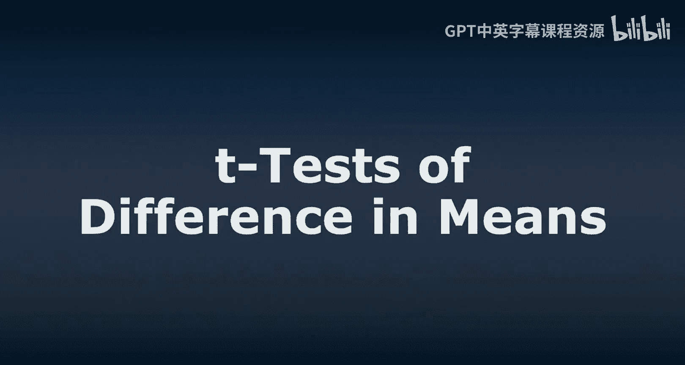
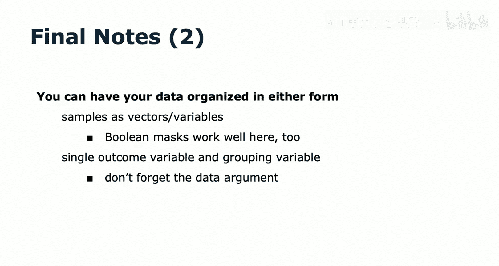

# 密歇根大学《公共部门的R数据分析（基础、数据探索、决策支持、）｜Data Analytics in the Public Sector with R》中英字幕 p91 12_均值差异t检验.zh_en -BV1YZ421J7Fx_p91-

Let's talk about a different kind of data task you might have if you have a continuous outcome or variable of interest and you want to compare that across two groups to see if there's a discernible difference。

 you may need to use a different type of test。So let's say you've observed different sample means。

 different means within two groups， does that mean there's a real difference there？

This comes up in a variety of contexts in the study of public policy。

Before and after an intervention， treatment versus control groups。

 but it also comes up in examining differences between two groups， mean incomes across two groups。

 or the mean cost of insurance across two states。Imagine you have data that's distributed normally。

 This is how we tend to think that a lot of data are drawn。This is a standard normal distribution。

 it has a mean of zero and a standard deviation of 1。On the other hand。

 you may have two distributions that look like this。 In one case。

 we have the standard normal distribution with a mean of 0 and a standard deviation of 1。

 but we have data drawn from a second distribution。

 which has a mean of  two and that same standard deviation of one。

 The data drawn from each of these distributions would look a little bit different。In reality。

 when we're looking at observed data， we might think about things like kernel density estimates。

 So here's a comparison of two groups of data drawn on the same measure across two different groups of observations Here。

 the kernel density plots look kind of similar， but the means do look a little bit different。

 And our question is， are these means significantly different enough for us to believe that these groups are different in some way。

To understand this， we can perform a statistical test。

 and the common test for differences in means across two groups are students test or Welchs test。

 these are both kinds of T tests。When we want to know whether the differences in our sample suggest an underlying difference in the populations。

 we need to know about whether the difference in their sample means。

 given a scaling factor for how much dispersion there is is big enough。

 and so t tests have a general test statistic form of a difference in sample means divided by a scaling factor to accommodate differences in dispersion。

If the resulting difference in means is big enough， given the scaling factor。

 the resulting T statistic will be far away from 0。 If it's far enough from 0。

 given the size of our underlying samples， then we can reject our baseline expectation。

 That is that there's no difference between the groups。 This， again。

 is that null hypothesis that we've talked about。In R。

 the basic function performing T test is T dot test。

 It's another function from within the stats package。 Now。

 the T test function performs a variety of different tests。 Today。

 we're going to focus on two the two sample tests or the two group T test and the paired T test which we use for before and after analysis。

It's also possible to pass two vectors or two variables from a data frame to this function or to pass a formula and a data frame name。

 and we'll look at both。So let's talk about how you set up a T test first for two groups。In R。

Here we're going to see the Form syntax。Now， here， the formula has a left hand side variable and a right hand side variable。

 The left hand side variable is our outcome of interest， So it comes before the till day。

 The right hand side variable is our grouping variable。

 our factor variable or other variable that has exactly two levels。When we do this。

 we also have to tell our what object holds the data and the variables。

 so this will be a data argument， in this case you could say data equals Df。

Let's go to R and take a look at what it looks like and bear in mind that defaults matter。

 so I'm going to show you a test with the defaults in place， at least for the first time through。

Let's switch over to R and take a look。So here we are in our script。

 This is the script for this section of the course。 We're going to load some objects into memory。

 If you notice， I've shared with you in our data workspace that's going to contain some data objects。

 So we'll load those in。But we'll also import some other cv files。

So we should have five data objects in memory， data  one through three。And paired Df and unequal Df。

Let's quickly look at a histogram of some of these data just to get a sense of how they're distributed。

 This is a base R histogram。 So you've seen histograms in G G plot in base R。

 if you need to do a quick histogram， you could use hist。And when we do that， a histogram。

Its created here。Let's look at how we would do a T test across two groups。If we look at data 3。

You'll see that there's a grouping variable。 It has two levels。

 control and treatment and a continuous outcome variable。 Its numer nature。For this。

 we'll use a formula。Our outcome variable is on the left hand side。

 and our grouping variable is on the right hand side。We tell R that the data comes from data 3。

And now we start specifying options for our test。 The first is the alternative hypothesis。

 We are specifying a two sided test。Here， we're saying we don't know whether the mean of the control group is greater than or less than the treatment group。

So we test both ways。We also specify a no hypothesis difference with mu here our no hypothesis is no difference。

 This is the default。We tell are that these are not paired samples。

 and we tell our that the variances are not equal。 These defaults are safe choices unless you have a reason to go otherwise。

 stick with the defaults。In our results， we're going to see a confidence interval around the difference in means。

 and we specify that using conf dot level。So let's execute this code and see what it looks like。

When we perform this test， we get some results down here in the console。

 Let's talk about what we've seen。When we look at the results in the console。

 we're going to see a variety of different things return to us first， we'll see a data summary。

 what objects are under test In this case， it is the data 3 data frame and the variable outcome We'll see T。

 and that is our computed T statistic， which is the ratio of the difference and means over that scaling factor。

We'll see DF， which is degrees of freedom， which relates to our sample size。

And we'll see that P value again。 That P value is our probability value。

 and it tends to be the thing that people look at when they perform these tests。

 We'll also get an X percent confidence interval。 When we specified 0。95。

 we asked for a 95% confidence interval， which is a range of estimates for the difference in the population means。

 given the data that we've seen， and we also see the sample means for those two groups。

So here's an example from a different set of results。

 and we'll jump back over to the R console to look at the ones from the test we just performed。

Here are our results。In our our session。We have our welt2 sample tea test。

Our data is outcome by group。Our T statistic is negative 5。555。With 167。51 degrees of freedom。

And our P value is very， very small。Here it's 1。069 times 10 to the negative 7。

So if our no hypothesis was that there was no significant difference。

We would reject it in favor of our alternative hypothesis that the true difference in means is not equal to zero。

And the 95% confidence interval around that difference ranges from about negative 10。

5 to about negative 。5。And the 95% confidence interval in those differences ranges from about negative 10。

5 to about negative5。Remember。In general， if your P value is less than 0。05。

 you're going to reject that null hypothesis， where our null hypothesis is that there's no underlying difference in the means。

You can also take a T test object and you can assign it a name so you could use the elements of the test for later use。

 putting it in a document， passing it to another function。

 So let's try taking the test we just performed and we'll name it my T test and then we'll examine the structure and you'll see that just like before it's a list。

 Let's jump over to our R session。So here's our T test。So once again。We have our T test。

Outcome by group。And data equals data 3。 and if you notice。

 I've omitted the rest of the defaults because the basics work for me in this case。

And now we have a new object in our data environment called myT test。

 and if we look at its structure， you'll notice that it's a list， so it has the test statistic。

 the parameters， specifically the degrees of freedom， the P value， the confidence interval。

 all the stuff you might need。Now let's look at the other way of specifying a T test。In R。

If you want to set up a T test for paired samples， it's oftentimes the case that we do this by specifying a T test with two variables because we'll have our pre and post。

Variables as are observations before and after a treatment in the same data frame for the same observation。

 However， it's also possible if you have a single variable with a grouping variable for pre and post treatment as a grouping variable to do this using the formula analysis we just saw。

We'll try that other setup here。 we're going to specify two different variables as vectors。

 Note that we're going to specify the data frame not as a data argument。

 but as part of the variable name， and we're going to add a new argument to our T test paired equals T。

 This tells R each element in each of the vectors matchesshees its pair in the other vector。

Each observation in the first vector is compared to the same observation in the second。

 which means that these vectors must be the same length。As we set this up。

 we'll take a look at how to do this over in our R session。

So let's take a look at the pair to underscore DF data frame。If you look， we have two variables。

 pre and post。And they're both continuous。We might think about setting up a T test like this。

Paired to underscore DF， Do sign pre identifies the pre vector。

Paired underscore DF dollar signed post identifies the post vector。

Will stick with that default alternative hypothesis of two sided test。A mean difference of zero。

But we've changed that flag， so it's paired equals T。 We're doing a paired T test now。

When we perform that analysis， you'll see that we get a slightly different set of results。

Here we get a different summary of our data。We have two vectors， pair Df pre and pair Df post。

We still get our T statistic and our degrees of freedom and our P value。

And our P value is very small， much less than 0。05。A couple of final notes about T tests。

The first is that there are going to be arguments of the functions that change the test。

 Checking the help file will clarify when these different functions or these different arguments come into play within the function。

 So paired equals T tells you it's a paired test。 Pared equals F， which is the default。

 is an unpaired test。There's also the option to assume equal variances or not。 in general。

 not assuming equal variance is your better choice。

 but this is what defines a student's tea test versus a Welchches tea test。 In general。

 stickick with the defaults here。And finally， you do have options for changing your alternative hypothesis。

 so the default being two sided。Is a good standard。

 but if you have a reason to test for the second group being greater or less。

 then you would change your alternative hypothesis here。

Note that you can have your data organized in either form。

 you can have your sample as vectors or as variables。

Or you can have a single outcome variable and a grouping variable in the former。

 you'll specify two vectors of data in the latter you'll use the formula form and you'll include that data argument。

