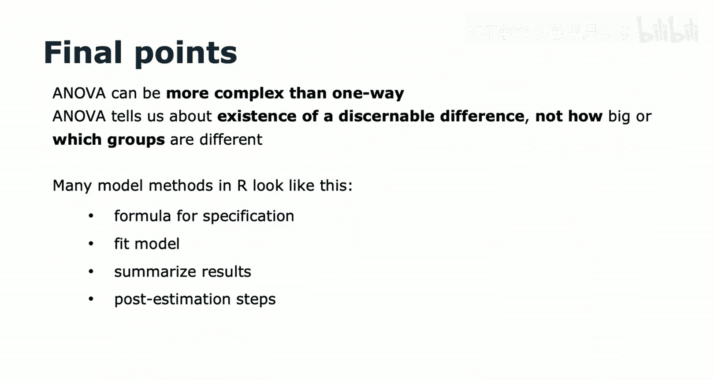

# 密歇根大学《公共部门的R数据分析（基础、数据探索、决策支持、）｜Data Analytics in the Public Sector with R》中英字幕 p92 13_方差分析模型.zh_en -BV1YZ421J7Fx_p92-

Let's talk about another type of data task you might experience。

 Let's say you have a continuous outcome of interest and you want to compare a measure across two or more groups to see if there's a discernible difference。

 So you've observed something and the group means are different。

 but other differences among those groups。This comes up in a variety of circumstances。

 you might think of comparing outcomes across four groups。

 so how are household savings different across four groups of families。

 or you might check for comparing an outcome before or after an intervention or a treatment test scores after one of three different interventions。

In these cases， you might think of using the T test， but because we have more than two groups。

 it's not feasible to do so。Differences come from a variety of different sources and when we observe things in the world。

When we look at the distribution of outcomes， we can think of variation as coming both from explanatory or group level differences。

 but also from idiosyncratic or individual level differences。

 people are just different from each other。One way of thinking about our task is。

 are the group level differences bigger or more important than individual level differences。

 and this is a gateway to a kind of thinking where we think about the variation our data coming from more from the differences between groups than from individual differences。

 and if the variation in our data comes more from the differences between groups。

 we might think that those groups are different in some critical way。

You might think of visualizing your kernel density estimates this way。

 So here we have a distribution of outcomes across different groups。 Here。

 we might say that within the individual groups， those groups are quite different。

So there's similarity within groups and differences across groups。Alternatively。

 you may be in a situation where there are differences both within and across groups。

But in some cases， groups are not terribly different。

 there's in fact more difference within the groups than there is across the groups。

We can use ideas about sources of variance to think about differences between groups at the core of a No methods is the analysis of variances comparing the sources of variance in some outcome。

For simple one way， a No， the ratio we compare is the variance between groups to the variance within groups。

Formerly， this creates an F statistic。 The mean square differences between groups divided by the mean square errors within groups。

Now， the F statistic has to be large enough， given the size of our sample and the number of groups we have。

And if it is， we may reject our baseline assumption， and that is that all the groups are， in fact。

 the same。 Our null hypothesis is that there is no difference between the groups。

What's important to know is the F distribution changes both with the number of observations and the number of groups。

 It has two degrees of freedom， one in the numerator and one in the denominator To give you an idea of this。

 Let's look at some different F statistic distributions。To give you an idea of this。

 let's look at some different F distributions。On the left hand side。

 we only change the number of degrees of freedom in the denominator。

 If you notice the shape of the curve changes， but it tends to asymptotically increase towards infinity as we get close to 0。

On the right hand side， we only change the number of degrees of freedom in the denominator Here。

 the shape of the curve changes to some extent as well。

If we increase both the numerator and the denominator together。

 you notice that the shape and also the central location of the distribution changes。

 The shape of the F distribution changes both with the number of degrees of freedom in the numerator。

 the number of degrees of freedom in the denominator， and the ratio of those two。

And so it's a little bit more difficult to think about how the F distribution is shaped for any combination of degrees of freedom。

 but luckily we don't have to think about it too hard， we can compute it。

To perform one way in Nova and R， it's fairly straightforward。

We're going to use a command for all ANOVA methods in R called AOV。

AOV takes a formula on the left hand side is our variable of interest， our outcome variable。

 and on the right hand side are grouping factors。 In this case。

 we're going to specify a single grouping factor。We also have to tell R what the data frame from which our observations are coming is called。

For one way AOVA， you might think of specifying outcome till day group as your formula。

 and data equals data underscore DF as your data argument。

The general workflow for performing A NOVA methods is you fit the model， you assign it a name。

 and then you summarize or you look at a summary of the analysis。

We'll look a code that looks like something like this， so let's jump over to our R studio session。

So here's our script for this current video。First， let's load in some data。

 So we'll load in two different data sets that contain AOva information。

 you can play with some of this later on。And we'll load in one。 That's data 2 from our last session。

If you'd played a little bit around with the code in the video 2 data。

 you would have noticed that the last part contained an option to perform a T test on data with three groups。

 and it didn't work。 We'll bring that data back in if you want to compare it here。

Analysis of variance is performed by this AOV command。Our outcome is test score。

And our grouping variable is group。If we look at the AO 1 underscore data frame。

Grouping variable test score， we can ignore the X's。When we do this。We get a summary table。

It tells us what the function call was and what the terms。

Of the function are or what the terms of the results are。But it's not terrifically helpful。

 What works better is if we take that same call and we assign it a name。 So we'll call this a no 1。

And we look at a summary。Now we have a summary table which tells us more about what the sources of variants in our data are。

The model call alone isn't as helpful for us。 In this case。

 What we get is a summary of the model fit， But what we want to know is specifically。

Where the sources of variances are。 Now， if we look at the sources of variance in our results。

 we'll see， in this case， group group identifies what portion of the overall variance in outcomes comes from group level differences。

 We'll see in F value， which is the F statistic for the ratio of variances。And we'll see a P value。

 which in this case is written PR greater than F in parentheses。 That's our P value once again。

In general， if PR greater than F is less than 0。05。

 we can reject our null hypothesis that there's no difference among the groups。

Your results might look something like this。Let's jump back over to our results in our studio and take a look。

In this case。Our group level of results。We have a probability of about 0。217。So this is above that 0。

05 threshold， so we might not reject the old hypothesis that there's no difference between the groups。

But let's look at a different data frame together， and we'll write the code together。

Let's try the same test， but with A Nova2 underscore DF。If we look here。

 we now have group and test score。If we write this code together， we'll call this annovava2。

It's the name， L V。Test score。Group。And the data frame。

 the data source from which we're pulling all of this。Is an o。To underscore。Df。Now。

 we can summarize that model。So summary of A Nova 2。And what we see is that in this case。Group now。

Has a P value of well。91。So it's above that 0。05 level。

If you want to revisit the data set data 2 from Vide2's code， you can try it out here。

 Think about where you would put each of the variables in that data set and then look at the summary。

The one thing to know is that Anova doesn't tell us anything about which group is different。

All the N Nova methods tell us is that there exists a difference。

 but it can't tell us which group is different To do this， we perform post analysis。

 One method of analysis is known as twokis on a significant differences。Now。

 you could perform a lot of pairwise T tests between the groups。

 Once you know Anovava says there is a group that is different。

 you might try testing each of the groups and their difference between the two。

 The problem is if you do lots of pairwise T tests， you have a problem of multiple comparisons。

 The problem of multiple comparisons means that you might reject accidentally。

The null hypothesis when， in fact， it is true。So we can perform those comparisons。

 but adjust our findings to correct for multiple tests。

 And this is where Tki's honestly significant difference tests comes in。 So it's like a T test。

 but there's an adjustment。To our P values， to accommodate the fact that we're comparing over lots of different pairs of groups。

In R we implement it with2ki HSD。 This takes an AOva model， an AOV object as an input。

 so we have to do it after we fit in a AOva model。Let's look at how we do this in R。In R。

 we'll first fit our analysis of variance model， and then we'll pass it to Tki HSD。

There are additional options if you want to make all the differences positive。

 if you want to make all of the differences between groups non negative。

 you can choose to make ordered equal to true。 You can also change the confidence interval around the differences in the means with cof level like we've seen before。

Let's try it together。So here we have our N Nova1 model， the one we performed first。

 if we pass this to Tki HSD。We see the differences between the groups。

The difference between group one and group 4， group 2 and group 4， group 3 and group4。

 they're all positive， but。The confidence interval contains 0。

 and we would not actually be confident of rejecting the null hypothesis of no difference。

 This is consistent with ouro results。 So none of these P values are less than 0。05。

If we jump over to our second test， a Nova 2， you'll see that here。

Even though our overall fit suggested there wasn't a significant difference。

 some of the groups appear more different than others。

But in no case is the P value for any pairwise comparison of groups。Get below that 0。

05 level that we would consider to be a significant difference。

But if any of these had come up as less than 。05， we would say there might be a difference between those two groups on our outcome of interest。

You can retry the data to AnovaVA models on variable 2 and variable 3 on your own time。

When you interpret the twoki's on significant differences， though， look at each of the columns。

The first column shows the level of the factor being compared。

 the second column shows the difference in means。Then the third and fourth column shows the lowers and upper ends of that confidence interval。

 and the final column shows the P value on the difference in means。

 And that's the thing that we care about。 In general， if the P value is less than 。05。

 you can reject that null hypothesis of no difference。A couple of closing points。

 you can have aOVva that goes with more than one factor， more complex than one way A NoVva。

 but all AO can tell us about is the existence of a discernible difference。

 not how big or which groups are different。Many R methods involving models look like this， though。

 You will specify a formula for the specification。 You will fit the model。

 You will summarize the results， and then you'll do additional post estimation。

 So AO is a nice gateway to more complex analysis of statistical models in R。

