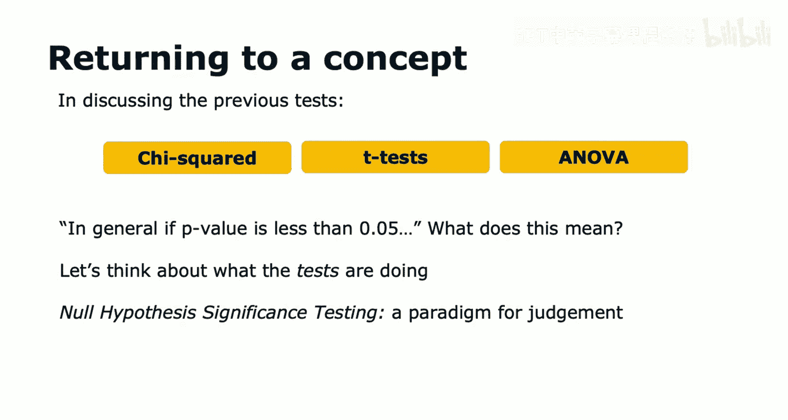
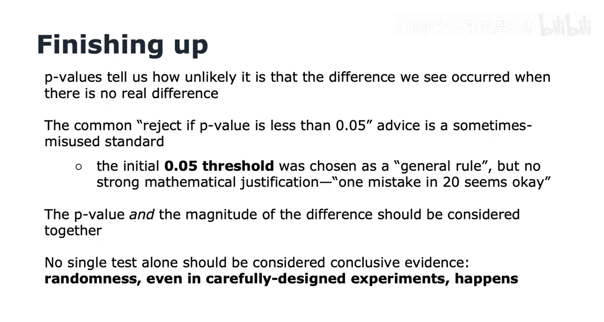

# 密歇根大学《公共部门的R数据分析（基础、数据探索、决策支持、）｜Data Analytics in the Public Sector with R》中英字幕 p93 14_P值模拟分析.zh_en -BV1YZ421J7Fx_p93-

So in the previous videos we've talked about this concept of P values when we talked about chi square tests and T tests and AOVA。

 I said in a variety of cases that when the P value is less than 0。05。

 you can reject the null hypothesis to understand what this means it's important to think about what the tests are doing。

This language comes from a paradigm called null hypothesis Sign testing in some of the previous videos。

 when we talked about chi square tests， T tests and AOVA。

 I said in a variety of cases if the P value is less than 。05。

 you might reject the null hypothesis of no difference。

What does this mean？If we think about what the tests are doing。

 they're testing for the presence of discernible differences。

 and when we talk about rejecting the null hypothesis。

 we're talking about a way of thinking called null hypothesis significance testing。

 It's a paradigm for statistical judgment， but understanding what that P value means is a little complex。

A P value is a probability somewhere between0 and1， of getting a test result， a test statistic。

 as large or as extreme or as different as what you observe if the underlying null hypothesis was true。

In other words， how likely or unlikely is it that the difference that we've observed has arisen by chance alone？

A P value of 0。05 implies that we would reject the null。

 that null hypothesis of no difference between the groups in favor of an alternative hypothesis。

 when， in fact， the null hypothesis was actually true when there's no real difference between the groups。

 about 1 in 20 times or 5% of the time。Understanding this means thinking a little bit about those probability distributions once again。

How do P values come about？For each of our tests we're comparing our test statistic back to different probability distributions。

 for the chi score test， it's the chi score distribution， for the T test， it's students's T。

 for AnovaVva， it's the F distribution。What we want to know is for a distribution with a shape that matches both our test and our sample。

 and this will affect the degrees of freedom。 And therefore， the value of our test statistic。

 What's the cumulative probability of seeing a statistic that is more extreme。

 given that our no hypothesis is true。 In other words。

 what's the probability that will see something more extreme than what we saw。

 This gives an idea of how likely it is that what we saw is by chance alone。

You can think about this with the chi square distribution by thinking about where a particular x statistic would divide the distribution。

 So here there's a thin dotted blue line which represents the x statistic of 7。

 the shaded area above， which is under the curve， represents the cumulative probability of an outcome。

 above that x statistic of 7。 If， in fact， the null hypothesis of no difference was true。

In this case， with the three degrees of freedom， our P value with an next statistic of 7 is about 0。

072。When we're working with the t statistic， then we look at the t distribution。

 the dotted line in this casees represents a t statistic of 2。

 and so that vertical line is with a critical value of2。

 and the shaded area above that line is the cumulative probability above that critical value of 2。

 which means that about 3。4% of the distribution is above and observed t statistic of 2。

 and so if our t stat was 2， we would say that our P value is 0。034。With the F statistic， again。

 you might think of an F statistic of 3。25 with a degrees of freedom in the numerator of3 and a degrees of freedom in the denominator of 122。

R T or f statistic rather of 3。25 is that vertical dotted line and the area above is the cumulative probability of more extreme values given our no hypothesis of no difference。

It's also easy to understand this。 If we look at intuition that we get through simulating data。

 we create data that we understand the distribution of， and we look for where patterns of。

Errors or differences might occur。We can see this false rejection in action and use it as an opportunity to learn a couple more skills in R。

 so we'll create some simulated data， we'll write some expressions and we'll encounter a function called replicate。

 which allows us to iterate over a function many times。We'll look at these two different ways。 First。

 we're going to simulate some samples and visualize the distributions with an indication of means so we can see how the density estimates might suggest whether groups are different or not。

 but then we're going to simulate lots of samples and look for extreme gr differences between them。

 and we're going to do this in a world where we assume that the null hypothesis is true。To do this。

 we're going to draw random numbers from a distribution。 Now。

 the stats package has a lot of functions related to probability distributions。

 You may see things like D norm or Q norm or P norm or R norm。D is for densities， Q is for quantiles。

 P is for probabilities， but R is for random draws， and that looks pretty good to us。

 that's the thing that we want to work with。 We want to take random draws from a normal distribution。

There are other distributions available to us so we could try DF or D Chi square or DT。

 so we'll use these three if we wanted to draw from the F distribution， the chi square distribution。

 or from students T， and we would need to provide arguments for the shape of those distributions as well as indicating how many draws we want to make。

If you swap the first letter， you can get some of those other features of the distributions as well。

One thing to know is that computers don't do things randomly， and that's a good thing。

We don't want computers to do things randomly because we want them to compute things correctly。

 so if we want repeatable random samples， which is what computers generate， we need to set a seed。

 Sometimes computers get this from the clock or from the internet。

 we're going to set a seed which will ensure that we're going to get the same results when you try this at home and when I do it here in the studio。

A seed is a number that's used to start a random number generation process。

If we set the seed and all do the same steps in the same order。

 we're going to get the same numbers in the end， so don't do any extra steps in between if you want to match what you see here。

Let's try to visualize some samples。The first thing we're going to do is we're going to draw one sample with a known mean and dispersion。

 and we're going to visualize it， and we'll add an indication of the mean of that sample with a vertical dotted line。

So let's jump over to the R studio session and we'll take a look at how this is done。

Here in our studio， I'm going to start by loading in some packages that you've seen before。

 If you haven't installed them I've left you some code here that you can uncomment to get them installed。

 but we're going to use both GG plot and D plier later on。Let's set that seed of one，2，3，4，5。Now。

 when we create an example data frame， we're going to create a data frame object with a single variable that single variable well call Randovar。

 and it is a draw from the normal distribution，100 observations with a mean of0 and a standard deviation of1。

And there's sample up in our environment as our data object。Let's look at a histogram of Randovar。

So there's our 100 observations as a histogram。Now let's calculate a sample mean and we'll do this through piping。

 but I'm going to use the other pipe operator that you may see in our code。

 which is from a package called Maggriter， and it's a percent sign。

 a greater than sign and a percent sign。So sample mean is the sample data frame passed to the summarize function。

And we get a data frame of one observation of one variable。

We can do the same thing again with  a thousand0 observations， so we'll create sample2。

 another data frame。Another histogram， which you see has a central tendency more towards zero and another sample mean。

We'll also create an example data frame with five groups of 100 observations。

So here we'll do Rva with。500 observations still with the mean0 in the standard deviation1。

 but I'm going to put in a grouping variable。 I'm going to call that draw。

This uses a function called Rep。 Rep means repeat or repeat a pattern。 Reat the pattern 1，2，3，4，5，1。

 colon 5 is a way of saying the vector of integers from 1 to 5。

 and repeat each element of that vector 100 times。 So we'll get 1001s then 1002s than 1003s than 1004s than 1005s。

 We've drawn all of our samples from the same random normal distribution。

 We're just saying they're from five different groups。

We'll calculate a sample for each of the groups there。

And if you're uncomfortable with doing it all as one big mass， we could also do it。Here。

 by specifying each of the random normals for 100 observations and doing the same draws。

So now let's plot our simulated samples。So remember， from the slides。

 we want to see a kernel density plot with a visual marker of where the mean is。To do that。

 we'll go back to GG plot code like what you've seen before。

 but which includes some additional elements， so you can go back and check the code later to see how each of these work。

 but we're going to plot a vertical line for our mean。A density plot。

 and we'll put a minimal theme in some labels。And when we do this。

 we get a curve that looks like that。 So most of our sample is clumped around here。

 but it has a central tendency， and the mean is a little bit above 0。

If we did it with our second sample， where we have 1 thousand observations。

We get a density plot that has a much closer central tendency around 0。 The mean is very close to 0。

But if we think about the two situations where we took five different draws of 100 observations。

You would see that each of these， those samples has a different distribution。

 and each of them has a slightly different mean。 And so even though we know that we created them from the same。

Random normal distribution。They have different means。We can do the same thing for our second group。

Of。5 samples。And we get similar but not identical results。

Where there is some variation in each of our sample of 100 observations。Around what the mean is。

 even though we know for sure that all of them have exactly the same mean and exactly the same standard deviation。

And so this is the first part of understanding where P values come into play。

 because even though we know that the true population mean is zero， there is some variation there。

 some variation from randomness。We can see this in the P value context of how many times we would see a more extreme T statistic if we try out repeated samples。

So we're going to do one more set of tests and we're going to examine a difference in sample mean between two samples。

 we're going to start with an assumption of no difference in mean by design。

 both of the samples under comparison are going to have a mean of zero。

 we're going to draw many pairs of samples so samples of 30 observations of 100 observations and we're going to calculate the difference in between pairs of samples and what we want to know from this simulation is for a given difference in mean where our difference in mean is truly zero。

How many times do we observe a difference that's larger？

Then one in which we know there's no difference Now in this case。

 what we're going to do is assume some arbitrary。Value for the difference。

And we'll look at that in the code。But we want to see how many times by pure randomness。

 we get difference greater than that just by chance。When we go through this。

 we're going to change the size of the samples and the dispersion， which is the standard deviation。

When we look at the results， we're going to look at a table that has the proportion of samples with a mean difference greater than a specific value。

We're going to start with a baseline value， we'll increase the sample size。

 and then we'll increase the dispersion， and this will give you a sense of how the probability of seeing those more extreme differences changes as we change elements of our test。

This is a kind of one tail test， we're just going to test for values greater than some threshold。

 but a two tail test does the same thing with more extreme values of an absolute difference。

Here's a preview of what things are going to look like we're going to specify some names for integers to set up our tests so we don't have to write as many numbers each time。

 but we're going to replicate a number of samples for a certain number of times and then create a proportions table for whether the mean differences between the samples for each pair of samples is greater than 0。

3 or not。So let's go to the code。In this case， we'll start with this first set of simulations。

We'll say that there's a thousand simulations in each of our tests。Within each of our samples。

 there were 30 observations。The mean of sample 1 is0。The mean of sample 2 is 0。

The standard deviation of sample 1 is one。The standard deviation of sample 2 is1。And then。

What we'll look at is。Given this function， where we say， replicate a simulation。

Over the number of Sims， So 1000 times。Compute the mean of。A normal distribution。

Minus the mean of another normal distribution。Here there's 30 observations per sample with a mean of0 and a standard deviation of 1。

We'll subtract a different normal distribution with a mean of  zero and a standard deviation of 1 with 30 samples。

 so you can think of this like two different groups。Of 30 observations。

Where we know the true difference of the mean is zero。And when we do this。

We end up with this vector of mean differences。And when we look at what proportion of those mean differences are greater than 0。

3， you'll see that about 87% of the time。They are not， but about 12 or 13% of the time， they are。

And if you made this threshold greater。If you made mean differences greater than 0。4 or 0。5。

 the number of cases where that was true would decline。

 And so the proportion of cases where that was true would decline。

But what happens if we increase the number of observations in each of our samples。

 so we go from 30 to 100。I'll run all this code again。

We'll resample our mean differences and we'll recreate our proportion table。Now。

The P value is much smaller。Now， a much smaller proportion of our 1000 simulations。

Resulted in a mean difference between the samples of greater than 0。3。Now it's about 0。01。

The bigger our samples are， the more information we have about the underlying population mean。

 and so the population mean difference is much closer to zero， which we know it is。And finally。

 if we increase the standard deviation， if we increase the dispersion。

 so here we'll increase it to two。And we change those values and we rerun this code。

You'll see that now that P value jumps back up again。

Because the greater dispersion means that there's potentially a greater difference between the means。

 just by random chance。In pairs of samples of 100 observations each。

 And you can play around with this code， changing the number of simulations。

 the number of observations， the mean of each group and the standard deviation。

 and also that threshold of difference to get an intuition behind how P values work。

Because P values are about what proportion of observations are more extreme？

Or might be more extreme than a threshold that we've computed given the data we've observed。

P values effectively tell us how unlikely it is that some difference in our data occurs when there's no real difference that it occurs by chance。

The common reject if the P value is less than 0。05 advice is a sometimes misuse standard。

 So that initial 0。05 threshold was chosen as a general rule。

 There wasn't an initially strong mathematical justification。

 It was kind of like one mistake in 20 seems okay， but further work on significance testing and power analysis sort of codified the 。

05 threshold。 Understand that that P value is telling you how likely it is that you would have seen that difference。

 even when the null hypothesis was true。And so when you think about your analysis。

 think of both the P value and the magnitude of the difference together。

It'll give you an idea of how much evidence there is in your data for a difference between groups or among groups or。

A difference in independence across factors。No single test alone should be considered conclusive evidence。

 even in carefully designed experiments， randomness can sometimes happen。

 and so that's how science works。 We accumulate knowledge over multiple tests over multiple samples over multiple experiments。

