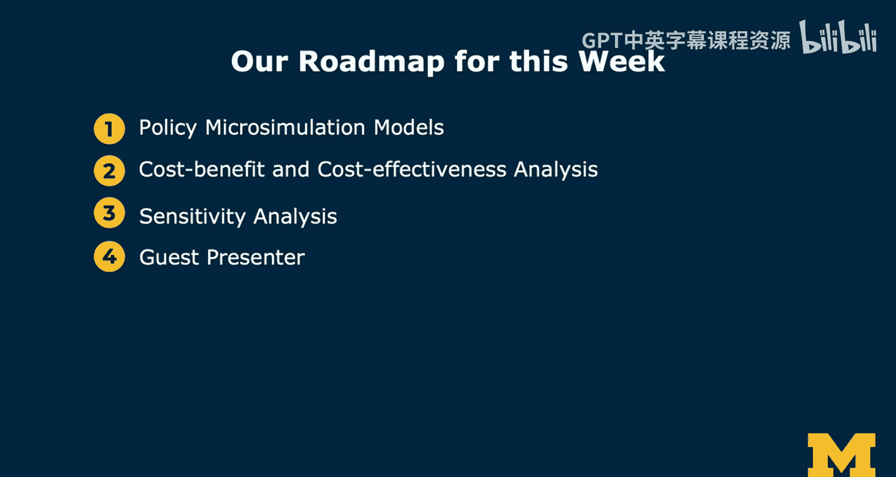
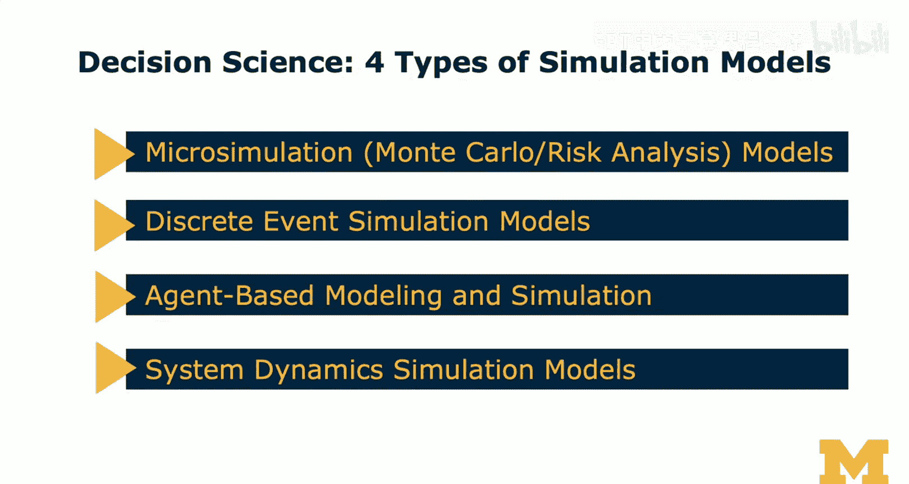
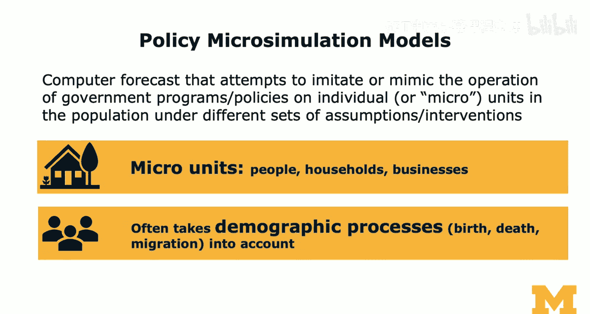
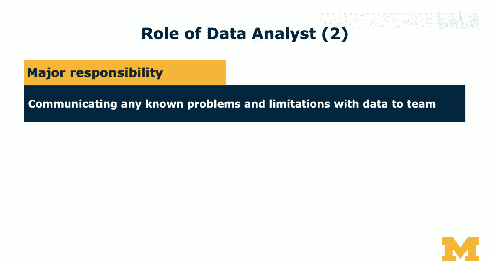
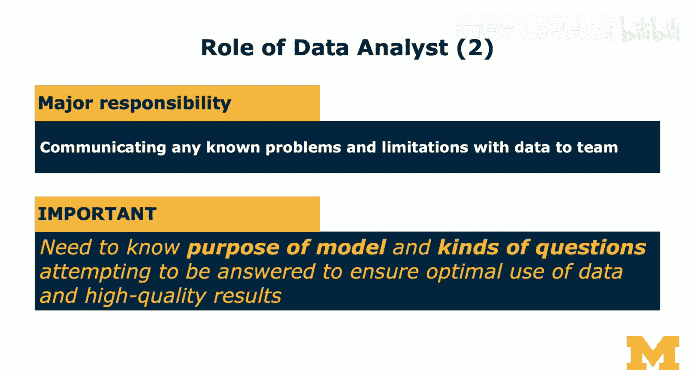
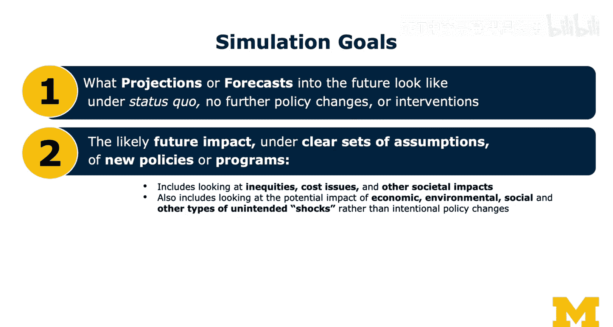

# 密歇根大学《公共部门的R数据分析（基础、数据探索、决策支持、）｜Data Analytics in the Public Sector with R》中英字幕 p94 15_政策仿真建模导论.zh_en -BV1YZ421J7Fx_p94-

Hi， I'm Professor Paula Lance and today we're going to be talking about policy simulation modeling so our roadmap for this discussion is first I'll talk a little bit about what our policy microsimulation models I will define a couple important terms in these kinds of models cost benefit and cost effectiveness analysis also talk about sensitivity analysis and then later on after I'm finished you'll have the pleasure of learning from Profesor David Mendez about a microsimulation model that he's developed just as a reminder we've talked a little bit about this already policy simulation models are a type of prospective policy analysis and this is a kind of policy analysis where we attempt to forecast or predict specific outcomes or conditions in the future usually under status quo conditions what would the future look like under the current policy regime and then what might that future look like under one or more policy changes policy simulation。

Models are pretty technical endeavors and they involve a lot of kinds of programming analysis and many。

 many different types of data in decision science， there are four general types of simulation models micro simulationim sometimes called Monte Carlo or risk analysis model。

 Also there's a discrete event simulation models， agentbased modeling and simulation and also system dynamics simulation models。

 What we're going to really focus on is micro simulationim models because these are the ones that are used primarily in policy analysis。

 So what is a micro simulationim model。 It's a computer generated forecast that attempts to imitate or mimic the operation of government programs or policies on individual or micro units in a population under different sets of assumptions and different kinds of policy interventions by microun。

 we mean people mostly， but also we can do this kind of simulation model to。

Look at what the effects of policy changes might be on households。

 businesses or other smallle kinds of organizations Now these policy microsimulation models are mostly designed to look at what the effect of policy change might be but they always often it says on the slide but almost always take demographic processes like the ones we've talked about birth。

 death and migration into account as well the role of the data analyst in this kind of policy simulation modeling is really important。

 first of all， you're going to be the member of a team because again。

 this is a pretty technical endeavor and so they'll be people with a lot of different kinds of training involved with developing and then using a microsimulation model but a data analyst as a member of this team could have a number of different roles first of all。

 identifying data sources where might the data come from that's going to be used as inputs into the model Also cleaning that data and then。

Some reccoding of the data and managing the data is a big part of the project and data analysts really get involved with that and then also when there's some results。

 creating data visualizations of the results is going to be very important the major responsibility of a data analyst however is communicating any known problems or limitations with the data to the team often you're going to be the one who knows the ins and outs and the strengths and also the limitations and problems with the data that the microsimulation team wants to use so that's an important role and also to do that you need to know the purpose of the model and the kinds of questions that the model is attempting to answer so you can help ensure the optimal use of data and that the model producing high quality results the things you're going to need to know are what are the goals of the simulation and that can be under the heading of what projections or。

Forecasts into the future look like under status quo or no further policy changes or different kinds of interventions I mean really what we're trying to design here is a crystal ball that's going to help decision makers predict what the future might look like you also need to know as a member of the team what the assumptions are that are going to go into the model so we can try to predict what the future impact of new policies or programs are going to be these assumptions include not only what might be the effectiveness of a policy change。

 but also we want to look at the differential effectiveness in terms of creating new or exacerbating existing inequities there's going to be cost issues that people want to look at and other kinds of societal impacts Also these microsimulation models often are used to look at the potential impact not only of policy changes but other kinds of shocks we might say。

Economic shocks like a recession or rising inflation there could be environmental shocks like a natural disaster of some sort other kinds of social shocks rather than intentional policy changes so models can be used to predict these kinds of things as well so I've just gone over at a very high level some of the basics of policy microsimulation models in the important role of the data analyst let's jump into a few examples。

