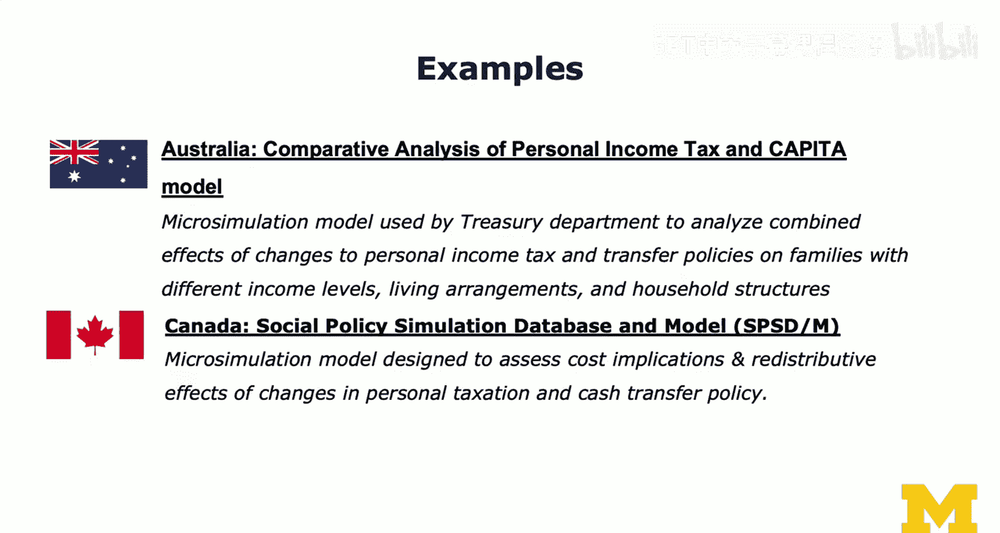
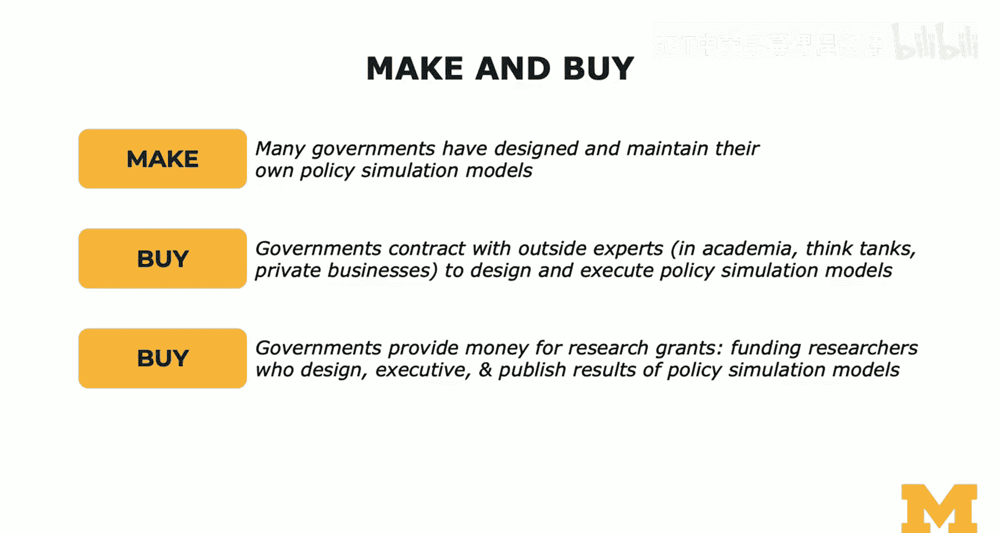
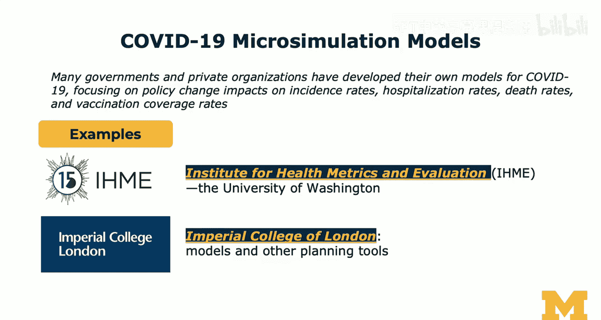

# 密歇根大学《公共部门的R数据分析（基础、数据探索、决策支持、）｜Data Analytics in the Public Sector with R》中英字幕 p95 16_政策仿真模型典型案例.zh_en -BV1YZ421J7Fx_p95-

Welcome back Let's go through some quick examples of some policy simulation models that are used by government so a lot of governments。

 pretty much every federal government has a number of different policy microsimulation models that help them think about what does the future look like for our pension systems for our public health care systems also these micros simulationimulation models are designed to look at what might be the impact of changes in the income tax policies how might that affect families and households and also businesses one great example of this and you can go online and look at it and even do some analyses yourself is Australia's capita model or the comparative analysis of personal income tax this is a microsimulation model used by the Australian Treasury department to analyze singular but also the combined effects of changes to the personal income tax？

Structure income transfer policies， these impacts on families at varying income levels and varying in living arrangements and household structures similar examples in Canadaada。

 they have something called the social policy simulation database and model again this is a micros simulationim model that's designed to look at what the cost implications and also the redistributive effects of changes in personal taxation and also cash transfer policies would be on the citizens of can Now I want to remind you when we talked about the different policy levers remember when I talked about governments always have a decision to make or buy policy simulation models are things that governments both make themselves so many governments have designed in house and maintain their own policy simulation models staff within the government is has been involved with this from the beginning to the end Also however。

 many governments will。

Through government contracts and also through research grants。

 outside expertise to develop policy simulation models that they in turn can use so sometimes governments contract with outside experts。

 including in academia in think tanks also in private businesses to design and then execute for them policy simulation models and then governments do。

 as I mentioned， provide money to researchers who have their own ideas for different kinds of policy simulation models。

 provide them resources to design， execute and then publish the results of these policy simulation models for the broader public Now with COVID-19。

 we saw the emergence of a number of different kinds of policy microsim models， many governments。

 but along with many private organizations and academic researchers develop their own models for COVID-19。

These were designed to forecast what do we think the future looks like in terms of incidence rates。

 hospitalization rates， death rates， vaccination coverage rates。

 all the important outcome metrics that we have in a pandemic so the models focus on the forecasting these things but also under assumptions about what the impact of different policy changes might be now just think about all the different things that go into these kinds of policy simulation models and you can see this in great detail you can go to the websites of both the Institute for Health metrics and evaluation and also the Imperial College of London and see their models how they were designed and all the information that goes into them and also you can do play around with the data a little bit yourself and do some of your own forecasts so with these COVd-19 microsim models or many of the other models that are out there you can go in and look。

At them and I'd love for you to take a moment to look at all the different kinds of data that goes into these models for the Covid19 models。

 it includes all kinds of things about the population， age structure about current。

Rates from other causes of death than just COVID-19 about where healthcare facilities are。

 laboratory testing， capabilities， there are many， many things that go into these models and when you go in and start looking at them in detail you will see how important the role of data that's coming from many。

 many different sources is to the creation and execution of these models。

