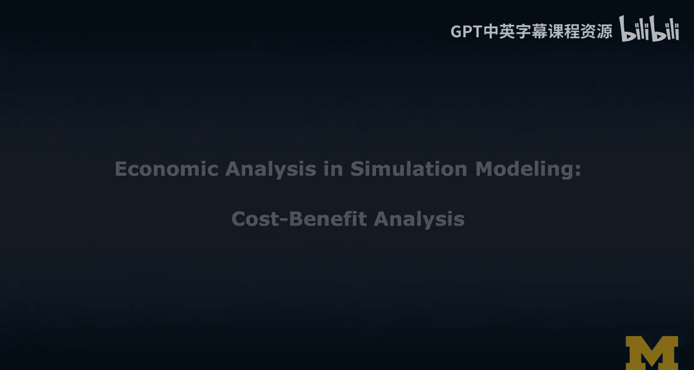
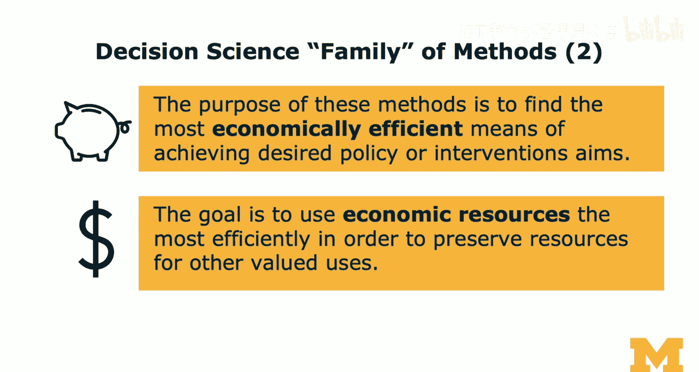
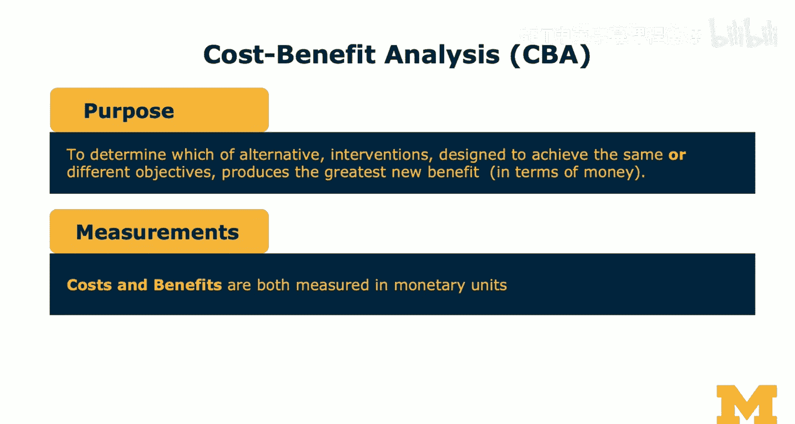
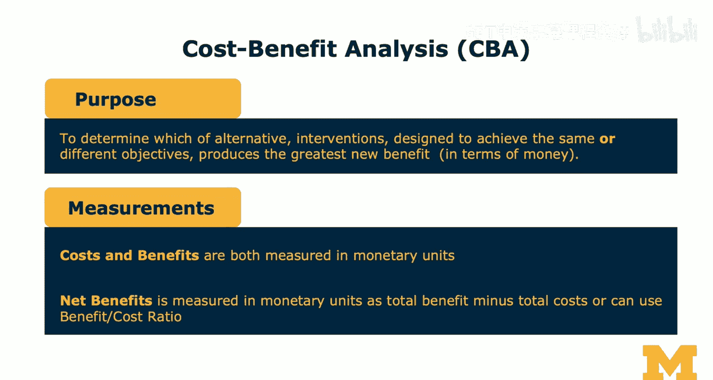
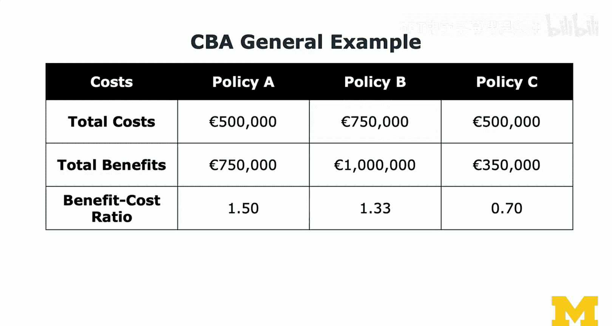

# 密歇根大学《公共部门的R数据分析（基础、数据探索、决策支持、）｜Data Analytics in the Public Sector with R》中英字幕 p96 17_仿真建模中的经济分析：成本效益评估.zh_en -BV1YZ421J7Fx_p96-

Since a lot of policy simulation modeling considers costs in the analysis。

 let's take a quick tour around economic analysis in simulation modeling now lots of these models look at a variety of outcomes。

 but it also includes considering issues related to money or costs now remember our four core principles of public administration。

 economy， efficiency， effectiveness and equity， cost metrics actually address all four of these principles。

 not just economy and efficiency and often at the same time。

 the consideration of cost in different kinds of analysis is used both in prospective policy analysis like we're talking about with microsimulation modeling。

 but also in retrospective policy evaluation like program evaluation now in decision science there's a family of methods that are used to consider costs in relation to different kinds of interventions。

Includes cost benefit analysis， cost effectiveness analysis。

 distributional cost effectiveness analysis and costut analysis Today we're going to talk about cost benefit and cost effectiveness analysis because these two methods are the ones that are used the most often in microsimulation modeling Now the purpose of these methods is really to help decision makers find the most economically efficient means of achieving desired policy or intervention aims and the goal overall is to use economic resources the most efficient in order to preserve resources for other valued uses Now a more blunt way of saying this is that in the public sector there is never enough money to go around we are working under constrained and scarce resources so we always do want to help decision makers think about how they can stretch the money as far as it can go and get the most out of。

Money that's expended for different purposes All right。

 let's start with cost benefit analysis The purpose of this kind of analysis CBA is to determine which of a set of alternative interventions designed to achieve the same or even perhaps different objectives produce the greatest net benefit in terms of money now in cost benefit analysis this is important both the cost and the benefit are measured in monetary units in CBA everything comes down to money and the end result of doing a cost benefit analysis is really to find out what is the net benefit of a different intervention or policy again it's measured in monetary units and defined as as a measure the total benefit in money minus the total cost for the interventions and this can also be expressed as a benefit cost ratio Let's look at some examples and these are hypothettic。

Examples what I really just want you to focus on here is the sort of easy math involved but let's say we have a set of policies that could be implemented to tackle a specific social problem Policy A costs 500。

000 euros It's estimated all of its costs the benefits of policy A at the societal level are determined to reap benefit of 750。

000s so the benefits in terms of the monetary unit here euro is perceived to be greater than the cost of the intervention over a specific time horizon that has to be established in the analysis and in this case the benefit cost ratio is 1。

50 so for every euro expended we would expect to see a euro 50 back in terms of benefit Policy B now that costs a little bit more to implement at 750。

000s。we're expecting the benefit again it's very technical how benefits and even costs are determined。

 but again the point here is to say that at the end of that technical analysis it was determined that the benefits would add up to in terms of money 1 million euros Now this policy then has a benefit cost ratio of 1。

33 for every euro expended we can expect a return of 1。33 Now policy C is one that would cost 500。

000 euros to implement and in this case with this policy the benefits are estimated to accrue to the level of 350。

000s so it's going to cost more to implement this policy and relative to the benefit that we would see from it and this has a benefit cost ratio of less than one and that's not good that means it's going to cost more than what we would see in return。

