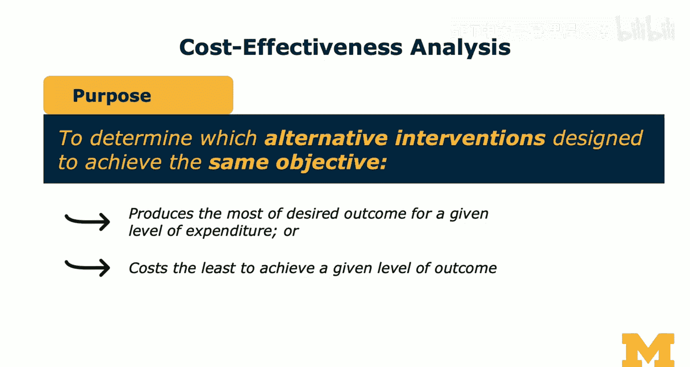
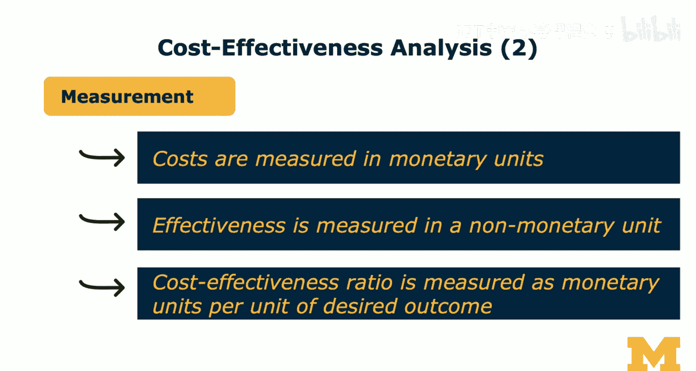
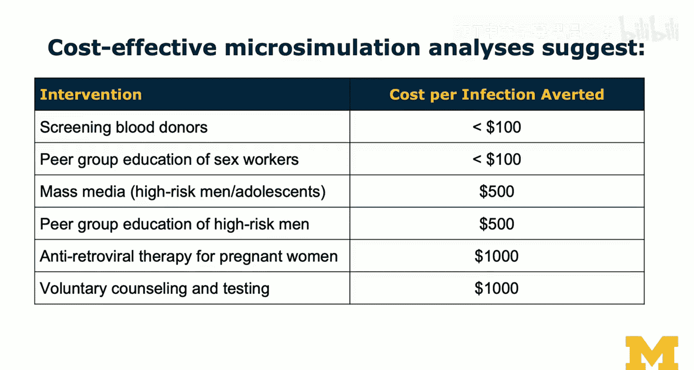
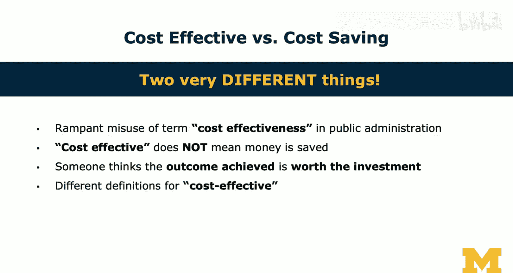

# 密歇根大学《公共部门的R数据分析（基础、数据探索、决策支持、）｜Data Analytics in the Public Sector with R》中英字幕 p97 18_仿真建模中的经济分析：成本效果评估.zh_en -BV1YZ421J7Fx_p97-

All right， let's move on to cost effectiveness analysis has a similar but a little bit different purpose。

 The purpose of CA is to determine which alternative set of interventions designed to achieve the same objective produces the most of that desired outcome or objective for a given level of expenditure or a little bit different costs the least to achieve a given level of outcome couple of different ways to look at it。

 but both come under the heading of cost effectiveness analysis and the important thing here in Ca is that costs are measured in monetary units。

 how much does it cost to implement a certain policy or intervention but in this case。

 effectiveness is measured in a nonmonetary unit that's different from cost benefit analysis where everything comes down to the money here。

 effectiveness is measured in a different way in a nonmonetary unit。

Cost effectiveness in this case， is measured as a ratio of the monetary units that have to be expended per the unit of a desired outcome。

 So sometimes using American currency I talk about this as what's our bang for the buck How much does you know how much are we getting for every dollar or buck expended and you can convert that to your own level of currency。

 but again， it's like how much for a level of money we're spending are we getting in terms of a desired outcome。

Let's do an example of this so in here let's go back to the really important and ongoing problem of very high rates of HIV and AIDS in subshara Africa and in Chad where we're going to focus on some modeling results at the time that this work was done the HIV prevalence rate in Chad was 9% of adults were living with HIV or AIDS so a microsimulation policy model was designed and looked at the cost effectiveness of a number of different interventions that are using very different policy lovers。

 but they're all designed to try to reduce the incidence of HIV and then the prevalence of HIV in the Chad population and so I'm sparing you the details of the model。

 but what the model found was that the cost per HIV infection averted and that's the measure of。

Infectiveness here so how much does it cost for these different interventions to prevent a single case of HIV and so going through the table you see that the intervention of screening blood donors so people who want to donate blood for whether or not they have HIV that detects some cases of HIV that costs 100 everything was converted to U dollars for the sake of this analysis it costs less than $100 per HIV infection prevented or averted doing peer group education of sex workers also comes in at costing less than $100 per case of HIV prevented mass media campaigns aimed at high risk men or adolescents was estimated to cost $500 per HIV infection prevented peer group education of high- risk men a little bit different intervention using different ways。

Rereaching people came in at about the same level implementing antiretroviral therapy for pregnant women。

 so here we have a medical intervention that was estimated to cost 1000 per case of HIV prevented and then voluntary HIV counseling and testing was $1000 per HIV case prevented。

 I'll tell you all of these cost effectiveness results are ones that we would say these interventions are very cost effective。

 they don't cost that much for a very valued outcome which is preventing HIV infection and another point to take away from this is that policy decision makers aren't going to look at this list and pick one they might say hey。

 these are all good things to do and they all。

Are things that we would call cost effective and so we should consider doing all of these things again。

 tackling a complex problem involves policy intervention at multiple levels and through multiple levers。

 All right， so let's talk about cost effective versus cost saving。

 there is rampant confusion in the policy world about these two different terms and it's really important that you understand the difference。

 they're very different things。 cost effective does not mean that money is saved cost if we say an intervention is cost effective。

 what we're really saying is that someone thinks the outcome being achieved is worth the investment。

 the cost investment。 okay so again， if something is cost effective it really means that someone thinks that the amount of money that it takes to achieve a certain outcome is worth it。

Cost saving is a little more straightforward because defining something that's cost effective really values。

And judgment comes into that。 Cost saving is much simpler。 Cost saving means that。

An intervention saves more money than it costs。 So if you want to say something that is cost saving。

 you really need to make sure that actually what we're getting for that intervention in terms of its impact on money expenditures。

Is actually more than what it costs to implement the intervention。

