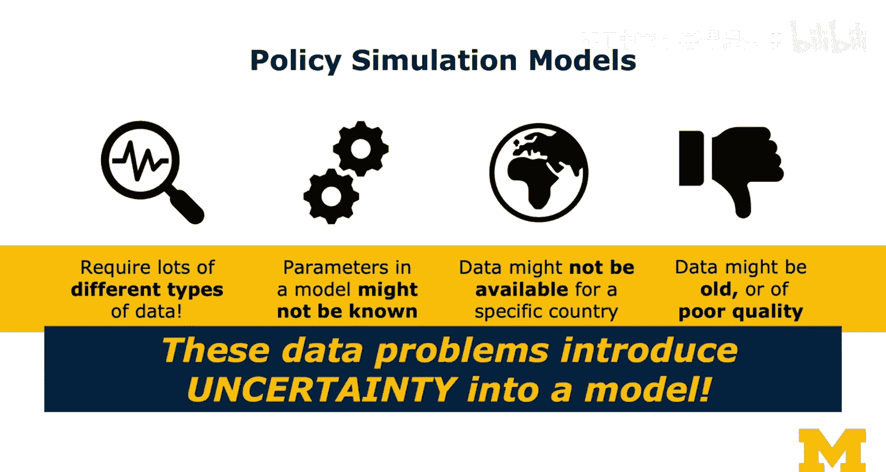
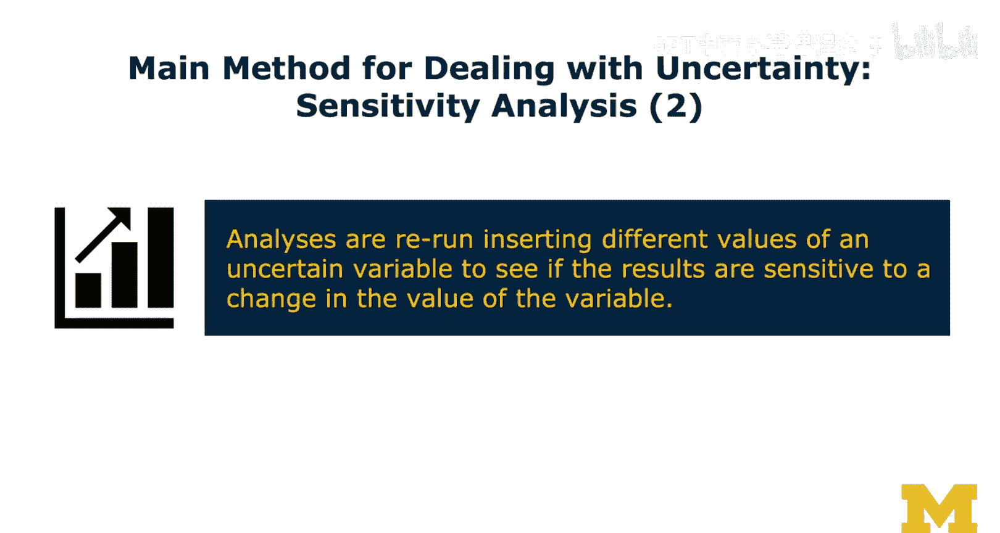
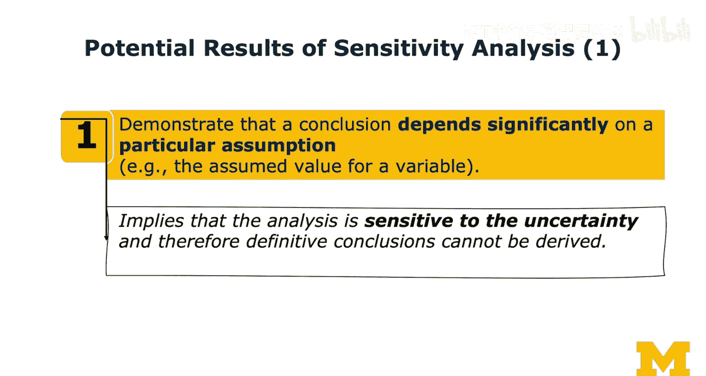
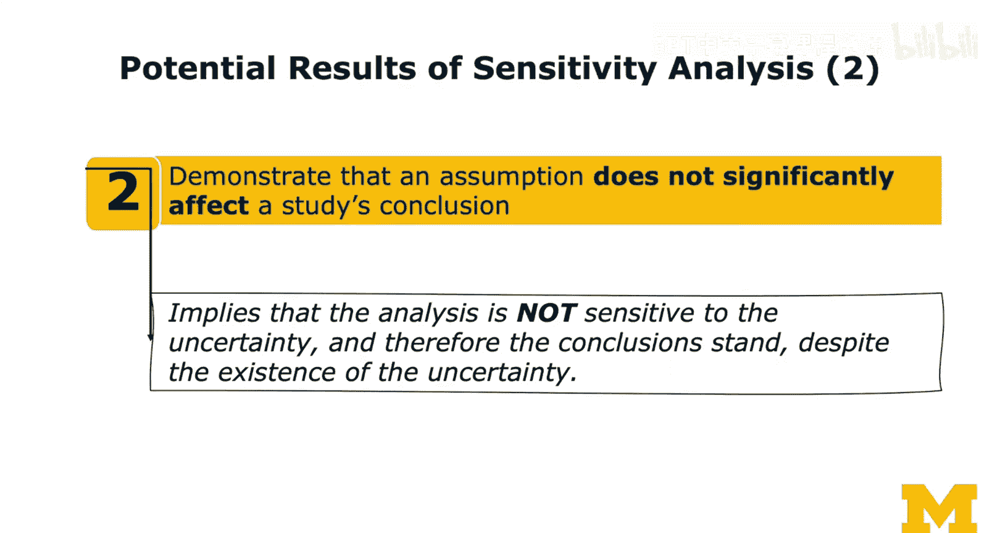
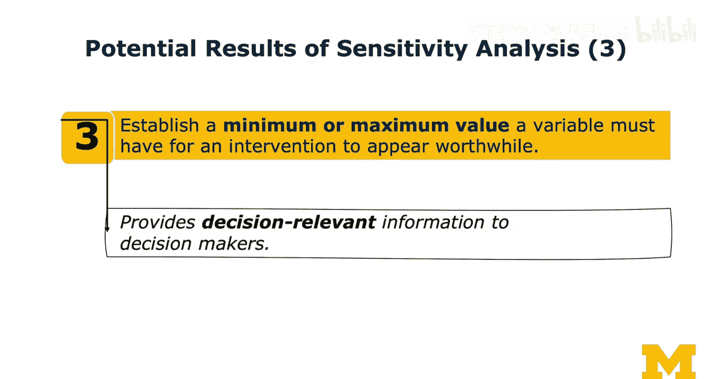
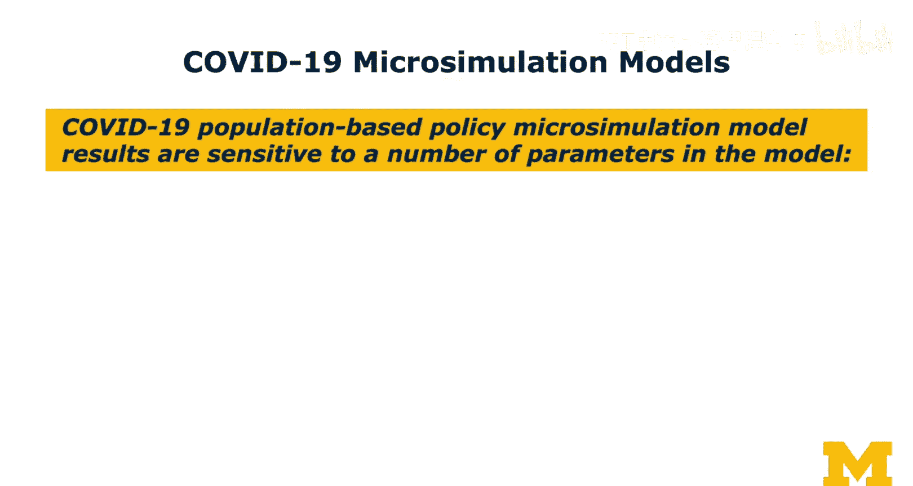
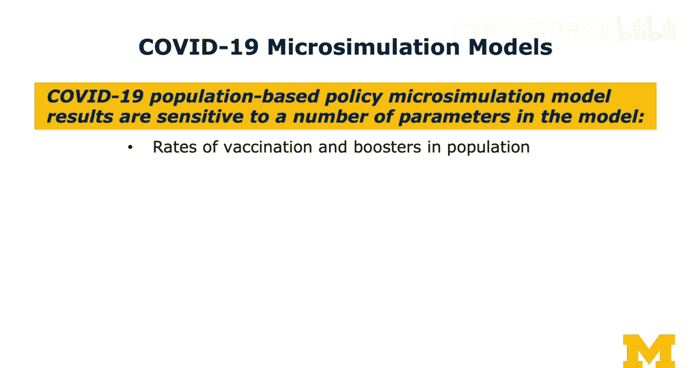
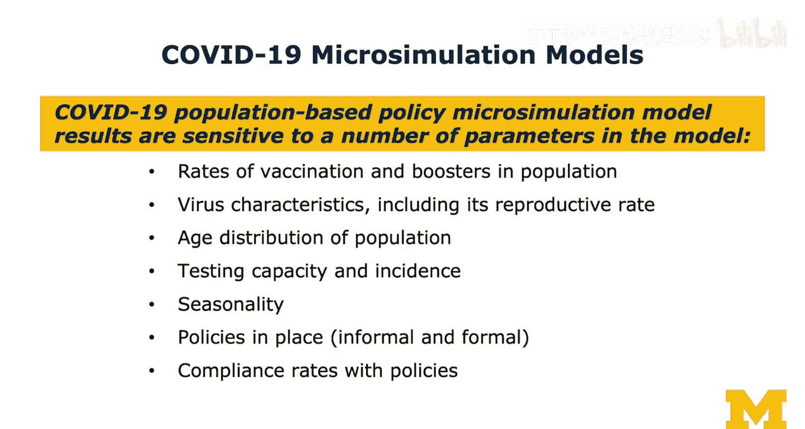

# 密歇根大学《公共部门的R数据分析（基础、数据探索、决策支持、）｜Data Analytics in the Public Sector with R》中英字幕 p98 19_不确定性处理：敏感性分析方法.zh_en -BV1YZ421J7Fx_p98-

Welcome back。In our discussion of policy micros simulationimulation modeling。

 there's one more thing we have to talk about， and that's the role of uncertainty。

In this big endeavor and how analysts deal with that and that's through something called sensitivity analysis Now policy microsimulation models require lots of different types of data however what we call the parameters or the variables and these models in some cases might not be known or the data might not be available for the country you're in might be available for other countries but not your country or the data might be old or of a poor quality。

 so all these problems with data introduce uncertainty into our models and the main method that policy simulators use for dealing with uncertainty is called sensitivity analysis sensitivity analysis is a test of whether uncertainty about the value of a single variable or a set of variables significantly influences the conclusions of an analysis。

And so when we do sensitivity analysis， simply what's happening is that analyses are rerun。

 inserting different values of an uncertain variable into the model to see if the results differ or if they're sensitive to a change in the value of the variable now what happens when you run sensitivity analysis there's a set of things that you will find out when you run sensitivity analysis first of all。

 it could demonstrate that a conclusion of your model depends significantly on a particular assumption or an assumed value for a variable so again we might have some data we're just not sure about it's not of high quality or in some cases we're not sure about the level of effectiveness of an intervention in different subpopulations and so we can run sensitivity analysis and use different values for that variable and we might find that the results are real。

Sensitive to this uncertainty and that also then means unfortunately that definitive conclusions can't be derived from our model。

 we have too much uncertainty and we just don't know what the results are because the model results are sensitive to that uncertainty Now another potential result of a sensitivity analysis is that it could demonstrate that an assumption does not significantly affect a study's conclusion and this then in turn implies that our analysis is not sensitive to this uncertainty again。

 we have data quality issues missing parameters missing variables we have to make assumptions to put them into the model but if we run the sensitivity analysis and it doesn't seem that the results really change then our conclusions can stand despite the existence of this uncertainty The models not sensitive to the data and the variables of which we're not。

Sure， and we've put in a range of values for them， but the model results end up being similar Now another way in which sensitivity analysis is used is that as analyst we can establish a minimum or maximum value that a variable must have for an intervention to appear worthwhile again we can see well we're uncertain about a certain variable let's put in the minimum value that we think it would be and we could put in the maximum value to see what it would be and then we could sort of figure out well where in between those would that value have to be to make an intervention appear worthwhile and again all of this is to provide decision makers with relevant information for their task at hand we can't you know these models are not crystal balls that work perfectly we have limits in our data but under different sets of assumptions and again in this。

Case about a minimum or a maximum value。Decision makers can know what you know things really need to look like in order for a policy path to be undertaken let's go back and think about the COVd-19 microsimulation models that were designed very quickly or in great use all over the world right now it is the case that these populationbased policy microsimulation model results are sensitive to a number of the parameters or variables in the model there's all kinds of things some of which you know as time goes on we're getting better information on but also there's things and the viruses changing that we just don't know and so these microsimulation models are used to do a lot of sensitivity analysis and looking at well what is the impact of these things on the outcomes we're trying to predict so rates of vaccination and boosters in populations what those rates are matters a lot。

For what the model outcomes are so sensitivity analysis around these rates is being done and also in some cases that lets decision makers know and the public know well if we had very high rates of vaccination and booster shots in a population how much more might the virus be under control than the rates we're seeing right now So another important characteristic in Cod-19 microsimulation models is the reproductive rate of the virus that's how transmissible it is and that's changing with different mutations of the virus these models results the results are very sensitive to assumptions about the reproductive rate of the covid-19 virus but that's good information to know and it's also good to know that if newer mutations of it new variants of it are more transmissible what that might mean for future outbreaks again there's so many other important variable？

in the CoVId-19 microsimulation models， and the point here is just that all these things matter for how well we might predict what the future looks like。

 including under different kinds of policies that are in place and also compliance rates with those policies。

