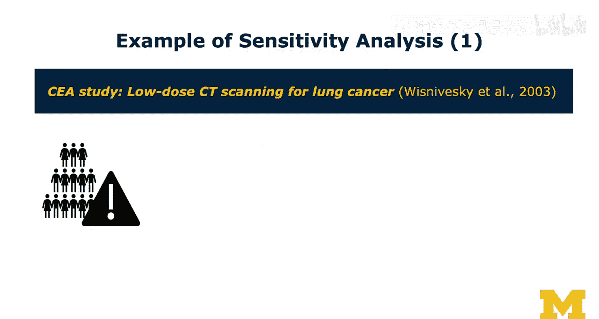
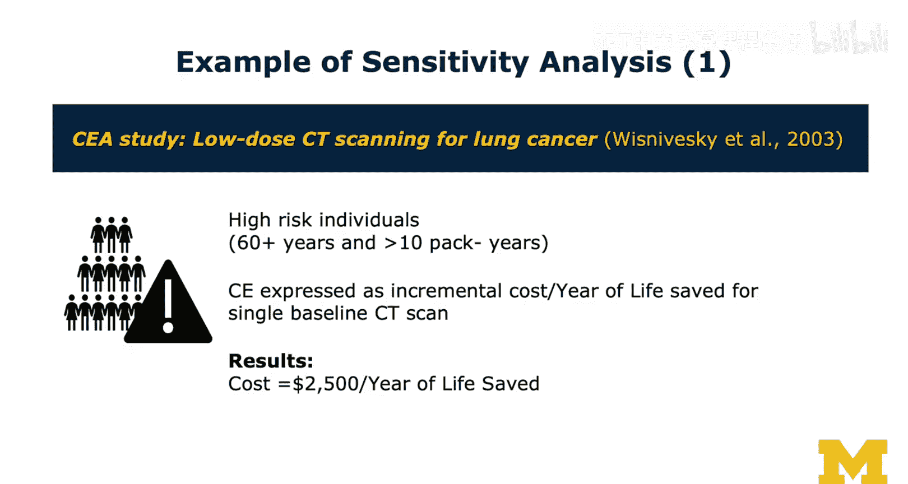
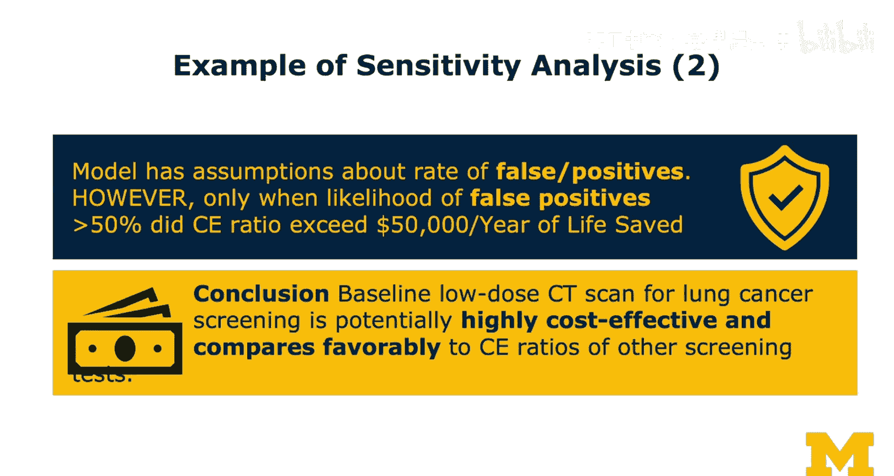
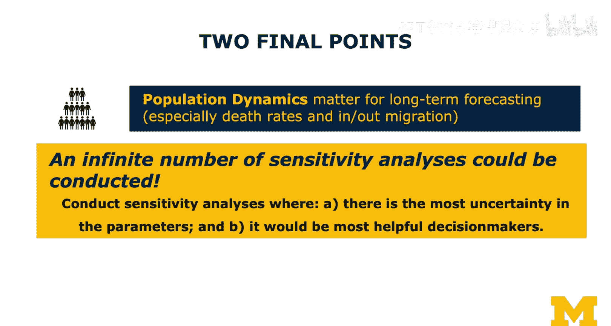

# 密歇根大学《公共部门的R数据分析（基础、数据探索、决策支持、）｜Data Analytics in the Public Sector with R》中英字幕 p99 20_不确定性敏感性分析实例演示.zh_en -BV1YZ421J7Fx_p99-

Let me give you one more example of how sensitivity analysis is used in policy microsimulation modeling and here we have a cost effectiveness study of the use of low dose CT scanning for lung cancer now there's lots of different kinds of cancer screening tests and the purpose of all of them is to try to detect a cancer at an earlier stage so that treatment options have much more chance for success so other examples of cancer screening are colorectal cancer screening。

 mammography and p test screening for women and there has been talk about well smokers who are at such a high risk for getting lung cancer。

 what if they underwent low dose scanning using CT technology of their lungs for early stage breast cancer。

 how might that impact early diagnosis and then。

Higher rates of survival for people who get tobacco inducedd lung cancer so this study looked at microsimulation model looked at high risk individuals。

 smokers who were age 60 and older and had on average what we call greater than 10 pack years of smoking so it means that they smoked on average a pack a day for at least 10 years and the study found that cost effectiveness expressed as the cost the cost of doing the CT scan per year of life saved for a single baseline CT scan was 2500 per year of life saved is that cost effective well that is very cost effective given other kinds of medical technology as I believe I mentioned to you another day medical interventions often cost up to 100。

000 per year of life saved and are still deemed as being cost effect。

We think it's okay to spend money to extend people's lives So the overall results of this microsimulation model are pretty positive However the model makes a lot of assumptions about lots of different things and this also includes an assumption about well what's the rate of false positive CT scans going to be and that means well if you have a CT scan that has a positive result then that person needs to go and have very expensive additional testing done to see if they actually do have cancer and so the false positive rate is going to add to the cost of it and if many of those positive CT scans turn out to be false for cancer that's going to change perhaps the metric of cost effectiveness and so the designers of this microsimulation model did some sensitivity analysis around the rate of false positives and they。

foundund that you could go all the way up to 50% of the tests， created a false positive test result。

 But even in under that scenario， the cost effectiveness ratio did not exceed $50000 cost per year of life saved and that still is considered cost effective。

 So this is an example of when cost effectiveness analysis is used to see， well， what。

We're not sure about this parameter in the model， but even under an assumption where it's pretty high and we don't think it's anywhere near that high in the real world we still can come out with include the conclusion that CT scanning for people at high risk for lung cancer is a cost effectiveff sort of intervention right I want to make two final highleve points about sensitivity analysis and microsimulation models first always remember that population dynamics matter for long-term forecasting so your microsimulation model always has to include all those population dynamics。

 especially death rates and in and out migration from populations in the forecasting and also in regard to sensitivity analysis。

 if you just think about it really an infinite number of sensitivity analysis could be conducted in any microsimulation model。

Have some uncertainty about all the data， all the variables and all the parameters that go into the model so the advice is really you conduct sensitivity analysis where there really is the most uncertainty in the parameters。

 but also where it would be the most helpful to decision makers because in the end these are tools that are being used to help allocate resources and think about policy reform and change。

