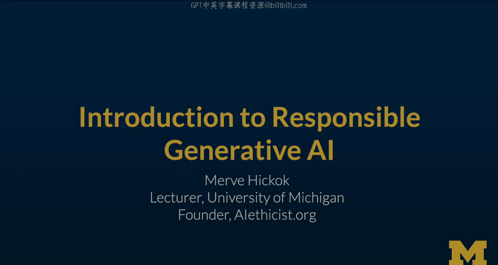
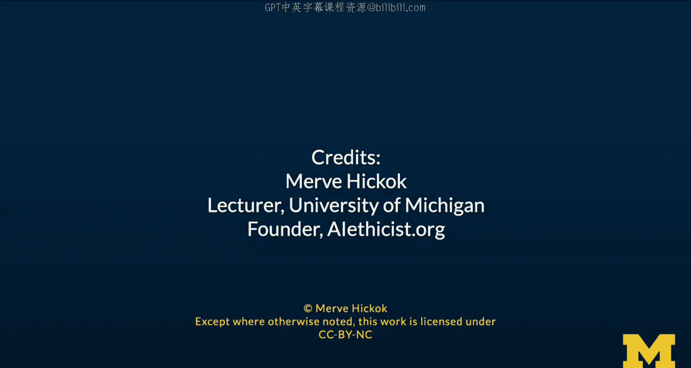

# 负责任生成式人工智能：01：导论 🧭

在本课程中，我们将开启负责任生成式人工智能系列课程的学习。我们将了解生成式人工智能的基本概念、其重要性，以及为何需要以负责任的态度来开发和使用它。

欢迎来到负责任生成式人工智能四门系列课程的第一门。我很荣幸能参与你的学习旅程，帮助你建立必要的知识和技能，以负责任地开发、使用和管理生成式人工智能系统。

生成式人工智能技术能为企业和个人带来许多可能性和机遇。但这些系统也可能对商业、社会、环境和未来工作产生重大影响。如此具有影响力的技术，要求我们采取负责任的方法，并具备批判性分析其影响的能力，以便做出明智的决策，从而取得最佳成果。

在技术、应用场景和治理方法快速变化的背景下，我希望能为决策者、开发者和最终用户带来基础性的知识。

我叫玛丽·希科克，是密歇根大学的教员，在信息学院教授数据科学课程，并在密歇根数据科学研究所就负责任人工智能和数据提供建议。同时，我也是全球独立研究与教育非营利组织“人工智能与数字政策中心”的主席，在那里我参与全球人工智能政策工作，并在超过80个国家教育未来的AI政策领导者。

---

上一节我们介绍了课程和讲师的背景，本节中我们来看看本课程的核心目标与结构。

本课程旨在为你提供坚实的基础，以便你能够：

*   **理解生成式AI的基本原理**。
*   **识别其潜在的社会与商业影响**。
*   **掌握评估和管理相关风险的方法**。
*   **了解当前的政策框架与治理趋势**。

通过本课程的学习，你将能够更自信、更负责任地参与到生成式人工智能的生态系统中。

---

在本节课中，我们一起学习了负责任生成式人工智能课程的导论部分，明确了学习目标，并认识了讲师。我们了解到，生成式AI是一把双刃剑，既充满机遇也伴随重大影响，因此必须以审慎和负责任的态度对待。在接下来的课程中，我们将深入探讨其技术基础、影响评估及治理策略。