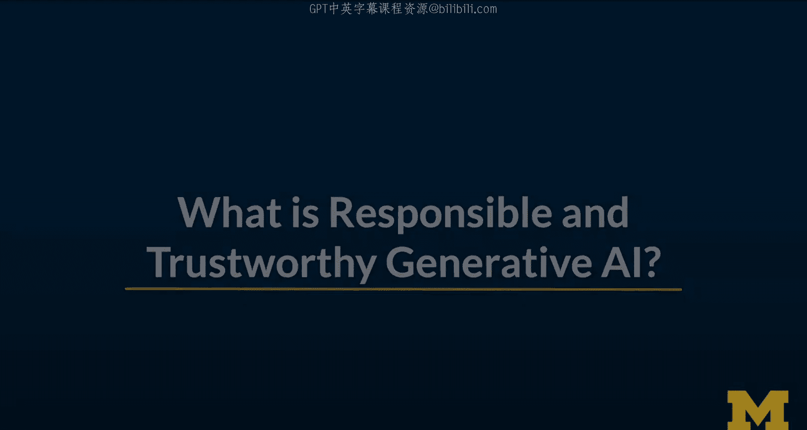
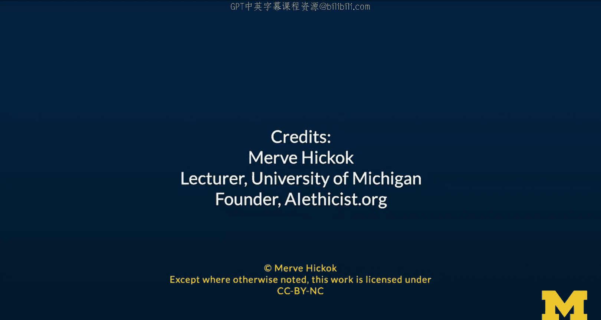

# 2：何为负责任可信生成式AI 🤔

在本节课中，我们将要学习什么是负责任且可信的生成式人工智能。我们将探讨生成式AI的基本概念、其带来的机遇与挑战，并理解为何需要以负责任的方式开发和部署这项技术。

---

2022年，数百万人接触到了生成式AI产品。这些产品承诺将更好地变革各行各业，并为主流用户提供创新工具。

在此之前，AI系统主要是预测式AI。这类系统专注于分析数据集，以完成分类、识别、预测、推荐等任务。

相比之下，生成式AI系统则分析底层模式和数据，允许用户基于文本、图像、音频、视频、代码或这些模态的组合来创造新内容。

用户可以创造的内容几乎是无限的，并且每周都有许多新的用例被引入。

生成式AI的普及得益于一个事实：你只需要自然语言就能使用它。

然而，AI的开发、部署和使用也带来了许多新的挑战和问题，同时放大了现有的风险。

那么，作为个人、企业和社区，我们如何才能从这项新兴技术中受益呢？

我们需要所有人的参与。这是一个激动人心的时代，我们可能现在还不知道未来会从生成式AI中涌现出多少应用。

我们需要不同利益相关者之间的协作。我们需要在此过程中促进人类尊严、贡献于积极的社会变革，并保护环境。

这就是负责任且可信的AI，而生成式AI正是其中的一部分。我们每个人都有发言权，作为AI开发者、用户、投资者、科学家、政策制定者、公民社会成员，我们都有责任。

负责任AI意味着确保对AI技术有合理的信任。信任可以提高采用率、用例数量以及对研究的投资。

生成式AI可以带来积极的变革，但我们需要更好地理解其可能性和局限性，并相应地调整我们的关注点。

有些人可能选择专注于短期经济利益，并利用数据、劳动力和自然资源。这最终会损害这项技术，并对我们的社会和企业产生重大影响。

或者，我们可以在开发和部署系统时，考虑到多个利益相关者和社区。我们可以批判性地分析这些技术的好处和影响。

我们可以致力于建立防护栏，以对抗偏见、两极分化和恶意使用。我们可以主动为积极的社会、劳动力或教育转型做好准备。

投资于增强可及性以及公平获取。激励对公共产品的投入。优先考虑伦理和社会进步。提高数据和AI素养。并确保经济利益的公平分配。

负责任AI不是单一的一件事。它取决于你决定优先考虑和实施什么。

---

本节课中，我们一起学习了生成式AI与预测式AI的区别，认识到生成式AI的巨大潜力与伴随而来的风险。我们明确了负责任AI的核心在于建立合理信任、进行多方协作，并在技术发展中优先考虑伦理、公平与社会福祉。负责任AI是一个需要所有利益相关者共同参与和定义的持续过程。