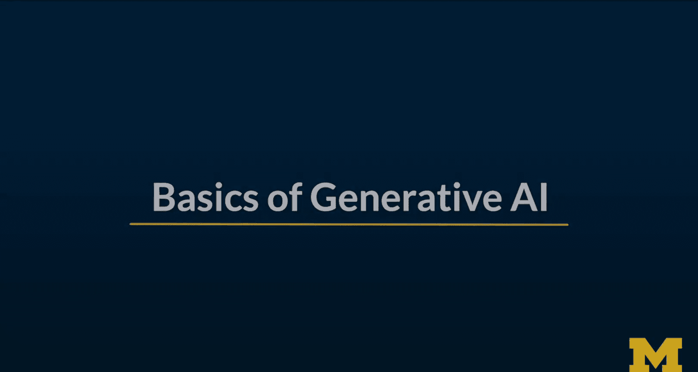
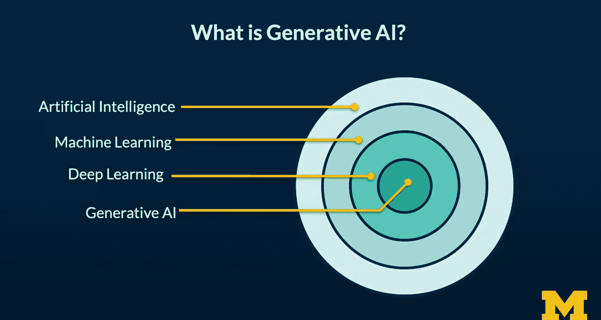
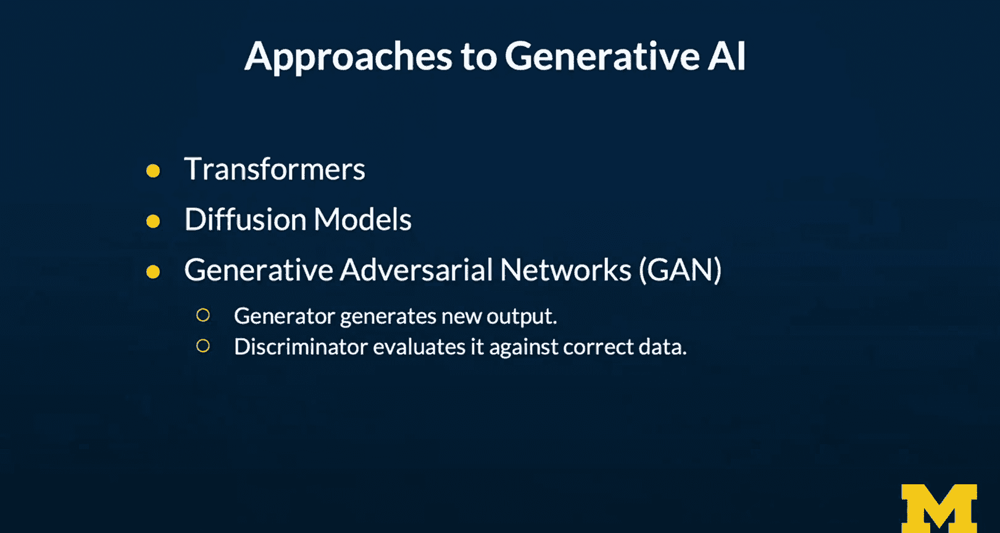
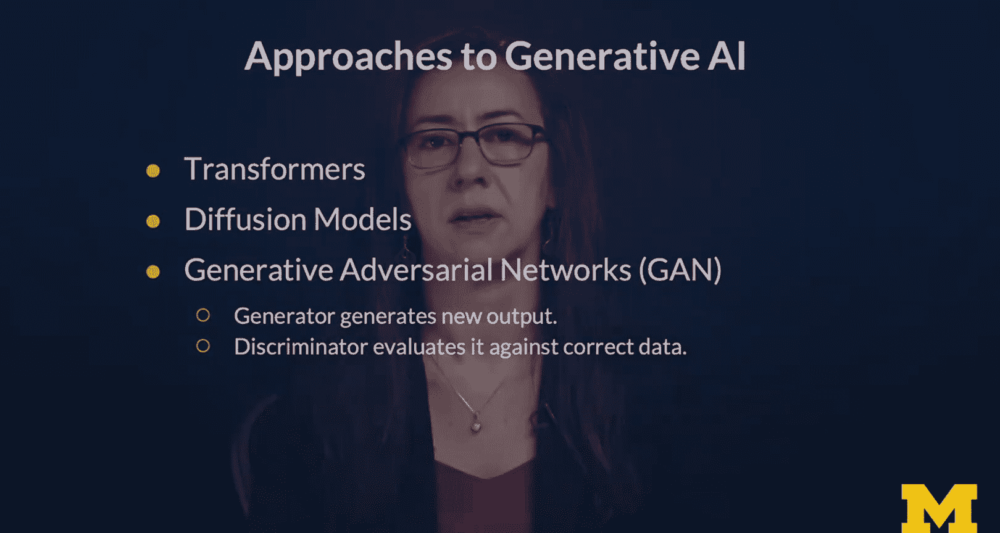
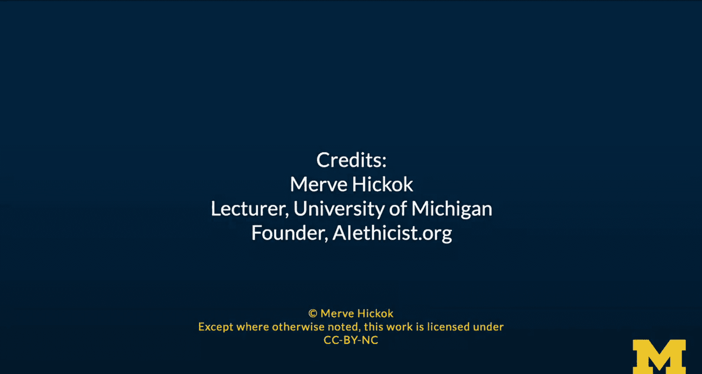

# 3：生成式AI基础原理 🧠

在本节课中，我们将要学习生成式人工智能的基础原理。我们将从人工智能的宏观概念入手，逐步深入到机器学习、深度学习，最终聚焦于生成式AI的核心工作机制。课程将解释这些系统如何学习、如何生成内容，并介绍几种关键的模型架构。

---

人工智能乃至大型语言模型并非新生事物。它们的历史可以追溯到数十年前。事实上，第一个聊天机器人由约瑟夫·魏岑鲍姆于1966年开发。然而，生成式AI系统自2022年向主流用户开放以来，才真正吸引了广泛的兴趣和关注。

这些系统允许人们无需技术知识，仅通过语言即可与之交互，这意味着社会上有更多人能够使用不同的AI产品。

## 人工智能的范畴

上一节我们回顾了AI的发展，本节中我们来看看人工智能的具体范畴。你可以将AI同时视为一个科学领域和一系列算法系统。

以下是AI领域的主要组成部分及其关系：
*   **人工智能**：最广泛的范畴，包含所有模拟人类智能的系统和研究。
*   **机器学习**：AI的一个子集，指系统能够从数据中学习，而非依赖明确的规则编程。
*   **深度学习**：机器学习的一个子集，使用**神经网络**来评估和表示数据间的复杂联系。
*   **生成式AI**：深度学习的一个子集，专注于创造新的、原创的内容。

## AI系统的类型

了解了AI的层次关系后，我们进一步看看AI系统的不同类型。AI系统可以非常简单，也可以极其复杂。

以下是几种主要的AI系统类型：
*   **基于规则的算法**：执行简单的“如果-那么”逻辑场景。
*   **算法模型**：被设计来执行特定任务。
*   **复杂系统**：输入与输出之间的关系非常复杂，难以解释或解读。

AI系统已广泛应用于我们生活的诸多领域，从招聘、保险、金融信贷决策，到房产估值、医疗诊断、天气预报、制造或关键基础设施管理。

## 机器学习与深度学习

上一节我们介绍了AI的应用，本节中我们来看看更复杂的AI方法：机器学习和深度学习。

**机器学习** 指的是系统从所使用的数据中学习，而非通过显式编程的算法模型。ML算法持续检测**模式**和关联，并调整其逻辑以产生结果。

**深度学习** 系统使用**神经网络**来评估和表示数据连接。“深度”一词指的是神经网络的**多层结构**，数据会穿过这些层并建立连接。这些神经网络可以被视为组织成层的互连节点。深度学习模型提取特征之间的连接，并将该信息传递到下一层，直至处理完成。

深度学习的有趣之处在于，它可以从**有标签**和**无标签**的数据中学习。例如，它可以使用带有标签或解释的图像数据集，这被称为**监督学习**。但这些系统也可以从**无标签**的原始内容数据集中学习，这被称为**无监督学习**。

## 什么是生成式AI？

在理解了深度学习之后，我们现在聚焦于它的一个子集：生成式AI。**生成式AI系统**在非常庞大的数据集或数据语料库上进行训练。由文本、音频、视频、图像甚至软件代码组成的数据集被用来训练生成式AI模型。

通常使用**无监督学习技术**来训练模型。换句话说，模型被提供无标签的数据，它们在没有人类明确编码的情况下自行发现模式和联系。

一个生成式AI模型从其数据集中学习单词之间现有的关系和模式。用户可以使用自然语言（如英语）要求系统创建回复或内容。响应用户的请求（称为**提示**），系统会生成文本、音频、视频或代码形式的输出。与系统交互无需技术知识。

自然语言交互使得该系统在事实信息或准确性并非主要关注点的任务中非常易于使用。然而，你仍然需要领域或技术知识来双重检查结果的准确性，特别是如果你计划根据提供的输出采取行动。

## 生成式AI的模型架构

我们已经知道生成式AI能做什么，现在来看看它是如何实现的。近十年来，深度学习模型已被用于生成越来越逼真的图像和音频。早期的系统使用**变分自编码器**。

随着近期的发展，生成式AI系统最流行的方法是**Transformer**、**扩散模型**和**生成对抗网络**。

以下是这三种核心架构的简要介绍：
*   **Transformer模型**：用于大型语言系统，用于预测序列输出中的下一个**词元**。
*   **生成对抗网络**：由两个模型组成：一个**生成器**和一个**判别器**。生成器生成新输出，判别器根据正确或真实数据进行评估。两者反复博弈，直到生成的输出与真实输出无法区分。GANs常用于生成逼真的视频、音频或“深度伪造”，也可用于创建合成表格或数据。
*   **扩散模型**：通过前向和反向的迭代过程生成图像。模型训练时，通过前向过程将图像转换为数据噪声（即系统地 dismantle 数据结构）。然后，模型将数据噪声发送回非结构化数据，以恢复其结构并创建图像。虽然计算量更大，但这个过程让开发者对结果有更多控制。

---

本节课中我们一起学习了生成式AI的基础原理。我们从人工智能的广义定义出发，梳理了机器学习、深度学习和生成式AI之间的包含关系。我们探讨了生成式AI如何利用海量数据和无监督学习进行训练，使其能够理解和生成文本、图像等内容。最后，我们介绍了实现这些能力的三种核心模型架构：Transformer、生成对抗网络和扩散模型。理解这些基础是后续探讨其负责任应用的关键。