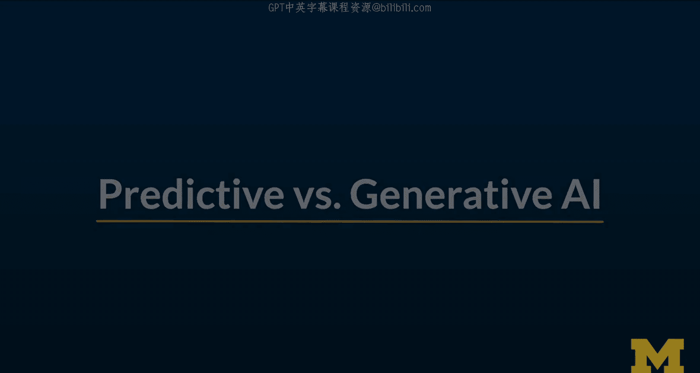
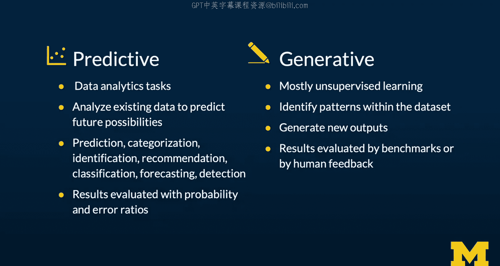
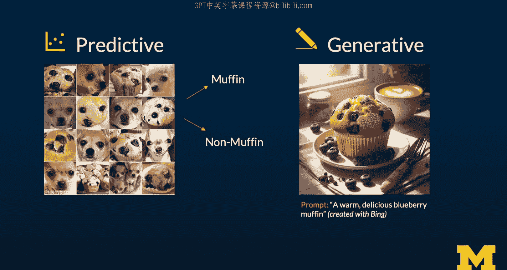

**P04：预测型AI与生成式AI对比** 🧠

在本节课中，我们将要学习预测型AI系统与生成式AI系统之间的核心区别。我们将探讨它们各自的工作原理、应用场景以及评估方式的差异。

---

预测型系统已嵌入我们当前有意或无意使用的许多应用程序中。

这些AI系统使我们能够执行数据分析任务，例如观察某个事件的过往发生情况，然后预测其再次发生的可能性。

以下是预测型系统的一些常见应用场景：
*   识别图像或视频中的物体。
*   推荐您接下来应该查看的新闻或社交媒体内容。
*   检测信用卡的异常活动等。

上一节我们介绍了预测型AI，本节中我们来看看生成式AI。

另一方面，生成式AI系统通过识别其训练数据集中的模式来创造新的输出。换句话说，这两类系统的应用场景有显著不同。它们通过海量数据集进行训练，且无需为数据片段打标签。

为了更清晰地理解，我们可以通过一个例子来对比。如果您想在图片中识别出海豚的图像，您会希望使用预测型系统。您需要用许多海豚的图片来训练该系统，其中许多图片会带有文本标签，直到系统能够正确识别图像为止。

但是，如果您想绘制一幅海豚在帆船前游泳的图画，您会希望使用生成式AI系统。

---

了解了基本区别后，我们来看看如何评估这两类系统。

预测模型的结果可以通过一系列性能指标来评估。例如，如果您向系统提供几张松饼和其他物品的图片，并询问哪些是松饼，您可以验证结果并计算准确率。

生成式AI系统输出的评估则更为复杂。对于生成式AI系统，您可能提示系统创建一张温暖、美味的蓝莓松饼图片。要评估系统生成的内容是否看起来美味，或者评估系统在图片中添加的额外元素（例如叉子、咖啡或新鲜浆果），则要困难得多。

评估可能因人而异。图像的质量以及它是否符合您的想象，这些都是主观判断。如果您使用的是语言模型，其性能可以跨任务进行评估。也许您可以评估它识别与事实、物理或化学定律等不符的错误输出的能力。或者更主观地，通过评估回答的质量以及它是否满足任务要求来判断。

目前，有许多语言基准被用来评估这些系统。这些基准可以被视为标准化框架，模型在其中接受标准语言任务的测试，例如释义或预测句子情感。

此外，生成式AI系统在生成图像或句子中的下一个词时，具有一定程度的随机性。即使使用相同的提示，结果也可能每次都有变化。因此，其结果比预测型系统的可复现性更低，也更难评估。

---

本节课中我们一起学习了预测型AI与生成式AI的关键区别。预测型AI主要用于基于现有数据进行分类、识别和预测，其输出相对确定且易于用客观指标评估。而生成式AI则专注于从数据模式中创造全新的内容，其输出具有创造性和随机性，评估更依赖于主观判断和复杂的基准测试。理解这些差异是负责任地开发和应用这两类AI技术的基础。