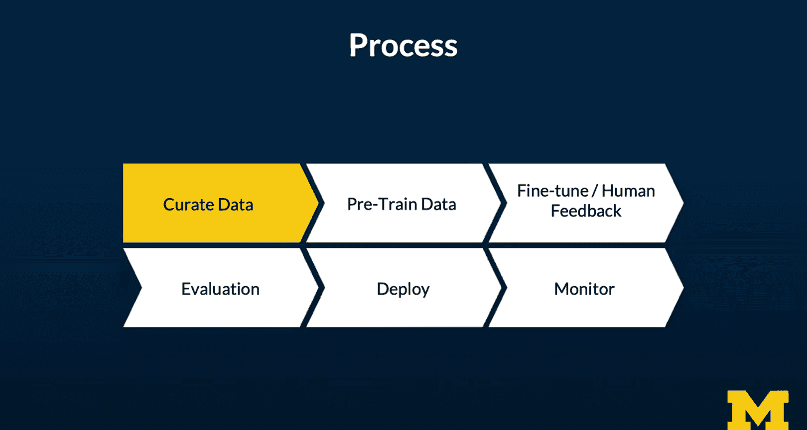
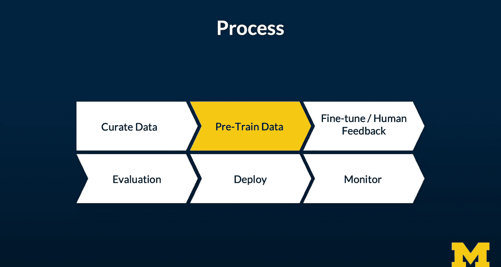
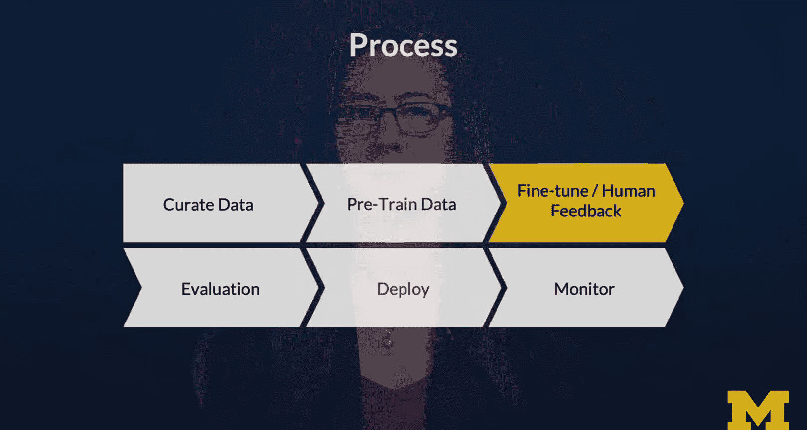
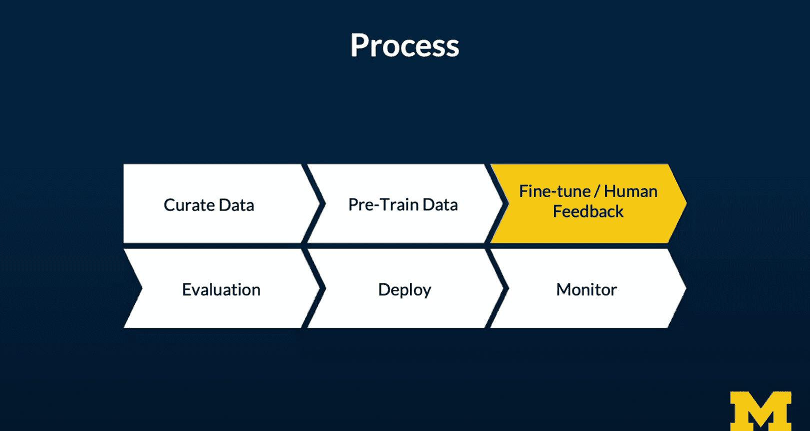
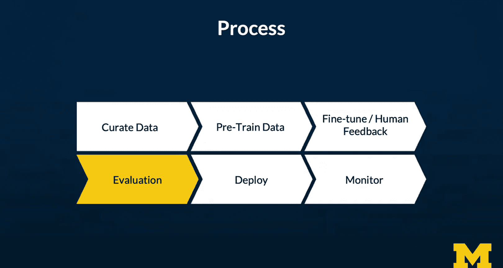
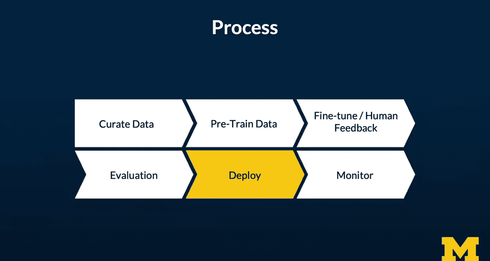
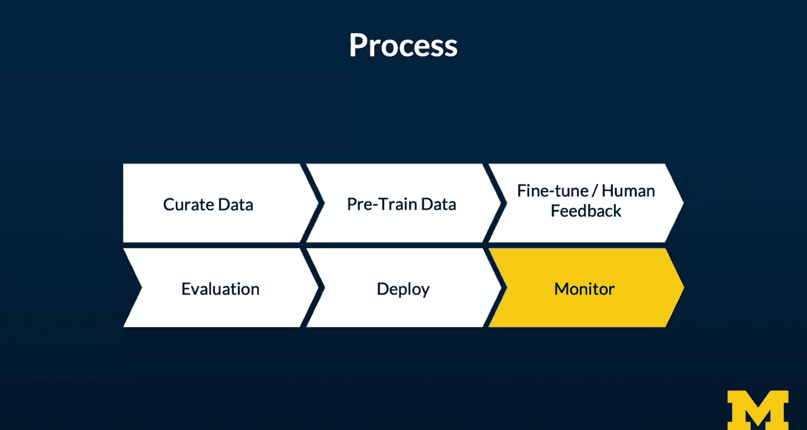

# 5：生成式AI生命周期 🧬

在本节课中，我们将要学习生成式人工智能系统的完整生命周期。我们将从模型的构建基础开始，逐步了解其训练、优化、评估和部署的各个阶段，并探讨如何在整个过程中贯彻负责任的原则。

## 模型构建与训练 🏗️

上一节我们介绍了生成式AI的基本概念，本节中我们来看看一个通用生成式AI模型是如何构建和训练的。

这些通用模型由数十亿甚至数万亿个参数构成。用公式表示，一个模型的复杂度可以表示为：
**模型复杂度 ∝ 参数数量**

根据当前可用的方法，通用生成式AI系统需要大量的计算基础设施和资源来进行训练。

### 数据收集与处理

正如之前提到的，训练生成式系统需要海量数据。当前的训练数据集代表了互联网的很大一部分。

以下是数据收集的主要来源：
*   通过爬取数百万个网站及其内容获得，包括论坛和社交媒体。
*   爬取大型资源库，如维基百科、专利申请、报纸、书籍、电影、YouTube视频和个人博客。
*   结合用于训练目的的商业数据集和专有数据集。

爬取如此大量的互联网内容意味着训练数据集中包含大量受版权保护的材料、公共信息，以及从付费墙或付费内容中收集的数据。

一旦收集完成，数据集会被压缩以提高效率。换句话说，模型编码了训练数据的一个简化版本或表示。

理想情况下，数据集应经过处理，以移除非法、危险或有毒的元素，以及私人信息。应进行质量检查，并记录数据集的来源和变更。随后，通过模型训练，神经网络学习数据集中词语之间的关系和模式。

### 模型训练与参数学习

当模型学习了这数十亿种关系后，它便能在收到提示时生成输出。在训练过程中，模型在数据点之间建立连接，并分析这些连接对其任务的强度和权重。这些学习到的变量被称为**参数**，它们包含了将输入转化为输出所必需的知识。

## 微调与优化 ⚙️

然而，系统可能仍需要进一步的改进和优化。您可能还希望减少一些有毒或危险的响应。这时，微调就派上了用场。

在微调阶段，系统会被提供一系列问题模板。当比较、纠正和调整这些响应时，会利用人类反馈来改进系统的回答。

## 评估与部署 📊

在系统部署之前，会再次进行性能评估。这些评估指标可能因系统是通用型还是基于特定任务而有所不同，也可能因系统可能应用的不同领域而异。

负责任的部署要求开发者和部署者共同确保系统是安全、可靠和值得信赖的。

### 部署前评估

部署前的影响和风险评估应在此阶段完成。已知的危害和风险应得到缓解。并且，应为那些不可预见的风险建立必要的反馈和响应机制。

诚然，我们可能无法在部署前知晓或预见每一个问题。然而，这并不能免除我们为AI系统中已知和已确立的问题采取一切可能的预防措施的责任。

## 持续监控与维护 🔍

一旦部署，任何AI系统都需要持续监控其性能变化、新的用例以及遭受对抗性攻击的可能性。这些不是静态系统。它们的性能可能因新数据、与用户的互动，甚至恶意行为者的行为而改变。

## 总结

本节课中，我们一起学习了生成式AI的生命周期。我们从海量数据的收集与处理开始，了解了模型如何通过训练学习数十亿参数。接着，我们探讨了通过微调和人类反馈来优化模型性能。然后，我们强调了部署前进行严格评估和风险缓解的重要性。最后，我们认识到，负责任的AI实践要求对已部署的系统进行持续监控和维护，以应对不断变化的环境和潜在风险。理解这个完整的生命周期，是负责任地开发和使用生成式AI的关键。