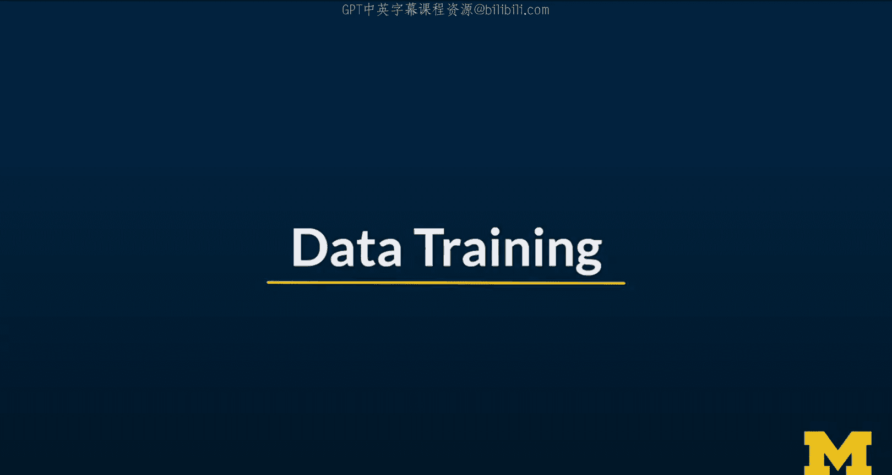
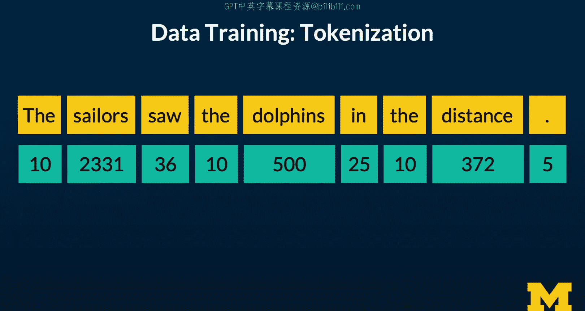
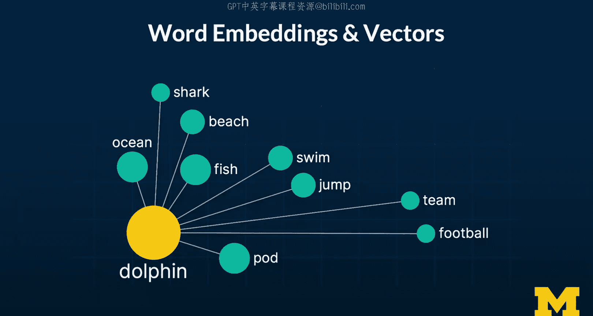
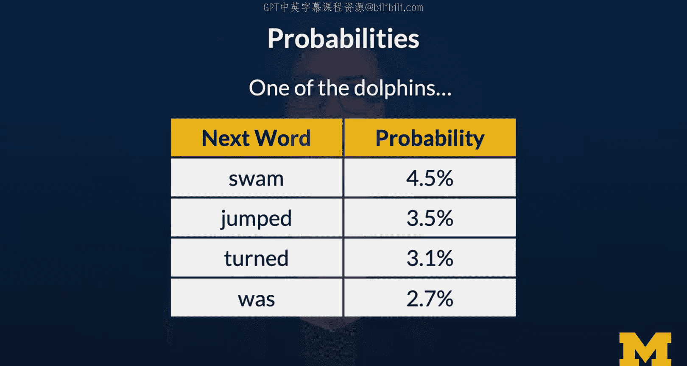
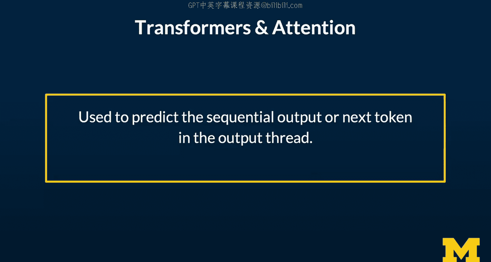
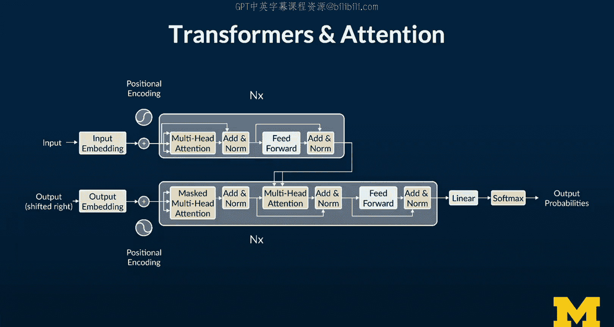
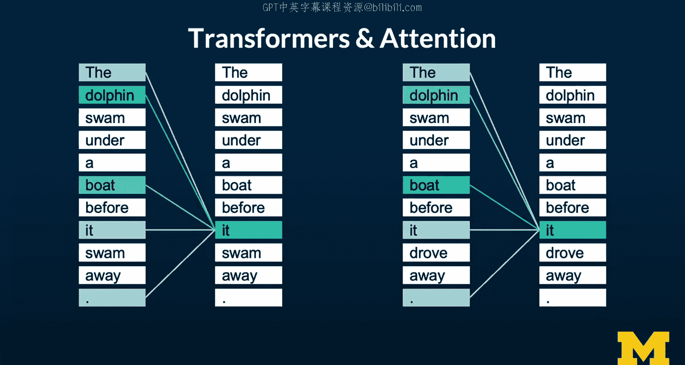
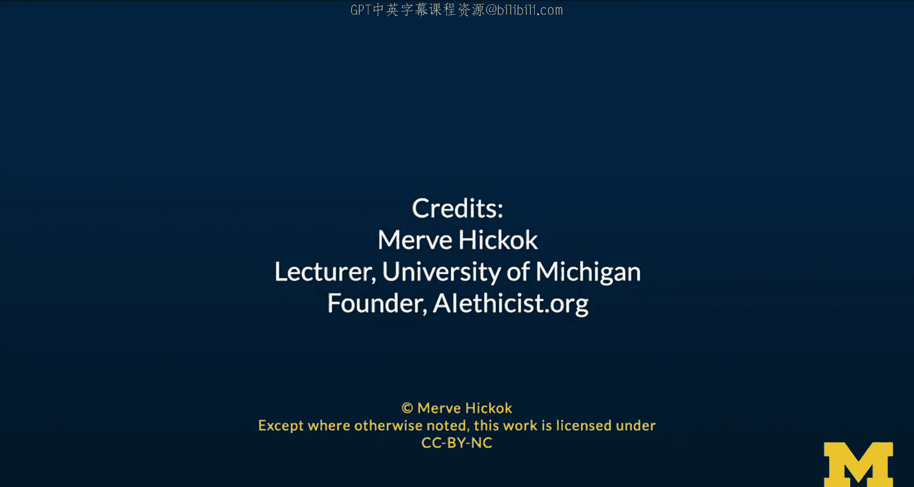

# 负责任生成式AI简介：5：数据训练阶段 🧠




在本节课中，我们将学习生成式AI模型在数据训练阶段的核心工作原理。我们将了解模型如何将人类语言转化为数学表示，并基于这些表示来生成连贯的文本。

---

## 概述


训练生成式AI模型需要多个步骤。模型无法直接理解人类使用的语言形式。为了训练系统，语言需要以一种公式化的方式进行处理。换句话说，数据集中的所有信息都需要被转换成数学表示。这个过程被称为**分词**。

---



## 分词：语言的基石

分词是让语言系统工作的基础。分词器将语言分解为称为“词元”的构建块。

以下是分词过程的步骤：
1.  首先，将句子中的每个单词和标点符号分割成独立的词元。
2.  然后，为每个词元分配一个唯一的数字ID。

例如，对于句子“One of the dolphins jumped.”，分词过程会将其分解为 `[“One”, “of”, “the”, “dolphins”, “jumped”, “.”]` 这样的词元序列，并为每个词元分配ID。


> **核心概念**：分词
> ```python
> # 简化的分词示例
> sentence = "One of the dolphins jumped."
> tokens = sentence.split() + [“.”]  # 结果: [“One”, “of”, “the”, “dolphins”, “jumped”, “.”]
> token_ids = [id_map[token] for token in tokens]  # 为每个词元查找对应的数字ID
> ```

虽然在这个例子中，词元与单词一一对应，但分词也可以基于字母或字符组合进行。

---



## 词向量与词嵌入

分词完成后，**词向量**开始发挥作用。词向量是词元之间关系的数学表示。

模型通过分析数据集，找出哪些词最常与当前词一起出现，从而学习这些关系。当我们把这些关系绘制出来时，就得到了**词嵌入**。词嵌入是词向量的可视化表示，它展示了哪些词在语义上是相似或相关的。


例如，在语言数据集中，“dolphin”（海豚）可能与“ocean”（海洋）、“fish”（鱼）或“shark”（鲨鱼）有更强的关联性。

> **核心概念**：词向量与词嵌入
> 词向量可以表示为高维空间中的一个点：`vector(“dolphin”) = [0.2, -0.5, 0.8, …]`
> 相似的词（如“dolphin”和“whale”）在这个空间中的向量距离会很近。

---



## 从提示到生成：模型如何工作

现在，让我们看看当用户给出提示时，系统做了什么。

1.  **分词**：用户输入的提示句子首先被分解为词元。
2.  **查找词嵌入**：模型找到这些词元对应的词向量。
3.  **神经网络处理**：这些向量经过神经网络的多层处理。
4.  **预测下一个词元**：此时，模型已经对可能作为回复的词元有了一个概念，并为每个候选词元计算了概率。


例如，如果提示系统“写一段关于海豚的文字”，系统可能会用“swam”（游）、“jumped”（跳）、“turned”（转身）等词来完成句子，而不是用“textant”这样的无意义词。

> **核心概念**：概率预测
> 模型计算下一个词元是 `w_i` 的概率：`P(w_i | w_1, w_2, …, w_{i-1})`
> 例如：`P(“jumped” | “One of the dolphins”)` 的概率可能很高。

重要的是要记住，大语言模型的核心是**统计关系**和**数学表示**。一个词（如“dolphin”）有其向量表示，序列中的所有其他词也有其向量表示，最终预测出的词或词元也有一个向量。系统通过不断地进行向量计算来生成对用户的响应。


---

## 训练数据质量与输出控制

如前所述，预测序列中下一个词的计算依赖于数据集中现有关系的强度和性质。因此，**训练数据的质量决定了你将收到的回复的质量**。

当系统预测下一个词元时，每个候选词元的概率会被排序。系统可以被设置为总是选择概率最高的词（top choice）。但有时这可能导致重复循环，产生无用的输出。

你可以通过调整生成结果的公式化过程，让模型选择排名较低的词，或从概率列表中随机挑选，同时仍保持一定的连贯性。这里的“随机性”意味着，如果我们多次使用相同的提示，每次都可能得到不同的回复。

---


## 变革者：Transformer架构

实现大语言模型更连贯回复的一项技术突破被称为 **Transformer**。在本课程开始时提到过，Transformer是构建生成式AI系统最流行的方法之一，对近期生成式AI的发展贡献巨大。



简单来说，与按顺序处理输入不同，**Transformer可以并行处理多个序列**。这使得模型的训练更快，规模也能更大。

> **核心概念**：Transformer并行处理
> 传统RNN：`hidden_state_t = f(hidden_state_{t-1}, input_t)` （顺序依赖）
> Transformer：同时处理所有输入词元，计算注意力权重。

---

## 注意力机制：理解上下文的关键


Transformer方法中一个非常有趣的概念是**注意力机制**。模型不再只关注最后一个词或词元，而是可以**观察更长的范围**，分析输入的词元序列。它会更加关注某些对保持上下文、代词与名词关系等至关重要的词元或单词。

注意力头有助于提高模型对下一个词元的预测能力。

具体流程如下：
1.  模型接收一个提示。
2.  将提示编码为数学表示。
3.  运行词嵌入和概率计算。
4.  **同时**，分析先前序列中最重要的部分以计算注意力权重。
5.  将概率计算和注意力结果结合起来，创建一个新的表示。
6.  最后，将这个数学表示解码，转换回自然语言。



例如，如果前面例子中的“dolphin”一词是在与海洋动物互动的上下文中使用的，注意力机制就会建立这种联系，而不会建议与“Miami Dolphins”（一支位于迈阿密的职业美式橄榄球队）相关的预测。

这种分析更长词汇范围并保持其关系完整的能力，是生成式AI系统的输出听起来像是理解了上下文的原因之一。输出听起来连贯，是因为模型利用了人类语言中存在的模式。

---


## 重要提醒：模型没有真正的理解

然而，必须牢记，**系统并不理解上下文或后果**。它只拥有关于词语之间关系的先验知识。



你可能还会注意到，如果你的提示长度超过某个阈值，回复可能会变得不那么一致和连贯。这是因为模型处理长程依赖的能力仍然有限。

---

## 总结




本节课中，我们一起学习了生成式AI模型数据训练阶段的核心概念：
1.  **分词**将语言转化为数字词元。
2.  **词向量和词嵌入**将词元之间的关系数学化。
3.  模型通过**概率计算**预测下一个词元。
4.  **Transformer架构**和**注意力机制**使模型能够并行处理信息并关注关键上下文，从而生成更连贯的文本。
5.  模型的输出质量根本上取决于**训练数据的质量**，并且模型本身不具备真正的理解能力，它只是在模仿数据中的统计模式。