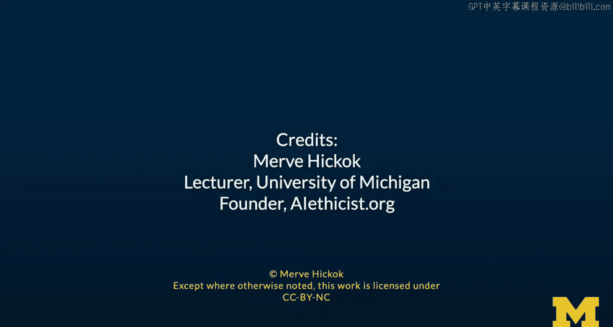

# 7：微调技术 🎯


在本节课中，我们将要学习生成式AI模型开发中的一个关键环节——微调。我们将探讨微调的目的、重要性以及两种主要的方法。

## 概述

上一节我们介绍了模型的无监督预训练。本节中我们来看看，当预训练完成后，如何进一步提升模型的性能与责任性。这个过程被称为微调。

## 什么是微调？

如前所述，一旦模型的无监督训练完成，你可能仍然希望改进或调整其响应质量。有些人认为微调是模型生命周期中一个可选的环节。然而，为了负责任地开发和实现良好的治理目的，或者为了提高系统在特定领域的性能，微调应受到重视。

微调可以被视为一个使模型输出与特定规则对齐的步骤。微调涉及更多高质量数据和人工参与。

## 微调的过程

以下是微调的基本工作流程：

1.  **人工与模型交互**：在此阶段，通过人类与模型之间的问答来改进系统的输出。
2.  **提问与比较**：向模型提出一系列问题，并将其答案与预期结果或标准答案进行比较。
3.  **进一步调整**：根据比较结果，对系统进行进一步的调优。

这项工作可能涉及大量的人工劳动。


## 基于人类反馈的强化学习

另一种使系统对齐的方法被称为“基于人类反馈的强化学习”。这种方法通过人类与系统的互动来提供示范或偏好响应的样本，或者比较不同的系统输出并对结果进行评分。

以下是该方法的步骤：

1.  **人类评分**：人类对模型的输出进行评价。
2.  **预测评分**：另一个神经网络尝试预测这些人类评分。
3.  **模型强化**：将预测的评分反馈给模型，并据此进行强化。

这成为一个迭代的过程，可以表示为以下简化流程：

```
模型生成输出 -> 人类提供反馈 -> 奖励模型预测人类偏好 -> 模型更新 -> 重复
```



## 总结


本节课中我们一起学习了微调技术。我们了解到，微调是提升生成式AI模型性能、确保其负责任地运行并与特定目标对齐的关键步骤。它主要分为直接的人工监督调优和基于人类反馈的强化学习两种方式，两者都强调了高质量数据和人类判断在AI开发中的核心作用。