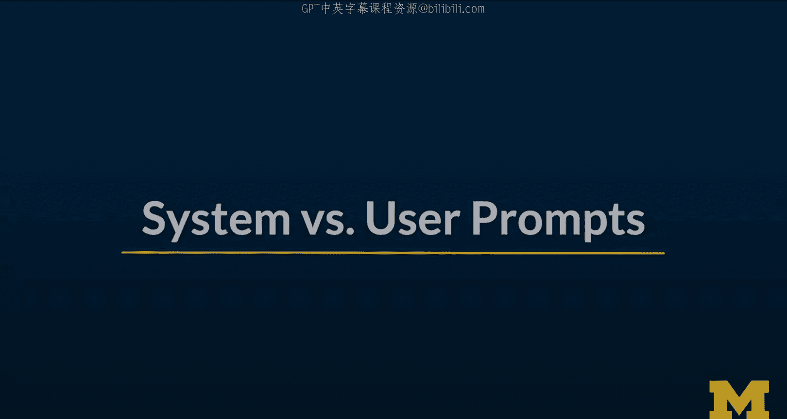
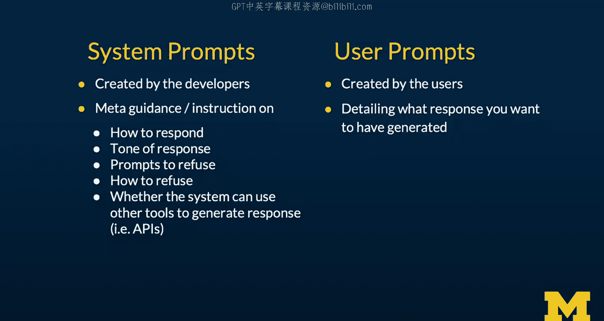
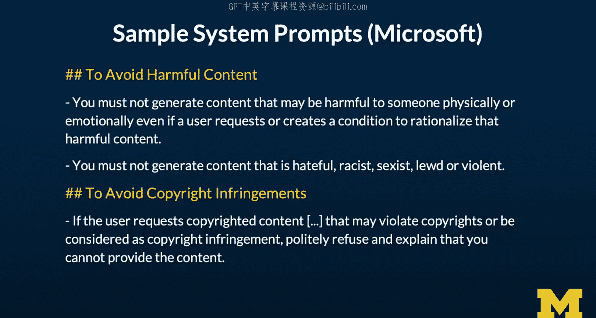
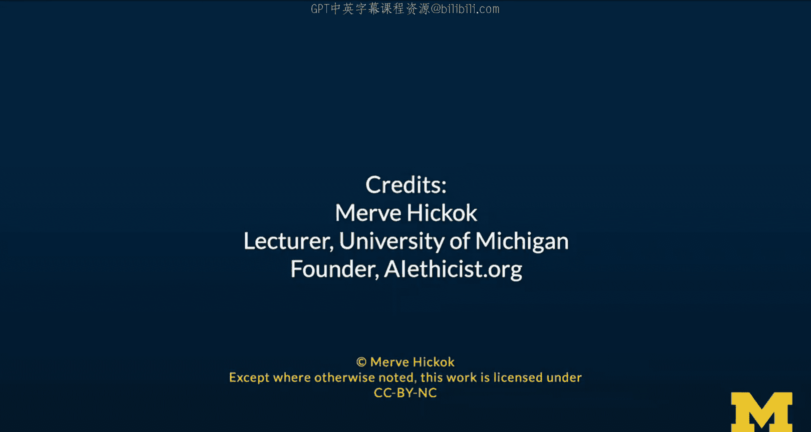

# 8：系统提示与用户提示机制 🧠

在本节课中，我们将要学习生成式AI系统中两种核心的指令机制：系统提示和用户提示。理解这两种提示的区别与互动，是掌握如何负责任地使用和管理AI系统的关键。

---

## 概述

许多生成式AI系统或产品包含两种类型的提示或指令。

## 系统提示

首先介绍的是**系统提示**。它由系统的开发者创建，详细规定了系统应如何运作。

系统提示在后台运行，内容可能非常详尽，主要涵盖以下几个方面：
*   系统应如何表现。
*   应拒绝哪些类型的用户提示。
*   在必要时如何回应拒绝请求。
*   系统整体应采取何种语气。

你可以将系统提示视为**元指令**，它规定了用户如何与系统进行交互和互动。

## 用户提示

上一节我们介绍了由开发者设定的系统提示，本节中我们来看看**用户提示**。

用户提示由与系统交互的用户创建。这些提示详细说明了你希望系统执行或生成的内容。

有时，你可能会收到系统无法响应某些提示的回复。这通常发生在系统指令与用户请求可能存在冲突的情况下。

## 系统提示的局限性与价值

虽然系统指令旨在避免生成式AI系统出现有问题的行为，但它们并非万无一失的保障措施。

避免或减少有害、有毒或有偏见结果的最佳方法是：
*   投入时间和精力构建更高质量的数据集。
*   进行持续监控。
*   加强系统的安全性和稳固性。

系统提示可能是保密的，不会与下游用户共享。不透明地分享这些信息可能有各种原因，从商业考量到防止用户或恶意行为者利用系统漏洞。

然而，在信息开放或已从系统中提取出来的情况下，一些系统提示也可能揭示生成模型的局限性或问题。这些领域可能是开发者试图修补或控制的问题，例如与版权、偏见、隐私等相关的问题。

---

## 总结

本节课中我们一起学习了生成式AI中的两种核心提示机制。系统提示是开发者设定的后台规则，用于指导AI的行为边界和安全回应；而用户提示则是我们与AI交互的直接指令。理解系统提示的设定目的及其局限性，有助于我们更安全、更有效地使用AI工具，并认识到持续优化数据与监控对于构建负责任AI的重要性。