# 负责任生成式AI简介：8：应用场景分析 📊

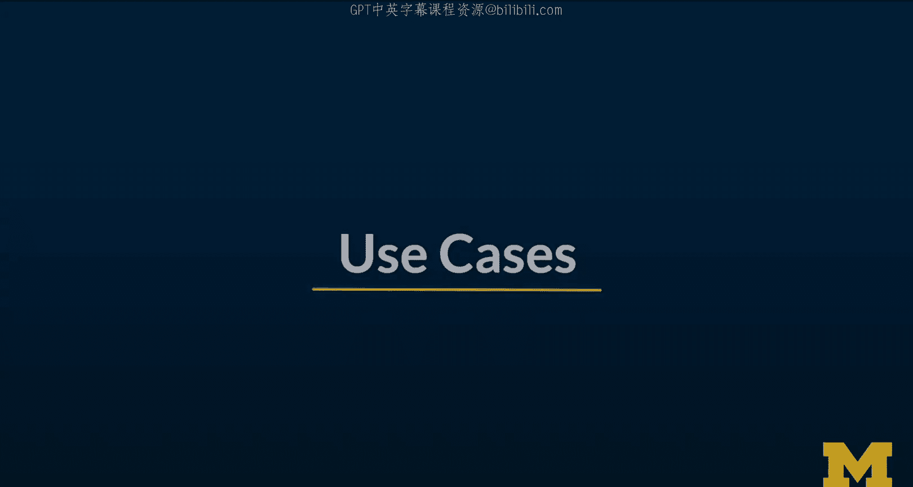

在本节课中，我们将探讨生成式AI系统在不同行业中的具体应用场景和新兴可能性。我们将看到，这些系统不仅限于文本生成，还能处理图像、音频、代码乃至时间序列数据，其影响可能是变革性的。

## 语言任务应用场景

上一节我们介绍了生成式AI的基础概念，本节中我们来看看它在语言任务中的具体应用。在语言任务方面，我们既能看到个人用途，也能看到商业用例。

以下是生成式AI在个人用途中的一些应用：

*   **个人助理**：用户可以要求系统总结长文本或音频对话。
*   **文本改写**：改变现有文本的风格或语气。
*   **内容生成**：生成特定风格的电子邮件、文章或演讲稿。
*   **文档搜索**：在文档集合中搜索，并提取使用特定词语的部分。
*   **自动化任务**：在电子表格中，使用语言指令自动完成任务，而无需编写冗长的公式或查询。

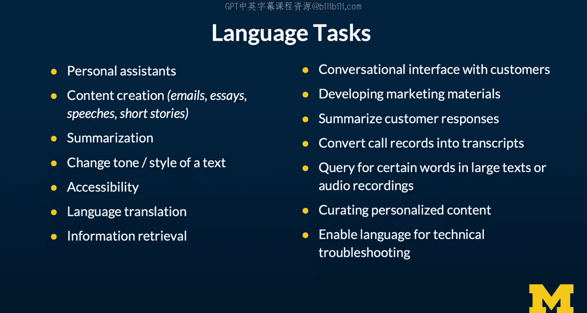

以下是生成式AI在创意内容创作中的应用：

*   **营销材料**：生成广告文案、宣传语等。
*   **故事与文章**：创作短篇故事或文章。
*   **内容草稿**：为长篇叙述（如博客文章、社交媒体更新）提供初稿。
*   **头脑风暴**：激发新的创意和想法。

然而，必须记住，生成的内容可能不准确、带有偏见或基于受版权保护的材料。我们将在后续课程中详细讨论这一风险。

在商业领域，生成式AI也有广泛的应用前景。

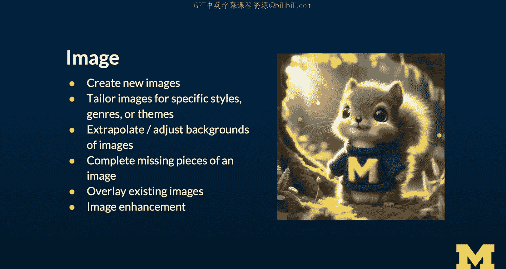

以下是生成式AI在商业中的一些应用：

*   **自动化客服**：使用对话系统自动响应客户查询。这与基于规则的上**一代聊天机器人**不同。
*   **评论分析**：总结客户评论中的意见或特定主题。
*   **语音转文本**：将通话记录转换为文字稿。
*   **信息检索**：创建查询或搜索脚本，以便更轻松快捷地访问信息，而无需在大量文本或录音中手动搜索。

## 图像与视频任务应用场景

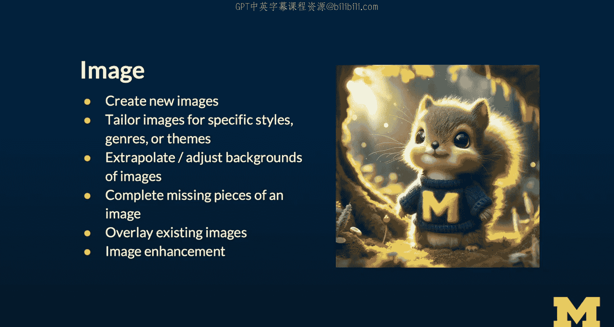

与语言任务类似，生成式AI系统也可用于图像相关任务的创意目的。

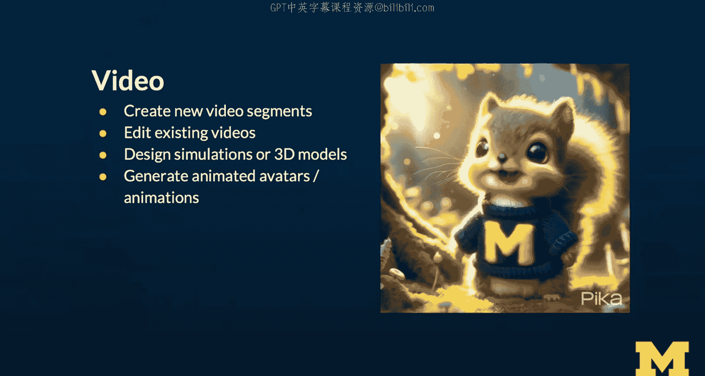

最简单的用例是用户通过向系统描述他们想在图像中看到的内容来生成新图像。

这可以简单到创建一本涂色书，也可以复杂到为卡通系列创建一致的角色、进行插图叙事或创作科幻图像等。

与语言类似，这些图像可以根据特定的风格、流派或主题进行定制。

在其他用例中，系统可以利用给定图像进行背景外推或调整、补全现有图像中缺失或破损的部分、叠加来自不同来源的对象以创建新图像，甚至增强现有图像的不同摄影质量。

除了创建静态图像或绘图，生成式AI系统还用于创建新的视频片段、动画头像和动画，甚至生成产品或设计想法的3D模型模拟。

在视频领域，负责任地使用生成式AI并理解这些模型的能力变得非常重要。虽然大多数视频预期用于娱乐或合法的商业目的，但我们已经看到非常逼真的深度伪造视频被用于制造虚假信息和勒索个人。我们将在后续课程中讨论深度伪造信息的影响。然而，记住这些技术总有其正面和负面的使用者，能让我们从一开始就走在正确的方向上。

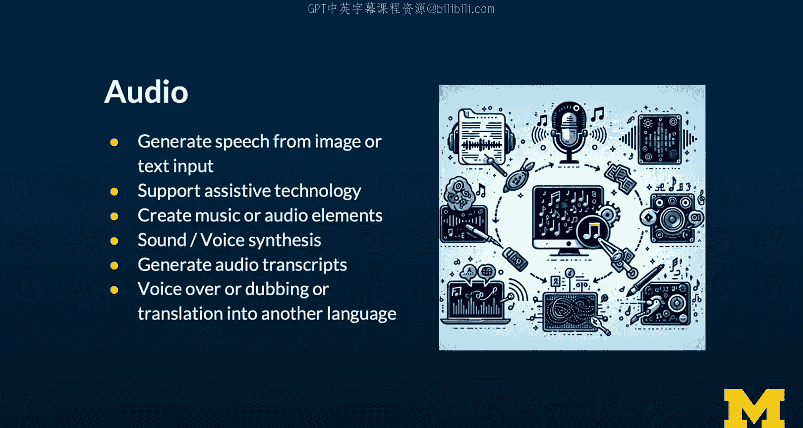

## 音频与代码生成应用场景

生成式AI系统可用于从图像或文本输入创建语音、生成音乐或音频元素、合成声音或语音，或构建音效。这些系统将文本转换为音频转录稿，例如用于有声读物。它们也用于辅助目的，例如，通过向用户解释图像的细节，将图像转换为音频描述。

这些模型还可以通过录音来模仿一个人的声音和风格，可用于配音、配音或翻译成另一种语言。虽然这可能用于创意目的，但这种能力也开启了创建音频深度伪造或潜在欺诈骗局的可能性。

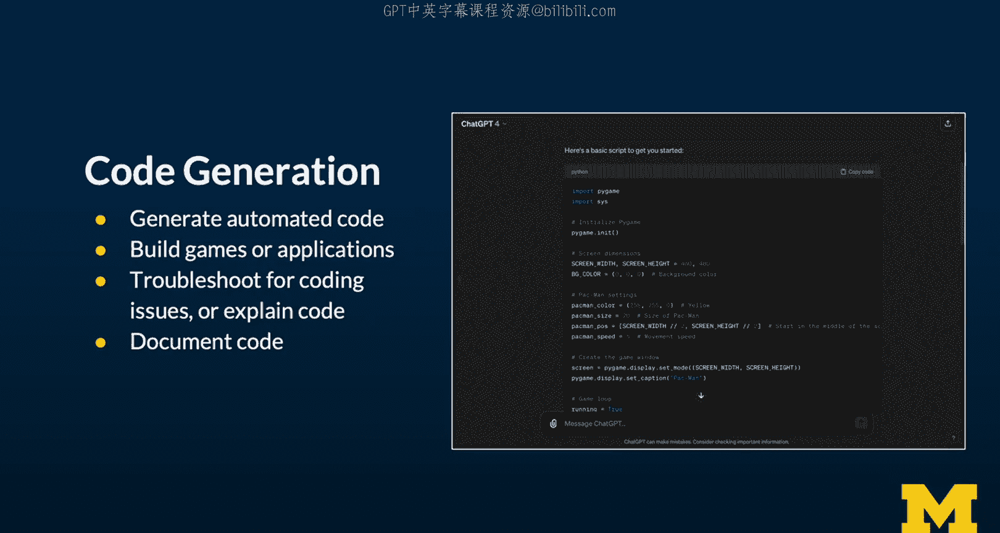

就像语言任务一样，使用这些系统进行代码生成也是基于其数据集中包含的代码。换句话说，系统的输出质量仅取决于其数据集中代码的质量。

以下是生成式AI在代码生成中的应用：

*   **构建应用**：用于构建游戏、完成任务或创建网站。
*   **简化编程**：可以通过向系统提供指令或绘制你想要编码内容的草图来生成代码。
*   **全流程创作**：例如，可以先使用生成式AI构思一个游戏，设计游戏角色及其动画头像，然后生成代码将这些想法变成真正的游戏。
*   **代码辅助**：可以提示系统用特定的编程语言创建软件代码，或用于解释和排查编码问题。
*   **文档与调试**：帮助编写代码文档。你可以向模型输入代码中遇到的错误代码，并要求它解释问题并提出修正建议。

虽然使用生成式AI进行编码是启动项目的好方法，但它并不能免除仔细检查代码所需的领域和编码专业知识，也不能免除保护模型免受恶意攻击者侵害的需要。文本生成中的问题在这里可能会重演。系统可能生成不准确的代码，或包含从其训练数据集中学到的恶意代码。就像深度伪造一样，恶意行为者也可以更容易地利用这些系统创建对抗性代码。

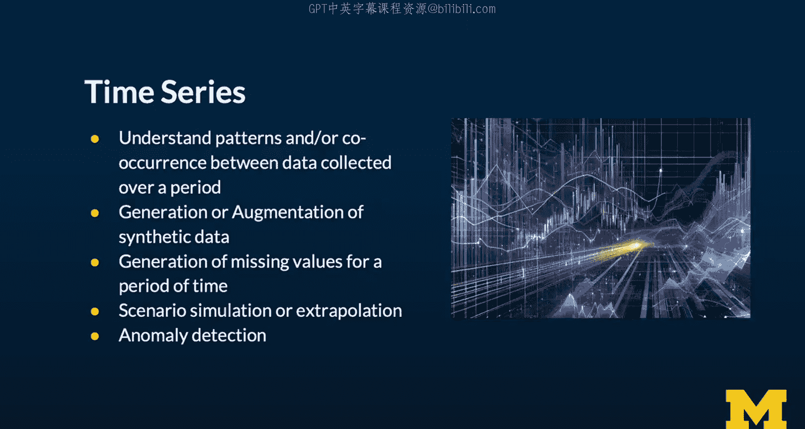

## 时间序列分析与多模态应用

一个较少被讨论的生成式AI应用是时间序列分析。目前，这种方法可能被视为一个研究问题。它使用在一段时间内收集的时间序列数据或测量值，用于理解系统的行为或趋势。

使用时间序列的一个挑战是特征之间的时间依赖性，以及其他因素可能导致变化的可能性。可以考虑连续数据，如天气模式、能源消耗、股票市场、网络活动、销售数据、交通或物流数据。

就像显示倾向于一起出现的词语的词嵌入一样，可以分析时间序列数据集以理解特征之间的模式，例如共现、季节性或周期性变化。

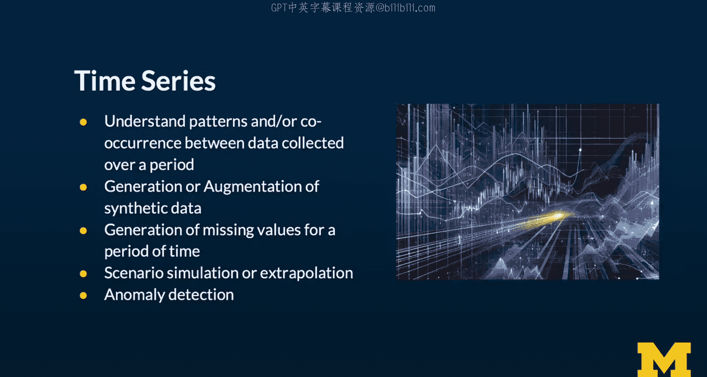

研究人员也在研究生成式AI是否可用于从现有时间序列创建合成数据，即创建顺序数据，或者用于在某个时间段数据缺失时进行外推的可能性。如果时间分析按预期工作，它也可用于模式和干预的场景模拟，或检测异常或偏离模式的情况。

一些生成式AI系统仅针对单一类型的输入（如图像或文本）进行训练，因此其输出仅限于单一输入类型。另一方面，更复杂的多模态生成式AI系统则使用多种类型的输入（如文本、图像或代码）进行训练。这些模型分析文本与其他类型数据（如图像或音频）之间的关联，并且也能生成不同格式的输出。

例如，你可以向系统提供一张图片，然后要求系统提供关于该物体的更多信息；或者上传一个网站的手绘草图模板，要求系统为你创建该网站；或者使用文本提示来创建视频。目前，使用扩散变换方法的一个局限在于，当指令过于复杂或响应需要空间或逻辑推理时，系统可能表现不佳。

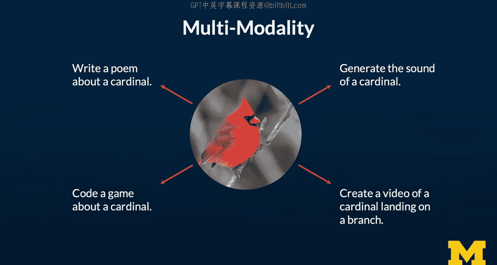

## 总结

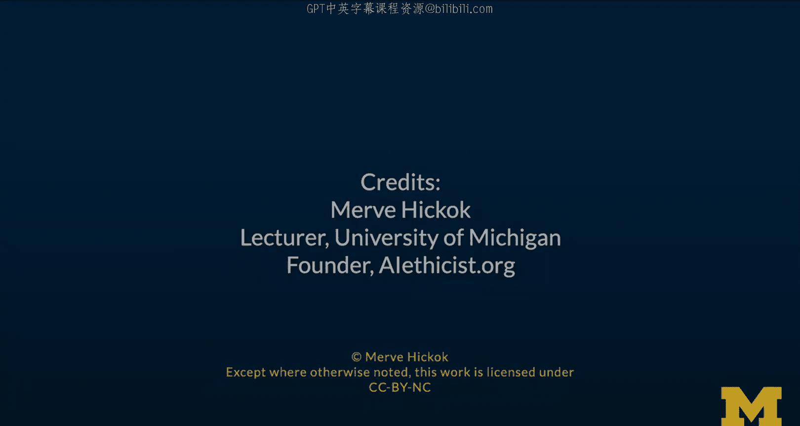

本节课中，我们一起学习了生成式AI系统在语言、图像、视频、音频、代码、时间序列分析以及多模态交互等多个领域的广泛应用场景。我们看到，这些技术为个人和商业应用带来了巨大的创新潜力，从自动化客服到创意内容生成，再到复杂的数据分析。然而，我们也必须清醒地认识到，伴随这些可能性而来的还有准确性、偏见、版权、深度伪造和安全等风险。理解这些系统的运作方式、潜力与局限，对于我们在任何领域负责任且有效地应用它们都至关重要。