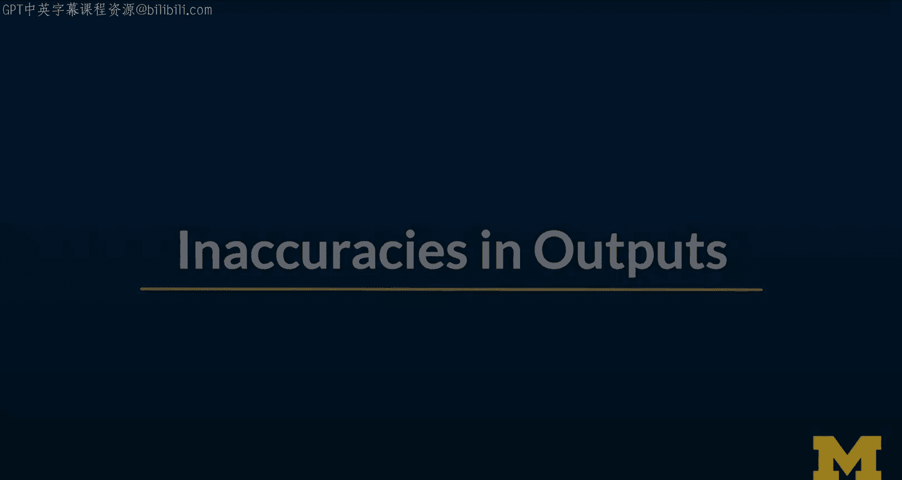
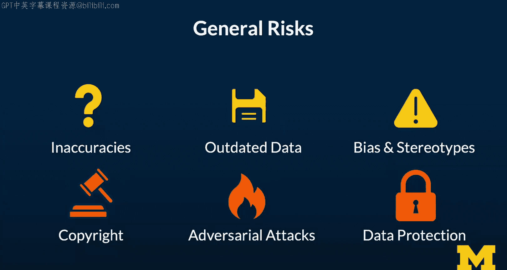
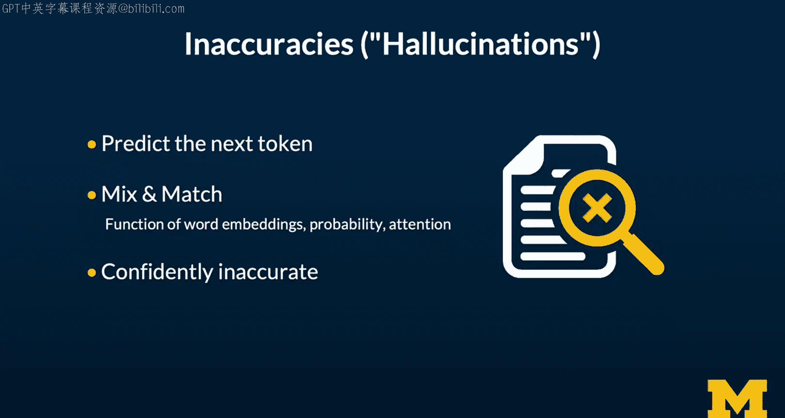
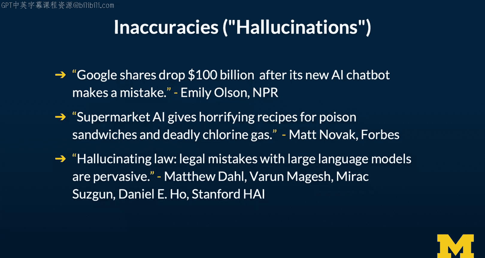
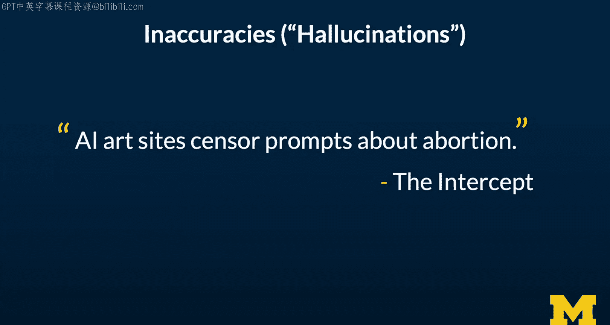

# 负责任生成式AI简介：P10：输出结果不准确性问题

在本节课中，我们将探讨生成式AI模型，特别是大型语言模型，在输出结果准确性方面面临的核心挑战。我们将了解这些不准确性产生的原因、可能带来的风险，以及为什么在某些关键应用场景中需要格外谨慎。

## 🧠 基础模型开发的现状

从零开始开发和训练生成式AI模型是一项资源密集型工作，涉及人才、资金、算力、数据和精力。目前，只有少数公司有能力开发和训练基础模型。许多下游用户或企业则在这些大型基础模型之上构建自己的模型。

然而，无论你是从零开始构建模型，还是构建一个连接或依赖模型，都需要注意其中存在的某些风险。在接下来的部分，我们将介绍与这些系统基础要素相关的一些普遍风险。

## 🔍 模型的工作原理与局限性

在最简单的层面上，大型语言模型的任务是预测序列中的下一个词。模型本质上是在反复执行同一个任务：**给定已有的文本，下一个词应该是什么**。模型的回答基于统计学，反映了训练数据中最常见的词语关联。

因为模型基于统计学而非逻辑推理，这些系统可能会产生不准确的结果，并且常常以高置信度输出。它们可以反映其数据集中的内容，但缺乏真正的逻辑或对世界的独立理解。这意味着，对于涉及细微语境知识、习语、特殊解释或因果推理的提示，它们可能会给出不连贯或错误的回答。

此外，训练数据集的质量——是否具有代表性、是否最新、是否充足——也会影响模型生成更好结果的能力。当用于创意任务时，这种“混合与匹配”的功能可能是有益的，甚至是被期望的，一些开发者将其视为特性而非缺陷。

## ⚠️ 准确性至关重要的场景

然而，对于任何输出准确性、事实性或精确性至关重要的用例，决策者都应三思而后行，考虑是否使用生成式AI系统。尽管生成式AI系统擅长生成听起来连贯的输出，但这些模型不具备完成复杂任务的技术手段，尤其是在需要对问题有细致理解（如金融或法律分析）的领域。这些模型的提供商也在其服务条款中警告了这种不准确性。

根据具体用例，这些不准确性可能对接收提示的个体以及产生此类结果的企业系统造成重大损害或失败。企业可能面临责任问题。例如，斯坦福大学研究人员最近的一项研究表明，当语言模型被用于回答具体的法律查询时，其不准确率在**69%到88%**之间。这些模型不会纠正错误，即使被进一步提示，也倾向于强化不正确的法律假设和信念。

## 🤔 不准确性的现实影响

这对一些担心工作保障的律师助理和律师来说可能是个安慰。然而，想象一下，一个没有经济能力聘请律师的人，决定使用语言模型来解答法律问题、撰写诉状，甚至理解法律程序。同一项研究也警告了语言模型倾向于过度自信，而不论其实际准确性如何。

类似的警告也适用于任何可能涉及用户根据生成式AI系统的回答采取现实行动的任务，例如进行金融投资、医疗咨询，甚至是规划下一次假期。

## 🚫 内容限制与审查的困境

但即使在你最不经意的时候，或者只是个人使用生成式AI系统，我们仍需牢记一些严肃的考量。理想情况下，如果这些新兴技术能带来益处，我们希望它们能平等、公平地惠及所有人。然而在某些情况下，生成的结果可能不适合特定语境，有时甚至具有冒犯性。

在许多情况下，正是关于训练数据源的决策，以及融入模型的设计决策，导致了有偏见或有毒的结果。一些AI产品通过系统提示或元指令的方式来避免某些问题。

然而，对某些内容的此类限制也可能被视为审查。目标问题可能因文化或语境而异，或者可能是一个存在政治分歧的议题。为了防范某些内容而创建安全措施，系统可能被训练为避开某些词语、语言或提示。但这可能导致用户无法自由表达自己、无法为其产品创建内容，或无法生成符合其身份认同的内容。

尽管可以使用不同的提示技术让系统生成被审查的文本或图像，但额外的步骤或负担，或者可能违反使用条款，仍然是有问题的。将“提示拒绝”作为对抗有毒内容或不准确性的唯一机制，可能会给系统的开发者和部署者带来虚假的安全感。

## 📝 总结

本节课中，我们一起学习了生成式AI模型输出不准确性的根源。我们了解到，由于模型基于统计模式而非逻辑推理，它们在处理需要深度理解、因果推理或最新事实的任务时存在固有局限。这种不准确性在法律、金融等高风险领域可能造成严重后果。同时，为防范风险而设置的内容限制也可能引发关于审查和表达自由的争议。因此，在应用生成式AI时，必须对其能力边界保持清醒认识，尤其是在准确性至关重要的场景中。