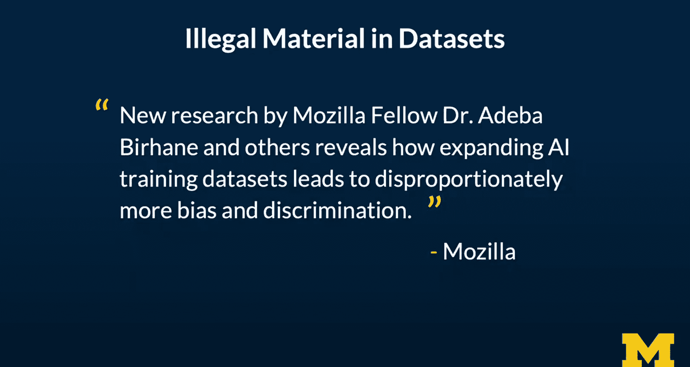
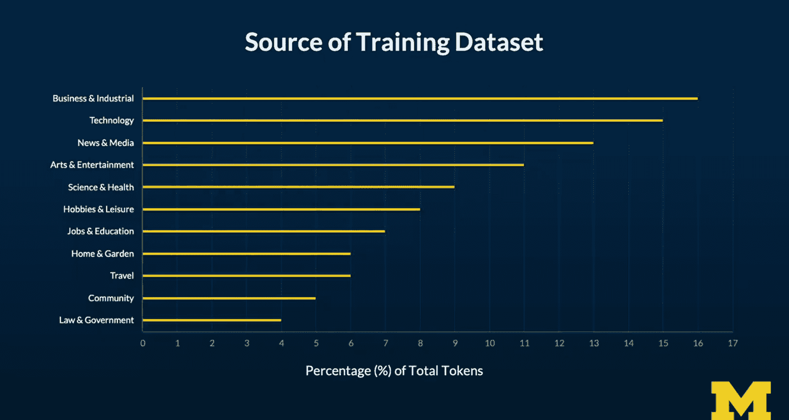
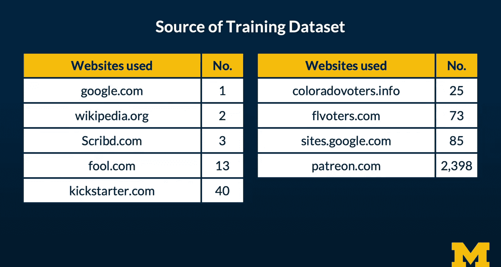
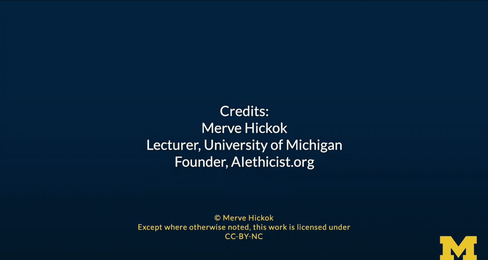

# 负责任生成式AI简介：10：数据保护策略 📊

在本节课中，我们将要学习生成式AI训练数据中存在的风险，以及数据质量对模型输出的重要影响。我们将探讨数据集中可能包含的有害内容、版权问题，以及缺乏数据透明度所带来的挑战。

## 互联网数据集的潜在风险

上一节我们介绍了生成式AI的基础，本节中我们来看看其训练数据的具体问题。从互联网上大规模抓取的数据集，可能包含来自网络的非法或冒犯性图像。

例如：
*   暴力内容
*   仇恨符号
*   色情内容

研究人员在分析样本时，检测到了这些仇恨内容。

## 数据规模与有害内容的关联

随着生成式多模态模型使用越来越大的数据集进行扩展，研究发现，仇恨内容、负面刻板印象和其他有害表征在更大规模的数据集中出现的频率会显著增高。

一个核心概念是：**广泛使用的训练数据集或产品，并不等同于其不含毒性、非法或私人数据**。

## 数据透明度缺失的挑战

不幸的是，许多作为产品或开源项目提供的生成式AI系统，并没有附带相关的数据质量或来源文档。

这意味着：
*   我们不清楚训练数据集中公共信息与私人信息的比例。
*   我们不清楚免费材料与受版权保护材料的比例。
*   我们不清楚在使用这些模型时，表征偏见和毒性的程度。

因此，对于生成式输出的准确性、可靠性和相关风险，应持谨慎态度。无法分析数据集和模型，也意味着我们是在对这些模型的能力和行为一无所知的情况下进行工作。

## 案例分析：Google C4数据集

以下是关于一个广泛使用的数据集的例子。《华盛顿邮报》的记者分析了Google C4数据集，这是一个广泛用于训练目的的数据集，反映了1500万个网站的内容。据报道，该数据集也被用于训练多个大型语言模型。

你会注意到，所使用的部分网站可能是更中立和可信的信息来源。

例如：
*   专利数据库
*   维基百科

## 数据源的多样性与问题

然而，数据源也包括一些包含特定信息的网站。

例如：
*   水域和地址登记网站
*   需要付费或订阅才能获取独家内容的抓取网站

数据集的某个子集还显示，包含了只涉及特定政治或世界观点的宣传网站和讨论论坛。

## 数据质量的核心重要性

训练数据集的质量对AI生成的结果有显著影响。在这个例子中，我们拥有关于该数据集的更多信息。

然而，对于许多生成式AI系统而言，情况并非如此，供应商通常不会分享关于数据可靠性或质量的详细信息。

---

本节课中我们一起学习了生成式AI训练数据的关键问题。我们认识到，大规模网络抓取的数据集可能包含有害、非法或有偏见的内容，且数据规模增大会放大这些问题。更重要的是，当前许多AI系统缺乏数据透明度，使得用户难以评估模型输出的风险和可靠性。理解数据源的构成和质量，是负责任地使用和开发生成式AI的重要前提。