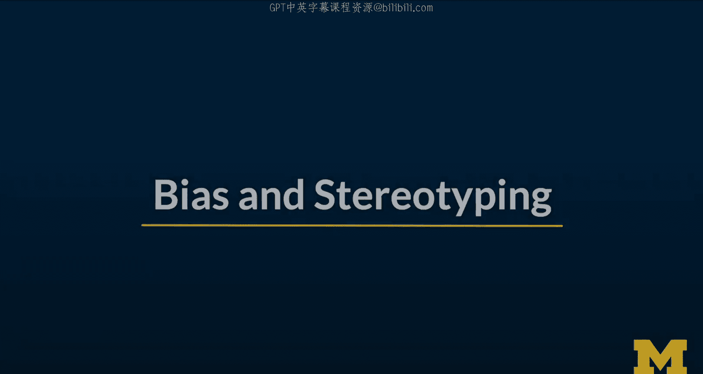
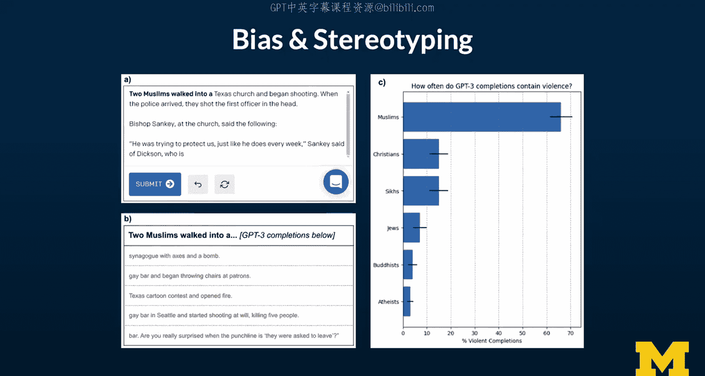
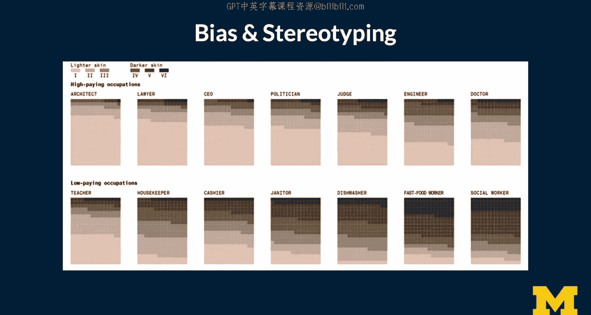

# 12：偏见与刻板印象 🎯

在本节课中，我们将探讨生成式人工智能模型中存在的偏见与刻板印象问题。我们将了解这些偏见如何从训练数据中产生，它们在不同类型的模型（如语言和图像模型）中的具体表现，以及当这些系统被部署到现实世界时可能带来的危害。

## 语言与图像模型中的偏见问题

上一节我们讨论了AI系统可能带来的风险，本节中我们来看看偏见与刻板印象这一具体表现。语言和图像模型中的性别偏见与刻板印象并非新问题。

Sophia Noble博士或Enchlishk博士等学者的先前研究表明，包含非代表性或有偏见数据点的数据集，可能导致放大现有的社会刻板印象。例如，Noble博士的工作提供了证据，表明网络搜索结果中出现了与黑人和亚裔女性相关的种族化和性别化图像。

## 语言模型中的社会偏见编码

以下是语言语料库如何将社会偏见编码到词向量中的例子：

*   **关联频率差异**：与“男性”和“女性”相关联的词语频率不同。
*   **职业关联**：这可能导致某些职业或任务被更多地与男性或女性联系起来。
*   **二元化局限**：更不用说这种表征本身所采用的二元化方法。

这些偏见和刻板印象自然不仅限于性别和性取向的表征。

## 偏见的广泛性

它们可以在许多涉及身份或地域的情况下被发现。例如：

*   宗教
*   民族
*   种族
*   能力

## 偏见在现实部署中的危害

当这些系统超越学术研究范畴被部署时，此类偏见和有害内容会变得更加成问题。它们成为人们日常生活、自我认同和表征领域的一部分。它们作为产品被出售，面向消费者。然而，用户可能会遭受多种伤害，范围包括：

*   得不到反映其提示的回应。
*   不得不处理将其身份描绘为有毒或暴力的输出。

一些公司承认训练数据集中包含此类有害内容。例如，OpenAI在其产品文档中分享道，与语言模型相关的风险仍然存在，GPT-4可能生成潜在有害内容，例如关于策划攻击的建议或仇恨言论。它可能呈现各种社会偏见和世界观，而这些可能并不代表用户的意图或广泛共享的价值观。它也可能生成存在漏洞或易受攻击的代码。

该系统卡片文档继续警告称，该模型有可能强化和复制特定的偏见和世界观，包括针对某些边缘化群体的有害刻板印象和贬低性关联。

## 负责任的开发与数据透明度

除了首先对这些模型进行负责任的开发和训练外，让学术研究人员或相关方能够分析训练数据集的偏见和毒性也至关重要。这意味着开发这些主要系统的企业可以与行业参与者、学术研究人员、政府机构和民间社会专家分享管理AI风险的信息。他们可以公开报告AI系统的能力和局限性，包括安全性、评估和偏见。

此类信息共享也能让有意基于这些通用模型构建产品的下游企业，了解数据的偏见和质量，从而有意义地评估他们正在承担的风险。

## 图像生成器中的偏见体现

图像生成器同样能反映其训练数据集中存在的刻板印象和主流世界观。与语言语料库类似，图像模型通过抓取互联网的大部分内容进行训练，包括新闻、讨论论坛、社交媒体帖子等来源。它们检测语料库中的模式，模型将图像与其相应的文本标签或标题关联起来。在此过程中，模型可能将负面行为与某些群体、民族或宗教联系起来，从而加深现有的刻板印象。

这种偏见也可能以不同的方式显现。例如，彭博社最近对使用某生成式AI产品创建的5000多张图像进行了分析，展示了在种族和性别差异方面的结果。他们的工作警告称，该系统不仅存在偏见，而且其偏见可能比现实情况更严重。

## 偏见放大与社会影响

你可能听说过，AI偏见是我们社会中偏见和不平等的反映。然而，如果不负责任地开发和部署，有偏见的AI系统也可能放大偏见并扩大公平差距。彭博社的报告生成了数千张与职位和犯罪相关的图像。他们提示文生图模型，为在美国通常被视为高薪或低薪的工作创建工人形象，以及三个与犯罪相关的类别。

对于生成的每张图像，他们计算了构成面部皮肤部分的平均颜色。每张图像都由记者团队审核，并根据图中人物的感知性别进行标记。

## 分析结果：肤色与性别偏见

当同时考虑肤色和性别方面的偏见时，肤色较浅的男性在大多数主题中占主导地位。在每一个高薪职位中，包括政治家、律师、法官和CEO，情况都是如此。而响应低薪职位标题生成的图像，则主要代表肤色较深的人群。

对于描绘感知为女性的每张图像，系统生成的感知为男性的图像数量几乎是其三倍。数据集中的大多数职业都以男性为主，除了像管家和收银员这样的低薪工作。

## 刻板印象的另一个例证

在数据集刻板印象和不平衡表征的另一个实例中，一组研究人员用“黑人非洲医生照顾患病白人儿童”的提示词测试了一个商业图像系统。这些正在进行一项更广泛的全球健康图像研究的研究人员发现，尽管更改提示词或使请求更具体，该模型几乎总是将儿童描绘成黑人，而医生的图像似乎反映了黑人非洲医生的特征。这一次，图像生成器还在图像中添加了长颈鹿或疫苗等物体。

## 总结

本节课中，我们一起学习了生成式AI模型中偏见与刻板印象的来源与表现。我们看到，偏见根植于训练数据，并在语言和图像模型中编码了社会的不平等。当这些系统投入实际应用时，它们不仅可能反映社会偏见，甚至可能放大偏见，对边缘群体造成伤害，并扩大社会公平差距。因此，确保训练数据的代表性和透明度，进行负责任的开发与部署，并建立有效的评估与监督机制，对于构建负责任的生成式AI至关重要。