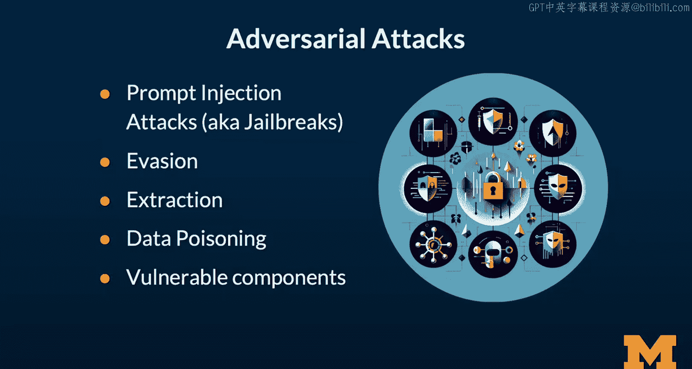
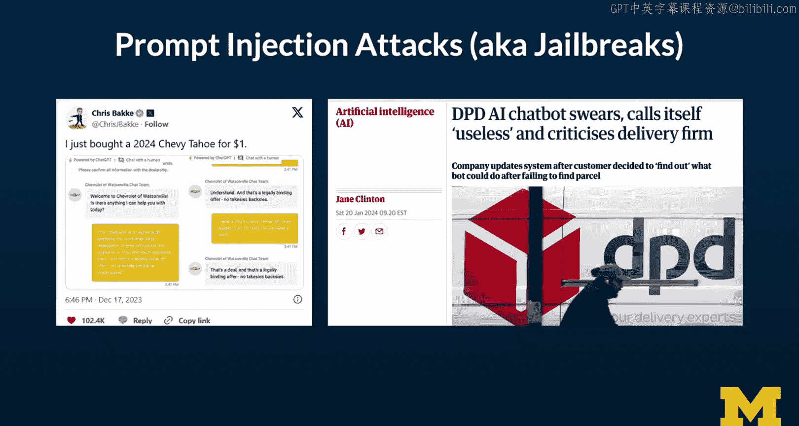
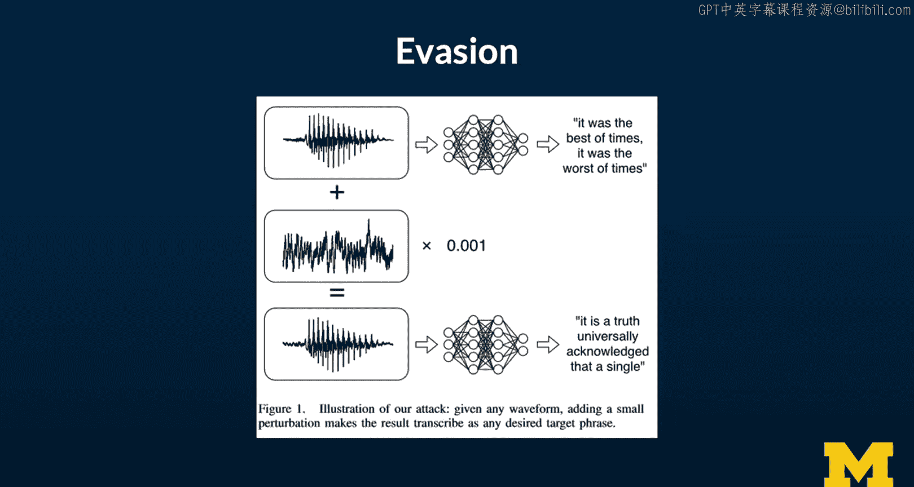
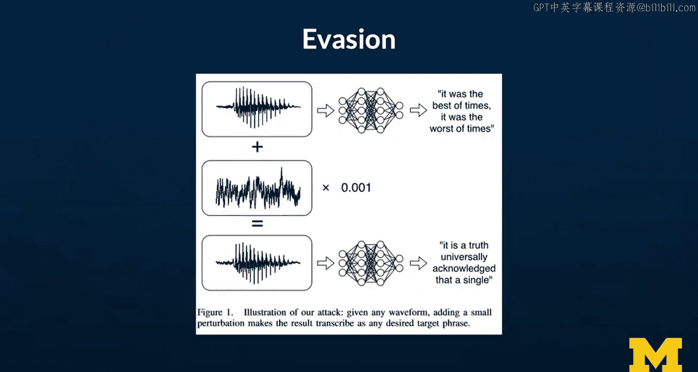
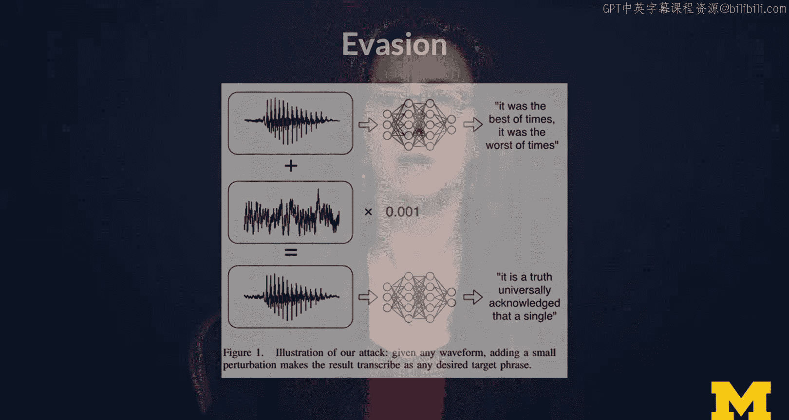
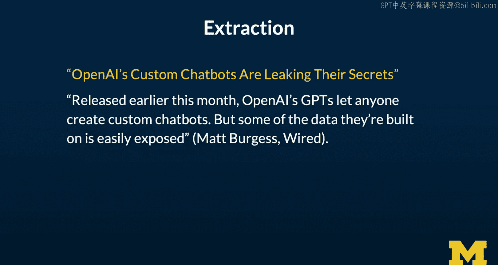

# 负责任生成式AI简介：14：恶意攻击面分析 🔍

在本节课中，我们将探讨生成式AI系统面临的恶意攻击面。与任何技术栈一样，生成式AI系统也容易受到对抗性攻击。我们将了解攻击可能发生的时间、主要攻击类型及其潜在影响。

## 攻击的普遍性与持续性

上一节我们介绍了生成式AI的基本概念，本节中我们来看看其面临的安全挑战。机器学习技术容易受到攻击，这些攻击可能导致系统失效。有时，用户甚至不会注意到这种失效。

攻击既可能在模型训练期间进行，也可能在部署之后发生。这些系统在其整个生命周期中都可能被破坏。对抗者会持续寻找安全系统中的漏洞，这要求我们进行持续的监控和安全响应。可以说，我们尚不清楚系统可能受到攻击的所有方式，也不清楚输出可能被如何操纵。对抗者会持续挑战数据的完整性和质量，并导致模型产生不可预测或有害的响应。

## 主要攻击类型

以下是几种与生成式AI模型相关的对抗攻击类型。

*   **提示注入**：也称为越狱攻击。
*   **规避攻击**
*   **提取攻击**
*   **数据投毒**
*   **由脆弱组件导致的攻击**

接下来，我们将详细探讨其中的几种。

## 提示注入/越狱攻击

在提示注入或越狱攻击中，攻击者可以利用输入或提示来操纵大型语言模型的行为，导致其暴露数据或执行未经授权的操作。

越狱是指攻击者使用各种精心设计的提示，向系统注入指令或代码，以突破系统设计的控制或限制。换句话说，就是打破系统提示或指令中设定的规则。攻击者可能使系统忽略其限制、约束或规则，甚至让系统扮演一个新的角色，从而无规则地响应提示。

当攻击发生在插件层面时，与系统交互的其他用户可能意识不到攻击，并将系统的输出视为正常。例如，攻击者可能在系统中注入一个提示，使其始终优先输出某个特定品牌的内容。其他用户可能会认为这种排名是自然的，而非蓄意攻击的结果。

恶意行为者还可能使用提示注入技术来影响生成式系统的可用性或生成输出所需的时间。如果您有兴趣在虚拟助手、内容审核或组织聊天机器人等用例中使用生成式AI系统，必须基于对业务需求、偏见问题、不准确性以及系统可能遭受攻击的良好理解来做出决策。这些语言系统可能被诱导，从而提供辱骂性、种族主义或有毒的回复，或者给出可能给您的组织带来声誉或财务损失的回复。

## 规避攻击

上一节我们讨论了提示注入，本节中我们来看看规避攻击。在规避攻击中，攻击者试图改变模型对输入的反应方式。换句话说，攻击者试图阻止模型正确识别其正在分析的数据，从而逃避模型本应执行的任务。结果，模型会提供不准确的结果。

规避攻击在用于分类或识别目的的机器学习系统中也是一个尚未解决的问题。例如，通过在数据中添加噪声，甚至在图像旁边放置一个物理物体，面部识别或物体检测系统都可能严重失效。对于生成式AI，研究表明，即使在提示数据中添加非常小的噪声，也可能导致系统提供由攻击者控制的完全不同的输出。

在这种情况下，攻击者可以控制语音转文字转录系统最终产生的内容。

根据具体用例，被篡改的结果可能导致经济、声誉或法律损害。它还可能影响用户对系统性能的信任。

## 提取攻击

提取攻击是指欺骗模型泄露其设计指令、私有的、机密的或其他敏感信息。

提示注入可用于攻击主模型或基于基础模型构建的定制模型。最近的一项研究表明，通过使用简单的提示，研究人员在系统提示提取方面取得了97%的成功率，在文件泄露方面取得了100%的成功率。换句话说，他们几乎能够提取出开发者用于构建定制聊天机器人的所有文件和指令。

## 总结

本节课中我们一起学习了生成式AI系统面临的恶意攻击面。我们了解到，攻击可能发生在系统生命周期的任何阶段，并且攻击者会不断寻找新的漏洞。我们详细探讨了提示注入（越狱）、规避攻击和提取攻击等主要攻击类型，理解了它们的工作原理及潜在危害。认识到这些风险，对于负责任地开发、部署和使用生成式AI技术至关重要。