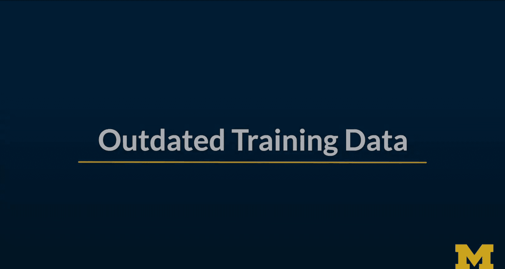
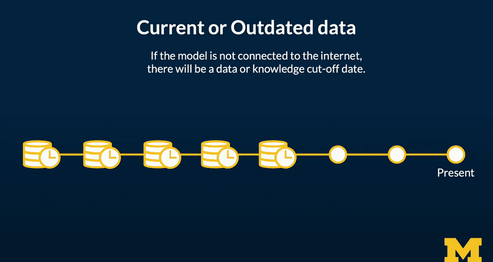

# 负责任生成式AI简介：14：训练数据时效性问题 📅

在本节课中，我们将探讨生成式AI系统训练数据的一个关键特性——时效性，即“知识截止日期”。我们将了解其定义、对商业应用的影响以及企业可采取的应对策略。

上一节我们介绍了企业如何通过API连接或微调来定制基础模型。本节中，我们来看看训练数据本身的一个固有局限。

如果模型未连接至互联网，换句话说，无法检索实时数据，那么就会存在一个数据或知识截止日期。这意味着模型的训练数据仅包含截至某个特定日期的信息，不包含该日期之后产生的信息。

## 知识截止日期的影响 ⚖️

根据具体应用场景，这种知识截止可能是一个严重问题，也可能无关紧要。

以下是不同场景的简要分析：
*   **影响较小的场景**：对于处理通用知识、经典理论或历史数据分析的任务，模型基于截止日期前的数据训练可能已足够。
*   **影响严重的场景**：对于需要最新信息、实时市场动态或近期事件背景的应用，过时的训练数据会导致模型输出不准确或失效。

## 企业的应对策略 🔗

为了解决数据时效性问题，企业可以考虑将模型与实时数据源和API进行集成或连接。

目前常见的实践方案包括：
*   **连接网络**：一些模型或生成式AI产品已接入互联网，甚至与搜索引擎浏览器结合。
*   **接入实时API**：为模型配置访问新闻、金融市场、特定数据库等实时信息的应用程序接口。

这种连接方式消除了数据陈旧的问题，但也可能引入关于数据质量管理的新考量，例如需要过滤噪声、验证实时信息的可靠性等。

本节课中，我们一起学习了生成式AI训练数据的“知识截止日期”概念。我们明白了它是指模型训练数据的时间范围上限，并探讨了其对不同商业用例的影响。最后，我们介绍了通过连接实时数据源来克服这一局限性的策略，同时也指出这带来了管理数据质量的新挑战。理解并妥善处理数据时效性，是负责任地部署生成式AI的关键一环。