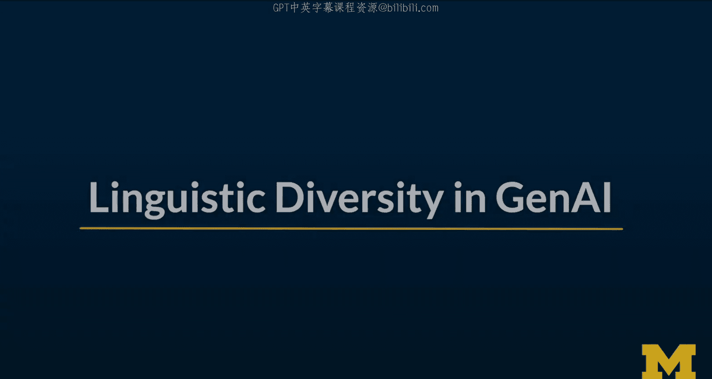
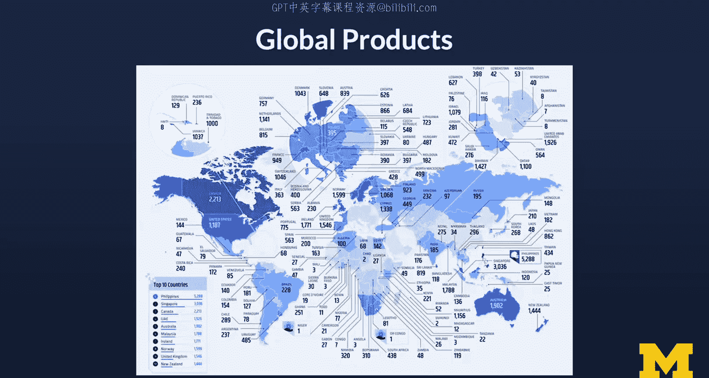
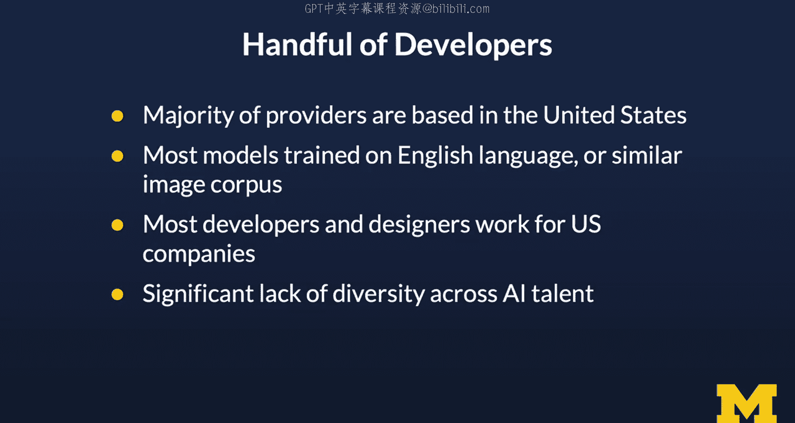
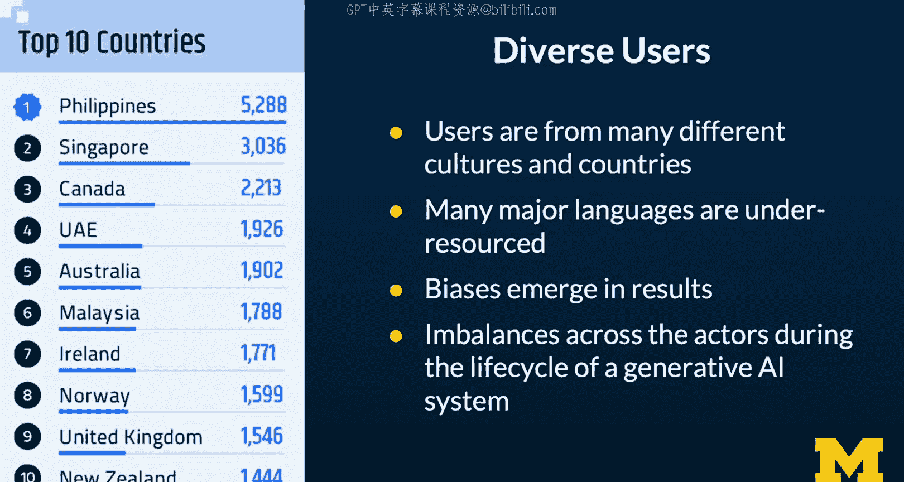
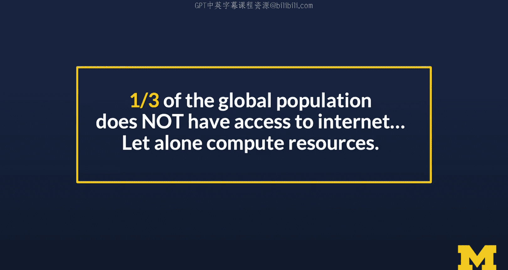
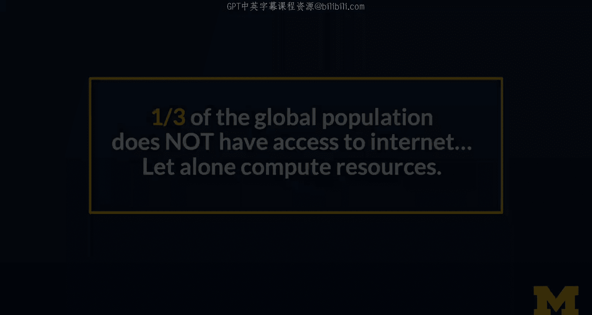

# 负责任生成式AI简介：16：生成式AI的语言多样性 🌐

在本节课中，我们将探讨生成式AI在全球范围内的普及情况，并深入分析其背后存在的语言多样性问题。我们将看到，尽管用户群体遍布全球且文化背景各异，但主导模型开发的公司、训练数据以及AI人才却高度集中，这导致了语言和文化代表性的严重失衡。

## 全球普及与兴趣

生成式AI工具已成为历史上采用速度最快的产品之一。这些产品激发了人们对未来可能性的兴奋。虽然关于其确切益处和最具影响力的用例问题，仍有待时间来解答。

要准确了解其全球用户数量以评估普及程度，目前存在困难。供应商很少披露用户数据，更重要的是，现在还存在许多基于开源模型构建的个人生成式AI模型，以及不同行业公司构建的各类系统。

然而，已有一些代理分析显示了全球对这些产品的好奇心。一项研究展示了各国每十万人中搜索生成式产品的次数。虽然图表上的数字难以辨认且时刻变化，但我想分享的是图表本身所传达的信息：生成式AI系统在全球范围内吸引了关注和实验。

## 开发与控制的集中性

尽管存在全球性的兴趣，但实际上只有少数集中在美国和中国的公司控制着主要的生成式AI模型。这少数几家公司决定了产品的设计、开发和优先级。

以下是当前格局的主要特点：
*   **地域集中**：大多数提供商总部位于美国。
*   **数据偏向**：大多数模型使用英语和类似的图像语料库进行训练。
*   **人才同质**：大多数开发者和设计师为美国公司工作。
*   **多样性缺失**：在这些公司内部乃至整个行业内，AI人才在背景和经验方面显著缺乏多样性。

## 用户群体的多样性与产品局限

与生成式AI公司及其团队的相对同质化形成鲜明对比的是，其用户基础反映了丰富的文化差异。事实上，之前展示的标准化搜索量图表所揭示的前十名国家，正体现了用户群体的显著多样性。

用户从使用中获得的体验和益处可能各不相同。许多用户的母语在这些产品中很少得到体现。这些模型使用的文本语料库不一定源自这些国家的内容，而更多是互联网文本对这些文化的反映。无论这些信息是从在线新闻源、讨论论坛还是社交媒体等渠道抓取的，这自然可能导致结果中的文化偏见和刻板印象。

## 全球语言格局与数字代表性

当今世界有超过7000种语言，展现了丰富的语言遗产和多样性。然而，某些语言占据了更大的代表性。事实上，仅几十种语言就覆盖了世界超过一半的人口。其中，英语的代表性尤为突出。

撇开历史、政治和社会原因不谈，尽管英语母语者数量较少，但其总使用人数却非常高。然而，即使英语在使用者数量上领先，这一统计数据也可能具有误导性。

以下是需要关注的两个关键点：
*   **代表性不足**：英语使用者仍不到世界人口的20%。
*   **内部差异**：并非所有人都说同一种英语。英语国家之间，甚至同一国家内的不同群体之间，都存在方言差异。不考虑这些差异的语言语料库，也可能导致模型在不同英语方言、俚语或词汇上的性能较低。优先考虑美式标准英语甚至会削弱单一语言本身的丰富性。

审视代表性的另一个角度，是观察全球语言在数字领域的呈现情况。对语言资源化程度的研究分析，为我们清晰地描绘了不平衡的图景。

以下是资源高低分类的示例：
*   **高资源语言**：如英语、西班牙语、德语、日语、法语、普通话、俄语、荷兰语、土耳其语、印地语等，构成了最大量的标注和非标注文本数据。
*   **数据可用性的影响**：数据的可用性直接影响到基于它们所能构建的语言系统的类型和质量。

语言的数量与数据资源绝对不成正比。即使在最高资源的语言中，英语再次被过度代表。虽然英语使用者数量不到世界人口的20%，但英语在线内容却占总量的50%以上。

尽管一些语言模型支持其他语言用于翻译或转录目的，并且中国也有基于普通话的应用，但世界仍然缺乏为许多其他语言使用者服务的语言模型。为其他语言构建文本资产的小型研究或社区努力，无法与英语或普通话内容的日常产出相提并论。

另一个例子是Common Crawl语料库的构成，它是预训练大语言模型的主要语言数据集之一。数据集中每种语言所占的比例，显示了某些高资源语言的压倒性影响力。仅英语本身就占总数据的45%，这些语言合计占整个数据集的75%以上。

## 非数字知识与可及性挑战

这些比较显然不意味着每个社群都需要自己的数据被大规模使用，或者他们需要投资于大语言模型。选择权属于使用该语言的社群。这些数字也不反映特定语言的价值或遗产。

同样重要的是，可用数字文本的规模并不意味着所有人类知识和经验都被捕获。虽然生成式AI系统受限于其数据集，但我们的社会运行在许多其他非数字知识层面之上，例如我们的口述历史、文化传统或经验。

作为个体，我们基于人际关系、过去的互动、社会经济、政治和文化教养做出明智决策。作为组织，尽管许多工作现在可能是数字化的，但我们仍然严重依赖机构历史。

关于非数字知识，我们还应该记住，世界上有三分之一的人口根本无法接入互联网，更不用说使用生成式AI产品或完整的数字资源了。

## 总结

本节课中，我们一起学习了生成式AI在全球普及背景下所面临的语言多样性挑战。我们了解到，模型开发和控制权高度集中，训练数据严重偏向英语等高资源语言，导致AI产品难以充分代表和服务于全球多样化的用户群体。同时，大量非数字知识和全球数字鸿沟的存在，提醒我们生成式AI的能力和影响仍有其边界。认识到这些局限性，是迈向更负责任、更包容的AI发展的重要一步。