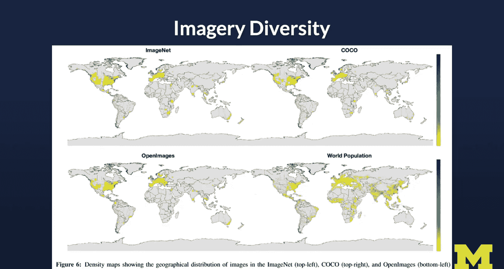
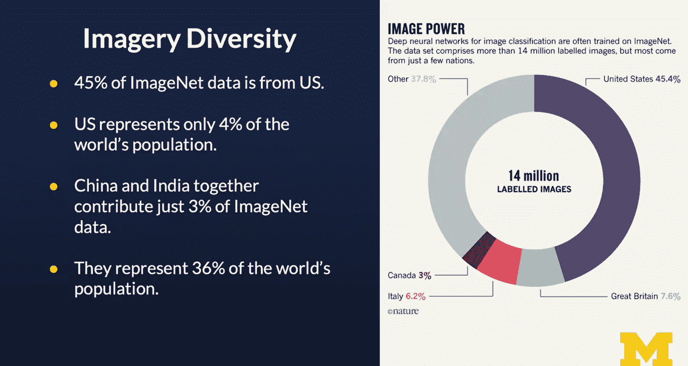
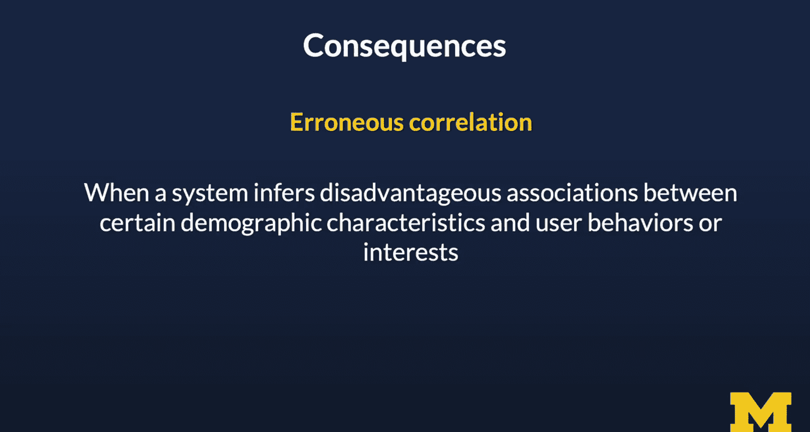
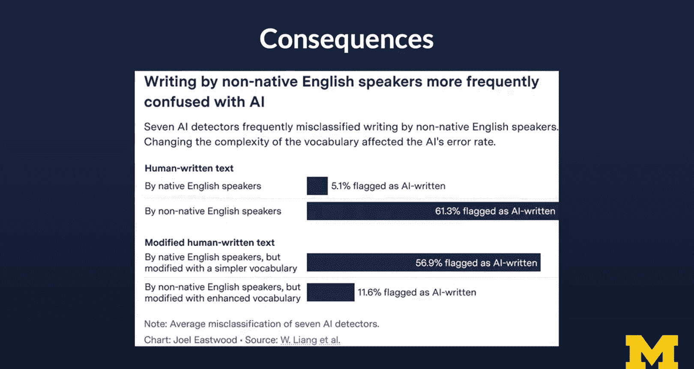
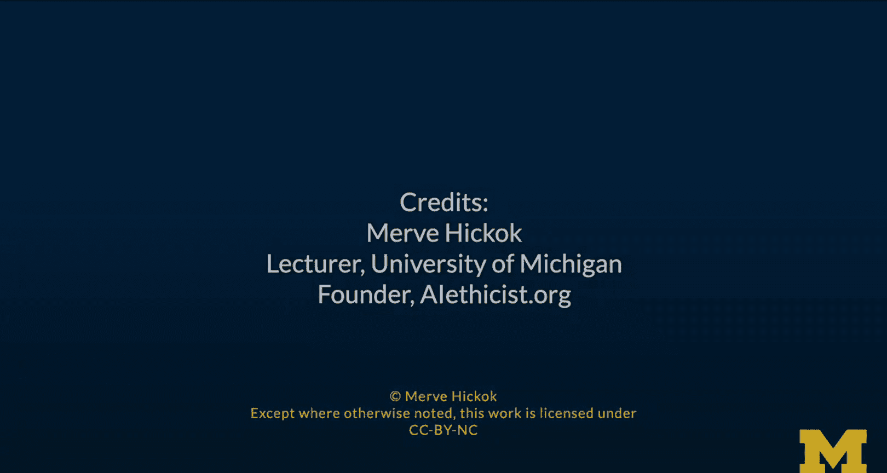

# 负责任生成式AI简介：1.7：生成式AI图像多样性问题

在本节中，我们将探讨生成式AI系统在图像数据多样性方面面临的挑战，分析其成因、表现及潜在后果。

尽管生成式AI产品令人兴奋，但它们仅代表了人类多样性的一小部分。不同文化的数字呈现不仅体现在语言数据上，也体现在图像数据中。换句话说，用于训练生成式AI系统的图像数据同样只反映了全球文化遗产的一小部分。图像数据集中存在的过度代表与代表不足问题并非新问题。

## 数据集中根深蒂固的偏差

上一节我们提到了数据代表性的问题，本节中我们来看看这个问题在图像数据上的具体体现。

用于图像识别和分类目的的数据集早已存在过度代表美国和欧洲国家图像的问题。而其他地区的图像在这些训练数据集中则很少被代表。当模型在来自代表不足地区的图像上进行训练时，其性能预计会显著下降。

## 偏差如何被放大与固化

问题的严重性会因数据集中某个对象出现的次数及其标注方式而被放大。每个国家和文化在家庭用品、服装、交通工具、食品等方面都存在差异。然而，那些在数据集中占多数的文化会被视为标准。

以下是几个具体的例子：
*   **婚礼礼服**：当系统被简单提示“一件美丽的婚礼礼服”时，它将生成数据集中出现最多的那种礼服图像，这会被确立为一种规范或标准。然而，如果你是日本或印度用户，你将不得不更具体地提示系统，才能得到你心目中符合自己文化规范或标准的结果。
*   **模型性能差异**：这种代表性问题还会导致泛化问题。模型可能为某些地区生成质量更高或更具创意的图像，而对来自代表不足文化的物体图像则表现较差。
*   **刻板印象**：生成式AI模型也可能简单地反映物体中陈腐或刻板的形象。现实生活更加复杂和多样，但这不是模型能够捕捉到的细微差别。

## 治标不治本的“修复”尝试

为了应对数据集中的代表性问题，开发者可能会采取硬编码指令。系统提示或元指令可能要求系统覆盖数据分布，并强制其产生看似多样化的结果。

这些指令并不能解决数据集质量低下或缺乏上下文理解的根本问题。它们充其量只能被视为临时补丁。它们可能在某些情况下奏效，但也可能严重失败或提供历史上不准确的结果。

## 偏差带来的严重后果

这些关于代表性、特定文化或观点被放大以及权力失衡的问题并非没有后果。根据目标用户或消费者群体，可能会产生重大影响。

以下是可能产生的一些负面影响：
*   **强化偏见**：结果可能强化某些世界观、文化和语言，同时边缘化其他。
*   **同质化与幻觉**：强制同质化的产品可能为某些用户群体或语言产生更多“幻觉”或扭曲的结果。
*   **产品失效**：在某些情况下，产品可能频繁失效或完全无法工作。
*   **有害内容管理缺失**：由于缺乏透明度或支持机制，一些用户可能无法检测或管理有害内容。
*   **错误关联**：系统可能错误地将用户行为数据点与某些人口统计特征关联起来。

当AI系统失败时，这不仅仅是软件错误。这些系统影响着个人的权利、资源获取、福利和机会。因此，在我们开发和部署这些系统时，我们同样对接收端的人们负有责任。

## 案例分析：AI内容检测器中的偏见

让我们看一个具体的例子。随着生成式AI模型的推出，人们对学生使用AI完成作业的担忧急剧上升。许多教育机构改变了他们的政策、作业说明和/或控制机制。即使是主要的生成式AI公司也强调，目前没有可靠的方法来检测合成内容。

然而，这并没有阻止一些声称其产品可以可靠检测作业中合成内容的供应商出现。在多个实例中，这些系统错误地将国际学生的作业标记为AI生成。这些系统倾向于将句子更简单或下一个词更可预测的写作标记为AI生成，而这在非英语母语者的写作中可能更为普遍。

在这些事件被报道后，The Markup的记者分析了其中七款AI检测工具。结果显示，这些工具对非英语母语者存在显著偏见。一些公司随后关闭了其软件中的AI检测功能。然而，仍有许多较小的供应商继续他们的宣传，尽管这对可能被错误标记的人构成了重大风险和伤害。

## 总结

本节课中我们一起学习了生成式AI在图像多样性方面面临的严峻挑战。我们了解到，训练数据的偏差会导致模型输出固化特定文化标准、表现不平衡，并可能放大刻板印象。临时性的指令“修复”无法解决根本问题。这些偏差不仅影响输出质量，更可能在实际应用中（如AI内容检测）对特定群体（如非英语母语者）造成不公和伤害。这提醒我们，在开发和应用生成式AI时，必须正视并努力解决数据代表性问题，承担起对用户和社会的责任。