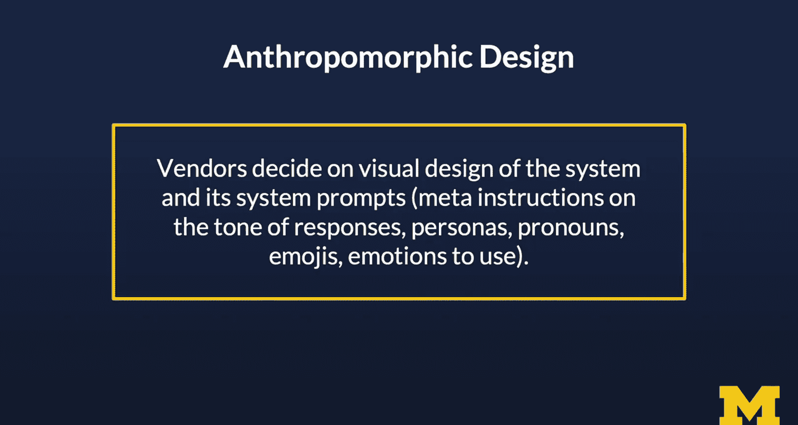
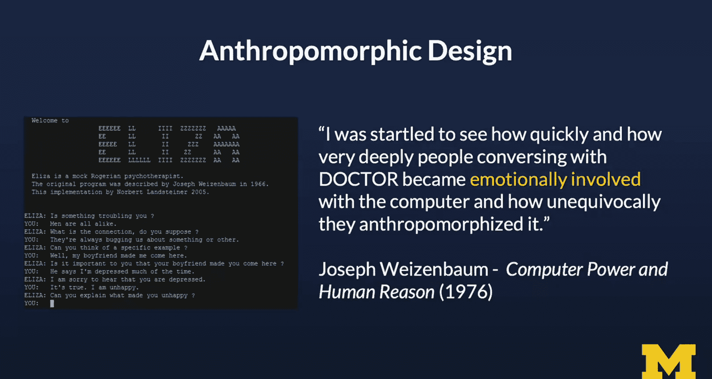
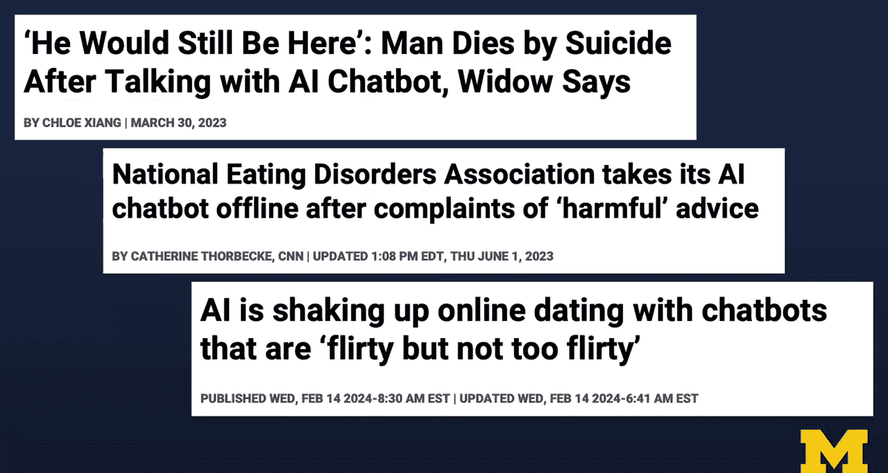

# 2：拟人化设计伦理

在本节课中，我们将探讨一个影响用户对生成式AI系统能力认知的关键问题：**拟人化设计**。我们将了解设计决策如何塑造用户对AI的理解，以及这种设计可能带来的伦理风险。

---

## 概述：设计如何影响用户认知

上一节我们讨论了生成式AI的能力与局限性。本节中我们来看看，**产品设计、警告和披露信息**在塑造用户对系统能力和局限性的认知方面，扮演着至关重要的角色。

用户群体对生成式AI技术的理解程度差异巨大。因此，系统的设计方式会显著影响用户对其能力的感知。

---

## 拟人化设计的动机

以下是企业可能倾向于采用拟人化设计的一些常见原因：

*   **提升用户参与度**：让模型的回应听起来更像人类，可以增加用户的互动兴趣。
*   **扩大数据收集**：更自然的互动可能鼓励用户更频繁地使用系统，从而收集更多使用数据。
*   **减少使用摩擦**：拟人化的交互方式可能让用户感觉更舒适、更直观，降低使用门槛。

---

## 拟人化设计的潜在风险

然而，这些设计决策可能对用户产生非预期的影响。并非所有用户都理解语言模型是基于词语间的**统计关系**（`P(word_n | word_1, word_2, ..., word_{n-1})`）工作的。因此，他们可能不了解系统存在局限性，例如会产生不准确和有偏见的结果。

*   **在高风险场景中采取行动**：用户可能基于系统的回应，在现实生活的高风险场景（如医疗、金融）中采取实际行动。
*   **误认为在与人类互动**：许多用户可能将模型的输出解读为在与人类交流，或将人类的能力赋予系统。
*   **高估系统能力**：用户可能赋予系统比其实际拥有的更多的权力和能力。

关于拟人化设计的担忧早在第一个聊天机器人**ELIZA**出现时就被提出。与ELIZA互动的人们承认他们对系统产生了情感依赖。

---

## 现实世界的严重后果

如今，随着用户与集成了生成式语言模型的产品互动，这个问题变得更为复杂。

*   有用户因过于严肃地对待AI对话而导致自杀。
*   有组织部署的AI系统向已有健康并发症的人提供了有害建议。
*   在其他案例中，用户将人类特征赋予AI系统，并像与人类一样与之互动。

生成式AI系统被设计成模仿真实的人类语言和风格。它们能追踪大量的先前聊天记录，并使用第一人称代词、图像甚至语音进行回应，就像人类一样。

在最坏的情况下，恶意行为者可能部署这些系统来操纵个人。

---

## 设计决策的重要性

当系统被设计成使用第一人称代词回应、扮演助手或健康伴侣的角色、甚至被设计成提及情感时，用户可能会被误导。

虽然当用户广泛分享这些体验并将新兴能力归因于统计模型时，这可能有助于公司的公关策略，但此类方法可能与负责任的生成式AI实践和方针相矛盾。

让我们看另一个例子：模型被设计成使用第一人称代词回应，并通过表情符号表达情感。回应本身包含了只属于有感知生物的**行动和技能**。

想象一个场景：用户询问向模型分享一个秘密是否安全。模型没有用准确描述产品数据保护和隐私实践的方式来回应，而是以一种让用户感到安全的方式回应。模型向用户**宣誓忠诚**，承诺对数据进行加密和保护，同时回应的方式仿佛它真的能采取行动或控制后果。

---

## 幻觉与事实错误

有时，类人的决策和**幻觉**甚至可能导致系统提供事实错误的信息，并在用户提供准确信息和回应时反驳用户。

在这个例子中，语言模型提供了一个不准确的答案，并声称用户“与现实脱节”，这可能听起来很有趣。然而，请想象用户在更重要的主题上进行互动，例如健康、金融、政治冲突等。

---

## 总结

本节课中我们一起学习了**拟人化设计伦理**。我们了解到，虽然让AI系统显得更人性化可能带来商业利益，但它也使用户容易高估系统的能力、产生情感依赖，并在高风险领域盲目信任其输出。负责任的AI设计需要清晰传达系统的非人类本质及其局限性，避免利用人性化的交互来掩盖技术的统计本质和潜在风险。