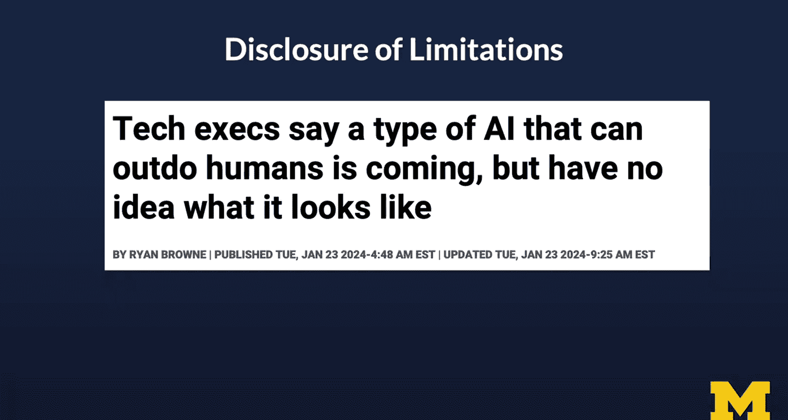
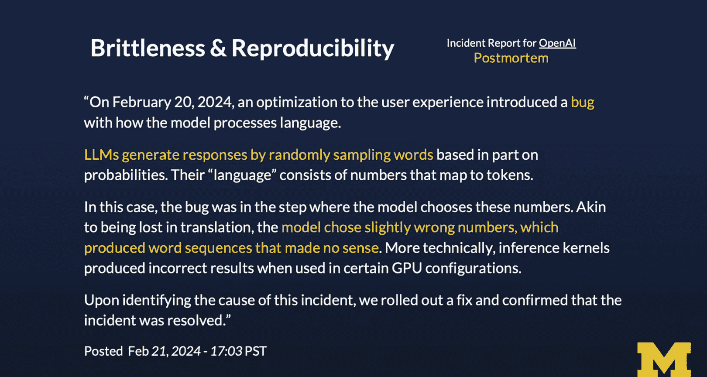

# 负责任生成式AI简介：3：现有披露机制的局限性

## 概述
在本节课中，我们将探讨当前生成式AI系统在信息披露方面存在的局限性。我们将了解为何清晰、透明的披露至关重要，以及不充分的披露如何导致用户困惑和潜在风险。

---

## 信息披露的缺失现状

上一节我们讨论了负责任AI实践的重要性，本节中我们来看看当前信息披露机制的具体问题。

关于生成式AI系统能力和局限性的清晰披露，不仅在产品设计中缺失，也存在于一些科技公司高管的公开声明中。

负责任的做法要求我们必须评估潜在的风险和危害，并为保障措施做出贡献。夸大产品能力或技术的未来演进，而在主流用户对其理解非常有限的情况下，这带来的困惑可能多于益处。

## 负责任实践的要求

为了帮助用户更好地理解这些技术，负责任的应用程序实践要求我们改进知识传播和透明化实践。通过这些努力，我们可以引导用户更明智地采用这些产品。

## 透明披露的益处

透明地揭示底层模型缺乏推理能力，或对情境背景及后果的理解不足，可以为用户节省时间和精力，避免他们产生挫败感和愤怒。

产品披露可以超越法律条文，或超越“用户已对AI技术有扎实理解”的假设。同样，披露内容也应与系统的实际用户界面和用户体验设计保持一致。

例如，在用户界面上设置一个默认警告，明确指出这些系统可能不准确，这能起到很大作用。这比仅仅在政策文件中提及这些局限性要好得多。

## 对用户认知的影响

通过清晰的披露，消费者可以更好地理解责任可能转移的情况，并且明白他们不应完全相信系统的准确性、事实性或完整性。

科技高管的声明可能暗示生成式AI即将取代人类。然而，产品的不稳定性为我们提供了一个窗口和机会，来进行更深入的讨论。

例如，当某个产品开始大规模产生完全不合逻辑的回应时，随后的事件报告和事后分析发出了一个明确的信息：一个错误可以显著影响系统的性能和结果的复现性。

---

## 总结
本节课中，我们一起学习了现有生成式AI信息披露机制的局限性。我们认识到，清晰、透明且与用户体验紧密结合的披露，对于帮助用户理解技术、管理预期和降低风险至关重要。夸大宣传或隐藏局限性只会导致用户困惑，而坦诚的沟通则能建立信任，并为技术的负责任采用铺平道路。