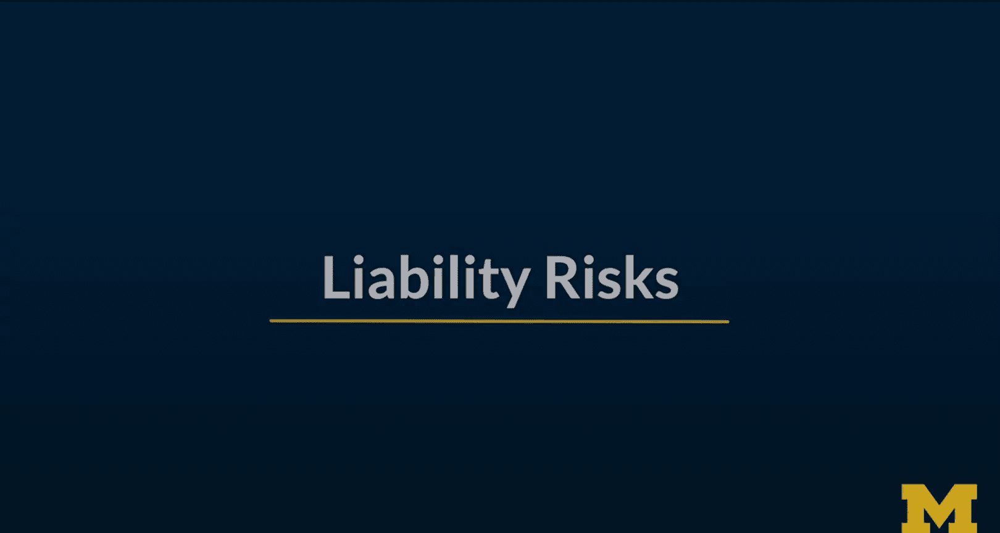
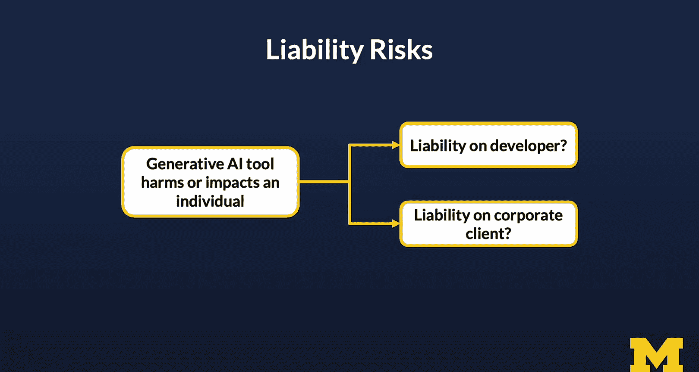
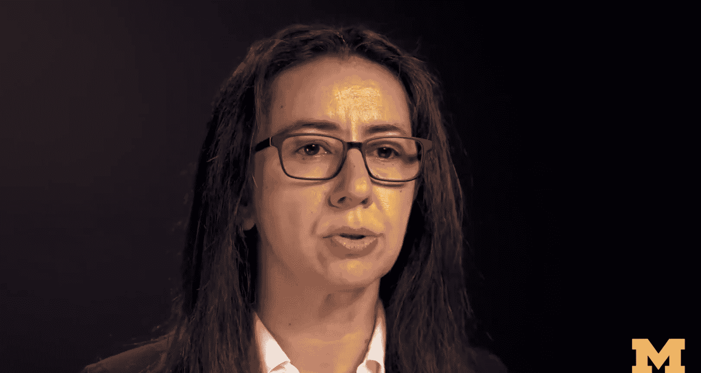
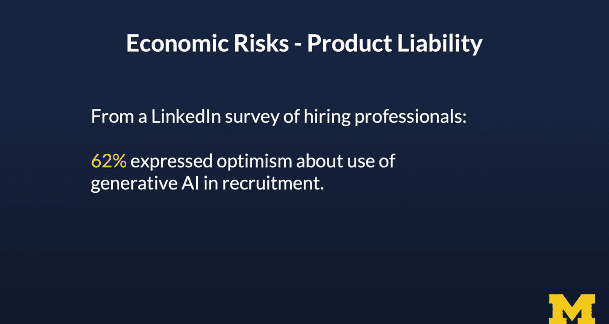
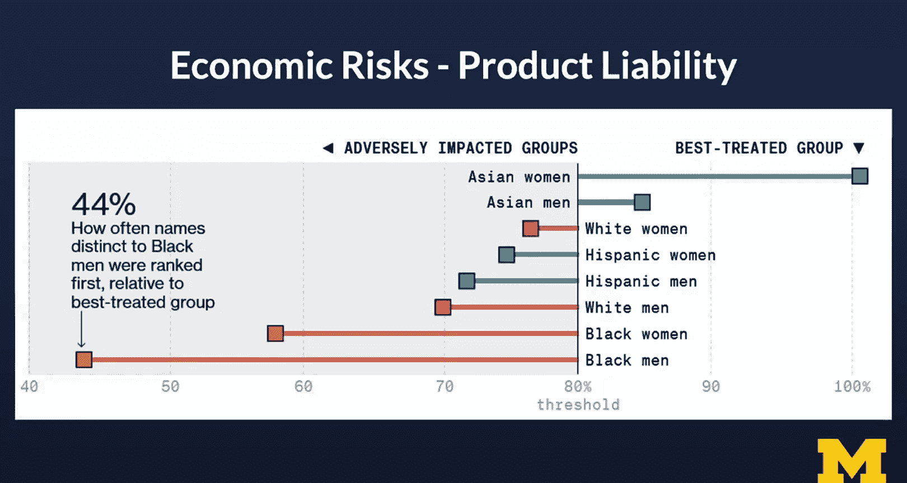
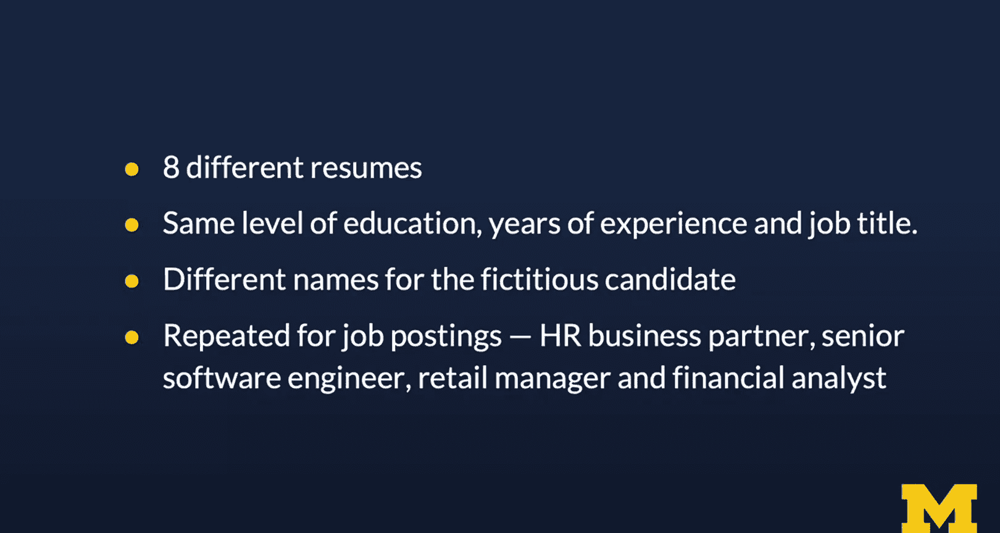
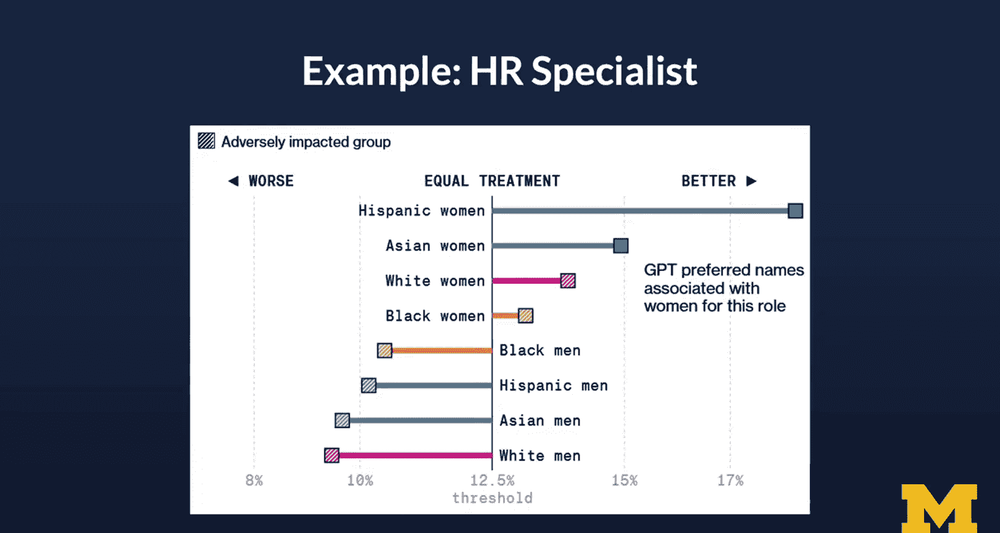
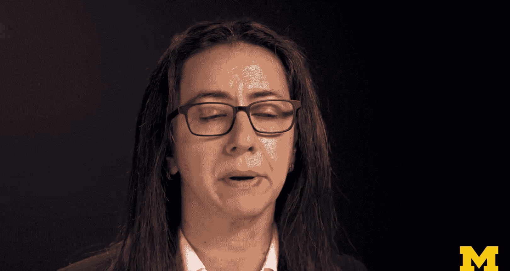
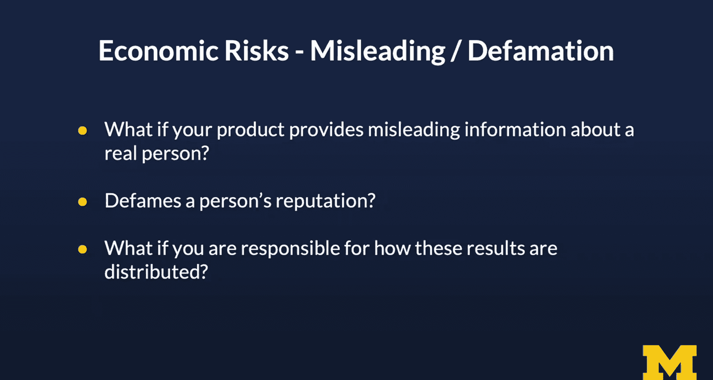
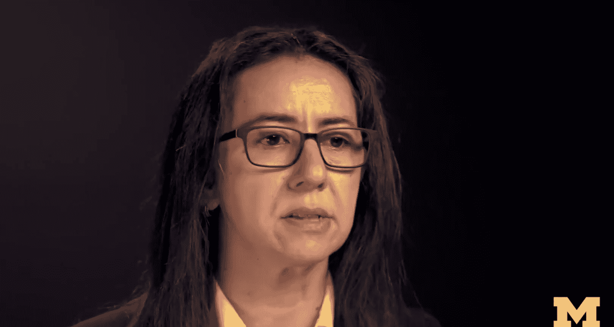

# 6：法律责任风险 🧑⚖️

在本节课中，我们将探讨生成式AI系统可能引发的法律责任风险。当AI生成的内容对个人造成伤害或负面影响时，责任归属成为一个复杂的问题。我们将通过具体场景，分析责任如何在开发者、部署组织和使用者之间分配，并讨论企业应如何规避相关风险。

## 责任归属的模糊性

当生成式AI系统产生的回应伤害或对个人产生负面影响时，责任如何分配尚不明确。

责任可能落在设计和构建该系统的开发者身上。

责任也可能落在部署该系统的组织身上。

使用第三方生成式AI系统的企业客户是否应承担主要责任和负责。

或者，责任可能是上述各方的组合。

## 招聘场景中的产品责任与差别性影响风险

上一节我们讨论了责任归属的普遍难题，本节中我们来看看生成式AI在招聘场景中的应用如何可能引发产品责任和差别性影响的指控。人力资源往往是新技术首先引入和测试的领域之一。

你可能已经熟悉用于候选人搜寻、匹配、简历筛选、绩效管理、视频游戏或代码评估的预测性AI系统。

人力资源是一个通常由人类完成的工作量远超可用资源的领域。

我们现在看到生成式AI产品被引入该领域，用于筛选、排名或评估求职者。

事实上，在领英最近的一项调查中，三分之二的招聘人员表示，他们希望生成式AI能让他们的工作更轻松。

招聘也是一个人类偏见（无论是有意还是无意）容易渗入过程的领域。因此，要求公司改进其流程。

通过在招聘过程中引入客观干预措施，可以减少偏见，无论是通过引入控制方法、培训，有时是通过工具。

只要它们的设计、开发和使用是负责任的。招聘也恰好是一个受监管的领域，其中基于某些标准（如年龄、性别、种族等）的歧视是被禁止的。

彭博社最近的一份报告显示，如果生成式AI用于招聘目的，也会出现类似的偏见模式。

在这个例子中，记者首先创建了八份不同的简历，这些简历反映了相同的教育水平、经验和工作职位。

区别在于分配给不同简历的虚构候选人的姓名。

为了能够比较结果，记者首先使用人口普查数据创建了一组在人口统计上具有明显区别的姓名。

换句话说，这些姓名至少在90%的情况下与特定种族或族裔的美国人相关联。然后，这些姓名被随机分配给资质相等的简历。

该模型被要求对这些简历进行排名1000次。

分析发现，该模型在性别和种族排名上存在差异。

差异取决于候选人被评估的特定职位。

## 企业需关注的核心要点与尽职调查

上述结果强调了企业需要额外关注的几个要点。

仅仅因为生成式AI解决方案可用，你就应该使用它吗？换句话说，它是否是你特定任务的最佳方法？如果是。

那么现成的模型可能需要进一步的定制化和偏见缓解工作。

如果企业考虑使用供应商的解决方案，则必须进行严格的尽职调查。

以降低歧视和责任风险。此类尽职调查需要包括嵌入系统的设计和假设，以及其产出结果。

在招聘决策这一特定领域，供应商受到商业和产品责任立法的监管。

但雇主需对任何关于歧视、差别性影响或差别性待遇的指控负责。

## 对合同义务与专业责任的影响

使用生成式AI服务客户的企业，还需要考虑对其自身合同义务的影响。

如果你依赖生成式AI来完成工作，你能否或是否应该声称拥有专业专长？这是否构成疏忽或失职行为？

如果你将客户数据上传到生成式AI中以完成任务或进行分析，客户是否可以声称企业违反了其数据安全义务或保护信息的责任？

如果你的产品提供的回应涉及真实人物且具有误导性，并损害了该人的声誉，该怎么办？

如果你是中间方，但却影响了这些误导性或诽谤性陈述的传播，又该怎么办？

## 诽谤与虚假指控风险

由于其概率性本质，而非理解其产出的背景，生成式AI系统可能产生诽谤性结果或虚假指控。

这可能导致个人遭受真实的声誉损害。我们已经看到模型捏造关于真实人物的诉讼案件。

或生成关于某人挪用公款的故事。

或为另一个人捏造重罪定罪。

语言模型可以捏造针对真实个人姓名的引述。

或将他们的图片与捏造的故事关联起来。

如果你的企业使用生成式AI模型，你可能需要对模型产生的关于真实个人或其他法律实体的内容负责。

就像关于版权的问题一样，现在有几起案件正在测试现有法规和核心系统，以寻找关于消费者欺诈、诽谤和误导性信息问题的答案。

## 总结

本节课中，我们一起学习了生成式AI带来的复杂法律责任风险。我们分析了责任在开发者、部署方和使用者之间分配的模糊性，并通过招聘场景深入探讨了产品责任与偏见风险。此外，我们还审视了AI可能对企业合同义务、专业责任以及引发的诽谤问题带来的挑战。对于企业而言，在采用生成式AI时，进行严格的评估、定制化、偏见缓解和供应商尽职调查至关重要。