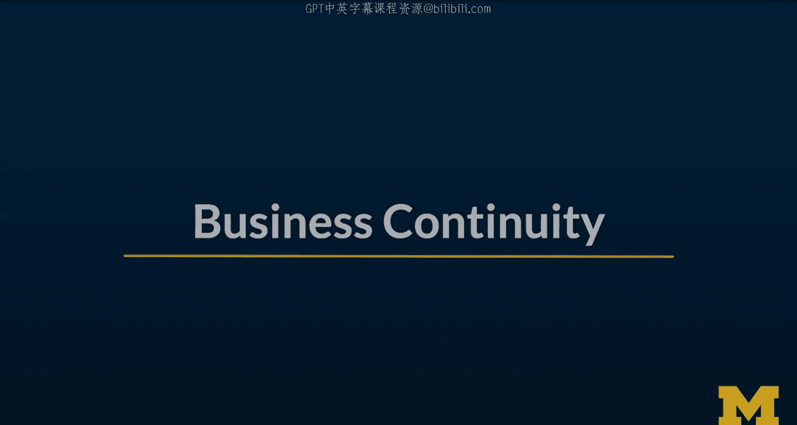
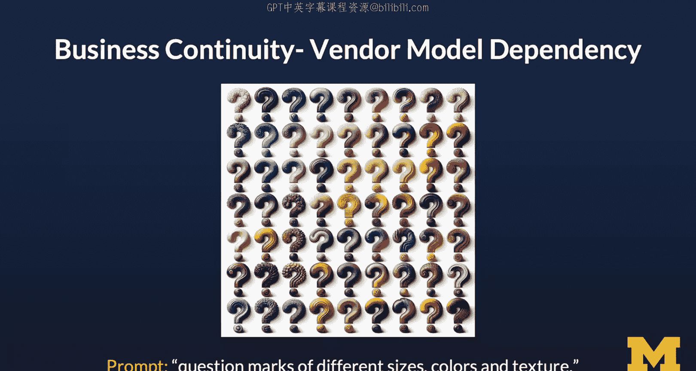
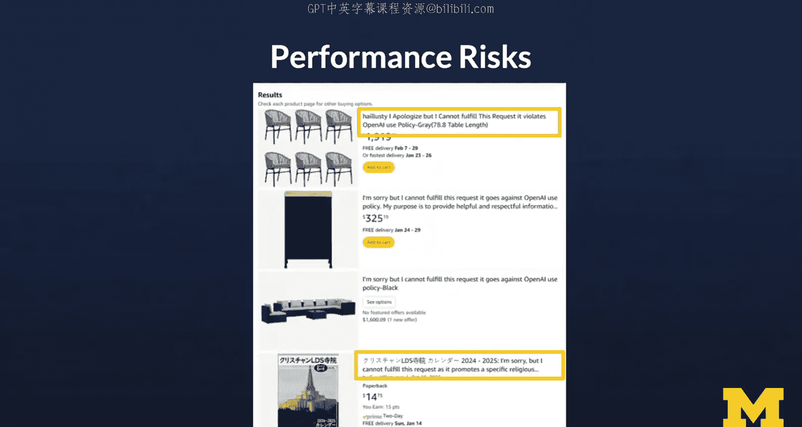
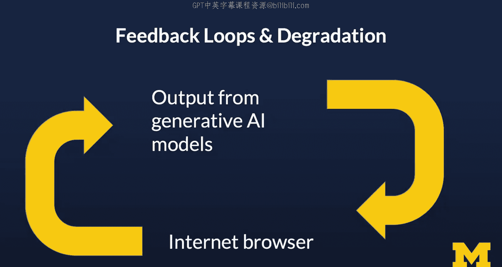
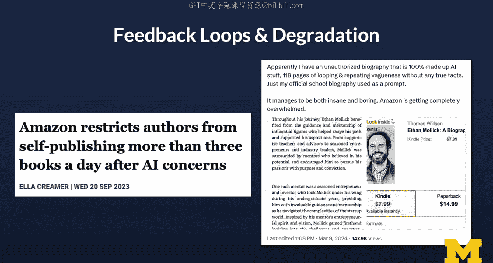
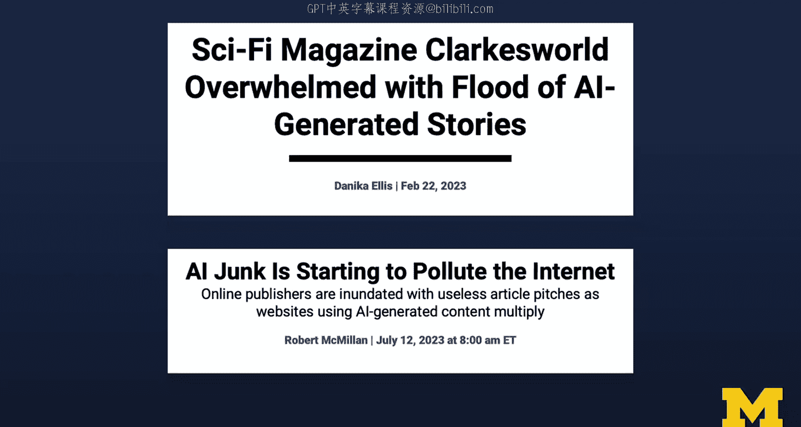

# 7：业务连续性保障 🔄

在本节课中，我们将探讨企业在采用生成式AI时，为确保业务连续性所需考虑的关键问题。我们将重点关注对上游提供商的依赖、模型性能风险以及可能出现的反馈循环问题。

## 对上游提供商的依赖

上一节我们讨论了生成式AI的潜在风险，本节中我们来看看企业在技术整合中面临的实际挑战。一个严肃的商业考量是对上游提供商的依赖。

除非你从零开始构建一个生成式AI系统，否则你很可能会连接到现有的提供商系统，或者使用公开可用的模型来构建自己的系统。

为了从服务提供商那里获得充分的保证，你需要提出以下问题：

*   **关于训练数据集**：模型的训练数据是如何获取和处理的？
*   **关于模型可用性**：你所依赖的基础模型未来是否会持续可用？
*   **关于模型更新**：模型的未来更新可能会对你的产品产生哪些下游影响？

如果你的产品功能依赖于另一个模型，你需要获得何种保证？

*   **性能保证**：模型性能的稳定性如何？
*   **对抗性攻击防护**：模型如何抵御恶意攻击？

你如何提前预知变更的程度及其对你产品的影响？甚至在事后如何评估？

在本课程的前面部分，我曾提到尽职调查和治理对于考虑开发或部署生成式AI系统的组织至关重要。企业必须理解其对上游提供商的依赖程度，以及他们正在承担何种风险。

如果不清楚AI系统的训练数据来源，我们就无法对风险做出明智的决策。这些数据是否能代表我们的消费者基础、问题和偏好？上游供应商如何分析、缓解和管理风险？

## 整合现有系统的考量

当将现有系统整合到你的业务流程中时，理解其性能、风险和局限性同样重要。

你使用的聊天模型是否有能力响应你设想的所有产品范围？该用例是否容易进入故障模式？例如，你可能使用生成式AI模型来帮助根据图像生成产品名称或描述。

考虑到图像数据集的代表性问题，以及系统在理解上下文方面的局限性，你能依赖该系统来产生准确的结果吗？

## 反馈循环与模型退化

关于模型持续性能的另一个问题，是反馈循环的可能性和模型可靠性的逐渐退化。

生成式AI模型是通过从互联网上抓取和整理数据构建的。然而，这些系统生成的合成输出现在也正流入互联网，并出现在网络搜索结果中。

当未来互联网内容再次被抓取时，这些新的合成内容可能会创建一个反馈循环。每天都有许多完全由AI生成的电子书、媒体文章被添加到互联网和数字语料库中。

这种循环最终可能导致AI模型用自己的数据进行训练，而这些数据包含了幻觉和进一步的偏见。这种循环也可能降低互联网搜索结果本身的质量。类似的问题现在也出现在科学期刊中。

这个问题影响了学术写作的质量。它也可能影响毫无戒心的读者如何理解这些文章中包含的问题。事实上，一些研究人员警告，从其他模型产生的数据中学习可能会导致**模型崩溃**。

模型崩溃是一个退化过程，随着时间的推移，模型会忘记真实的底层数据分布。即使对于长期学习条件近乎理想的情况，这个过程也是不可避免的。

---

本节课中，我们一起学习了企业在部署生成式AI时保障业务连续性的核心考量。我们认识到，必须审慎评估对上游提供商的依赖，深入理解整合系统的性能与局限，并警惕由合成数据污染引发的反馈循环和模型退化风险。这些是确保AI系统可靠、可持续地服务于商业目标的基础。