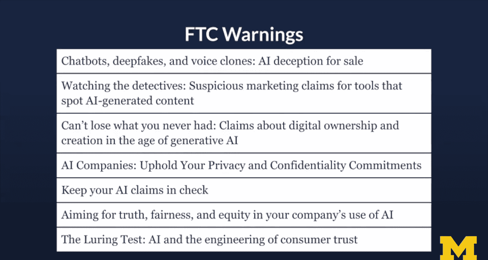

# 8：监管预警机制 🚨

在本节课中，我们将探讨监管机构为考虑部署生成式AI系统的企业提供的指导与预警。我们将了解监管机构关注的核心问题，以及企业应如何从治理和消费者权益的角度进行自我审视，以避免风险并建立信任。

上一节我们讨论了生成式AI的全球监管框架。本节中，我们来看看监管机构向企业发出的具体预警和指导性问题。

## 监管机构的关注点

监管机构已就企业应自问的关键问题提供了指导或发出警告。这些问题旨在引导企业在开发和部署AI产品前进行审慎评估。

以下是美国联邦贸易委员会提出的部分关键问题示例：

*   **产品合理性**：你是否应该制造或销售这款特定的AI产品？
*   **风险缓解**：你是否有效地缓解了相关风险？
*   **检测依赖**：你是否过度依赖产品发布后的检测机制？
*   **信息真实性**：你是否在人们所见、所闻或所读的内容上误导了他们？
*   **能力夸大**：你是否就AI产品的能力欺骗或误导了人们？
*   **条款变更**：你是否在悄悄修改你的服务条款和条件？

## 对企业的明确警告

除了提问，监管机构还对某些企业行为发出了明确警告。他们特别警惕企业试图通过以下方式转移责任：

*   声称其产品是一个“黑箱”，先进到连自己的开发者都无法理解其工作原理。
*   声称没有合适的手段来测试自己的产品。

## 从治理与消费者权益出发

消费者的认知影响产品的采用率以及他们对企业信任度的评价。因此，从治理和消费者权益的视角出发，负责任的企业在推出生成式AI产品前，可以考虑以下几个问题：

以下是企业在产品 rollout 前应思考的几个治理与消费者权益问题：

1.  **透明度**：第一步是让消费者知道正在使用生成式AI系统，并明确告知它能提供和不能提供何种支持。
2.  **反馈与申诉机制**：如果消费者认为或因生成式AI的输出而实际受到损害，企业应提供何种机制让消费者反馈给组织，甚至升级问题以求解决？
3.  **保障措施**：此外，可能需要向消费者提供保证，即企业已采取预防措施，以确保公平和准确的呈现。
4.  **信任维护**：信任需要被维护。当消费者因企业的实践或所开发/部署的生成式AI工具受到负面影响时，他们可能会失去对该组织乃至整个新兴技术的信任。

## 负责任实践的重要性

负责任的应用程序实践和主动的安全保障措施，对于避免上述不良结果起着至关重要的作用。

---

本节课中，我们一起学习了监管机构对生成式AI企业的预警机制。核心要点包括：监管机构关注产品的合理性、风险控制、透明度以及企业责任；企业应避免使用“黑箱”等借口推卸责任；从消费者权益出发，企业需确保透明度、建立反馈渠道并提供保障，以维护至关重要的信任。采取负责任的实践是避免风险、实现可持续发展的关键。