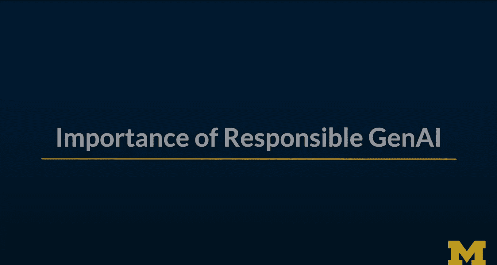
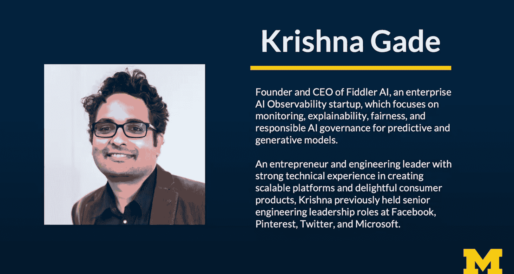

# 负责任生成式AI简介：9：负责任生成式AI的重要意义 🎯

在本节课中，我们将探讨负责任生成式AI的重要性，了解其核心挑战、潜在风险以及构建可信赖AI系统所需的治理框架。我们将从一位行业专家的视角出发，深入理解在商业和社会中负责任地部署AI的关键考量。

---

## 概述

生成式AI，特别是大型语言模型，正在引发一场深刻的技术变革。然而，与传统的确定性软件不同，AI模型具有非确定性和“黑箱”特性，这带来了独特的信任与透明度挑战。本节课将系统性地分析这些挑战，并阐述建立AI可观测性与治理框架对于企业和社会可持续发展的至关重要性。

---

## 从个人经历到行业洞察

上一节我们概述了课程主题，本节中我们来看看分享者创立Fiddler公司的背景与动机。这段经历揭示了大型科技公司内部面临的AI可解释性挑战，并预示了更广泛的企业将遇到的类似问题。

我曾在Facebook担任动态消息团队的工程负责人，负责为机器学习工程师构建基础设施，以监控模型、实验并解答来自公司各部门的疑问。例如，“为什么这条新动态出现在我信息流的顶部？”或“为什么我会错过朋友的生日帖子？”由于动态消息排名系统的复杂性，回答这些问题非常困难。

这就像面对一个黑箱系统，需要揭开其神秘面纱，让公司其他成员能够理解和解释它。我在Facebook参与的一个名为“我为什么看到这个”的项目，旨在向人们揭示动态消息排名算法的内部工作原理，提供人类可读的洞察。这便是我进入AI可解释性领域的开端。

在科技行业工作的15年里，我从事过搜索质量、数据分析和最终机器学习等各种基础设施项目。我发现，与传统软件相比，机器学习模型非常不同。它们是非确定性的，对人类而言也是黑箱，但当它们工作时却能产生神奇的效果。因此，核心问题是：我们如何有信心地采用ML模型和AI模型？

Facebook的经历促使我创立了Fiddler。像Facebook和谷歌这样的公司拥有大量工程师来构建内部工具，但对于企业（如银行、保险公司、制造公司等）而言，它们在尝试采用AI时也将面临同样的信任和透明度问题。我们希望建立一家公司来服务它们，提供工具，让它们无需自己从头构建。这就是Fiddler的起点。

---

## 企业AI可观测性平台

上一节我们了解了行业挑战的起源，本节中我们来看看Fiddler如何构建解决方案来应对这些挑战。

如今，我们构建了一个称为企业AI可观测性的产品。Fiddler的功能是检测所有不同类型的AI应用，从大型语言模型应用到简单的机器学习模型，以提供关于其性能、模型退化、准确性、偏见、幻觉、安全问题等各类风险的洞察。我们通过一个统一的仪表板来提供所有这些信息。

我认为生成式AI在一个非常大的维度上很有趣。许多生成式AI应用并非从头构建。很多公司所做的是，采用由微软、OpenAI、谷歌等大公司创建的预训练模型，然后用自己的定制数据对其进行微调或提示工程，以构建LLM应用。因为从头构建LLM模型成本高昂，大多数公司都在这样做。

作为这个过程的一部分，存在几个问题：
*   一是我们不知道这些LLM模型是如何训练的，使用了何种数据。大多数大型语言模型是在整个互联网语料库上训练的。
*   但您是在这些预训练模型之上构建自己的应用。因此，当投入生产时，模型表现如何、是否会幻觉、是否会产生有害内容、是否会泄露任何私人信息，这些问题都是高管们最关心的。

---

## 生成式AI的新风险与挑战

上一节我们介绍了企业采用生成式AI的常见模式及其带来的问题，本节中我们深入探讨生成式AI特有的新型风险。

这些大型语言模型或生成式AI模型的另一个特点是，它们某种程度上可以即兴编造内容。因为它们本质上是预测您输入的下一个词、下一个序列、下一个段落。它们不像是在进行推理，它们是在海量历史数据上训练的，基本上是在尝试预测下一个词序列。

因此，它们总是可以写出看似连贯、仿佛来自知识源的内容。这是一个大问题。当人类查看输出时，感觉它可能是合理的，但它很可能是一个不正确的陈述或答案。我们已经看到许多这样的案例，很多人写过关于如何“越狱”ChatGPT或让它说出不同内容的博客。

同样的问题也存在于毒性内容中。众所周知，互联网上存在大量仇恨言论。当您爬取互联网并将其馈送给这些模型时，它们可能会编造种族主义笑话，产生有害内容。这是另一个大问题。

因此，核心问题是：我们如何驯服这些LLMs，使其对企业应用有用？这些风险是新的，与预测性ML世界相比。因为预测性ML模型主要处理模型退化、偏见和缺乏透明度等问题，生成式模型也有这些问题，但生成式AI新增了这组新风险：幻觉风险、数据隐私风险、毒性风险。

---

## 人机信任的根本问题

上一节我们分析了生成式AI的技术风险，本节中我们来看看这些风险如何影响最终用户，并引出人机信任这一核心议题。

最终，我们是为人类构建AI产品。例如，我们可能构建一个大型语言模型应用来支持客户联络中心团队，以便客户支持团队成员能提供更好的服务；我们可能为法律团队构建一个总结法律文档的摘要应用；或者一家银行可能投资一个帮助台应用，让交易分析师能快速获得答案。

无论何种用例，这些应用都是由人类使用的，旨在快速获得问题答案或数据洞察。因此，问题是：人类如何信任这台机器？这种人机信任是一个根本问题。

当我们与机器打交道时，想象一下驾驶没有驾驶舱的飞机，或者操作没有控制面板的微波炉。我们已经习惯了这些需要持续反馈的界面，作为人类，我们在操作机器时会形成一种直觉。而AI作为一个黑箱，我们没有那种交互式的方式来理解它。这正是所需要的。

当涉及到像Fiddler这样的工具时，这就是我们提供的。这些洞察对各种利益相关者都非常有用：
*   模型开发人员在调试模型时发现它很有用。
*   消费模型输出的其他利益相关者，如主题专家、业务团队，也发现它非常有用。
*   试图在公司内建立治理流程的合规利益相关者，他们也想了解模型在幕后如何工作。

这归根结底是那个人机信任问题，更多地了解AI内部发生了什么。这基本上是一切问题的根源。

---

## 伦理考量与社会影响

上一节我们讨论了建立信任的工具需求，本节中我们进一步探讨不负责任的AI可能带来的深远伦理与社会影响。

我认为，在构建AI产品时，必须考虑伦理因素。否则，我们可能会为我们的孩子和他们的孩子创造一个反乌托邦的社会，不公平的黑箱模型将做出决策，这可能会使一部分社会受益，但许多其他人将被边缘化。希望这不会成为现实。

让我举一些例子。正如您提到的，这些大型语言模型是在庞大的互联网语料库上训练的。那么，是谁创作了互联网语料库？主要是那些有电力和互联网接入的privileged国家和privileged阶层。因此，您会发现互联网上大部分是英语内容，主要由西方国家创作。

因此，您会看到这样一种情况：这些用庞大互联网语料库预训练的大型语言模型，已经内置了这些固有的偏见。而现在，人们撰写的新文章、新内容实际上正在使用LLM，所以LLM正在喂养LLM。我们已经陷入了一个恶性循环。最近有人引用一个统计数据给我，说如今互联网上25%的内容可能是生成式AI的输出。

那么会发生什么？您会看到大量不同的声音、语言风格、民族风格等被边缘化。您会进入这种单一化的状态，这对我们人类来说并不好。我们人类非常多样化，这正是人类社会的精彩之处。每个人都有不同的文化、不同的说话方式、不同的处事方式。

另一个危险的方面是，当您真正将这些模型用于关键用例时，例如招聘、承保（我们讨论过）、或其他影响安全的应用，比如自动驾驶汽车，甚至国防和军事用例，这些将影响人类生命或某种人权，那么重大问题就会出现。

---

## 立法、治理与未来展望

上一节我们审视了不负责任AI的潜在危害，本节中我们来看看全球社会如何通过立法和治理框架来应对，并对未来提出建议。

我认为这就是为什么我们看到各国和各大陆纷纷出台关于AI的立法和指南。有欧洲的《人工智能法案》，有拜登关于AI安全的行政命令，都谈及这些内容。它们强调：我们需要确保这些模型中没有无意的偏见，需要对模型输出进行持续监控，需要对模型决策进行可解释性说明，或者需要保护隐私。

这些我们称之为整个负责任AI流程的基本原则，正在被纳入这些立法指南中。我认为这些举措非常重要，因为我们需要每个组织都遵循这些治理框架。为了我们未来与AI共建更美好的社会，必须建立一些制衡机制。

我在科技行业工作了20年，这可能是我们眼前正在发生的最大变革。我经历过互联网革命、移动革命、以及整个云计算和大数据革命，公司必须转变其文化、软件产品以适应这些新时代技术。而AI可能是我们正在目睹的最大革命，说实话，它可能比互联网革命还要大。

因此，许多参加本课程的人可能已经以某种方式参与其中，他们的公司可能正在构建新时代的AI产品，利用这些大型语言模型、生成式AI应用甚至传统的AI应用。

---

## 总结与关键建议

在本节课的最后，我们一起来总结核心观点，并为正在或计划构建AI应用的组织和个人提供关键的行动建议。

我想确保人们考虑到这一点：AI是一个新的软件技术栈。它不像是一种增强，也不像云转型那样只是将数据中心运行的软件应用迁移到云端，或者构建一个移动版本。它实际上是一种新的软件开发方式。这意味着您的业务正在进行重构。因此，必须非常、非常认真地对待此事。

从根本上说，AI在两个方面与传统软件不同：一是非确定性，二是黑箱性。

因此，在构建AI技术栈时，请确保您有适当的流程，有制衡机制，确保在部署模型之前对其进行彻底测试，并监控模型的各种表现。因为您不希望构建一个AI应用，使您的组织声誉受损，或以您意想不到的方式伤害客户，失去客户信任，或将您的业务置于风险之中。

我认为，在推出AI应用时，必须非常认真地对待此事。生成式AI非常神奇，ChatGPT推出时我每天都在使用，我认为它非常有用。但您也必须遵循正确的流程，并建立适当的框架，无论您称之为AI治理框架还是负责任AI框架。拥有合适的人员、流程和工具组合，对于成功至关重要。这是我想作为结束语留下的一点思考。

---

## 本节课总结

在本节课中，我们一起学习了负责任生成式AI的多方面重要意义。我们从AI可观测性的实际需求出发，探讨了生成式AI特有的幻觉、偏见、毒性等新风险，并深入分析了其背后的人机信任根本问题。我们看到，不负责任的AI可能加剧社会不平等，因此全球范围内的立法与治理框架至关重要。最后，我们认识到AI是一场深刻的变革，而非简单的工具升级，成功采纳它需要严肃的态度、完善的流程以及贯穿始终的负责任AI实践。构建可信、可靠、公平的AI系统，是我们共同的责任与目标。