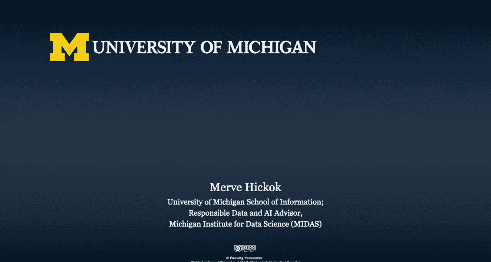

**负责任生成式AI简介：10：生成式AI的社会影响力** 🌍

在本节课中，我们将探讨生成式人工智能系统对社会和环境产生的广泛影响，并思考如何引导其向积极方向发展。

多年来，研究人员、企业、公民社会倡导者和政策制定者一直在讨论预测性AI系统带来的各种社会与环境影响。

这些是**社会技术系统**。如果其设计、采购和治理方式不够负责任，AI系统可能会放大刻板印象和极端世界观，导致歧视性结果，限制或剥夺获取资源与机会的途径，甚至侵犯权利与自由。不透明的系统、无法追溯或无法解释的结果，都可能引发激烈的争议。

上一节我们讨论了预测性AI的普遍挑战，本节中我们来看看生成式AI。生成式AI系统同样可能体现这些已知的挑战。

此外，生成式AI还引入了新的风险，这些风险需要被研究、缓解和管理。以下是其主要风险类别：

*   **虚假信息与侵权**：包括错误信息、虚假信息以及版权侵犯。
*   **数字鸿沟与缺陷**：可能加剧数字鸿沟，并存在技术缺陷。
*   **降低恶意行为门槛**：生成式AI易于使用且能以自然语言交互的特性，在带来机遇的同时，也降低了恶意行为者发动网络攻击、利用缺陷或进行欺诈计划的成本和门槛。

我们无需接受现状。我们能够，也应该为有益且可信的创新贡献力量。如果我们想构建一个积极的未来，就必须思考生成式AI的社会影响。

我们期望的未来是：生成式AI的社会经济效益得到更公平的分配；更多文化、语言和身份得到体现；技术对环境的影响得到缓解。

一项新兴技术及其相关产品存在需要解决的问题，这是自然的。这些技术存在某些局限性，也是自然的。

我们现在需要做的是承认这些问题，对其能力和局限性保持透明，并建立防护措施以预防可预见的危害。

为了培育负责任且可信的生成式AI，从而产生积极的社会影响，我们需要提高公众意识，并就我们期望的未来图景进行包容性的辩论。

本节课中，我们一起学习了生成式AI可能带来的社会风险与挑战，并明确了通过透明、防护和公众参与来引导技术向善、创造积极未来的必要性。