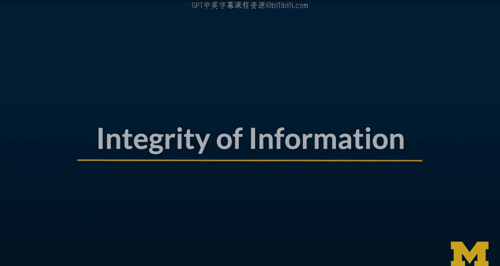
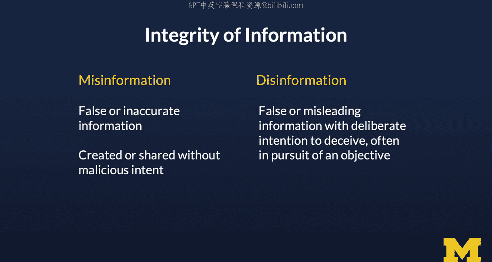
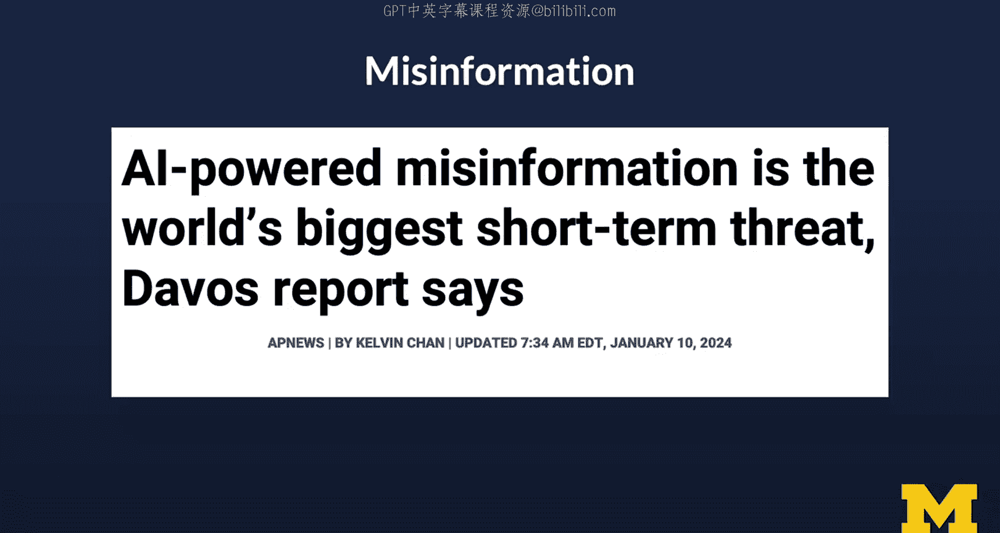
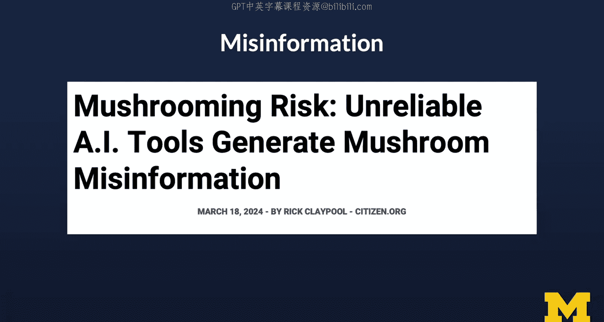
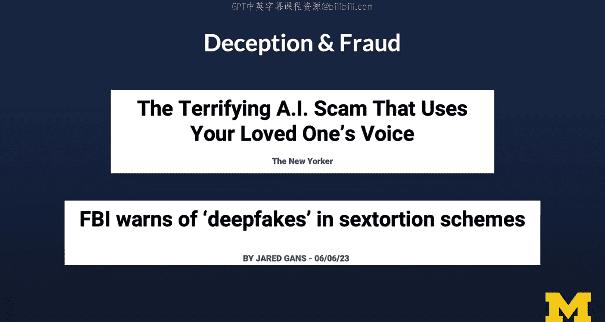

# 11：信息完整性保障 🛡️

在本节课中，我们将要学习生成式AI如何影响信息的完整性，探讨错误信息与虚假信息的区别，并分析其在选举、个人安全、公共安全及网络安全等领域带来的具体挑战。

## 概述

信息完整性是数字时代的核心挑战。从社交媒体到数字大众媒体，再到如今的生成式AI，错误信息和虚假信息的影响被不断放大，对全球信息生态构成了严峻考验。

## 错误信息与虚假信息

上一节我们介绍了信息完整性面临的整体挑战，本节中我们来看看两个核心概念：错误信息与虚假信息。

*   **错误信息** 指无意中创建或分享的虚假或不准确信息。
*   **虚假信息** 指为欺骗他人而故意创建的虚假信息，通常是为了达成特定目的。

生成式AI尤其容易制造错误信息，因为这类系统本质上基于**统计相关性和模式**进行输出。

## 生成式AI与选举信息

生成式AI的随机性效应，可能导致其推荐虚假且影响重大的信息。选举信息便是其中一个关键领域。

一项近期研究测试了五大主流生成式AI模型对选民可能提出的问题的回答。研究评估了回答的偏见性、准确性、完整性和危害性，并发现：
*   所有模型在选举信息方面的表现都很差。
*   超过一半的AI模型回答被多数专家测试者评为不准确。
*   超过三分之一的AI模型回答被评为有害或不完整。

## 对个人安全的影响

当用户了解生成式AI系统的局限性时，他们可能不会向这些系统询问重要问题。然而，有时用户可能完全意识不到他们正在使用的应用是由生成式AI模型驱动的。

例如，人们依赖手机应用来区分野外可食用蘑菇与有毒蘑菇。已有报告显示，有用户因完全依赖这些应用而住院。

生成式AI系统还降低了恶意行为者从事欺诈和欺骗活动的门槛。

除了通过这类系统生成的静态图像，生成式AI还可用于克隆一个人的声音或视频，进而用于AI驱动的诈骗或欺骗。

这类骗局可用于骗取个人或企业的钱财、进行勒索，甚至说服他们接受某种政治、经济或社会信仰。不幸的是，这些骗局不仅造成财务损失，还可能引发严重的情感创伤。

我们已经看到多起事件，个人接到电话，来电者的声音和电话号码均被克隆。毫无戒心的目标看到的是亲人的号码，听到的是他们痛苦的声音，在许多情况下被诱导陷入欺骗和诈骗陷阱。

同样，一个人的肖像也可能被制作成虚假的色情照片或视频，用于勒索或敲诈。

## 对公共安全的影响

除了对个人的影响，生成式AI与公共安全的交集也是AI治理者和政策制定者关注的重点。核心问题是：生成式AI系统是否会为恶意行为者提供可资利用的信息或工具？

我们已经讨论了错误信息的放大效应及其被用于制造不信任或诈骗个人的用途。当前主流生成式AI产品的使用政策中已识别的其他风险包括恐怖主义、虐待或剥削儿童、人口贩卖等非法活动。

一个更间接的公共安全担忧是，通过这类系统获取信息是否会使得敌对行为者更容易开发和部署生化武器、制造有害药物，或发现关键基础设施的漏洞。

特别是最后这组担忧，已被一些商业参与者用作不披露基础模型信息、甚至要求限制开源基础模型访问的理由。

研究人员在争论，这些模型是否提供了超出公开可用信息之外的额外信息。换言之，恶意行为者通过生成式AI系统获得的信息，是否会多于他们通过互联网能够访问和整合的信息？目前这些问题尚无明确答案，因为答案也取决于具体行为背景，以及是否存在物理安全、监督机制、出口管制等现有控制或瓶颈点来阻止恶意行为。

## 对网络安全的影响

“生成式AI系统是否会为恶意行为者提供可资利用的信息或工具”这一问题，同样适用于网络安全背景。

AI工具长期以来被用于检测代码漏洞，并显著增强了网络攻击检测和响应的能力。然而，生成式AI系统的编码功能也可能被武器化，用于开发攻击代码，尤其是针对过时的基础设施和中小型企业。

## 总结

本节课中，我们一起学习了生成式AI对信息完整性的多方面冲击。我们明确了错误信息与虚假信息的区别，探讨了AI在选举信息、个人安全（如声音克隆诈骗）、公共安全（如武器信息获取）及网络安全（如攻击代码生成）等领域带来的具体风险与挑战。理解这些风险是迈向负责任地开发和使用生成式AI的第一步。