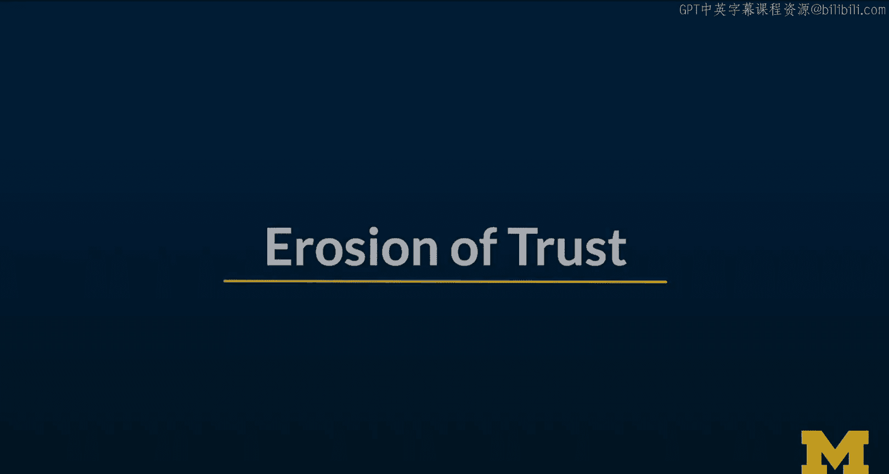
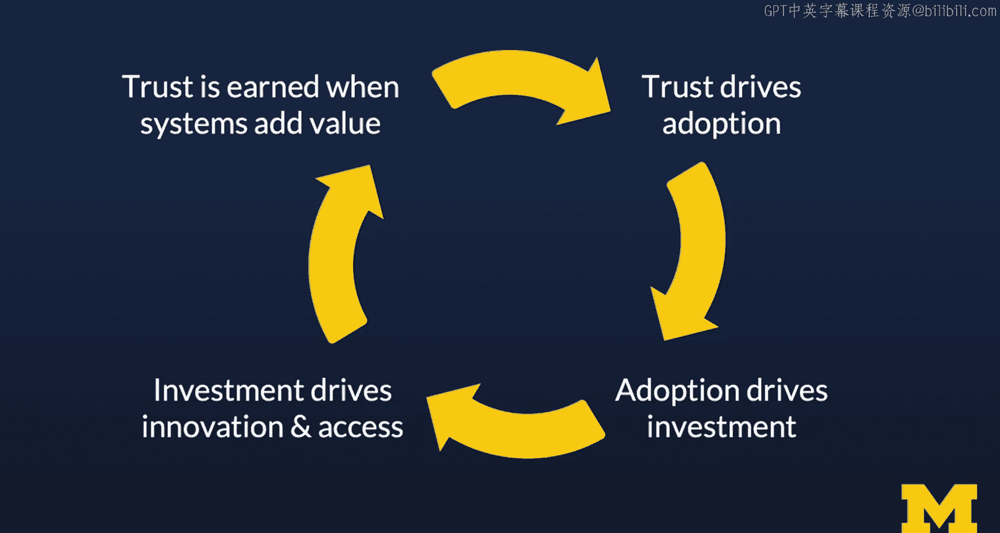
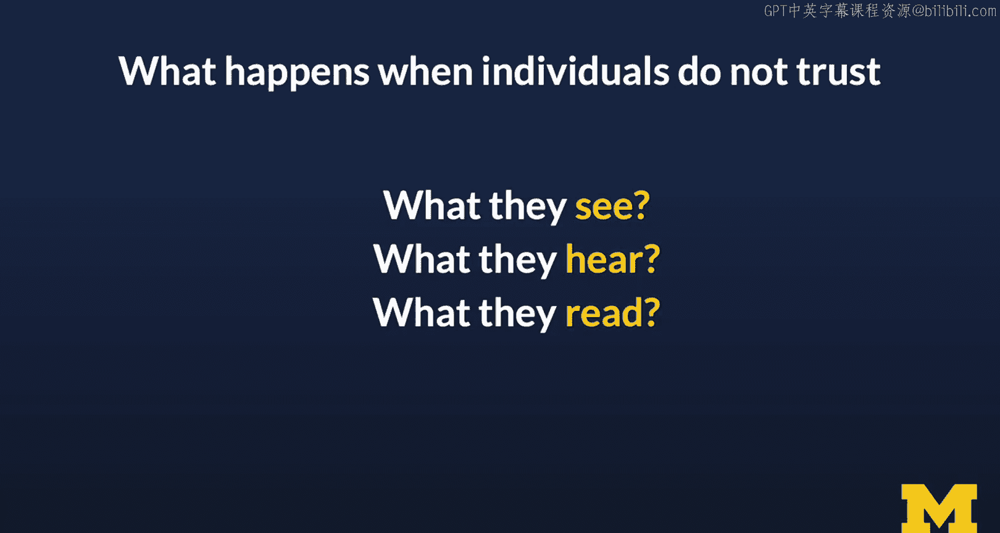
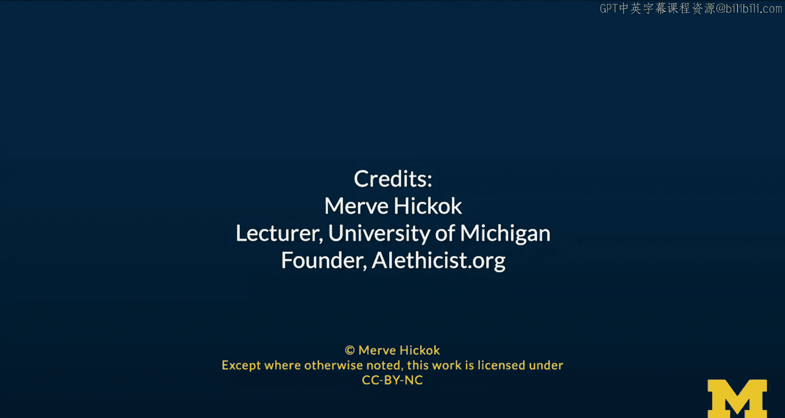

# 负责任生成式AI简介：12：信任衰减防范 🛡️

在本节课中，我们将探讨生成式AI系统若不负责任地开发或部署，可能导致的信任衰减问题，并分析其对社会和商业的深远影响。

## 核心问题：信任的重要性

从根本层面看，最重要的问题是信任。如果生成式AI系统在开发或部署时不负责任，例如在没有安全护栏的情况下，或仅出于商业优先和激励目的而部署，就可能导致信任的侵蚀。这会产生长期影响。

## 信任衰减的成因与后果

上一节我们指出了信任问题的核心，本节中我们来看看导致信任衰减的具体原因及其后果。

当这些系统在没有清晰描述和解释其能力与局限性的情况下被部署时，用户可能会因其不准确性而感到沮丧。其中一些不准确性，或不够理想的安全保障措施，主要会导致影响个人权利、自由和安全的事件。对存在缺陷的生成式AI系统的恶意利用，可能造成财务、人身、情感和声誉上的损害。

以下是信任衰减可能引发的具体问题：
*   **用户挫折**：因系统不准确而产生。
*   **权利与安全事件**：由不完善的安全措施导致。
*   **多重损害**：恶意利用可能造成财务、人身、情感和声誉损失。

## 短期收益与长期风险

商业和政府中的高级职位人员肩负重任。他们可以在短期内吸引用户并推动商业收益。然而，从长远来看，上述所有问题综合起来，会显著削弱公众的信心和信任。

信任需要被证明是合理的。当系统增加价值并按预期和设计运行时，才能赢得信任。信任驱动采用，更多的采用驱动更多的投资。商业、政府和学术界更多的投资，则会带来更多的创新和对这些技术的更广泛访问。

短视的做法会破坏这些系统的好处和可能性。在社会层面，信任的侵蚀及其影响是一个危险的组合。

## 社会层面的深远影响

想象一个场景：人们不再信任他们所看到的、所听到的、所读到的东西。问问自己，你是否已经开始质疑日常所遇信息的真实性。这对社会结构意味着什么。

## 总结

本节课中我们一起学习了生成式AI领域信任的重要性。不负责任的开发与部署会通过多种途径侵蚀用户和公众的信任，这种信任衰减不仅损害商业的长期发展，更会对社会的信息真实性与结构稳定构成深层威胁。因此，建立并维护信任是负责任地发展生成式AI技术的基石。