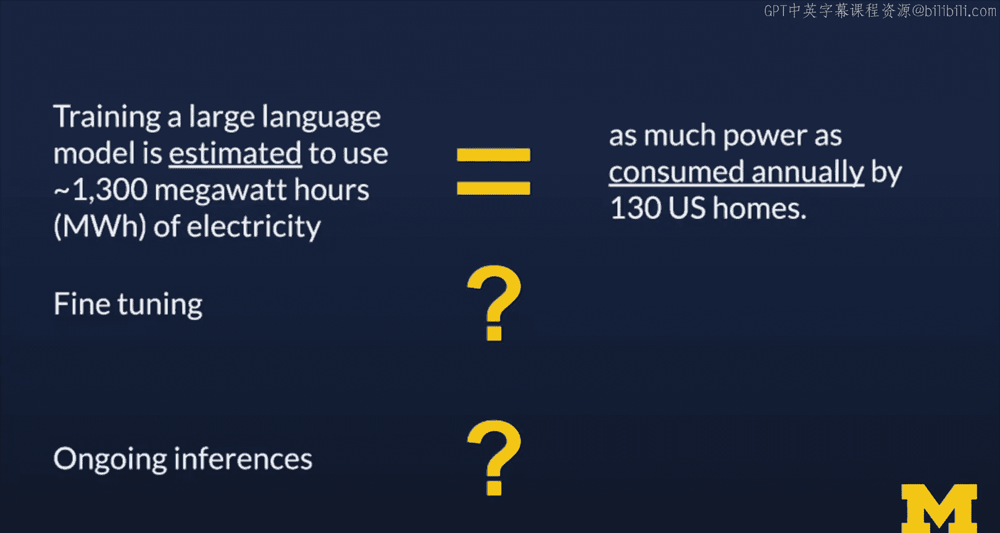
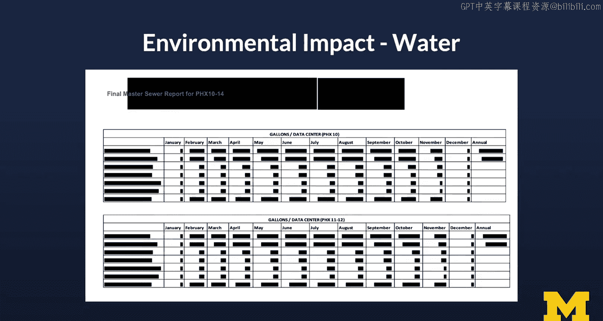
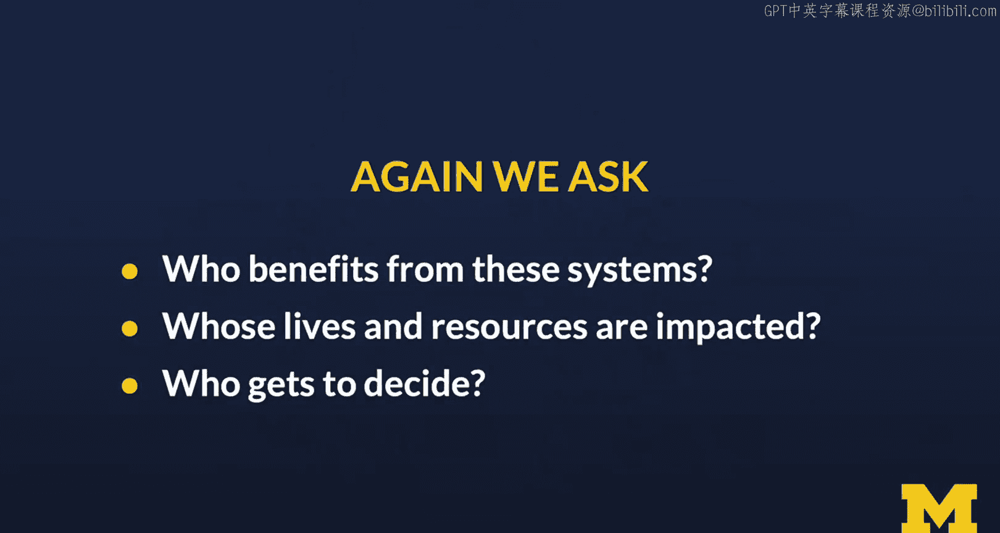
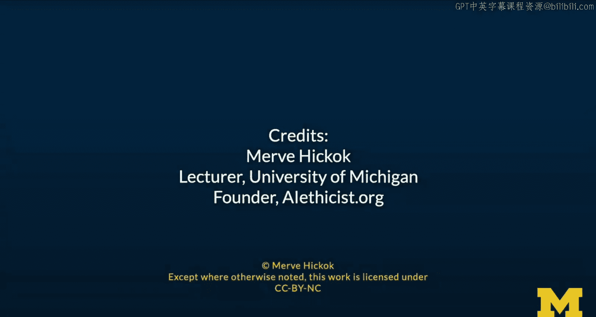

# 13：环境影响评估 🌍

在本节课中，我们将探讨生成式人工智能系统对环境的影响，包括其巨大的能源消耗和水资源使用，以及当前在量化与披露这些影响方面所面临的挑战。

## 概述

生成式AI系统，如同任何依赖数据和计算的技术一样，对环境具有显著影响。新研究指出，预测性AI系统与生成式AI系统在能耗方面存在显著差异。

## 生成式AI的能源消耗 🔋

上一节我们介绍了生成式AI的广泛影响，本节中我们来看看其具体的环境影响。研究发现，生成式AI在能源消耗和碳排放方面更为密集。

该研究提供了有用的相对数据和比较的起点，但指出具体数字会因不同的模型使用场景而变化。然而，与生成式AI系统的许多方面一样，我们并不确切知道这些模型具体消耗多少能源。

以下是导致此问题的几个因素：

*   **缺乏标准化方法**：研究人员指出，目前缺乏量化这些模型能耗的标准化方法。
*   **无强制披露要求**：目前没有强制要求披露具体的环境影响，尽管已出现一些相关的政策与治理讨论。
*   **信息被屏蔽**：即使某些层面存在相关信息，这些信息也被屏蔽，不予披露。

全球数据中心的能源消耗持续上升，这结合了生成式AI和加密货币的需求。研究人员估计这一需求将进一步增长，全球数据中心的能源消耗量可能相当于爱尔兰、阿根廷或瑞典等国家的总量。

## 训练与推理的能耗 🏋️‍♂️

生成式AI系统在其整个生命周期中消耗大量能源。拥有数十亿参数的大型语言或图像模型，有时需要数月时间进行训练。在部署后，每次系统运行推理任务，能耗会进一步增加。

换句话说，当终端用户提示系统完成文本、图像、视频或代码任务时，模型会进行一次前向运行（即推理）并产生结果。商业模型每天运行数十亿次推理。事实上，英伟达和亚马逊网络服务估计，推理消耗的能源显著更多，在深度学习中可占总运营成本的**80%至90%**。

## 数据中心的水资源消耗 💧

承载用于训练或运行生成式AI系统的服务器的数据中心，也需要大量淡水来冷却服务器。

一篇2021年分析数据中心环境影响的文章，估算了数据中心运营的水足迹。与各地区经历的水资源短缺相比，数据中心严重依赖供水本就紧张的流域，给当地带来了额外的压力。

值得注意的是，这一情况出现在生成式AI技术兴起之前。对新数据中心建设的需求仍在持续增长。

数据中心的冷却系统主要使用新鲜的饮用水，以避免任何不良成分在系统中循环。换句话说，数据中心与当地居民依赖的是同一水源，用于日常生活、农业、工业或市政需求。

## 信息不透明与责任问题 ❓

由于水资源消耗数据同样未被披露，研究人员试图估算生成式AI系统的水消耗足迹。与能耗数据的保密情况类似，水资源消耗信息也难以获取。

公司并未有意义地披露这些数据。即使州或地方政府要求提供信息，公司也可以请求将这些信息归类为专有信息，从而阻止其披露。

换句话说，不仅居住在当地的居民可能不知道这些公司使用了多少饮用水和能源，消费者也无从知晓。如果你是一家具有环保意识的企业，你可能无法比较不同模型的替代方案。

随着对新数据中心的需求持续上升，数据中心消耗的淡水大量取自当地资源。

面对如此大的环境影响以及相关信息的缺乏，我们再次提出负责任AI的根本问题：**谁从这些系统中受益？谁的生活和资源受到了影响？最终，由谁来决定这一切？**

## 总结

本节课中，我们一起学习了生成式AI系统对环境造成的重大影响，主要包括巨大的能源消耗和水资源使用。我们了解到，由于缺乏标准化的测量方法、强制披露要求以及信息的保密性，准确量化这些影响面临挑战。这引发了对技术受益者、受影响者以及决策权的深刻思考，这些都是构建负责任AI必须面对的核心问题。