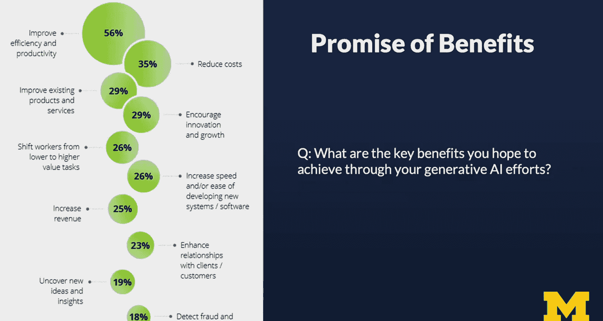
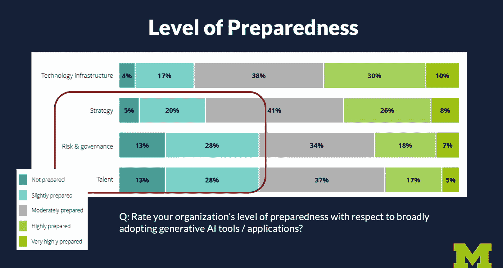
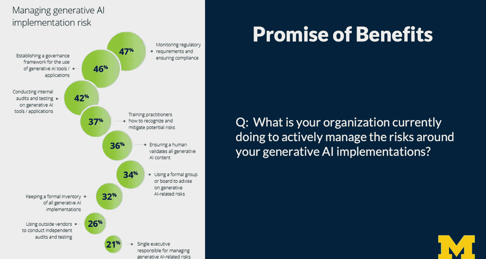
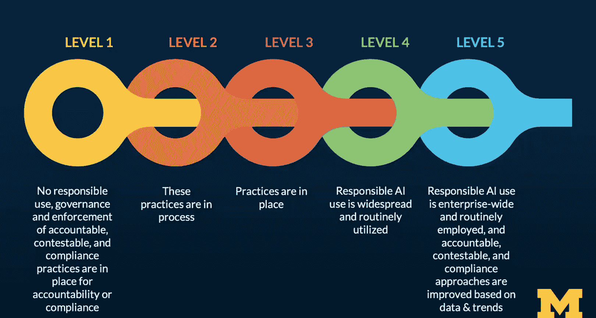

# 14：治理必要性探究 🔍

在本节课中，我们将探讨企业采用生成式AI时，为何必须建立有效的治理框架。我们将分析企业准备度的关键因素，并深入理解治理的全面含义及其在确保AI系统负责任、可信赖方面的核心作用。

---

上一节我们讨论了生成式AI的潜在效益，本节中我们来看看企业如何为这些效益做好准备。

生成式AI预计将为企业带来多种益处。在一项针对六个行业、十六个国家超过2000名总监及以上级别受访者的德勤咨询调查中，这些益处范围广泛，从**提升效率和生产力**到**降低总体成本**以及**加强与客户的关系**。企业能否实现其预期，将取决于其为变革所做的准备程度。

一个组织的准备度可以通过不同因素来评估，例如其数据战略、技术基础设施、业务战略、治理和人力资本。同一项针对高级管理层的调查显示，组织在其技术栈方面感觉准备更充分。然而，任何重大发展的主要推动力或障碍都将是人的因素，无论是开发生成式AI所需的人才，还是执行战略、管理风险或治理这些系统所必需的人才。

---

认识到人力资本的重要性后，接下来我们探讨企业在部署生成式AI前需要经历的准备过程。

对于任何考虑开发或部署生成式AI的企业而言，投资人力资本是必要的。每个组织在部署其生成式AI用例前，都将经历探索、分析和准备的旅程。以下是部分准备工作：
*   理解监管与合规要求及其环境。
*   建立相应的内部治理框架和角色。
*   对参与该过程的人员进行培训。

随着企业采纳并建立最佳实践，组织将迈向更高水平的负责任AI成熟度，并使这些实践成为标准操作程序。一个目标成熟度水平，即组织为实现最优水平而设定的目标，取决于其使命、实践和目标。每个企业都从探索级别开始。重要的是要密切关注战略和最终目标，并定期评估现状与目标之间的差距。

---

在了解了成熟度路径后，我们来具体定义什么是“治理”。

在一个负责任的AI成熟组织中，负责任的使用、治理和执行实践被常规性地采用。它们成为业务运营的一部分，并随着新数据或趋势的出现而改进。但对某些人而言，治理最初可能意味着法律合规。然而，治理实际上包含了一个组织自身的规则制定、实施和执行机制，以指导其职能。

治理是机制、角色与职责、规则、流程、程序、政策指南和限制（也称为“护栏”）的集合。理想的公司治理能创造关于价值观、规则、目标和控制的透明度。它指导组织的工作，并有助于与员工、客户、社区、监管机构和投资者建立信任。

---

具体到AI领域，治理意味着什么？它如何帮助企业？

具体到AI和生成式AI，治理意味着确保在生成式AI的设计、开发和使用中，潜在风险最小化，效益最大化。这意味着组织能够控制这些系统如何影响组织内部广泛的流程和决策，并且组织的实践是可质疑的，并能导向问责制。

有了负责任的AI治理，组织就可以投资于人才、数据和基础设施，同时在生命周期的各个阶段（从设计、训练、开发、测试、安全和部署，到生成式AI系统的监控）明确期望和责任。

---

既然治理如此重要，那么企业在决策之初就需要考虑哪些具体方面？

当你决定开发或采用一个生成式AI系统时，你就承诺了要持续监控系统性能并改进其功能。AI或生成式AI不是静态的系统。因此，从一开始，组织就需要考虑治理和问责机制。这包括：
*   改变现有的角色和职责。
*   内部监控与控制方法。
*   受生成式AI使用影响的任务和决策的文档记录与沟通流程。

从一开始就将负责任和可信赖的方法嵌入到你的系统中至关重要，并与内外部利益相关者沟通，了解你提议的系统对这些群体可能产生的正面和负面影响。

---

最后，我们必须理解为什么生成式AI尤其需要强有力的治理。

与预测性AI系统类似，生成式AI由于以下几个原因而存在固有风险：
1.  **训练数据风险**：训练数据可能包含有毒、有害、非法内容。
2.  **模型复杂性**：模型复杂且不透明。
3.  **系统安全**：系统可能受到恶意行为者的攻击和操纵。
4.  **用户交互**：用户可能以开发者未预见或未预测的方式与系统交互，从而引发全新的问题。
5.  **输出质量**：响应可能不准确或存在偏见。
6.  **影响规模**：如果发生意外情况，对个人和组织的影响可能非常重大。

---

本节课中我们一起学习了企业采用生成式AI时治理的必要性。我们明确了企业准备度的评估因素，定义了治理的广泛内涵及其在AI领域的特定目标，并强调了从项目伊始就建立治理框架、持续监控以及认识生成式AI固有风险的重要性。有效的治理是确保生成式AI技术被负责任地使用、最大化效益并最小化风险的关键基石。