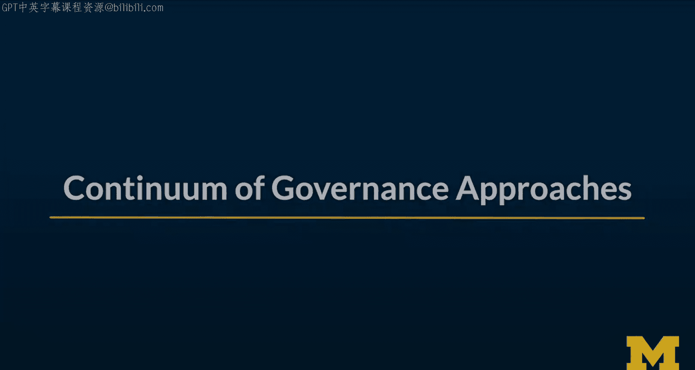
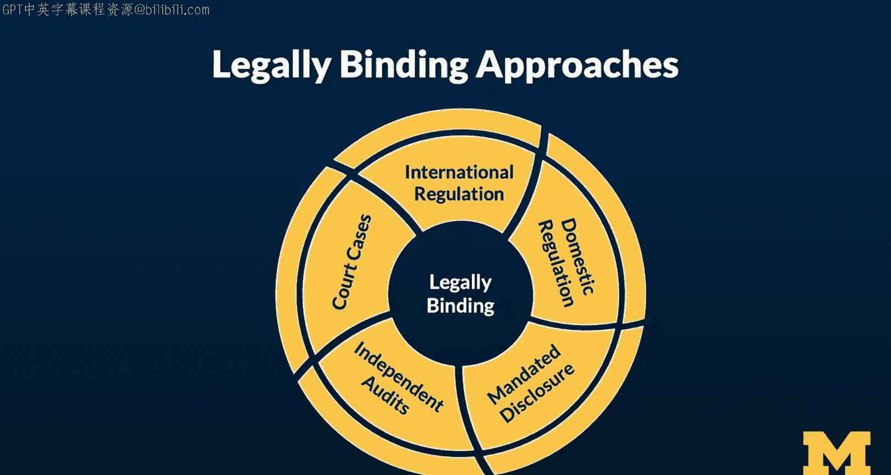
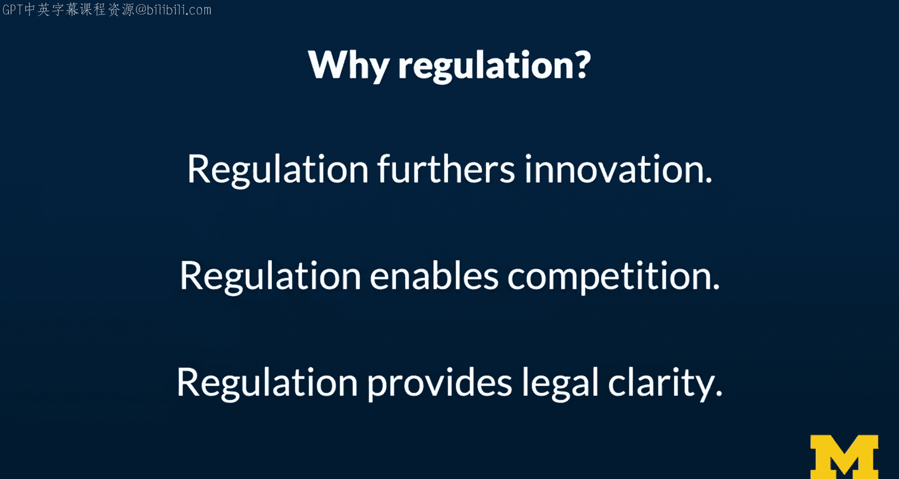
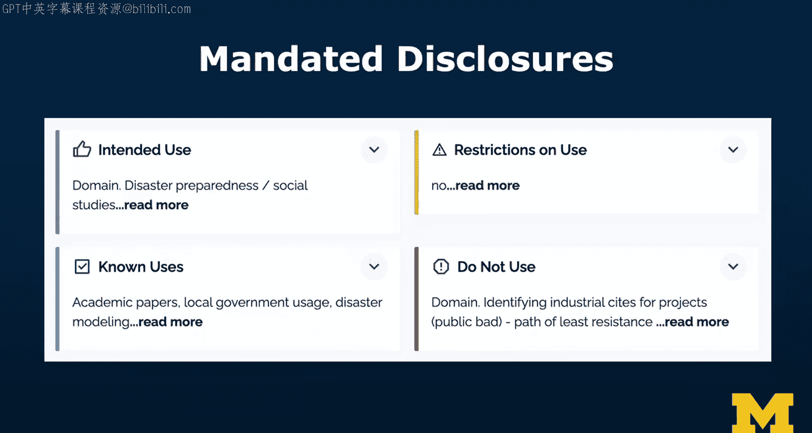
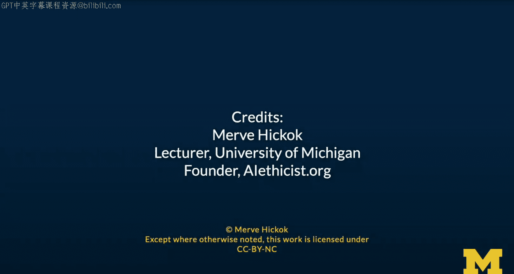

# 负责任生成式AI简介：1.3：治理方法连续体

在本节中，我们将探讨生成式AI的治理方法。治理并非“一刀切”的解决方案。商业决策者需要理解哪些方法适用于其组织及其服务对象。我们可以将这些方法视为一个连续体，从“硬性”机制到“软性”机制。换句话说，就是从具有法律约束力的要求到自愿行动。许多方法需要以灵活的方式共存并相互补充。

## 概述：治理的必要性与多样性

生成式AI系统很少在单一司法管辖区或文化中运行。这些系统的性质及其新兴用例要求我们理解治理连续体中的所有可能性。我们将首先从具有法律约束力的方法开始。

## 具有法律约束力的方法

顾名思义，具有法律约束力的方法要么为组织的当前行为设定义务，要么要求其为系统可能产生的影响承担责任。在法院判决的情况下，它们为未来的法律解释和实践设定了先例。违反或无视这些规则可能意味着组织将面临经济或运营制裁。

### 现有法规的适用性

认为AI或生成式AI系统没有法规约束是一种误解。许多司法管辖区已经制定了法律和法规，这些将继续适用于这些系统的产出。例如：
*   反歧视或平等法律
*   数据保护或隐私法律
*   儿童安全、公平商业实践或消费者保护法律

**核心概念**：`新技术 ≠ 现有法律不适用`。如果歧视或欺骗是非法的，那么使用生成式AI进行歧视或欺骗同样是非法的。这些系统的设计和部署需要反映法律要求。

事实上，一个又一个机构明确表示，他们“随时准备追究那些未能解决可能产生的不公平和歧视性结果的实体的责任”，并且“正在采取全政府的方法来执行涉及自动化系统（包括AI）时的民权及相关法律”。

### 新兴法规

此外，新的法规正在生效。例如：
*   **欧盟《人工智能法案》**：要求对生成式AI系统进行事件监控。
*   **中国AI法规**：要求生成式AI系统通过安全自评估，并对合成生成的内容进行标注。
*   **美国**：在州和联邦政府层面，对合成内容进行水印或标注的要求也日益受到关注。

在国际层面，欧洲委员会的《人工智能条约》草案将成为首个关于AI的国际条约。随着时间的推移，国内和国际法规都将适应AI系统的具体用例和影响。就像私营组织一样，随着经验的积累和学习的深入，监管方法也会随着新技术的成熟而成熟。

### 为何需要监管？

人们可能会问，为何需要对新兴技术进行监管？这是因为新技术创造了新的方法和用例，可能影响市场和社会。
*   **促进创新**：监管通过制定游戏规则来促进创新。约束促使设计和工程过程更加审慎和周全。可以类比汽车安全带或药品副作用分析。
*   **促进竞争**：监管通过防止大公司的垄断性商业行为来促进竞争。这为小型企业创造了吸引新投资者和发明家的机会。
*   **提供清晰度**：通过划定界限，监管明确了可接受的范围，使企业和消费者能够做出明智的决策。

## 具体法律约束方法示例

除了要求生成式AI开发者和部署者评估、减轻和监控风险外，法规还可以强制要求公开披露有关生成式AI系统的某些信息。

以下是两种具体方法：

### 1. 强制披露

强制披露要求组织公开其AI系统的相关信息。披露的信息范围可能包括：
*   简单地披露正在使用生成式AI系统。
*   发布有关系统的技术文档。
*   报告相关事件。

**示例**：
*   **美国政府**：强制要求联邦政府在注册表中披露AI系统的使用情况，以及这些系统的某些细节的透明度。
*   **欧盟**：要求高风险AI系统的提供者进行类似的信息披露。

此类披露为最终用户提供了信息，使他们能够评估系统的产出，或在必要时提出异议。

### 2. 独立审计

强制性的独立审计已经存在很长时间。例如：
*   上市公司的财务审计。
*   个人的税务审计。
*   处理个人数据的公司的网络安全审计。

鉴于生成式AI系统的复杂性、不透明性和影响力，独立第三方审计是可能的治理机制之一。它由一个受信任的方代表监管机构或公众对系统进行检查。

**核心概念**：
*   **审计**：是对组织记录进行正式的、方法论的检查和验证。
*   **独立性**：是执行审计的个人与被审计实体之间不存在任何利益冲突（财务或其他）的原则，这使他们能够保持评估和结论的客观性。

作为一个治理领域，算法审计可能包括以下组合：
*   模型设计
*   模型产出
*   数据质量
*   组织内部文档
*   预期用途与实际性能之间的保真度

## 总结

在本节中，我们一起学习了生成式AI的治理方法连续体。我们了解到，治理没有单一的解决方案，而是从具有法律约束力的“硬性”机制到自愿性的“软性”机制的一个谱系。我们重点探讨了法律约束方法，包括现有法规的适用性、新兴的专门法规（如欧盟AI法案、中国AI法规），以及监管对于促进创新、竞争和提供清晰度的重要性。最后，我们介绍了两种具体的法律约束方法：强制披露和独立审计，它们有助于提高系统透明度、问责制和可信度。理解这些治理方法对于负责任地开发和部署生成式AI至关重要。